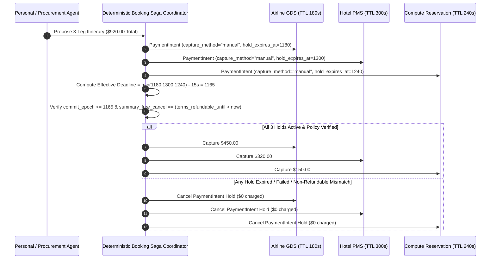

# Multi-Leg Booking Two-Phase Hold Saga & Enterprise SFTP Three-Way Reconciliation

> **Verification Date**: `2026-10-19` (Asia/Shanghai)
> **Primary Evidence Base**:
> - Stripe Agentic Commerce Booking & Order Intents (`https://docs.stripe.com/agentic-commerce/use-cases/booking`)
> - Stripe SFTP Catalog & Payout Feed Ingestion (`https://docs.stripe.com/agentic-commerce/catalog/sftp`)
> - Stripe Machine Payments Protocol (`MPP`) Tempo Pay-as-you-go Sessions (`https://docs.stripe.com/payments/machine/mpp/pay-as-you-go-sessions`)
> - Stripe Token Billing (`https://docs.stripe.com/billing/token-billing`) & Poppy `v0.1` `operations` Two-Phase Commit
> - **Executable Verifier**: [`lab/booking_sftp_reconciliation_guard.py`](../../lab/booking_sftp_reconciliation_guard.py)

---

## 1. Multi-Leg Booking Two-Phase Hold Saga (`HOLD_ALL -> VERIFY -> ATOMIC_CAPTURE_OR_REVERSE`)

### 1.1 The "Orphan Leg" Exposure in Multi-Provider Agentic Reservations

When a personal or corporate travel/procurement agent books a linked itinerary—such as an **Airline GDS flight (`TTL = 180s`) + Hotel PMS room (`TTL = 300s`) + GPU/Event ticket (`TTL = 240s`)**—classic stateless tool calling captures each provider sequentially (`capture_method="automatic"`). If Leg 1 (non-refundable flight) captures immediately and Leg 2 (hotel) fails inventory lock or expires, the buyer is left with an **uncompensated orphan charge**.

### 1.2 Deterministic Two-Phase Hold Invariants (`verify_multi_leg_booking_saga`)



Let the itinerary consist of $K$ legs $\{L_k\}_{k=1}^K$. The Saga coordinator enforces three pre-capture invariants:

1. **Mandatory Auth-Hold (`capture_method == "manual"`)**:
   - Every leg must be placed in `hold_status == "held"` with `capture_method == "manual"`. Any leg configured with `automatic` capture during the hold phase aborts the entire Saga (`premature_automatic_capture_forbidden`).
2. **Earliest-Expiration Barrier with Safety Buffer ($\Delta_{\text{buf}} = 15\text{s}$)**:
   $$t_{\text{deadline}} = \min_{k \in \{1..K\}} \left(t_{\text{exp}, k}\right) - \Delta_{\text{buf}}$$
   - If $t_{\text{commit}} > t_{\text{deadline}}$, the coordinator aborts (`saga_hold_ttl_expired_or_within_safety_buffer`) and cancels all $K$ authorization holds simultaneously, preventing `orphan_exposure_minor_prevented`.
3. **Summary-vs-Terms Cancellation Window Integrity**:
   - If an enterprise or agent summary claims `summary_claims_free_cancel = True` while the structured tariff terms specify `terms_refundable_until <= commit_attempt_epoch`, the coordinator aborts (`summary_claims_free_cancel_but_terms_non_refundable`).
   - Non-refundable legs (`terms_refundable_until <= commit_attempt_epoch`) require explicit `buyer_accepts_non_refundable = True`.

---

## 2. Enterprise End-of-Day Three-Way Ledger Reconciliation (`reconcile_sftp_tempo_token_ledger`)

At `00:00 UTC` end-of-day cutoff, enterprise finance systems must reconcile three asynchronous data streams:
1. **Stripe SFTP Payout Batch Feed** (`gross_minor - fee_minor == net_minor` per row),
2. **Stripe MPP Tempo Streaming Micro-Sessions** (6-decimal micro-USDC gross spend vs. whole-cent settlement), and
3. **Stripe / Metronome Token Billing Ledger** (`token_billed_minor` vs `token_collected_minor`).

### 2.1 Four Sources of Apparent EOD Variance & Deterministic Resolution

| Variance Source | Root Cause | Deterministic Classification in `reconcile_sftp_tempo_token_ledger()` |
|---|---|---|
| **Duplicate Webhook Delivery** | At-least-once webhook retries (`evt_1` delivered twice) | Deduplicated by `event_id` (`duplicate_webhook_ids_dropped`) before summing Day $D$ net |
| **Post-`00:00 UTC` Cutoff In-Flight** | Charge captured before `00:00 UTC` but settled at `hour >= 24` | Isolated into `in_flight_after_cutoff_minor` (carried to Day $D+1$ batch) |
| **MPP Tempo Sub-Cent Forfeiture** | Tempo session closes with unaligned micro-USDC remainder (`$0.043750` gross $\rightarrow$ `$0.02` settled) | Quantified as `mpp_subcent_forfeited_usd = "$0.023750"`; only settled whole cents enter bank payout |
| **Unreversed Connect Refund** | Partial refund issued on `destination` / `separate_charges_and_transfers` without `reverse_transfer=true` | Flagged as `connect_unreversed_refund_deficit_detected` with exact `connect_unreversed_refund_deficit_minor` |

### 2.2 Master Three-Way Reconciliation Equation

After deduplicating `event_id`s and isolating Day $D+1$ in-flight items (`settled_at_utc_hour >= 24`), the expected bank payout in minor units (cents) must satisfy:

$$P_{\text{expected}} = \sum_{e \in \text{Unique}(D)} \left(\text{Gross}_e - \text{Fee}_e\right) + \left\lfloor \frac{\text{MPP}_{\text{gross\_micro\_usdc}}}{10^4}\right\rfloor_{\text{settled}} + \text{Token}_{\text{collected}} - \text{Deficit}_{\text{Connect}}$$

Any non-zero $\text{Variance} = P_{\text{bank}} - P_{\text{expected}}$ or non-zero $\text{Deficit}_{\text{Connect}}$ halts automated ledger sign-off.

---

## 3. Verification

```bash
python -m lab.booking_sftp_reconciliation_guard
python -m unittest tests/test_booking_sftp_reconciliation_guard.py -v
```
