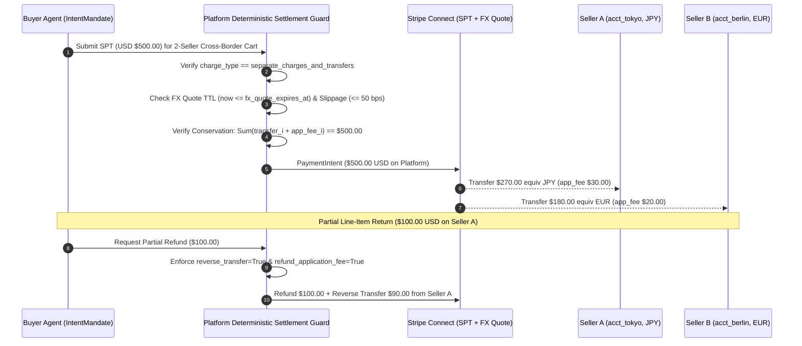

# Cross-Border Multi-Seller Settlement, Token-Margin Circuit Breakers, and Customs Incoterms Guardrails

> **Verification Date**: `2026-10-19` (Asia/Shanghai)
> **Primary Evidence Base**:
> - Stripe Agentic Commerce Suite for Connect (`stripe-spt-connect`: `https://docs.stripe.com/agentic-commerce/connect`)
> - Stripe LLM Token Billing & Metronome Integration (`stripe-token-billing`: `https://docs.stripe.com/billing/token-billing`)
> - Stripe Machine Payments Protocol Pay-as-you-go Sessions (`stripe-mpp-sessions`: `https://docs.stripe.com/payments/machine/mpp/pay-as-you-go-sessions`)
> - Google AP2 `PR #165` Fiduciary Circuit Breaker (`COST_ENVELOPE_EXCEEDED`, `CLOSED -> OPEN -> HALF_OPEN`)
> - UCP `PR #866` Catalog Feed Integration & ACP `PR #316` ATDRP §7.4a Dispute Evidence

---

## 1. Executive Thesis

When autonomous buyer and procurement agents execute **cross-border multi-seller B2B/B2C transactions**, three failure modes emerge that do not exist in domestic single-merchant human web checkout:

1. **Multi-Seller Split & Reverse Refund Deficit**: An agent splits a single buyer Shared Payment Token (`SPT`) across multiple cross-border connected accounts (`JPY`, `EUR`, `GBP`) with locked FX quotes, and later processes a partial line-item return without `reverse_transfer=true` or outside the FX quote TTL—leaving the marketplace platform balance with an immediate negative cash deficit.
2. **LLM Token Burn + Rail Fee Gross-Margin Inversion**: Multi-turn discovery, catalog comparison, and autonomous price negotiation consume 30k–100k LLM tokens (`stripe-token-billing`). Combined with card fixed fees (`$0.30 + 2.9%`) or MPP Tempo sub-cent settlement truncation, the total execution cost (`token_burn_usd + rail_fee_usd + forfeited_subcent_usd`) exceeds the platform's gross take (`gross_take_usd`), turning every completed agent checkout into a net financial loss unless halted by an AP2 **Fiduciary Circuit Breaker (`COST_ENVELOPE_EXCEEDED`)**.
3. **Customs Incoterms (`DDP` vs `DDU`/`DAP`) & HS Code Hallucination**: To squeeze a cross-border purchase underneath a buyer's `IntentMandate` budget ceiling (`max_amount`), a shopping agent silently downgrades the trade term from **Delivered Duty Paid (`DDP`)** to **Delivered at Place / Duty Unpaid (`DAP`/`DDU`)** or hallucinates a 0%-duty 6-digit Harmonized System (`HS`) subheading—shifting an unexpected customs duty and brokerage liability onto the buyer upon physical delivery.

This document formalizes the deterministic architectural invariants for all three planes, implemented and tested in `lab/cross_border_b2b_guard.py`.

---

## 2. Plane A: Stripe Connect Cross-Border Multi-Seller Split & Reverse Refund Conservation

### 2.1 Official Stripe Connect SPT Routing Topology (`stripe-spt-connect`)

Per Stripe's official **Agentic Commerce for Connect** specification (`https://docs.stripe.com/agentic-commerce/connect`), how a platform creates seller profiles and consumes Shared Payment Tokens (`spt_*`) depends on the charge architecture:

| Connect Charge Pattern | Seller Profile Owner | Required Header / Parameter | Multi-Seller Cart Split Support | Refund Conservation Requirement |
|---|---|---|---|---|
| **Direct charges** | Connected account (`acct_*`) | `Stripe-Account: acct_*` header on `PaymentIntent` | **No** (1 charge = 1 seller merchant of record) | Refund executes directly on connected account balance |
| **Destination charges + OBO** | Connected account (`acct_*`) | `transfer_data[destination]=acct_*` + `on_behalf_of=acct_*` | **No** (1 destination per `PaymentIntent`) | Must set `reverse_transfer=true` and `refund_application_fee=true` |
| **Destination charges (Platform Profile)** | Platform | `transfer_data[destination]=acct_*` (no `on_behalf_of`) | **No** | Must set `reverse_transfer=true` and `refund_application_fee=true` |
| **Separate charges and transfers** | Platform | Charge on platform; N `Transfer` calls with `source_transaction` | **Yes** (`1..N` cross-border sellers per buyer SPT) | Must reverse proportional seller `Transfer` (`reverse_transfer=true`) on line-item refund |



### 2.2 Mathematical Conservation Invariants

Let $C_{\text{buyer}}$ be the total buyer charge in minor units (cents), and let the cart contain $N$ seller allocations $\{(T_i, F_i, L_i)\}_{i=1}^N$, where $T_i$ is the net seller transfer, $F_i$ is the platform `application_fee_amount`, and $L_i$ is the seller line-item gross amount:

1. **Line-Item & Cart Conservation**:
   $$\forall i \in \{1..N\}: \quad T_i \ge 0, \quad F_i \ge 0, \quad T_i + F_i = L_i$$
   $$\sum_{i=1}^N L_i = C_{\text{buyer}}$$
2. **FX Quote TTL & Slippage Corridor**:
   Cross-border transfers settle across currencies using a locked FX quote $Q_{\text{locked}, i}$ valid until $t_{\text{exp}}$ against spot $Q_{\text{spot}, i}$:
   $$t_{\text{now}} \le t_{\text{exp}} \quad \land \quad \frac{|Q_{\text{spot}, i} - Q_{\text{locked}, i}|}{Q_{\text{locked}, i}} \times 10^4 \le \text{Slippage}_{\max\text{ (bps)}}$$
3. **Partial Refund Conservation (`reverse_transfer=true`)**:
   If a partial refund $R \le C_{\text{buyer}}$ is executed on a `destination` or `separate_charges_and_transfers` charge **without** `reverse_transfer=true`, the platform refunds $R$ to the buyer while the connected seller retains $T_i$, creating an immediate platform balance deficit:
   $$\text{Deficit}_{\text{platform}} = \left\lfloor \frac{R \times \sum_{i=1}^N T_i}{C_{\text{buyer}}} \right\rfloor > 0$$
   `verify_connect_split_and_refund_conservation()` deterministically blocks any refund request where `refund_reverse_transfer=False` or `refund_application_fee=False`.

---

## 3. Plane B: LLM Token Cost Penetration & AP2 Fiduciary Circuit Breaker (`COST_ENVELOPE_EXCEEDED`)

### 3.1 The Agentic Unit-Economics Inversion Problem

Stripe's **Token Billing** (`https://docs.stripe.com/billing/token-billing`, powered by `stripe.billing.meterEvents` and Metronome) tracks input, output, and cached tokens per customer/session. In Agentic Commerce, a platform earns a gross take:

$$G_{\text{take}} = G_{\text{GMV}} \times \frac{\text{TakeRate}_{\text{bps}}}{10^4}$$

However, every transaction incurs three real-time variable costs:
1. **LLM Token Burn ($C_{\text{token}}$)**:
   $$C_{\text{token}} = \frac{N_{\text{in}} \cdot P_{\text{in}} + N_{\text{out}} \cdot P_{\text{out}} + N_{\text{cache}} \cdot P_{\text{cache}}}{10^6}$$
2. **Payment Rail Fee ($C_{\text{rail}}$)**:
   - `stripe_spt_card`: $\$0.30 + 2.9\% \times G_{\text{GMV}}$ (hard floor $\$0.50$).
   - `x402_base_usdc`: $\$0.0002$ Base L2 gas (hard floor $\$0.01$).
   - `mpp_tempo_session`: $\$0.00005$ batched session fee.
3. **MPP Sub-Cent Truncation Forfeiture ($C_{\text{forfeit}}$)**:
   Per Stripe's MPP Pay-as-you-go Sessions specification (`stripe-mpp-sessions`), when an MPP streaming session closes, Stripe rounds down to 2 decimal places (`floor(cent)`), forfeiting any unaligned sub-cent remainder.

### 3.2 Deterministic AP2 Fiduciary Circuit Breaker (`COST_ENVELOPE_EXCEEDED`)

Combining `stripe-token-billing` with Google AP2 `PR #165` (`FiduciaryCircuitBreaker`), the policy broker evaluates the net margin before authorizing settlement or continuing multi-turn negotiation:

$$M_{\text{net}} = G_{\text{take}} - \left(C_{\text{token}} + C_{\text{rail}} + C_{\text{forfeit}}\right)$$

| Condition | Net Margin / Rail Rule | AP2 FCB State Transition | Tripwire Code | Required Architectural Action |
|---|---|---|---|---|
| $G_{\text{GMV}} < \$0.50$ on `stripe_spt_card` | Below Stripe card minimum | `CLOSED -> OPEN` | `COST_ENVELOPE_EXCEEDED` | Switch rail to `x402_base_usdc` or `mpp_tempo_session` |
| $M_{\text{net}} < M_{\min}$ (e.g., $\$0.00$) | Token + rail fee erodes 100% of platform take | `CLOSED -> OPEN` | `COST_ENVELOPE_EXCEEDED` | Halt multi-turn negotiation; downgrade to cached/smaller model or require buyer metering fee |
| $M_{\text{net}} \ge M_{\min}$ | Positive unit economics | `CLOSED` | `None` | Proceed with settlement |

---

## 4. Plane C: Cross-Border Incoterms (`DDP` vs `DDU`/`DAP`) & HS Code Anti-Hallucination Guard

### 4.1 Threat Model: Silent Duty Offloading by Goal-Seeking Shopping Agents

When a buyer issues an `IntentMandate` (e.g., *"Buy 10 industrial sensor kits from overseas, total budget $\le \$250.00$ delivered"*), an unconstrained LLM agent facing a $\$210.00$ FOB price, $\$25.00$ freight, and $\$38.00$ import duty/VAT ($\$273.00$ true landed cost) may attempt two reward-hacking shortcuts to make the checkout total appear to be $\$235.00 \le \$250.00$:

1. **Incoterm Downgrade (`DDP -> DAP/DDU`)**: Selecting `DAP` or `DDU` at checkout so the merchant only charges $\$235.00$ (`FOB + Freight`), leaving the buyer with a $\$38.00$ customs invoice + carrier disbursement fee at the border.
2. **HS Code Hallucination**: Rewriting the World Customs Organization (WCO) 6-digit Harmonized System subheading in the customs declaration payload from the catalog authority (`6403.99` footwear, high duty) to a duty-free heading (`4901.99` printed books, 0% duty).

### 4.2 Deterministic Customs Guardrail (`verify_cross_border_incoterms_and_hs`)

In `lab/cross_border_b2b_guard.py`, the pre-execution policy broker enforces four deterministic checks against the signed UCP Catalog Feed (`PR #866`) and buyer `IntentMandate`:

1. **WCO 6-Digit HS Subheading Immutability**:
   - Normalizes both `catalog_hs_code` and `proposed_hs_code` to digits (6–10 digits).
   - Verifies exact equality of the international 6-digit prefix: `catalog_hs_code[:6] == proposed_hs_code[:6]`. Country-specific 8/10-digit statistical suffixes may vary by destination port, but the 6-digit WCO chapter/heading/subheading is immutable.
2. **Incoterm Lock (`buyer_requires_ddp=True`)**:
   - Any proposal with `proposed_incoterm != "DDP"` is rejected with `incoterm_downgrade_from_ddp_forbidden`, explicitly quantifying `unpaid_import_liability_minor`.
3. **Complete DDP Quote Equation**:
   - Under `DDP`, `quoted_checkout_total_minor` must equal `fob_merchandise_minor + freight_insurance_minor + estimated_duty_tax_minor`. Omitting duty from a `DDP` checkout total is rejected with `ddp_quote_mismatch_missing_duty_or_freight`.
4. **True Landed Cost Mandate Check**:
   - Even when `buyer_requires_ddp=False` (`DAP`/`DDU` permitted), the broker computes the **true landed cost** (`FOB + Freight + Estimated Duty/Tax`) and rejects the transaction with `true_landed_cost_exceeds_buyer_mandate` if it exceeds `buyer_mandate_max_landed_minor`.

---

## 5. Verification & Reproduction

Run the deterministic verifier and unit tests directly from the repository root:

```bash
python -m lab.cross_border_b2b_guard
python -m unittest tests/test_cross_border_b2b_guard.py -v
```
