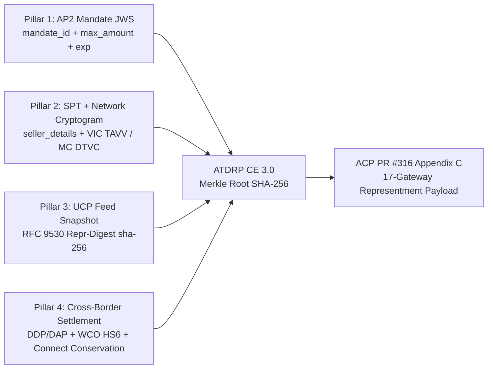

# Cross-Protocol Dispute Evidence Compilation & Cryptographic Non-Repudiation (ACP PR #316 Appendix C)

> **Verification Date**: `2026-10-19` (Asia/Shanghai)
> **Primary Evidence Base**:
> - ACP `PR #316` ATDRP §7.4a & Appendix C 17-Gateway Dispute Representment Mapping
> - Google AP2 `IntentMandate` / `CartMandate` JWS Signature & Fiduciary Circuit Breaker (`PR #165`)
> - UCP `PR #866` Catalog Feed RFC 9530 `Repr-Digest` (`sha-256`) Snapshot Integrity
> - Stripe Shared Payment Tokens (`SPT`) Seller Scope & Network Cryptograms (`visa_intelligent_commerce` `TAVV`, `mastercard_agent_pay` `DTVC`, `amex_ace_kit` `AAV`)

---

## 1. The Agentic Chargeback Problem (`10.4` / `4837` & `13.3` / `4853`)

In Agentic Commerce, traditional Compelling Evidence 3.0 (CE 3.0) signals—such as the buyer's residential IP address, browser device fingerprint, and interactive 3DS challenge session—are absent when an autonomous cloud agent executes a delegated purchase. Consequently, two major dispute vectors arise:

1. **"AI Unauthorized Purchase" (Visa `10.4` / Mastercard `4837`)**: The cardholder claims they never authorized the AI agent to execute the transaction, or the agent platform replayed a Shared Payment Token (`SPT`) across an unintended merchant or after mandate expiration.
2. **"Terms, Price, or Customs Duty Not As Described" (Visa `13.3` / Mastercard `4853`)**: The cardholder disputes the charge because the merchant mutated catalog terms post-quote, or the shopping agent silently downgraded `DDP` (Delivered Duty Paid) to `DAP`/`DDU` (leaving the buyer with an unexpected customs invoice) or declared an inaccurate 6-digit `HS` code.

---

## 2. Four-Pillar Cryptographic Compelling Evidence 3.0 (CE 3.0) Bundle

To achieve cryptographic non-repudiation and deterministic liability routing across **Buyer**, **Agent Platform**, and **Merchant**, `lab/dispute_evidence_replay.py` compiles a four-pillar Merkle-linked evidence bundle (`bundle_merkle_root_sha256`):



### 2.1 Deterministic Liability Routing Matrix

| Verification Check | Failure Condition (`violation_code`) | Completeness Score | Assigned Liability | Architectural Rationale |
|---|---|---|---|---|
| **AP2 Mandate Signature** | `missing_or_malformed_ap2_mandate_jws` | `20 / 100` | `agent_platform_liable` | Agent executed spend without a valid 3-part JWS compact mandate from the buyer |
| **AP2 Mandate Liveness** | `mandate_expired_prior_to_settlement` | `35 / 100` | `agent_platform_liable` | `settled_at > mandate_expires_at` violates admission/settlement TTL |
| **SPT Seller Scope** | `spt_cross_merchant_replay_mismatch` | `25 / 100` | `agent_platform_liable` | `spt_bound_seller_id != actual_merchant_id` proves cross-merchant token replay |
| **Spend Ceiling** | `settled_amount_exceeds_mandate_or_spt_ceiling` | `30 / 100` | `agent_platform_liable` | Settled amount exceeded `mandate_max_amount_minor` or `spt_max_amount_minor` |
| **Network Cryptogram** | `missing_network_agent_cryptogram` | `40 / 100` | `agent_platform_liable` | Missing `visa_vic_tavv`, `mastercard_agent_pay_dtvc`, or `amex_aav` |
| **UCP Feed SHA-256** | `ucp_catalog_repr_digest_mismatch` | `45 / 100` | `merchant_liable` | Merchant catalog payload diverged from the signed UCP `PR #866` RFC 9530 `sha-256` digest |
| **Cross-Border DDP** | `undisclosed_ddu_customs_duty_on_ddp_mandate` | `50 / 100` | `agent_platform_liable` | Agent settled `DAP`/`DDU` with unpaid import duty against a `DDP`-required buyer mandate |
| **WCO 6-Digit HS Code** | `customs_hs_subheading_tampered` | `50 / 100` | `merchant_liable` | Customs declaration 6-digit HS subheading diverged from catalog authority |
| **Connect Conservation** | `connect_split_or_refund_conservation_violated` | `55 / 100` | `agent_platform_liable` | Multi-seller transfer/fee sum or `reverse_transfer` invariant violated |
| **All 4 Pillars Verified** | `None` (`defensible=True`) | `100 / 100` | `buyer_liable_merchant_wins` | Cryptographic proof of buyer intent, exact catalog terms, seller scope, and DDP landed total |

---

## 3. ACP `PR #316` Appendix C 17-Gateway Deterministic Field Mapping

When `compile_cryptographic_dispute_bundle()` produces a representment package, it maps the four pillars deterministically into the target payment gateway's native dispute evidence schema:

| Gateway (`gateway`) | Native Representment API (`api_method`) | Mandate + SPT Field (`mandate_field`) | UCP Feed + Customs Field (`catalog_digest_field`) | Fulfillment + Connect Field (`fulfillment_field`) | Merkle Audit Field (`consent_audit_field`) |
|---|---|---|---|---|---|
| `stripe` | `stripe.disputes.update` | `evidence.uncategorized_text` | `evidence.product_description` | `evidence.shipping_documentation` | `evidence.customer_communication` |
| `adyen` | `disputes.supplyDefenseDocument` | `defenseDocuments[SignedMandateProof]` | `defenseDocuments[TermsAndConditions]` | `defenseDocuments[ProofOfDelivery]` | `defenseDocuments[CustomerCommunication]` |
| `braintree` | `gateway.dispute.add_text_evidence` | `MERCHANT_WEBSITE_OR_APP_ACCESS` | `PROOF_OF_FULFILLMENT` | `CARRIER_TRACKING` | `CUSTOMER_COMMUNICATION` |
| `checkout_com` | `disputes.provide_evidence` | `additional_information_text` | `invoice_or_receipt_text` | `proof_of_delivery_or_service_text` | `customer_communication_text` |
| `paypal` | `v1/customer/disputes/{id}/provide-evidence` | `notes[mandate_jws]` | `notes[catalog_repr_digest]` | `tracking_info[0].tracking_number` | `evidences[PROOF_OF_FULFILLMENT].notes` |
| `worldpay` | `disputes.submitDefense` | `compellingEvidence.mandateDigest` | `compellingEvidence.itemDescriptionDigest` | `compellingEvidence.deliveryProof` | `compellingEvidence.customerConsentLog` |
| `cybersource` | `CaseManagement.uploadDisputeEvidence` | `merchantDefinedData.mandateSignature` | `merchantDefinedData.catalogSha256` | `shippingInformation.trackingNumber` | `customerAgreement.communicationLog` |
| `fiserv` | `DisputeResponse.submitRepresentment` | `representmentText.authorizationMandate` | `representmentText.productTermsDigest` | `representmentText.shippingConfirmation` | `representmentText.buyerAuditTrail` |
| `global_payments` | `disputes.acceptOrChallenge` | `documents[AUTHORIZATION_MANDATE]` | `documents[SALES_RECEIPT]` | `documents[PROOF_OF_DELIVERY]` | `documents[CUSTOMER_COMMUNICATION]` |
| `nuvei` | `chargebacks.submitEvidence` | `evidence.signedMandateHash` | `evidence.catalogSnapshotHash` | `evidence.deliveryTracking` | `evidence.interactionTranscriptHash` |
| `dlocal` | `v1/chargebacks/{id}/documents` | `proof_of_purchase.mandate_hash` | `proof_of_purchase.customs_ddp_hs_digest` | `proof_of_delivery.tracking_code` | `customer_communication.audit_merkle_root` |
| `airwallex` | `api/v1/payment_disputes/{id}/challenge` | `additional_explanation` | `product_description` | `shipping_delivery_documentation` | `customer_communication` |
| `rapyd` | `v1/disputes/{id}/evidence` | `textual_evidence.mandate_signature` | `textual_evidence.catalog_digest` | `textual_evidence.delivery_proof` | `textual_evidence.consent_log` |
| `mollie` | `chargebacks.submitEvidence` | `evidence.mandateReference` | `evidence.orderLineDigest` | `evidence.shipmentTracking` | `evidence.customerConsent` |
| `square` | `disputes.createDisputeEvidenceText` | `GENERIC_EVIDENCE` | `RECEIPT_EVIDENCE` | `TRACKING_NUMBER_EVIDENCE` | `CARRIER_CONFIRMATION_EVIDENCE` |
| `shift4` | `disputes.update` | `uncategorizedText` | `productDescription` | `shippingTrackingNumber` | `customerCommunication` |
| `payu` | `disputes.defend` | `defenseNotes.mandateDigest` | `defenseNotes.catalogDigest` | `defenseNotes.deliveryProof` | `defenseNotes.auditTrail` |

---

## 4. Verification & 7-Card 4:5 Benchmark Report Generation

```bash
python -m lab.dispute_evidence_replay --output-dir reports/agentic-commerce-b2b-settlement-bench
python -m unittest tests/test_dispute_evidence_replay.py -v
```
