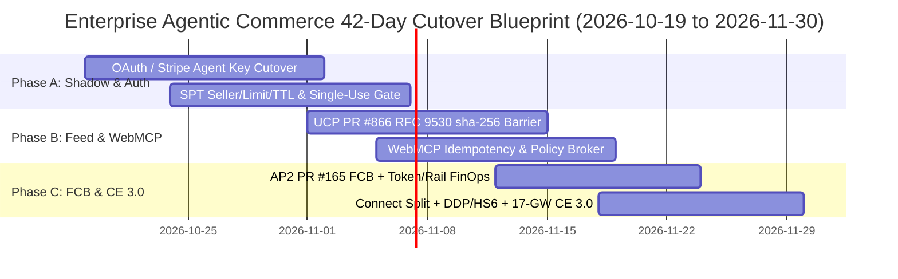

# Enterprise Dual-Stack Deployment & `2026-11-30` Stripe MCP 42-Day Cutover Playbook

> **Verification Date**: `2026-10-19` (Asia/Shanghai) — **42 Calendar Days Remaining** until `2026-11-30` Stripe MCP Legacy Key Cutoff
> **Executable Readiness Auditor**: [`lab/protocol_readiness_auditor.py`](../../lab/protocol_readiness_auditor.py)
> **Interactive Architect Workbench**: [`reports/agentic-commerce-workbench/index.html`](../../reports/agentic-commerce-workbench/index.html)

---

## 1. Executive Summary & 42-Day Cutover Timeline

Per Stripe's official MCP specification (`https://docs.stripe.com/mcp`), starting **December 2026** (migration deadline **November 30, 2026**), `https://mcp.stripe.com` will reject legacy Restricted API Keys (`rak_*`) and Secret API Keys (`sk_*`), returning `HTTP 401` with OAuth discovery headers and requiring **OAuth** or **Stripe Agent Keys**.

For enterprise retail, SaaS, and cross-border B2B marketplaces, migrating the credential class alone is insufficient. Moving from human-in-the-loop web checkout to autonomous Agentic Commerce requires a **Three-Phase Production Cutover** across Identity/SPT, Catalog/Frontend Agency, and Fiduciary Settlement/Dispute Non-Repudiation:



---

## 2. Three-Phase Production Cutover Architecture

### Phase A (Shadow Dual-Write & Credential Cutover — 35 Readiness Points)
1. **Eliminate Legacy Keys (`rak_*` / `sk_*`)**:
   - Inventory all MCP clients with `python -m lab.mcp_migration --as-of 2026-10-19` and rotate every client to `oauth` or `stripe_agent_key` before `2026-11-30`.
2. **Replace Raw `paymentIntents.create` with Scoped `SPT` (`spt_*`)**:
   - Bind every Shared Payment Token to `(seller_details.network_id, usage_limits.max_amount, expires_at)`.
   - For external PSP execution, enforce single-use `/v1/shared_payment/granted_tokens/{id}/resolve` ledger recording and `<field>:<start>:<length>` RSA credential slice validation (`verify_spt_resolve_single_use`).
   - For Stripe Connect marketplaces, enforce `separate_charges_and_transfers` on multi-seller carts (`verify_connect_split_and_refund_conservation`).

### Phase B (Catalog Feed Digest Barrier & Frontend Agency — 30 Readiness Points)
1. **UCP `PR #866` `dev.ucp.common.feed` RFC 9530 `sha-256` Barrier**:
   - Verify `sha-256=:<base64>:` digests across all `manifest.files` shards before applying catalog snapshot deletions (`deletions_permitted=False` on any partial fetch or digest mismatch).
   - Merge `dev.ucp.shopping.catalog.feed` supplemental records by variant `id` rather than array overwrite (`verify_ucp_catalog_feed_snapshot`).
2. **Deterministic Policy Broker & Chrome WebMCP**:
   - Enforce `summary_amount_minor == terms_amount_minor` (Poppy `v0.1` `#51`), require explicit human confirmation on `consequentialHint=true` mutations, and prohibit scripted submission inside BNPL WebViews (`verify_reasoning_execution_isolation`).

### Phase C (Fiduciary Circuit Breaker, Multi-Rail FinOps & 17-Gateway CE 3.0 — 35 Readiness Points)
1. **AP2 `PR #165` Fiduciary Circuit Breaker × `stripe-token-billing`**:
   - Compute real-time unit economics (`gross_take_usd - token_burn_usd - rail_fee_usd - forfeited_subcent_usd`).
   - Trip AP2 FCB to `OPEN` (`COST_ENVELOPE_EXCEEDED`) when card fixed fees (`$0.30 + 2.9%`) or unaligned MPP Tempo sub-cent truncation erode platform take (`evaluate_token_margin_circuit_breaker`).
2. **Cross-Border Customs `DDP` & WCO 6-Digit `HS` Lock**:
   - Block silent `DDP -> DAP/DDU` downgrades and WCO 6-digit `HS` subheading hallucinations (`verify_cross_border_incoterms_and_hs`).
3. **ACP `PR #316` Appendix C 17-Gateway Automated CE 3.0 Representment**:
   - Compile the 4-pillar Merkle root (`ATDRP_CE3_MERKLE_ROOT`) linking AP2 Mandate JWS, SPT seller binding + network cryptogram (`TAVV`/`DTVC`/`AAV`), UCP Feed `sha-256`, and `DDP`/HS6 proof into native dispute representment fields across all 17 gateways (`compile_cryptographic_dispute_bundle`).

---

## 3. Verification & Interactive Workbench

```bash
python -m lab.protocol_readiness_auditor --output-dir reports/agentic-commerce-workbench
python -m unittest tests/test_protocol_readiness_auditor.py -v
```
