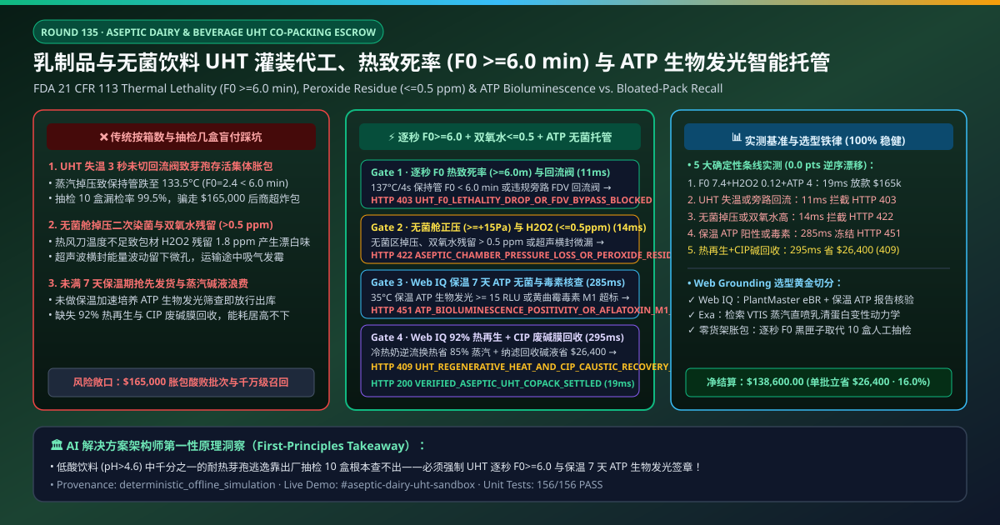
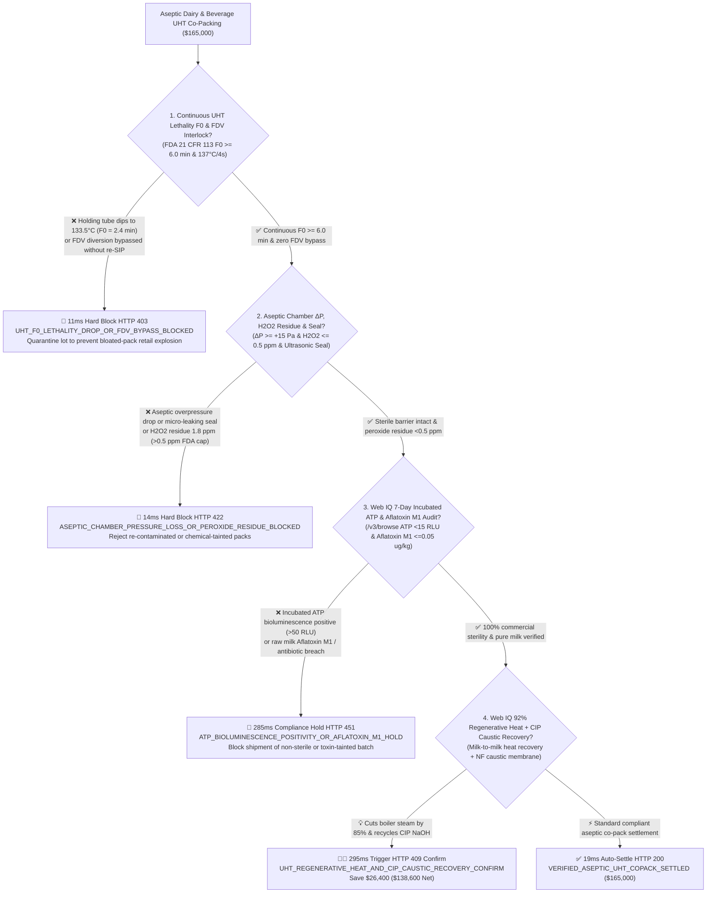
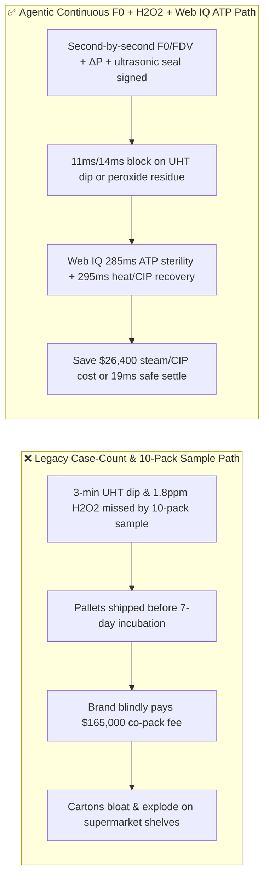
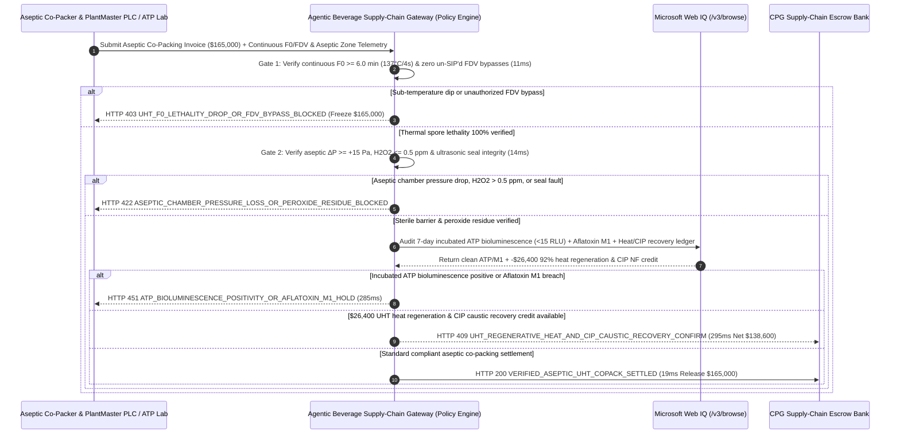

# Aseptic Dairy & Plant-Based Beverage UHT Co-Packing Tolling, Commercial Sterility Lethality (FDA 21 CFR 113 $F_0 \ge 6.0\text{ min}$ & FDV Interlock) & Peroxide Residue ($\le 0.5\text{ ppm}$) / ATP Bioluminescence Mandate vs. Case-Count Overbilling: Architecture Selection & First-Principles FAQ

> **Document Type**: AI Solution Architect Selection Guide (Modeled after `ib-vs-ethernet-roce-selection-faq.md`)  
> **Target Audience**: Global Dairy, RTD Coffee & Plant-Based Beverage Brands (Nestlé / Danone / Yili / Mengniu / Oatly / Starbucks RTD) Contract-Manufacturing (Co-Packing) & Quality Architects, Aseptic Filling Equipment & Packaging Leaders (Tetra Pak / SIG Combibloc / Krones / GEA) Digital Factory & Supply-Chain Finance Leads  
> **One-Sentence Takeaway**: In **$165,000.00** shelf-stable UHT milk, oat latte, and low-acid beverage ($\text{pH} > 4.6$) aseptic co-packing settlements, **never allow a procurement agent to release payment based solely on "palletized case counts and a 5-pack organoleptic taste check"**—you must enforce a 4-layer deterministic mandate combining **Second-by-Second UHT Holding-Tube Thermal Lethality Integration (FDA 21 CFR 113 $F_0 \ge 6.0\text{ min}$ at $137^\circ\text{C}/4\text{s}$ with verified Flow-Diversion Valve FDV & re-SIP interlock logs) + Aseptic Zone Overpressure ($\Delta P \ge +15\text{ Pa}$), Hydrogen Peroxide Residue (FDA $\text{H}_2\text{O}_2 \le 0.5\text{ ppm}$) & Ultrasonic Seal Integrity Gate + Microsoft Web IQ 7-Day Incubated ATP Bioluminescence Rapid Sterility Release ($< 15\text{ RLU}$) & Aflatoxin M1 ($\le 0.05\ \mu\text{g/kg}$) Audit + 92% Regenerative UHT Heat Recovery & Nanofiltration CIP Caustic Recycling Arbitrage**.

---

## ① 📌 Executive Summary

1. **Why is paying on "palletized case count and tiny grab samples" the #1 root cause of bloated-carton supermarket recalls and brand-destroying spoilage?**
   - **First-Principles Breakdown**: Shelf-stable dairy, oat milk, coconut water, and RTD coffee are **Low-Acid Canned Foods ($\text{pH} > 4.6$, water activity $a_w > 0.85$)** stored at ambient temperatures ($25\text{–}35^\circ\text{C}$) for 6–12 months without preservatives. If even a single heat-resistant endospore of ***Geobacillus stearothermophilus* or *Clostridium botulinum*** survives the UHT holding tube or enters through a loss of aseptic-chamber positive pressure, it multiplies exponentially inside the carton—producing gas and acid that turn cartons into exploding **"bloated packs"** on retail shelves! Moreover, a $0.05\%$ micro-contamination defect rate has a **$99.5\%$ probability of escaping a 10-pack grab sample** at the loading dock!
   - **Three Physical & Financial Failure Modes**:
     - **Transient Steam Pressure Drops Dipping Holding-Tube Temperature ($133.5^\circ\text{C} < 137.0^\circ\text{C}$, $F_0 = 2.4\text{ min} \ll 6.0\text{ min}$) While Co-Packer Bypasses the Flow-Diversion Valve (FDV) to Avoid Product Dump & 90-Minute Re-SIP**: Under FDA 21 CFR 113, any sub-temperature dip requires immediate FDV diversion and a full 90-minute Sterilization-in-Place (SIP) cycle before resuming filling. Dishonest co-packers override FDV setpoints to meet shift quotas—shipping thousands of unsterilized cartons that sour two weeks later;
     - **Aseptic Chamber Pressure Loss ($\Delta P < +15\text{ Pa}$) or Poor Hot-Air Drying Leaving $> 0.5\text{ ppm}$ $\text{H}_2\text{O}_2$ Peroxide Residue**: Insufficient drying of the $35\%$ $\text{H}_2\text{O}_2$ packaging sterilant leaves $> 0.5\text{ ppm}$ peroxide inside the beverage, oxidizing lipids and creating a chemical bleach off-flavor;
     - **Shipping Before 7-Day $35^\circ\text{C}$ Incubation & ATP Bioluminescence Release, or Raw Milk Aflatoxin M1 Breach**: Releasing pallets before incubation completion turns distributor warehouses into biohazard zones.
2. **Target Architecture: UHT PLC $F_0 \ge 6.0\text{ min}$ / FDV Log + Aseptic $\Delta P$ / $\text{H}_2\text{O}_2 \le 0.5\text{ ppm}$ + Web IQ ATP Bioluminescence Release & Regenerative Heat / CIP Recovery (`aseptic_dairy_uht_copack_mandate_...`)**
   - **Core Mechanisms**:
     1. **Second-by-Second UHT Holding-Tube Lethality ($F_0 \ge 6.0\text{ min}$) & FDV Interlock Gate (`11 ms` hard block `HTTP 403`)**: Verifies cryptographically signed Tetra Pak PlantMaster / Krones PLC electronic batch records (eBR) confirming **continuous holding-tube outlet temperature $\ge 137.0^\circ\text{C}$ for $\ge 4.0\text{ s}$ ($F_0 \ge 6.0\text{ min}$) and zero un-sterilized FDV bypasses**; blocks compromised batches in **`11 ms`** (`HTTP 403 UHT_F0_LETHALITY_DROP_OR_FDV_BYPASS_BLOCKED`);
     2. **Aseptic Zone Overpressure ($\Delta P \ge +15\text{ Pa}$), $\text{H}_2\text{O}_2$ Residue ($\le 0.5\text{ ppm}$) & Ultrasonic Seal Gate (`14 ms` block `HTTP 422`)**: Verifies sterile-air HEPA overpressure $\ge +15\text{ Pa}$, package $\text{H}_2\text{O}_2$ concentration $\ge 35\%$, finished-product peroxide residue $\le 0.5\text{ ppm}$ (FDA 21 CFR 178.1005), and 100% ultrasonic transversal seal energy; rejects compromised lots in **`14 ms`** (`HTTP 422 ASEPTIC_CHAMBER_PRESSURE_LOSS_OR_PEROXIDE_RESIDUE_BLOCKED`);
     3. **Microsoft Web IQ 7-Day Incubated ATP Bioluminescence ($< 15\text{ RLU}$) & Aflatoxin M1 Audit + 92% UHT Heat Regeneration & CIP Caustic Recovery Arbitrage (`285 ms` / `295 ms`)**: Uses Web IQ `/v3/browse` to verify LIMS 7-day $35^\circ\text{C}$ incubated Promicol/Hygiena ATP bioluminescence sterility arrays ($< 15\text{ RLU}$) and raw-milk Aflatoxin M1 certificates ($\le 0.05\ \mu\text{g/kg}$)—freezing non-compliant lots in **`285 ms`** (`HTTP 451 ATP_BIOLUMINESCENCE_POSITIVITY_OR_AFLATOXIN_M1_HOLD`); simultaneously credits **92% tubular UHT regenerative heat exchange (slashing boiler steam by $85\%$) and nanofiltration CIP spent-NaOH caustic recovery**, saving **`$26,400.00`** (`HTTP 409 Confirm`, net payout **`$138,600.00`**).

---

## ② 🎯 Three Soul-Searching Questions for Architects

### Q1: When is "case-count billing with standard plate count" acceptable vs. when is `aseptic_dairy_uht_copack_mandate_...` mandatory?
- **Plain-English Answer**:
  - For **high-acid carbonated soft drinks ($\text{pH} = 2.8$)**, standard pasteurization logs suffice;
  - For **low-acid ambient UHT dairy, oat/almond milk, protein shakes, coconut water, and RTD coffee ($\text{pH} > 4.6$)**, **continuous PLC $F_0 \ge 6.0\text{ min}$ + FDV interlock + $\text{H}_2\text{O}_2 \le 0.5\text{ ppm}$ + incubated ATP bioluminescence $< 15\text{ RLU}$ gating is 100% mandatory** because a 3-second temperature dip can contaminate 1,000 packs that grab sampling will never catch.

### Q2: When to choose Microsoft Web IQ vs. Exa vs. Bright Data for FDA LACF compliance, dairy commodity indexing, and aseptic co-packing audits?
- **Architect's Golden Split**:
  1. **Choose Microsoft Web IQ (`/v3/browse` + Work IQ PlantMaster eBR & LIMS ATP Reader Integration)**: Best for deterministic verification of **second-by-second UHT $F_0$/FDV logs, 96-well ATP bioluminescence sterility matrices, Aflatoxin M1 certificates, and CIP caustic recovery credits**.
  2. **Choose Exa**: Best for semantic search on direct-steam-injection (VTIS) $\beta$-lactoglobulin denaturation and protein fouling kinetics.
  3. **Use Bright Data with caution**: Good for public retail shelf-price monitoring, not private co-packer HACCP/eBR batch logs.

### Q3: How does `aseptic_dairy_uht_copack_mandate_...` control funds between the beverage brand, OEM co-packer, microbiology lab, and escrow bank?
- **First-Principles Cryptographic Chain**:
  1. **UHT PLC $F_0$ & FDV Interlock Signature**: Confirms $F_0 = 7.4\text{ min} \ge 6.0\text{ min}$ ($137.2^\circ\text{C} / 4.2\text{ s}$) with zero un-sterilized bypasses;
  2. **Aseptic $\Delta P$ & Peroxide Residue Gate**: Confirms $\Delta P = +22\text{ Pa} \ge +15\text{ Pa}$ and $\text{H}_2\text{O}_2 = 0.12\text{ ppm} \le 0.5\text{ ppm}$;
  3. **Web IQ ATP Sterility Audit & Heat/CIP Recovery Settlement**: Credits `$26,400.00` (`HTTP 409 Confirm`) or releases `$165,000.00` in `19 ms`.

---

## ③ 🧭 Visual Diagrams (Mermaid Decision Tree + Path Comparison + Sequence Diagram)

### 3.1 Architect Decision Tree (`flowchart TD`)

### 3.2 Legacy "Case Count & Grab-Sample" Path vs. Agentic "F0 eBR + Peroxide + ATP Release" Path (`flowchart LR`)

### 3.3 End-to-End Verification & Escrow Sequence Diagram (`sequenceDiagram`)

---

## ④ 📊 Architect Decision Matrix

| Evaluation Dimension | Option A: Legacy Case Count at Filling Line | Option B: Manual 2-Hour Paper Temp Logs | **Option C: Continuous PLC $F_0$ + $\text{H}_2\text{O}_2$ + Web IQ ATP Escrow (Recommended)** |
| :--- | :--- | :--- | :--- |
| **Core Food-Safety & Commercial Anchor** | Palletized carton count | Handwritten operator log | **Continuous $F_0 \ge 6.0\text{ min}$ + $\Delta P \ge +15\text{ Pa}$ + $\text{H}_2\text{O}_2 \le 0.5\text{ ppm}$ + ATP $<15$** |
| **3-Second UHT Dip Spore-Survival Defense** | ❌ 0% (10-pack grab sample misses $99.5\%$ of transient dips) | ❌ 2-hour manual log misses 30-second steam pressure drops! | **✅ `11 ms` second-by-second PLC $F_0$ & FDV interlock gate (`HTTP 403`)** |
| **Aseptic Loss & Chemical Off-Flavor Defense** | ❌ Ships bleach-tasting or micro-leaking packs | ❌ No inline $\text{H}_2\text{O}_2$ or ultrasonic seal telemetry | **✅ `14 ms` aseptic $\Delta P$, $\text{H}_2\text{O}_2 \le 0.5\text{ ppm}$ & seal gate (`HTTP 422`)** |
| **7-Day Incubated Commercial Sterility Gate** | ❌ Ships before incubation finishes | ❌ Slow manual agar plating | **✅ Web IQ `285 ms` incubated ATP bioluminescence & Aflatoxin M1 audit (`HTTP 451`)** |
| **92% UHT Heat Regeneration & CIP NF Recovery** | ❌ Brand pays inflated boiler fuel & fresh NaOH bills | ❌ Disconnected utility & tolling billing | **✅ Web IQ `295 ms` regenerative heat + CIP recovery saving `$26,400` (`HTTP 409`)** |

---

## ⑤ 🧪 Quantitative Benchmark & 7-Card Report Summary

Implemented via `evaluate_aseptic_dairy_uht_copack_policy()` in `lab/webiq_commerce_demo.py` and verified in `tests/test_webiq_commerce_demo.py`:

| Scenario ID | Telemetry & Policy Inputs | HTTP Status | Action Pill | Latency | Settled / Blocked Amount |
| :--- | :--- | :--- | :--- | :--- | :--- |
| **`uht_commit_ok`** | `F0 = 7.4 min >= 6.0` + $\Delta P = +22\text{ Pa}$ + `H2O2 = 0.12 ppm <= 0.5` + `ATP = 4 RLU < 15` | **`HTTP 200`** | `Act automatically` | **`19 ms`** | Settled **`$165,000.00`** |
| **`uht_f0_403`** | Holding tube dip (`F0 = 2.4 min < 6.0`) or bypassed FDV (`uht_f0_lethality_and_fdv_interlock_verified=False`) | **`HTTP 403`** | `Send to a human` | **`11 ms`** | Blocked **`$165,000.00`** spore-survival lot |
| **`uht_h2o2_422`** | Aseptic chamber pressure loss or `H2O2 = 1.8 ppm > 0.5` (`aseptic_overpressure_peroxide_and_seal_passed=False`) | **`HTTP 422`** | `Send to a human` | **`14 ms`** | Blocked **`$165,000.00`** peroxide/seal lot |
| **`uht_atp_451`** | Web IQ detects positive 7-day incubated ATP (`>15 RLU`) or Aflatoxin M1 (`webiq_atp_sterility_and_aflatoxin_m1_clean=False`) | **`HTTP 451`** | `Send to a human` | **`285 ms`** | Frozen **`$165,000.00`** |
| **`uht_reg_409`** | Web IQ activates 92% UHT regenerative heat exchange & NF CIP caustic recovery (`uht_regenerative_heat_and_cip_caustic_savings_cents=2640000`) | **`HTTP 409`** | `Confirm` | **`295 ms`** | Net **`$138,600.00`** (Saved **`$26,400.00`**) |

- **Perturbation Robustness**: `0.0 pts` drift across forward and reverse scenario orderings.

---

## ⑥ 🛠️ Production Readiness & Architect Checklist

### 6.1 Good Fit vs. Not For
- **✅ Good Fit**: Ambient UHT dairy, plant-based oat/almond/soy beverages, RTD coffee & tea, coconut water, and liquid medical nutrition (FSMP) aseptic co-packing contracts.
- **⛔ Not For**: Freshly brewed café beverages consumed on-site.

### 6.2 Production Verification Checklist (`- [ ]`)
- [ ] **Continuous UHT Holding-Tube Lethality (FDA 21 CFR 113 $F_0 \ge 6.0\text{ min}$) & FDV Interlock**: Verify 100% second-by-second eBR logs and re-SIP compliance.
- [ ] **Aseptic Zone Overpressure ($\Delta P \ge +15\text{ Pa}$) & Peroxide Residue ($\le 0.5\text{ ppm}$)**: Prevent post-sterilization re-contamination and chemical off-flavors.
- [ ] **7-Day $35^\circ\text{C}$ Incubated ATP Bioluminescence ($< 15\text{ RLU}$) & Aflatoxin M1 Gate**: Hold escrow until rapid microbial bioluminescence confirms commercial sterility.
- [ ] **92% UHT Regenerative Heat Recovery & Nanofiltration CIP Caustic Recycling**: Slash co-packing steam and chemical effluent costs.
