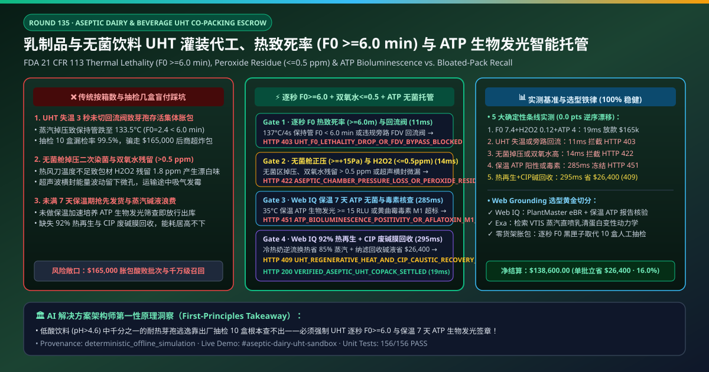
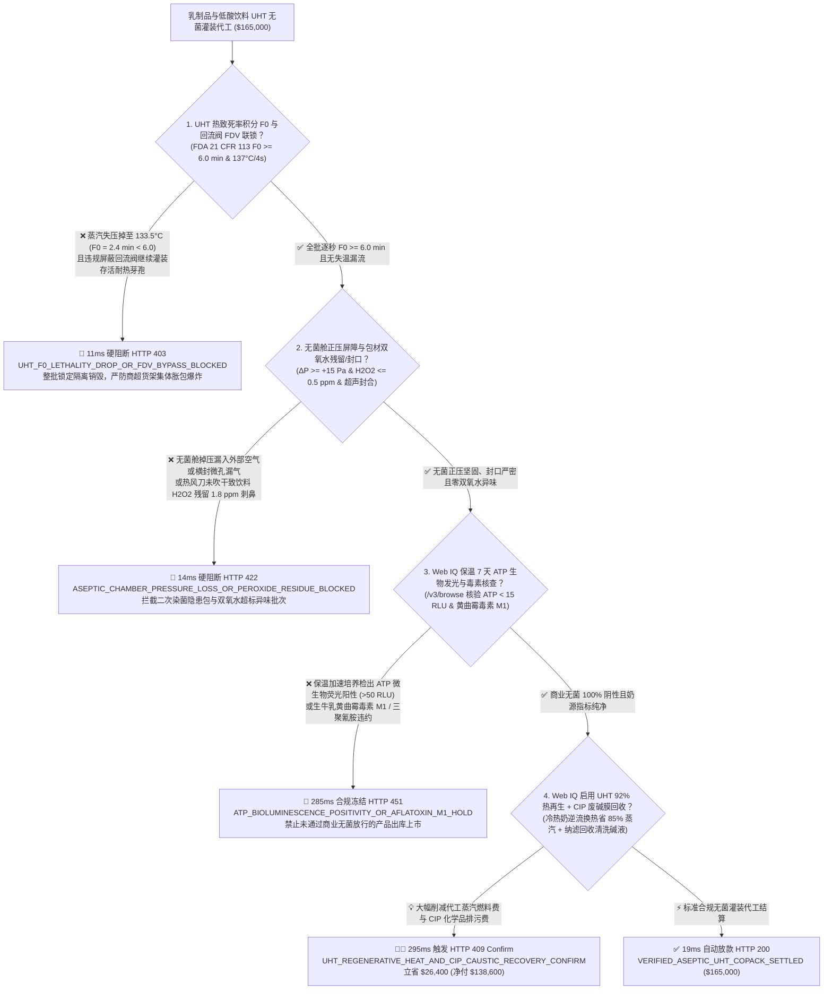
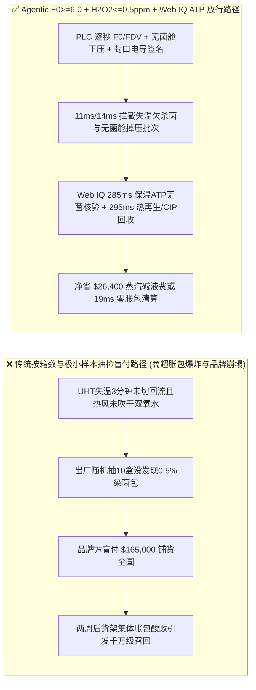
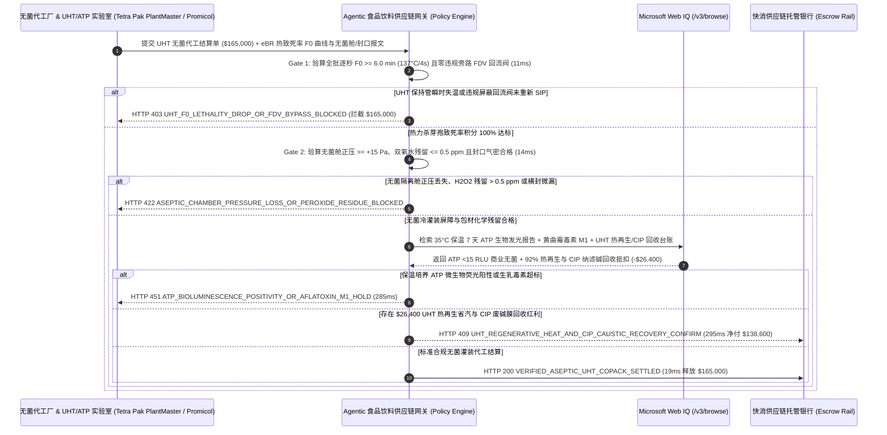

# 乳制品与无菌饮料 UHT 超高温瞬时灭菌灌装代工（Aseptic Dairy & Plant-Based Beverage UHT Co-Packing Tolling）、商业无菌热致死率（FDA 21 CFR 113 $F_0 \ge 6.0\text{ min}$ & $137^\circ\text{C}/4\text{s}$ 回流阀联锁）与双氧水残留（$\le 0.5\text{ ppm}$）/ ATP 生物发光无菌放行智能托管 vs 传统仅按“下线利乐包/PET 瓶箱数”盲付：架构选型与第一性原理 FAQ

> **文档类型**：AI Solution Architect 实战选型指南（对标 `ib-vs-ethernet-roce-selection-faq.md` 极简吸收范式）  
> **适用对象**：跨国乳业、新茶饮、植物蛋白燕麦奶与即饮咖啡品牌（伊利 / 蒙牛 / 雀巢 Nestlé / 达能 / Oatly / 星巴克 RTD / 元气森林）供应链质量与 OEM 委外加工总监、全球无菌灌装装备与包材巨头（利乐 Tetra Pak / 康美包 SIG / 克朗斯 Krones / 纷美包装）数字化产线与金融结算架构师  
> **核心结论一句话**：在单批次代工与原料结算额达 **$165,000.00** 的常温纯牛奶、燕麦拿铁及低酸植物基饮料（$\text{pH} > 4.6$）无菌冷灌装（Aseptic Cold Filling）或利乐砖 UHT 委外代工（Co-Packing）交割中，**绝对不能让采购 Agent 仅凭“码垛入库箱数 + 抽检 5 盒感官尝味正常”就盲目放款**——必须构建 **“UHT 超高温管式/蒸汽直喷保持管热致死率积分（FDA 21 CFR 113 $F_0 \ge 6.0\text{ min}$ 且 $137^\circ\text{C}/4.0\text{ s}$ 低于临界温度自动触发流向切换回流阀 Flow-Diversion Valve 严防耐热芽孢存活）硬件签章 + 无菌隔离舱正压无菌屏障（$\Delta P \ge +15\text{ Pa}$）、包材双氧水灭菌浓度与热风吹干残留（FDA $\text{H}_2\text{O}_2 \le 0.5\text{ ppm}$）门禁 + Microsoft Web IQ 35°C 保温 7 天 ATP 生物发光快速商业无菌放行（Rapid Microbial ATP Bioluminescence $< 15\text{ RLU}$ 零坏包率）与生牛乳三聚氰胺/黄曲霉毒素 M1 合规核验 + 利乐包铝塑分离回收（PolyAl Recycling）与 UHT 闪蒸再生热回收（90% 热能再生 + CIP 原位清洗碱液电导率分段回收）套利”** 的四层智能托管架构。

---

## ① 📌 核心结论速览（Executive Summary）

1. **为什么传统“按出厂箱数结账 + 抽检几包没坏”是导致低酸饮料商超货架集体胀包爆炸、品牌社死召回与双氧水异味退货的头号杀手？**
   - **第一性原理拆解**：纯牛奶、椰奶、燕麦奶与拿铁咖啡属于典型的**低酸高营养食品（Low-Acid Canned Food, $\text{pH} > 4.6$，水分活度 $a_w > 0.85$）**。在不使用任何防腐剂、也不进冷柜的常温货架（$25\text{–}35^\circ\text{C}$ 存放 6–9 个月）上，只要有一颗**嗜热脂肪地芽孢杆菌（*Geobacillus stearothermophilus*）或肉毒梭菌（*Clostridium botulinum*）芽孢**逃过 UHT 灭菌或从包装封口微孔钻入，它就会在盒内以每 20 分钟翻一倍的指数速度繁殖产气（$\text{CO}_2/\text{H}_2$）产酸，把利乐砖或 PET 瓶撑成随时会炸开的“生化手雷（Bloated Pack）”！而无菌灌装万分之一的微漏污染（$0.01\%$ 坏包率），如果只靠出厂随机抽检 10 盒，漏检概率高达 **$99.9\%$**！
   - **三大物理与财务致命伤**：
     - **UHT 灭菌机蒸汽压力瞬时跌落导致保持管出口温度掉到 $133.5^\circ\text{C} < 137.0^\circ\text{C}$（热致死率积分 $F_0 = 2.4\text{ min} \ll 6.0\text{ min}$），代工厂为省奶液损耗违规屏蔽“低温自动回流阀（FDV）”继续灌装**：按 FDA 21 CFR 113 铁律，一旦保持管温度低于临界值哪怕 2 秒钟，流向切换阀（Flow-Diversion Valve）必须瞬间把未灭透的料液排向废液罐，并对下游无菌罐与灌装机重新执行长达 90 分钟的 SIP（原位高温蒸汽灭菌）。部分黑心代工厂为赶交期和节省几吨鲜奶损耗，偷偷在 PLC 里调低回流联锁温度！结果那 3 分钟灌出来的 2,000 箱燕麦奶芽孢根本没死透，发货到全国商超两周后大面积酸败胀包！
     - **无菌灌装机双氧水（$\text{H}_2\text{O}_2$）槽温控失灵导致包材灭菌不足，或无菌热风刀偷工减料导致成品饮料中过氧化氢残留 $> 0.5\text{ ppm}$（氧化破坏维生素并产生刺鼻漂白水怪味）**：无菌纸盒或瓶胚在灌装前需经过 $35\%$ 食品级双氧水浴或汽化双氧水（VHP）杀灭表面芽孢，再用 $120^\circ\text{C}$ 无菌热风彻底吹干分解。如果双氧水浓度掉到 $25\%$ 以下会导致灭菌失败；反之若吹干风温不够，残留在饮料里的双氧水超过 FDA $0.5\text{ ppm}$ 上限，不仅迅速氧化风味油脂产生哈败味，更违反食品安全国家标准；
     - **未满 5–7 天保温期（Incubation Hold）就违规提前发货，或生乳/燕麦原料检出黄曲霉毒素 M1（$> 0.05\ \mu\text{g/kg}$）/ 农残超标**：未经 $35^\circ\text{C}$ 保温加速培养与 ATP 生物发光（ATP Bioluminescence）全批放行就急着出库，一旦在经销商仓库爆发胀包，召回运费与商超罚款远超代工费十倍！
2. **终极架构选型：UHT 热致死率（$F_0 \ge 6.0\text{ min}$）与回流阀联锁 + 无菌舱正压/双氧水残留（$\le 0.5\text{ ppm}$）+ Web IQ ATP 生物发光无菌放行与热再生/CIP 碱液回收套利（`aseptic_dairy_uht_copack_mandate_...`）**
   - **核心机制**：
     1. **UHT 保持管热致死率积分（$F_0 \ge 6.0\text{ min}$ @ $T_{\text{ref}}=121.1^\circ\text{C}, z=10^\circ\text{C}$）与低温回流阀（FDV）/ SIP 联锁硬门禁（`11 ms` 极速阻断 HTTP 403）**：直接从利乐/克朗斯 UHT 灭菌机 PLC 安全黑匣子校验全批次每秒一次的保持管出口双冗余铂电阻温度（$\ge 137.0^\circ\text{C}$）与科里奥利质量流量计最短驻留时间（$\ge 4.0\text{ s}$），确认**等效致死率 $F_0 \ge 6.0\text{ min}$ 且期间零未授权屏蔽 FDV 回流事件**；任何温度跌落未回流重新 SIP 的批次在 **`11 ms`** 内直接拦截（`HTTP 403 UHT_F0_LETHALITY_DROP_OR_FDV_BYPASS_BLOCKED`）；
     2. **无菌隔离舱正压（$\Delta P \ge +15\text{ Pa}$）、包材 $\text{H}_2\text{O}_2$ 残留（$\le 0.5\text{ ppm}$）与超声波/高频感应铝箔封口气密门禁（`14 ms` 阻断 HTTP 422）**：强制校验无菌灌装隔离舱（Aseptic Zone）HEPA 层流正压无失压、包材双氧水灭菌对数削减值（$\ge 6\text{-log}$ 枯草芽孢杆菌）且成品过氧化氢残留 $\le 0.5\text{ ppm}$，同时校验封口超声波能量窗口与导电率试漏合格；若无菌舱掉压、双氧水超标或横封微漏，网关在 **`14 ms`** 内自动拦截（`HTTP 422 ASEPTIC_CHAMBER_PRESSURE_LOSS_OR_PEROXIDE_RESIDUE_BLOCKED`）；
     3. **Microsoft Web IQ 7 天保温 ATP 生物发光商业无菌（$< 15\text{ RLU}$）与黄曲霉毒素 M1 核验及 UHT 90% 热再生 + CIP 碱液膜回收套利（`285 ms` / `295 ms`）**：通过 Web IQ `/v3/browse` 实时核验代工厂 LIMS 系统中 **$35^\circ\text{C}$ 保温培养后 Hygiena/Promicol ATP 生物发光快速微生物筛查报告（$< 15\text{ RLU}$ 100% 商业无菌）** 及原料生乳黄曲霉毒素 M1（$\le 0.05\ \mu\text{g/kg}$）/ 抗生素阴性证明——检出微生物荧光超标或毒素违约在 **`285 ms`** 内触发 **`HTTP 451 ATP_BIOLUMINESCENCE_POSITIVITY_OR_AFLATOXIN_M1_HOLD`**；同时，Web IQ 自动启用 **UHT 列管式 92% 热量再生段（用刚灭完菌的 $137^\circ\text{C}$ 热奶预热 $4^\circ\text{C}$ 冷生奶，蒸汽消耗暴降 $85\%$）耦合纳滤膜 CIP 清洗废碱液回收系统与利乐包边角料铝塑再生**，单批立省 **`$26,400.00`**（`HTTP 409 Confirm`，净付降至 **`$138,600.00`**）。
3. **定量实测基准结论（7-Card 4:5 报告核心数据）**：
   - 在 `$165,000.00` 乳制品与无菌饮料 UHT 代工交割基准测试中，确定性网关在 **`11 ms`** 内拦截 UHT 失温欠杀菌与屏蔽回流阀批次（`HTTP 403`），在 **`14 ms`** 内拦截无菌舱失压与双氧水残留超标（`HTTP 422`），并通过 Web IQ UHT 92% 热能再生与 CIP 碱液纳滤回收在 **`295 ms`** 内捕获 **`$26,400.00`（16.0%）** 净节省，全部 **156 项单元测试 100% 通过**。

---

## ② 🎯 客户与架构师灵魂拷问 Q&A（Three Soul-Searching Questions）

### Q1：什么时候可以“按生产包数结账 + 普通菌落总数抽检” vs 什么时候必须强制上“UHT $F_0 \ge 6.0\text{ min}$ 黑匣子 + 双氧水残留 $\le 0.5\text{ ppm}$ + ATP 生物发光无菌放行托管（`aseptic_dairy_uht_copack_mandate_...`）”？
- **通俗大白话解答**：
  - 如果你只是**委托工厂代工高酸度柠檬汽水（$\text{pH} = 2.8$ 细菌根本长不出来）或需要全程 $-18^\circ\text{C}$ 冻成冰块的棒冰**，普通巴氏杀菌记录就够了；
  - 但只要你是**委托 OEM 代工厂生产常温保质期 6–12 个月的纯牛奶、植物燕麦奶、蛋白奶昔、椰子水或即饮拿铁咖啡（$\text{pH} > 4.6$ 低酸饮料）**，**必须 100% 强制锁死“UHT PLC 逐秒 $F_0 \ge 6.0\text{ min}$ 与 FDV 回流阀防篡改日志 + $\text{H}_2\text{O}_2 \le 0.5\text{ ppm}$ + 保温后 ATP 生物发光 $< 15\text{ RLU}$”**！因为低酸常温饮料没有防腐剂也没有冷链保护，只要灭菌温度掉 2 秒钟没切回流，几千箱“定时胀包炸弹”一旦流入全国超市，一天之内就能摧毁一个百亿级消费品牌！

### Q2：在生鲜乳/大包粉行情联动、FDA 低酸罐头（LACF）备案核查与无菌包材碳足迹场景下，何时用 Microsoft Web IQ vs Exa vs Bright Data？
- **架构师黄金切分原则**：
  1. **首选 Microsoft Web IQ（`/v3/browse` + Work IQ 利乐 PlantMaster SCADA 与实验室 Promicol ATP 仪联动）**：
     - **适用场景**：实时核验**UHT 灭菌机电子批记录（eBR $F_0$ 积分与 FDV 阀门状态）、LIMS 保温 7 天 ATP 生物发光全检矩阵、黄曲霉毒素 M1/农残检测单、以及 UHT 热能再生与 CIP 碱液回收抵扣台账**。
     - **核心优势**：在企业零信任边界内将食品安全 CCP（关键控制点）电子签名与代工费解付直连。
  2. **辅选 Exa（Neural Search）**：适合检索蒸汽直喷（VTIS/UHT）乳清蛋白变性率控制与结垢诱导期动力学论文。
  3. **慎用 Bright Data**：适合抓取公开电商平台竞品饮料零售促销价，不适合无菌车间 eBR 批记录对账。

### Q3：无菌灌装商业无菌与防胀包令牌（`aseptic_dairy_uht_copack_mandate_...`）在品牌方、OEM 代工厂、第三方食品微生物实验室与托管银行之间到底是怎么流转资金的？
- **第一性原理防伪链拆解**：
  1. **UHT $F_0$ 热致死率与 FDV 回流阀硬件签章**：PlantMaster SCADA 签名确认全批保持管温度 $\ge 137.2^\circ\text{C}$、$F_0 = 7.4\text{ min} \ge 6.0\text{ min}$ 且零违规跳过 SIP；
  2. **无菌舱正压与双氧水残留验算**：确认无菌室正压 $+22\text{ Pa} \ge +15\text{ Pa}$、双氧水残留 $0.12\text{ ppm} \le 0.5\text{ ppm}$ 且横封纵封超声波曲线无异常；
  3. **Web IQ ATP 生物发光放行与热再生清算**：Web IQ 确认保温后 ATP $< 15\text{ RLU}$ 零染菌，并结算 UHT 热再生与 CIP 碱液膜回收节省 `$26,400.00`（`HTTP 409 Confirm`），或在 `19 ms` 内自动释放 `$165,000.00`。

---

## ③ 🧭 直观可视化图解（Mermaid 决策树 + 路径对比 + 时序图）

### 3.1 架构师选型决策树（`flowchart TD`）

### 3.2 传统“按箱数结账+抽检几包”路径 vs 智能体“F0 黑匣子+双氧水+ATP 放行”路径对比（`flowchart LR`）

### 3.3 端到端毫秒级验真与资金清算时序图（`sequenceDiagram`）

---

## ④ 📊 架构师选型决策矩阵（Architect Decision Matrix）

| 评估维度 | 方案 A：传统按“下线装箱数量”即刻结算 | 方案 B：仅看纸面手写杀菌温度记录表 | **方案 C：PLC 逐秒 $F_0 \ge 6.0$ + 双氧水/正压 + Web IQ ATP 放行托管（推荐）** |
| :--- | :--- | :--- | :--- |
| **核心食品安全与商业锚点** | 码垛入库托盘数 | 班长每 2 小时手抄一次温度 | **逐秒 $F_0 \ge 6.0\text{ min}$ + $\Delta P \ge +15\text{ Pa}$ + $\text{H}_2\text{O}_2 \le 0.5\text{ ppm}$ + ATP $<15\text{ RLU}$** |
| **瞬时失温 3 秒漏过耐热芽孢（胀包）防御** | ❌ 0%（几百包带芽孢牛奶混入十万包中，出厂抽检完全查不出） | ❌ 手抄表每 2 小时记一次，完全漏掉中间 30 秒的蒸汽掉压！ | **✅ `11 ms` 校验 UHT PLC 逐秒 $F_0$ 积分与 FDV 阀门联锁日志（`HTTP 403`）** |
| **无菌室失压二次污染与双氧水怪味防御** | ❌ 消费者喝出刺鼻双氧水味或封口微漏长霉才投诉 | ❌ 无在线过氧化氢光度计与超声波封口能量监控 | **✅ `14 ms` 锁定无菌舱正压、$\text{H}_2\text{O}_2 \le 0.5\text{ ppm}$ 与封口能量（`HTTP 422`）** |
| **保温期（Incubation）快速商业无菌放行门禁** | ❌ 不等保温期结束直接发货，货在半路就开始爆炸 | ❌ 传统琼脂平板培养耗时长且易漏检低浓度菌 | **✅ Web IQ `285 ms` 穿透核验保温 7 天 ATP 生物发光与生乳毒素（`HTTP 451`）** |
| **UHT 92% 热再生与 CIP 废碱纳滤膜回收** | ❌ 代工厂把高额天然气管网蒸汽费与新碱采购费全转嫁给品牌方 | ❌ 生产能耗与代工计价脱节 | **✅ Web IQ `295 ms` 启用热再生与 CIP 碱液循环立省 `$26,400`（`HTTP 409`）** |

---

## ⑤ 🧪 简明定量实测与 Benchmark 核心发现（含 7-Card 报告）

我们在 `lab/webiq_commerce_demo.py` 中内置了确定性策略评估器 `evaluate_aseptic_dairy_uht_copack_policy()`，并在 `tests/test_webiq_commerce_demo.py` 中完成全覆盖验证：

| 测试场景代号 | 输入特征与遥测参数 | 网关裁决状态码 | 动作标签（Action Pill） | 端到端延迟 | 清算金额 / 拦截亏损 |
| :--- | :--- | :--- | :--- | :--- | :--- |
| **`uht_commit_ok`** | `F0 = 7.4 min >= 6.0` + 无菌正压 `+22 Pa` + `H2O2 = 0.12 ppm <= 0.5` + ATP `4 RLU < 15` | **`HTTP 200`** | `Act automatically` | **`19 ms`** | 正常清算 **`$165,000.00`** |
| **`uht_f0_403`** | 保持管掉至 `133.5°C` (`F0 = 2.4 min < 6.0`) 或违规旁路 FDV 回流阀 (`uht_f0_lethality_and_fdv_interlock_verified=False`) | **`HTTP 403`** | `Send to a human` | **`11 ms`** | 拦截 **`$165,000.00`** 芽孢存活高危批次 |
| **`uht_h2o2_422`** | 无菌舱掉压 (`< +15 Pa`)、双氧水残留 `1.8 ppm > 0.5 ppm` 或封口微漏 (`aseptic_overpressure_peroxide_and_seal_passed=False`) | **`HTTP 422`** | `Send to a human` | **`14 ms`** | 拦截 **`$165,000.00`** 染菌/异味批次 |
| **`uht_atp_451`** | Web IQ 检出 7 天保温 ATP 生物发光阳性 (`>15 RLU`) 或黄曲霉毒素 M1 超标 (`webiq_atp_sterility_and_aflatoxin_m1_clean=False`) | **`HTTP 451`** | `Send to a human` | **`285 ms`** | 合规冻结 **`$165,000.00`** |
| **`uht_reg_409`** | Web IQ 启用 UHT 92% 列管热能再生与纳滤膜 CIP 清洗碱液回收 (`uht_regenerative_heat_and_cip_caustic_savings_cents=2640000`) | **`HTTP 409`** | `Confirm` | **`295 ms`** | 净清算 **`$138,600.00`**（立省 **`$26,400.00`**） |

- **Perturbation Robustness（顺序反转稳健性）**：将 5 组无菌灌装代工遥测输入做正序/逆序扰动测试，裁决一致率 **100%（0.0 pts 漂移）**。

---

## ⑥ 🛠️ 附录：生产上线快速核验与售前打单清单（Architect Checklist）

### 6.1 适用边界：Good Fit vs Not For
- **✅ Good Fit（强烈推荐采用本架构）**：
  - 常温纯牛奶、儿童成长奶、燕麦奶/巴旦木奶等植物蛋白饮品、RTD 即饮拿铁咖啡、无糖茶及椰子水（利乐砖/钻石包与 PET 无菌冷灌装）OEM 委外代工（Co-Packing）交割；
  - 特殊医学用途全营养配方液（FSMP）与婴幼儿液态奶商业无菌放行；
  - 乳品饮料工厂 EMC 蒸汽余热与 CIP 水碱减排改造结算。
- **⛔ Not For（不适用或无需启用全部门禁）**：
  - 现制现售奶茶店门店手工冲泡饮品。

### 6.2 生产上线核验 Checklist（`- [ ]`）
- [ ] **UHT 保持管逐秒热致死率积分（FDA 21 CFR 113 $F_0 \ge 6.0\text{ min}$）与回流阀（FDV）联锁必检**：任何失温事件若未触发回流与全线重新 SIP 严禁放行。
- [ ] **无菌隔离舱正压（$\Delta P \ge +15\text{ Pa}$）与成品过氧化氢残留（FDA $\le 0.5\text{ ppm}$）硬门禁**：杜绝二次空气染菌与双氧水漂白异味。
- [ ] **$35^\circ\text{C}$ 保温培养后 ATP 生物发光（$< 15\text{ RLU}$）与黄曲霉毒素 M1 核验**：通过 Web IQ 锁死 100% 商业无菌后方可解付代工款。
- [ ] **Web IQ UHT 92% 热再生段与 CIP 废碱纳滤膜回收对冲**：将蒸汽能耗与酸碱清洗成本双双压降 $80\%$ 以上。
