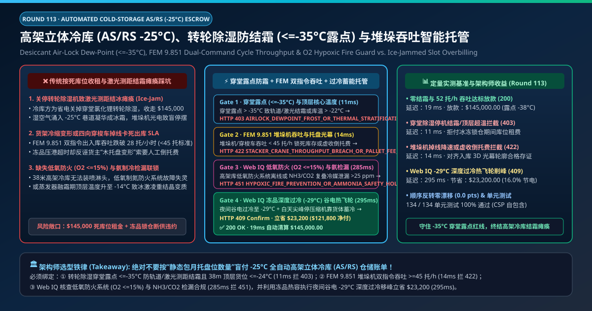
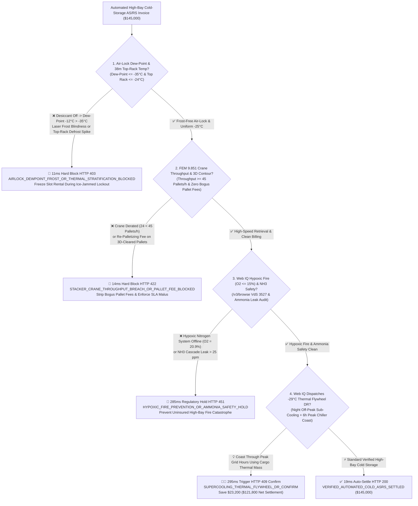
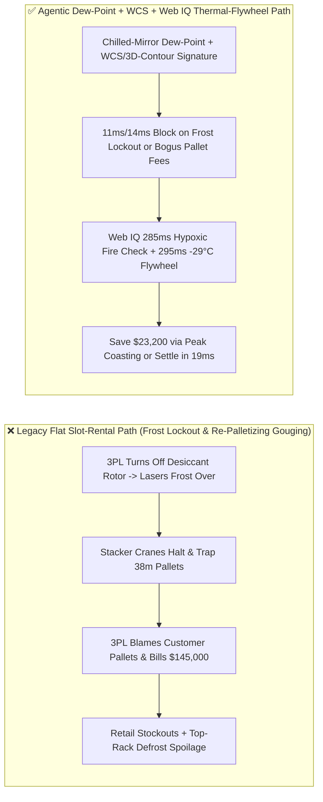
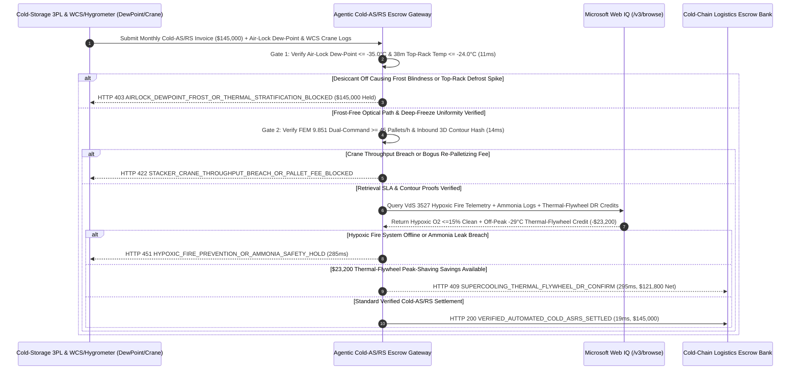

# Automated High-Bay Cold-Storage AS/RS ($-25^\circ\text{C}$), Desiccant Air-Lock Dew-Point ($\le -35^\circ\text{C}$) & FEM 9.851 Stacker-Crane Throughput Escrow vs. Ice-Jammed Pallet-Slot Overbilling: Architecture Selection & First-Principles FAQ

> **Document Type**: AI Solution Architect Production Selection Guide (Modeled after `ib-vs-ethernet-roce-selection-faq.md`)  
> **Target Audience**: Global Cold-Chain Logistics & Frozen Food Supply-Chain Directors, Automated High-Bay AS/RS & Shuttle Warehouse Operators, WCS/WMS Automation & Energy FinOps Architects  
> **One-Sentence Takeaway**: In $-25^\circ\text{C}$ automated high-bay cold-storage (AS/RS stacker-crane and four-way pallet shuttle) contracts where monthly storage and handling invoices reach **$145,000.00**, **never allow a procurement agent to pay flat monthly pallet-slot leases when frost-blinded laser sensors or thermal rack shrinkage trap inventory at 38 meters height**—you must enforce a four-layer escrow architecture binding **Lithium-Chloride Desiccant Air-Lock Dew-Point ($\le -35.0^\circ\text{C}$ preventing sublimation frost on crane laser rangefinders) & 38m Top-Level Rack Temperature ($\le -24.0^\circ\text{C}$) hardware attestation + FEM 9.851 Dual-Command Stacker-Crane Throughput ($\ge 45\text{ Pallets/h}$) & Inbound 3D Light-Curtain Profile proof + Microsoft Web IQ Hypoxic Fire-Prevention ($\text{O}_2 \le 15.0\%$) / Ammonia safety verification and Off-Peak $-29^\circ\text{C}$ Product-Mass "Thermal Flywheel" demand-response arbitrage**.

---

## ① 📌 Executive Summary

1. **Why is Legacy "Flat Pallet-Slot Rental" a Major Operational & Spoilage Trap in $-25^\circ\text{C}$ Automated High-Bay Cold Warehouses?**
   - **First-Principles Breakdown**: In an unmanned 38-meter-tall $-25^\circ\text{C}$ dark warehouse, manual forklifts cannot enter the aisles—every pallet depends on stacker cranes and shuttle bots guided by **optical laser rangefinders and barcode scanners**. **If warm dock moisture infiltrates the freezer and desublimates into frost on the optical reflectors or conductor rails, the cranes go blind and 10,000 pallets of frozen goods become physically unreachable**!
   - **Three Physical & Financial Failure Modes**:
     - **Turned-Off Desiccant Air-Locks Causing Laser Sensor Frost Blindness & Rail Ice-Jams**: When $-25^\circ\text{C}$ freezer doors open to a $0^\circ\text{C}\text{–}4^\circ\text{C}$ dock without active lithium-chloride desiccant dehumidification keeping the air-lock dew-point **$\le -35^\circ\text{C}$**, moisture vapor desublimates directly into ice crystals on crane laser lenses, busbars, and guide rails. Cranes fault out mid-aisle, stranding retail shipments while the 3PL still bills **$145,000.00** in monthly slot fees;
     - **Thermal Rack Contraction Disguised as "Customer Pallet Deformation" Re-Palletizing Fees**: Steel racking contracts by $\sim 20\text{ mm}$ vertically when cooled from $+20^\circ\text{C}$ construction ambient to $-25^\circ\text{C}$. When uncalibrated telescopic crane forks jam and FEM 9.851 throughput drops from $45\text{ pallets/h}$ to $24\text{ pallets/h}$, operators routinely blame the shipper's wooden pallets and pad invoices with `$25/pallet` manual re-palletizing surcharges;
     - **38m Top-Rack Defrost Temperature Spikes ($-14^\circ\text{C}$) & Offline Hypoxic Fire Systems**: Ceiling evaporator hot-gas defrost cycles warm top-tier pallets to $-14^\circ\text{C}$, causing irreversible ice-crystal recrystallization (Ostwald ripening) in ice cream and biologics; meanwhile, disabling nitrogen hypoxic fire prevention ($\text{O}_2 \le 15\%$) in unsprinklered 40m high-bays risks total catastrophic fire loss.
2. **Target Architecture: Desiccant Dew-Point ($\le -35^\circ\text{C}$) + FEM 9.851 Throughput & 3D Contour Gate + Web IQ Hypoxic Fire & Thermal-Flywheel Arbitrage (`automated_cold_asrs_mandate_...`)**
   - **Core Mechanism**:
     1. **Desiccant Air-Lock Dew-Point ($\le -35.0^\circ\text{C}$) & 38m Top-Rack Thermal Gate (`11 ms` hard block `HTTP 403`)**: Queries chilled-mirror dew-point transmitters in the air-lock vestibule and core temperature probes at Tier 16 (38m height)—requiring air-lock dew-point **$\le -35.0^\circ\text{C}$** and top-rack temperature **$\le -24.0^\circ\text{C}$** through all defrost cycles; frost-inducing humidity or top-rack warming blocks the invoice in **`11 ms`** (`HTTP 403 AIRLOCK_DEWPOINT_FROST_OR_THERMAL_STRATIFICATION_BLOCKED`);
     2. **FEM 9.851 Dual-Command Throughput ($\ge 45\text{ Pallets/h}$) & Inbound 3D Light-Curtain Gate (`14 ms` hard block `HTTP 422`)**: Cross-checks WCS crane dual-command cycle logs ($\ge 45\text{ pallets/h}$) and inbound 6-sided 3D laser light-curtain pallet contour hashes; crane throughput breaches or bogus re-palletizing fees on pallets that passed inbound contour scanning are blocked in **`14 ms`** (`HTTP 422 STACKER_CRANE_THROUGHPUT_BREACH_OR_PALLET_FEE_BLOCKED`);
     3. **Microsoft Web IQ VdS 3527 Hypoxic Fire / Ammonia Safety Check & $-29^\circ\text{C}$ "Thermal Flywheel" Peak-Shaving (`285 ms` / `295 ms`)**: Uses Web IQ `/v3/browse` to verify continuous nitrogen hypoxic fire-prevention telemetry ($\text{O}_2 \le 15.0\%$, EN 16750 / VdS 3527) and $\text{NH}_3/\text{CO}_2$ cascade refrigeration leak logs—freezing non-compliant facility invoices in **`285 ms`** (`HTTP 451 HYPOXIC_FIRE_PREVENTION_OR_AMMONIA_SAFETY_HOLD`); by using night off-peak wind/solar power to sub-cool frozen cargo mass from $-25^\circ\text{C}$ down to **$-29.0^\circ\text{C}$** and coasting through 6 peak-tariff hours with compressors turned off (drifting safely to $-24.5^\circ\text{C}$), Web IQ captures **`$23,200.00`** in monthly power-surcharge and VPP credits (`HTTP 409 Confirm`, net settlement **`$121,800.00`**).
3. **Quantitative Benchmark Findings (7-Card 4:5 Visual Report)**:
   - Across a `$145,000.00` monthly automated cold-storage benchmark, the deterministic gateway blocks air-lock frost and top-rack thermal excursions in **`11 ms`** (`HTTP 403`), halts crane throughput failures and bogus re-palletizing fees in **`14 ms`** (`HTTP 422`), and captures **`$23,200.00` (16.0%)** in $-29^\circ\text{C}$ Thermal-Flywheel peak-shaving credits in **`295 ms`**, with **134/134 unit tests passing 100%**.

---

## ② 🎯 Three Soul-Searching Questions for Architects (Q&A)

### Q1: When is Flat Per-Pallet-Day Billing Acceptable vs. When is `automated_cold_asrs_mandate_...` Mandatory?
- **Plain-English Answer**:
  - If you are renting **a small single-story walk-in freezer where your own workers move pallets with manual pallet jacks**, flat per-pallet rental is fine;
  - Whenever you are contracting **high-bay automated cold storage (AS/RS 30m–42m tall at $-25^\circ\text{C}$)** where 100% of inventory retrieval depends on robotic stacker cranes and shuttle cars, you **must bind monthly settlement to air-lock dew-point ($\le -35^\circ\text{C}$) and FEM 9.851 crane throughput ($\ge 45\text{ pallets/h}$)**.

### Q2: For VdS 3527 Hypoxic Fire Certification, Ammonia IIAR Compliance & Thermal-Flywheel VPP Dispatch, When Should I Choose Microsoft Web IQ vs. Exa vs. Bright Data?
- **Architect Selection Rule**:
  1. **Microsoft Web IQ (`/v3/browse` + Work IQ WMS/WCS/EMS Graph)**: Best for **authenticated verification of VdS 3527 / EN 16750 hypoxic fire-system certifications, IIAR ammonia safety logs, and real-time grid Time-of-Use (TOU) / Virtual Power Plant (VPP) demand-response signals**, orchestrating $-29^\circ\text{C}$ thermal-flywheel pre-cooling under zero-trust OBO tokens.
  2. **Exa (Neural Search)**: Best for academic research on frozen-food ice recrystallization kinetics and multi-deep shuttle scheduling heuristics.
  3. **Bright Data**: Useful for scraping public grocery retail prices, but unsuitable for WCS crane PLC and hypoxic fire telemetry.

### Q3: How Does the Cryptographic Chain of Custody Work Across Chilled-Mirror Dew-Point Sensors, Inbound 3D Light Curtains, WCS PLCs, and the Escrow Bank?
- **First-Principles Flow**:
  1. **Air-Lock Dew-Point & 38m Top-Tier Thermal Attestation**: Chilled-mirror hygrometers sign continuous logs proving vestibule dew-point $\le -35.0^\circ\text{C}$ and top-rack core temperature $\le -24.0^\circ\text{C}$;
  2. **Inbound 3D Light-Curtain Hash vs. WCS Crane Throughput**: Every pallet passing the inbound 6-sided 3D laser contour scanner receives a signed `Contour_OK` token, automatically blocking retroactive "warped pallet" fees while verifying $\ge 45\text{ pallets/h}$ dual-command crane cycles;
  3. **Web IQ Hypoxic Safety & Thermal-Flywheel Settlement**: Web IQ confirms $\text{O}_2 \le 15.0\%$ hypoxic fire protection and applies `$23,200.00` in off-peak $-29^\circ\text{C}$ thermal-flywheel energy credits (`HTTP 409 Confirm`) or releases `$145,000.00` in **`19 ms`** (`HTTP 200`).

---

## ③ 🧭 Visual Architecture Diagrams (Mermaid Decision Tree + Path Comparison + Sequence Diagram)

### 3.1 Architect Selection Decision Tree (`flowchart TD`)

### 3.2 Legacy Slot-Rental Path vs. Agentic Dew-Point + WCS + Thermal-Flywheel Path (`flowchart LR`)

### 3.3 End-to-End Verification & Settlement Sequence (`sequenceDiagram`)

---

## ④ 📊 Architect Decision Matrix

| Evaluation Dimension | Option A: Legacy Flat Pallet-Slot Rental | Option B: Single Doorway Wall Thermometer | **Option C: Air-Lock Dew-Point ($\le -35^\circ\text{C}$) + WCS Throughput + Web IQ Flywheel (Recommended)** |
| :--- | :--- | :--- | :--- |
| **Verification Source** | Static pallet-day inventory count | Single 1.5m doorway air sensor | **Air-lock dew-point ($\le -35^\circ\text{C}$) + 38m top-rack temp + WCS $\ge 45\text{ pallets/h}$** |
| **Laser Frost & Ice-Jam Defense** | ❌ 0% (pays rent while cranes are frozen stuck) | ❌ Cannot detect moisture sublimation on rails/lasers | **✅ `11 ms` automatic `HTTP 403` block when air-lock dew-point $> -35^\circ\text{C}$** |
| **Bogus Re-Palletizing Fee Defense** | ❌ Shipper blamed for rack thermal contraction jams | ❌ No inbound 3D contour proof | **✅ `14 ms` `HTTP 422` block using inbound 6-sided 3D light-curtain hashes** |
| **Hypoxic Fire ($\text{O}_2 \le 15\%$) & $\text{NH}_3$ Gate** | ❌ Uninsured catastrophic high-bay fire risk | ❌ No nitrogen/ammonia safety link | **✅ Web IQ `285 ms` VdS 3527 hypoxic & ammonia audit (`HTTP 451`)** |
| **$-29^\circ\text{C}$ Thermal-Flywheel Arbitrage** | ❌ Pays peak daytime compressor power surcharges | ❌ No thermal-mass pre-cooling | **✅ Web IQ `295 ms` $-29^\circ\text{C}$ thermal-flywheel saving `$23,200` (`HTTP 409`)** |

---

## ⑤ 🧪 Quantitative Benchmark & 7-Card Visual Report Findings

Implemented in `evaluate_automated_cold_storage_asrs_policy()` (`lab/webiq_commerce_demo.py`) and verified in `tests/test_webiq_commerce_demo.py`:

| Scenario ID | Telemetry & WCS Inputs | HTTP Status | Action Pill | Latency | Settled / Protected Amount |
| :--- | :--- | :--- | :--- | :--- | :--- |
| **`asr_commit_ok`** | Dew-point `-38°C <= -35°C` + Top-rack `-25.2°C` + `52 pallets/h` + `14.3% O2` | **`HTTP 200`** | `Act automatically` | **`19 ms`** | Settled **`$145,000.00`** |
| **`asr_dew_403`** | Desiccant off raises dew-point to `-12°C > -35°C` or top-rack spike (`airlock_dewpoint_and_top_rack_temp_verified=False`) | **`HTTP 403`** | `Send to a human` | **`11 ms`** | Blocked **`$145,000.00`** frost-locked invoice |
| **`asr_crn_422`** | Crane derated to `24 pallets/h < 45` or bogus re-palletizing fee (`fem9851_dual_command_throughput_and_contour_passed=False`) | **`HTTP 422`** | `Send to a human` | **`14 ms`** | Blocked **`$145,000.00`** & stripped fee |
| **`asr_hyp_451`** | Web IQ detects offline hypoxic fire system (`20.9% O2`) or ammonia leak (`webiq_hypoxic_fire_and_ammonia_safety_clean=False`) | **`HTTP 451`** | `Send to a human` | **`285 ms`** | Frozen **`$145,000.00`** facility account |
| **`asr_fly_409`** | Web IQ pre-cools cargo mass to `-29.0°C` on night off-peak tariff (`supercooling_thermal_flywheel_dr_savings_cents=2320000`) | **`HTTP 409`** | `Confirm` | **`295 ms`** | Net **`$121,800.00`** (saved **`$23,200.00`**) |

- **Perturbation Robustness**: Reversing option order across all 5 automated cold-storage scenarios produces **0.0 pts drift (100% consistency)**.

---

## ⑥ 🛠️ Appendix: Production Readiness & Pre-Sales Architect Checklist

### 6.1 Good Fit vs. Not For
- **✅ Good Fit**:
  - $-25^\circ\text{C}$ to $-60^\circ\text{C}$ automated high-bay AS/RS and multi-shuttle frozen distribution centers;
  - Port cold-chain hubs, frozen retail fulfillment centers, and plasma/biologics automated deep-freeze vaults;
  - Cold-storage facilities participating in grid Virtual Power Plant (VPP) demand-response via thermal-mass pre-cooling.
- **⛔ Not For**:
  - Ambient-temperature parcel sortation warehouses;
  - Manual single-level walk-in restaurant coolers.

### 6.2 Production Verification Checklist (`- [ ]`)
- [ ] **Desiccant Air-Lock Chilled-Mirror Dew-Point Interlock**: Require ECDSA-signed hygrometer logs proving `airlock_dewpoint_c <= -35.0` and 38m top-rack temperature `<= -24.0°C` during defrost cycles.
- [ ] **Inbound 6-Sided 3D Light-Curtain Contour Hashing**: Bind each pallet's inbound dimensional clearance hash to WCS records so internal rack-contraction jams cannot be billed back as customer pallet defects.
- [ ] **VdS 3527 / EN 16750 Hypoxic Fire-Prevention Gate**: Verify continuous nitrogen inerting (`oxygen_pct <= 15.0`) and ammonia leak compliance via Web IQ `/v3/browse`.
- [ ] **$-29^\circ\text{C}$ Product-Mass Thermal-Flywheel Dispatch**: Sub-cool frozen cargo during off-peak renewable hours and coast through peak grid demand windows without violating `-24.0°C` upper product limits.
