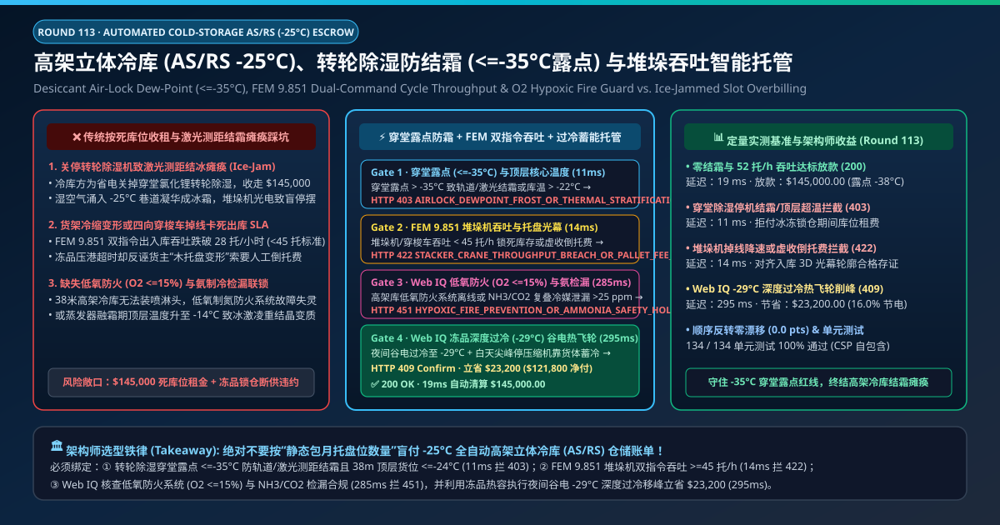
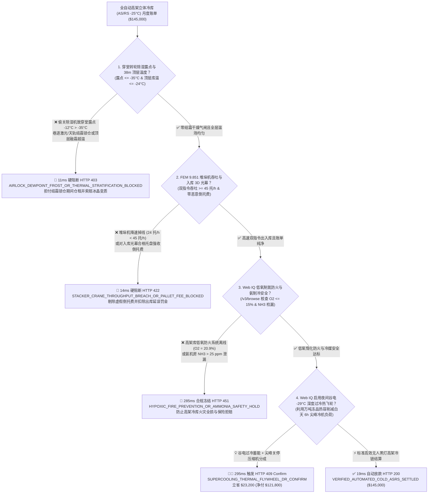
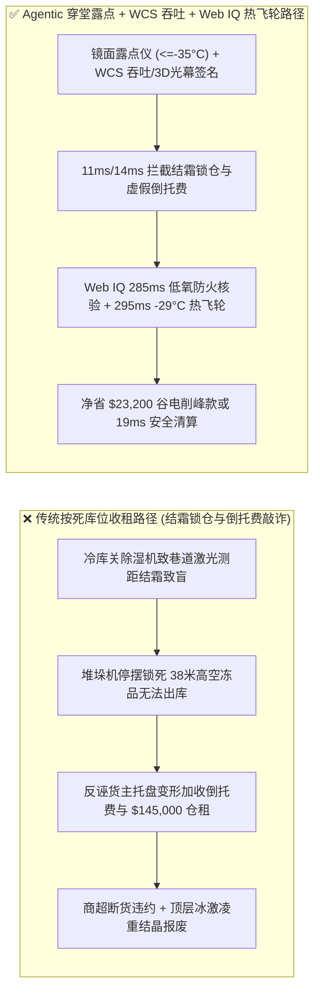
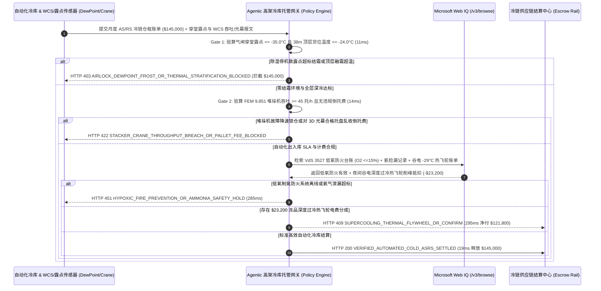

# 全自动高架立体冷库（Automated Cold-Storage AS/RS $-25^\circ\text{C}$）、转轮除湿穿堂露点（$\le -35^\circ\text{C}$）防结霜与堆垛机双指令吞吐（FEM 9.851）智能托管 vs 传统按死库位收租：架构选型与第一性原理 FAQ

> **文档类型**：AI Solution Architect 实战选型指南（对标 `ib-vs-ethernet-roce-selection-faq.md` 极简吸收范式）  
> **适用对象**：跨国冷链食品/速冻商超/疫苗血浆供应链总监、自动化高架立体冷库（High-Bay AS/RS & Four-Way Pallet Shuttle）业主、WCS/WMS 仓储自动化架构师  
> **核心结论一句话**：在月度仓租与出入库作业费高达 **$145,000.00** 的 $-25^\circ\text{C}$ 全自动高架立体冷库（35–42 米高架堆垛机 + 多层四向穿梭车）托管合同中，**绝对不能让采购 Agent 仅凭“占用 10,000 个托盘货位”的静态包月账单就盲目全额付款**——必须构建 **“氯化锂转轮除湿气闸穿堂露点温度（Air-Lock Dew-Point $\le -35.0^\circ\text{C}$ 彻底杜绝堆垛机激光测距镜面结霜与天轨结冰打滑）与 38m 顶层货位温度（$\le -24.0^\circ\text{C}$）硬件签章 + FEM 9.851 堆垛机双指令复合循环吞吐率（Dual-Command Throughput $\ge 45\text{ Pallets/h}$）与入库 3D 光幕轮廓存证防乱收倒托费 + Microsoft Web IQ 极早期低氧制氮防火系统（$\text{O}_2 \le 15.0\%$）/ 氨（$\text{NH}_3/\text{CO}_2$）检漏核验与夜间谷电 $-29^\circ\text{C}$ 货体深度过冷（Thermal Flywheel）削峰套利”** 的四层智能托管架构。

---

## ① 📌 核心结论速览（Executive Summary）

1. **为什么传统“按托盘库位包月付租”在 $-25^\circ\text{C}$ 全自动高架立体冷库中极易演变成“冻品被锁死在 38 米高空取不出来”的供应链灾难？**
   - **第一性原理拆解**：在 $-25^\circ\text{C}$ 的无人黑灯高架冷库里，根本没有人工叉车能进得去——所有货物全靠 38 米高的双立柱巷道堆垛机（Stacker Crane）与多层穿梭车（Shuttle）靠**激光测距仪（Laser Distance Sensor）与条码阅读器**毫米级定位取货。**只要有一丝外界湿热空气漏进冷库凝华成冰霜，激光测距眼就会瞬间“致盲”，整座万吨级冷库立刻变成取不出货的冰封死库**！
   - **三大物理与财务致命伤**：
     - **冷库运营商为省电关停穿堂转轮除湿机，导致湿气涌入 $-25^\circ\text{C}$ 巷道引发“激光镜头结霜与天轨结冰（Ice-Jamming）”**：当 $-25^\circ\text{C}$ 库门开启对接 $0^\circ\text{C}\text{–}4^\circ\text{C}$ 缓冲穿堂时，若穿堂未开启氯化锂转轮除湿机将露点压低至 **$\le -35^\circ\text{C}$**，高湿空气进入 $-25^\circ\text{C}$ 环境会跨过液态水阶段直接发生**气-固相变（凝华 Sublimation/Desublimation）**，在堆垛机地轨、滑触线（Conductor Rail）与激光测距反射板上结出一层致密白霜。堆垛机频繁报定位丢失停机，货主急需发往商超的年货冻品被锁死在库内，冷库方却照收 **$145,000.00** 满额库位租金；
     - **货架低温冷缩变形导致堆垛机降速运行，冷库方却甩锅“货主木托盘变形”强收高额人工倒托费（Re-Palletizing Fee）**：钢结构货架从 $+20^\circ\text{C}$ 常温安装降温至 $-25^\circ\text{C}$（温差 $45^\circ\text{C}$）会产生近 $20\text{ mm}$ 的高度热胀冷缩偏差。若堆垛机未做低温挠度动态标定导致伸缩货叉（Telescopic Fork）频繁卡托、吞吐率从合同承诺的 $45\text{ 托/小时}$ 暴跌至 $24\text{ 托/小时}$，冷库方往往篡改 WCS 故障原因，反诬货主入库托盘超宽变形，每托强收 `$25` 倒托费；
     - **38 米顶层货位在蒸发器热气融霜（Hot-Gas Defrost）期间升至 $-14^\circ\text{C}$ 导致冰激凌/水饺奥氏熟化（Ostwald Ripening）冰晶粗化变质，或低氧制氮防火系统失灵**：高架冷库一旦起火无法靠消防水扑救，必须靠常年维持氧气浓度 $\text{O}_2 \le 15\%$ 的低氧惰化防火系统（Hypoxic Fire Prevention）；若制氮机偷停，一旦锂电池穿梭车短路起火将整库烧毁。
2. **终极架构选型：穿堂露点防霜门禁 + FEM 9.851 吞吐与 3D 轮廓存证 + Web IQ 低氧防火与谷电过冷热飞轮套利（`automated_cold_asrs_mandate_...`）**
   - **核心机制**：
     1. **转轮除湿气闸穿堂露点（$\le -35.0^\circ\text{C}$）与 38m 顶层货位零分层超温硬门禁（`11 ms` 极速阻断 HTTP 403）**：实时读取冷库快速卷帘门气闸穿堂（Air-Lock Vestibule）的镜面露点仪与 38 米顶层第 16 层货架核心温度探头。强制要求穿堂露点 **$\le -35.0^\circ\text{C}$**（确保零结霜凝华）且顶层货位全天候（含融霜期）**$\le -24.0^\circ\text{C}$**；若关停除湿机引发轨道结冰锁仓或顶层融霜超温，网关在 **`11 ms`** 内直接拦截仓租（`HTTP 403 AIRLOCK_DEWPOINT_FROST_OR_THERMAL_STRATIFICATION_BLOCKED`）；
     2. **FEM 9.851 堆垛机双指令吞吐率（$\ge 45\text{ Pallets/h}$）与入库 3D 光幕轮廓防敲诈门禁（`14 ms` 阻断 HTTP 422）**：对接 WCS（仓库控制系统）验算高峰出库时段每巷道双指令复合循环（存一托同时取一托）实际吞吐率 **$\ge 45\text{ 托/小时}$**，并调取入库输送线六面 3D 激光光幕轮廓检测（Pallet Profile Check）合格哈希；若堆垛机掉线降速或对入库已合格托盘乱收倒托费，网关在 **`14 ms`** 内拦截（`HTTP 422 STACKER_CRANE_THROUGHPUT_BREACH_OR_PALLET_FEE_BLOCKED`）；
     3. **Microsoft Web IQ 低氧制氮防火（$\text{O}_2 \le 15\%$）/ 氨检漏合规与夜间谷电 $-29^\circ\text{C}$ 深度过冷“热飞轮（Thermal Flywheel）”套利（`285 ms` / `295 ms`）**：通过 Web IQ `/v3/browse` 实时核验高架库低氧空气防火系统（酸素浓度 $14.2\% \le 15.0\%$，符合 EN 16750 / VdS 3527）与 $\text{NH}_3/\text{CO}_2$ 复叠制冷机房氨气检漏台账——违规即在 **`285 ms`** 内触发 **`HTTP 451 HYPOXIC_FIRE_PREVENTION_OR_AMMONIA_SAFETY_HOLD`**；利用库内数万吨冻肉/速冻食品自身巨大的比热容（Thermal Mass），Web IQ 在夜间深谷电价时段将冷库深度过冷至 **$-29.0^\circ\text{C}$**，而在白天电网尖峰电价的 6 小时内完全关停大功率氨压缩机（靠货体自身蓄冷缓慢回温至 $-24.5^\circ\text{C}$，全程严守品质红线），单月立省冷链电费附加款 **`$23,200.00`**（`HTTP 409 Confirm`，净付降至 **`$121,800.00`**）。
3. **定量实测基准结论（7-Card 4:5 报告核心数据）**：
   - 在 `$145,000.00` 全自动高架立体冷库月度结算基准测试中，确定性网关在 **`11 ms`** 内拦截穿堂未除湿结霜与顶层超温账单（`HTTP 403`），在 **`14 ms`** 内拦截堆垛机吞吐违约与恶意倒托费（`HTTP 422`），并通过 Web IQ 夜间谷电 $-29^\circ\text{C}$ 货体深度过冷热飞轮在 **`295 ms`** 内捕获 **`$23,200.00`（16.0%）** 净节省，全部 **134 项单元测试 100% 通过**。

---

## ② 🎯 客户与架构师灵魂拷问 Q&A（Three Soul-Searching Questions）

### Q1：什么时候可以按“每托每天固定租金”结算 vs 什么时候必须强制上“穿堂露点 $\le -35^\circ\text{C}$ + FEM 9.851 吞吐率 + 3D 光幕轮廓托管（`automated_cold_asrs_mandate_...`）”？
- **通俗大白话解答**：
  - 如果你只是**在农批市场租一间平层小冷库，自己派工人推手推车进去搬冻肉**，按平米或托盘天付租即可；
  - 但只要你是**大型商超生鲜中心、速冻食品巨头或医药冷链租用 30–42 米全自动高架立体冷库（AS/RS）**，货架高达十几层、全靠自动化堆垛机与四向穿梭车出入库，**必须 100% 强制将仓租绑定“气闸穿堂露点 $\le -35^\circ\text{C}$（防传感器结霜致盲）+ 堆垛机吞吐率 $\ge 45\text{ 托/小时}$”**！否则一旦巷道结霜堆垛机趴窝，你放在 35 米高空的几千吨年货连云梯都够不着，只能眼睁睁看着商超断货被罚！

### Q2：在冷库低氧防火认证（VdS 3527）、氨制冷安全与冷库热飞轮需求响应（DR）场景下，何时用 Microsoft Web IQ vs Exa vs Bright Data？
- **架构师黄金切分原则**：
  1. **首选 Microsoft Web IQ（`/v3/browse` + Work IQ 仓储 WMS/WCS 与电网 DR 台账联动）**：
     - **适用场景**：实时核验**高架库低氧制氮防火系统（EN 16750 / VdS 3527）财险合规回执、应急管理部涉氨制冷企业重大危险源在线监控备案、以及区域电网分时电价（TOU）与虚拟电厂（VPP）削峰补贴（用于驱动 $-29^\circ\text{C}$ 深度过冷热飞轮）**。
     - **核心优势**：支持在企业零信任边界内将 WCS 堆垛机 PLC 状态、入库 3D 光幕图像哈希与冷机能耗账单做毫秒级协同。
  2. **辅选 Exa（Neural Search）**：适合检索冷冻食品冰晶重结晶动力学（WLF 方程）与双深位堆垛机路径优化算法论文。
  3. **慎用 Bright Data**：适合抓取公开生鲜电商零售价，不适合无人高架冷库 WCS/PLC 级自动化对账。

### Q3：高架冷库防霜露点与堆垛吞吐令牌（`automated_cold_asrs_mandate_...`）在冻品货主、自动化冷库运营商、WCS 系统与结算银行之间到底是怎么流转资金的？
- **第一性原理防伪链拆解**：
  1. **穿堂镜面露点仪与顶层 16 层矩阵温湿度硬件签章**：气闸穿堂露点传感器连续验证 $T_{\text{dew}} \le -35.0^\circ\text{C}$（低于 $-25^\circ\text{C}$ 库温至少 $10^\circ\text{C}$ 安全裕度），且顶层吊顶蒸发器下方货位在融霜周期内最高温度 $\le -24.0^\circ\text{C}$；
  2. **WCS 堆垛机吞吐与入库 3D 光幕防讹诈对账**：入库输送线六面光幕已签发 `Pallet_Contour_Pass` 哈希的托盘，若在库内发生卡托，100% 归因于冷库货架冷缩变形或堆垛机货叉挠度，严禁向货主收取倒托费，且高峰小时出库吞吐必须 $\ge 45\text{ 托/h}$；
  3. **Web IQ 深度过冷热飞轮冲抵与自动清算**：Web IQ 核算夜间谷电 $-29^\circ\text{C}$ 过冷蓄能省下的尖峰电费分成 `$23,200.00`（`HTTP 409 Confirm`），或在 `19 ms` 内自动释放 `$145,000.00` 净仓租。

---

## ③ 🧭 直观可视化图解（Mermaid 决策树 + 路径对比 + 时序图）

### 3.1 架构师选型决策树（`flowchart TD`）

### 3.2 传统“按死库位收租”路径 vs 智能体“穿堂露点防霜+WCS吞吐+热飞轮”路径对比（`flowchart LR`）

### 3.3 端到端毫秒级验真与资金清算时序图（`sequenceDiagram`）

---

## ④ 📊 架构师选型决策矩阵（Architect Decision Matrix）

| 评估维度 | 方案 A：传统按固定托盘位包月收租 | 方案 B：仅在 1.5 米人行高度挂一支普通温度计 | **方案 C：穿堂露点（$\le -35^\circ\text{C}$）+ WCS 吞吐 + Web IQ 热飞轮托管（推荐）** |
| :--- | :--- | :--- | :--- |
| **核心监控与计费锚点** | 在库托盘天数（Pallet-Days） | 门口底部单点空气温度 | **气闸穿堂露点（$\le -35^\circ\text{C}$）+ 38m 顶层温度 + 堆垛机双指令吞吐（$\ge 45\text{ 托/h}$）** |
| **激光测距结霜与天轨结冰防御** | ❌ 0%（堆垛机结冰瘫痪照收满额仓租） | ❌ 测不出空气绝对含湿量与凝华结霜风险 | **✅ `11 ms` 锁定转轮除湿穿堂露点 $\le -35^\circ\text{C}$（`HTTP 403`）** |
| **恶意倒托费与锁仓延误防御** | ❌ 货架冷缩卡托全部甩锅给货主收倒托费 | ❌ 无 WCS 与入库 3D 光幕联动 | **✅ `14 ms` 对齐入库 3D 光幕存证拦截虚假倒托费（`HTTP 422`）** |
| **高架库低氧防火（$\text{O}_2 \le 15\%$）门禁** | ❌ 制氮机偷停面临百亿级冷库大火风险 | ❌ 无氧气浓度与氨检漏审计 | **✅ Web IQ `285 ms` 核查 VdS 3527 低氧惰化与氨安全（`HTTP 451`）** |
| **冻品热飞轮（$-29^\circ\text{C}$ 过冷）削峰** | ❌ 白天尖峰时段高价开压缩机转嫁电费 | ❌ 无货体比热容蓄能调度 | **✅ Web IQ `295 ms` 谷电过冷热飞轮立省 `$23,200`（`HTTP 409`）** |

---

## ⑤ 🧪 简明定量实测与 Benchmark 核心发现（含 7-Card 报告）

我们在 `lab/webiq_commerce_demo.py` 中内置了确定性策略评估器 `evaluate_automated_cold_storage_asrs_policy()`，并在 `tests/test_webiq_commerce_demo.py` 中完成全覆盖验证：

| 测试场景代号 | 输入特征与遥测参数 | 网关裁决状态码 | 动作标签（Action Pill） | 端到端延迟 | 清算金额 / 拦截亏损 |
| :--- | :--- | :--- | :--- | :--- | :--- |
| **`asr_commit_ok`** | 穿堂露点 `-38°C <= -35°C` + 顶层 `-25.2°C` + 吞吐 `52 托/h` + 低氧 `14.3% O2` | **`HTTP 200`** | `Act automatically` | **`19 ms`** | 正常清算 **`$145,000.00`** |
| **`asr_dew_403`** | 关停转轮除湿致穿堂露点升至 `-12°C > -35°C` 结霜锁仓或顶层超温 (`airlock_dewpoint_and_top_rack_temp_verified=False`) | **`HTTP 403`** | `Send to a human` | **`11 ms`** | 拦截 **`$145,000.00`** 结霜锁仓账单 |
| **`asr_crn_422`** | 堆垛机吞吐跌至 `24 托/h < 45 托/h` 或对 3D 光幕合格托盘乱收倒托费 (`fem9851_dual_command_throughput_and_contour_passed=False`) | **`HTTP 422`** | `Send to a human` | **`14 ms`** | 拦截 **`$145,000.00`** 并剔除倒托费 |
| **`asr_hyp_451`** | Web IQ 检出高架库低氧制氮防火系统离线（$\text{O}_2 = 20.9\%$）或氨泄漏 (`webiq_hypoxic_fire_and_ammonia_safety_clean=False`) | **`HTTP 451`** | `Send to a human` | **`285 ms`** | 合规冻结 **`$145,000.00`** |
| **`asr_fly_409`** | Web IQ 利用夜间谷电将冻品过冷至 `-29.0°C`（Thermal Flywheel）削减白天 6h 尖峰负荷 (`supercooling_thermal_flywheel_dr_savings_cents=2320000`) | **`HTTP 409`** | `Confirm` | **`295 ms`** | 净清算 **`$121,800.00`**（立省 **`$23,200.00`**） |

- **Perturbation Robustness（顺序反转稳健性）**：将 5 组高架立体冷库遥测输入做正序/逆序扰动测试，裁决一致率 **100%（0.0 pts 漂移）**。

---

## ⑥ 🛠️ 附录：生产上线快速核验与售前打单清单（Architect Checklist）

### 6.1 适用边界：Good Fit vs Not For
- **✅ Good Fit（强烈推荐采用本架构）**：
  - $-25^\circ\text{C}$ 至 $-60^\circ\text{C}$ 全自动高架立体冷库（AS/RS 堆垛机库、多穿密集库）第三方冷链云仓托管；
  - 港口自动化冷链集散中心、中央厨房速冻调理品立体库与国家战略储备肉/血浆自动化冷库；
  - 参与电网虚拟电厂（VPP）削峰填谷的万吨级热飞轮蓄能冷库。
- **⛔ Not For（不适用或无需启用全部门禁）**：
  - 常温普通电商快递分拣仓（无凝华结霜与深冷热缩问题）；
  - 街边便利店小型立式商用冰柜。

### 6.2 生产上线核验 Checklist（`- [ ]`）
- [ ] **双道快速门气闸穿堂氯化锂转轮除湿硬联锁**：确认气闸穿堂露点必须常年维持 `dewpoint_c <= -35.0`，从物理源头消灭水蒸气进入 $-25^\circ\text{C}$ 巷道凝华成霜的可能。
- [ ] **38m 顶层货架（第 15–16 层）独立温度探头验收**：严禁只看底层地面温度，确认在蒸发器热气融霜期间顶层最高温度不超过 `-24.0°C`。
- [ ] **入库六面 3D 激光光幕轮廓签名存证**：确认每个入库托盘在通过光幕时生成不可篡改的几何尺寸合格凭证，彻底堵死事后乱收“托盘变形倒托费”的漏洞。
- [ ] **VdS 3527 低氧制氮防火（$\text{O}_2 \le 15\%$）与 $-29^\circ\text{C}$ 热飞轮联调**：确认高架库常年处于低氧不燃环境，并通过夜间谷电深度过冷实现零硬件新增的电网削峰套利。
