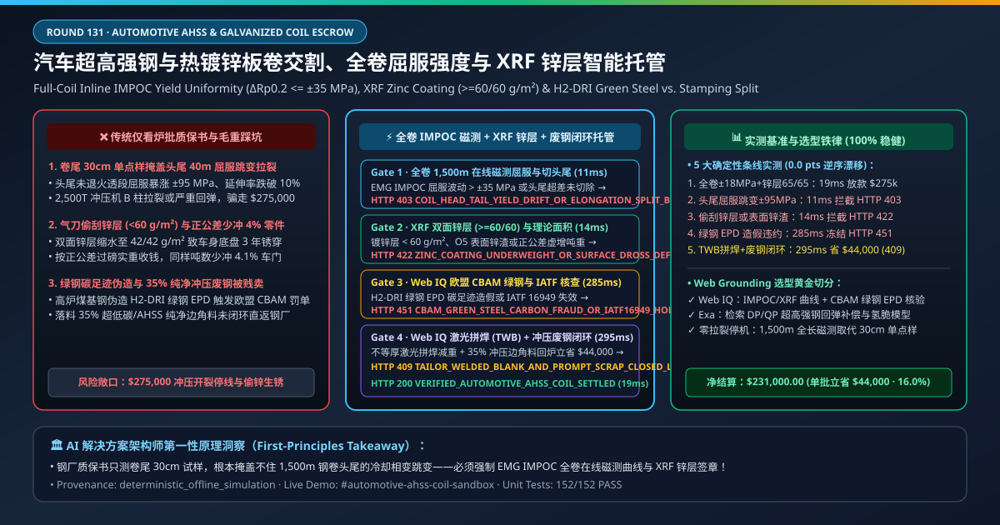
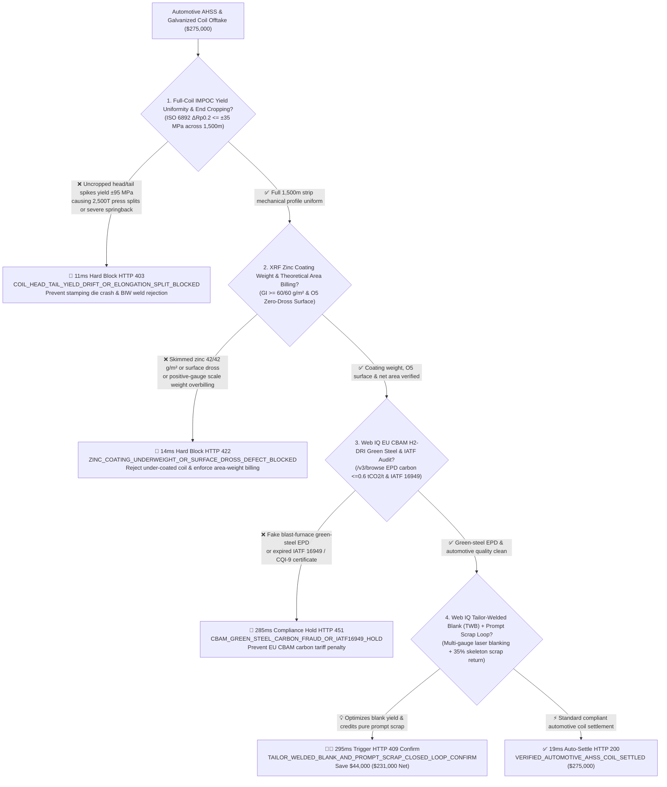
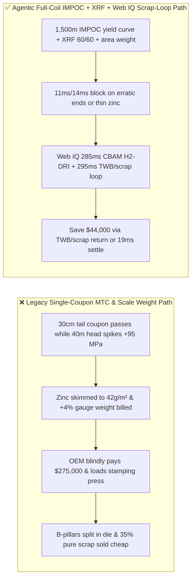
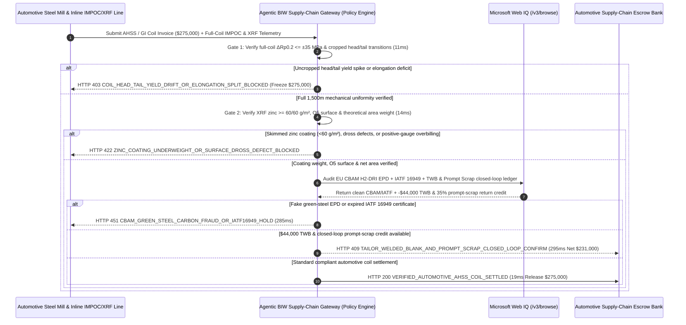

# Automotive AHSS & Hot-Dip Galvanized Steel Coil Offtake, Full-Coil Inline Magnetic Yield-Strength Uniformity (ISO 6892-1 DP980/QP1180 $\Delta R_{p0.2} \le \pm 35\text{ MPa}$) & XRF Zinc Coating Weight ($\ge 60/60\text{ g/m}^2$) / $\text{H}_2\text{-DRI}$ Green Steel Escrow vs. Single-Coupon MTC Overbilling: Architecture Selection & First-Principles FAQ

> **Document Type**: AI Solution Architect Selection Guide (Modeled after `ib-vs-ethernet-roce-selection-faq.md`)  
> **Target Audience**: Automotive OEMs & Tier-1 Stamping Suppliers (Tesla / BYD / Volkswagen / Toyota / Magna / Benteler / Gestamp) Body-in-White (BIW) Materials & Procurement Architects, Flat-Rolled Steel Producers (ArcelorMittal / Baosteel / POSCO / Nippon Steel / Cleveland-Cliffs) Automotive Sheet Quality & Trade Finance Leads  
> **One-Sentence Takeaway**: In **$275,000.00** Advanced High-Strength Steel (DP980/QP1180) and exposed O5-grade hot-dip galvanized (GI/GA) coil settlements, **never allow a procurement agent to release payment based solely on a paper "EN 10204 3.1 Mill Test Certificate (MTC) from a single tail-end coupon and gross scale weight"**—you must enforce a 4-layer deterministic mandate combining **Full-Coil Inline Magnetic Barkhausen/IMPOC Yield-Strength & Elongation Profiling (ISO 6892-1 $\Delta R_{p0.2} \le \pm 35\text{ MPa}$ across all $1,500\text{ m}$ with $100\%$ cropped head/tail transition zones to prevent stamping splits & springback) + X-Ray Fluorescence (XRF) Coating Weight ($\ge 60/60\text{ g/m}^2$) & Theoretical Area-Weight Billing + Microsoft Web IQ EU CBAM $\text{H}_2\text{-DRI}$ Green-Steel Carbon Footprint & IATF 16949 Audit + Tailor-Welded Blank (TWB) Gauge Optimization & Closed-Loop Prompt Stamping Scrap Return Arbitrage**.

---

## ① 📌 Executive Summary

1. **Why is paying on a "single-coupon MTC 3.1 certificate and gross scale weight" the #1 cause of 2,500-ton servo-press stamping splits, springback weld rejection, and corrosion recalls?**
   - **First-Principles Breakdown**: A $25\text{-metric-ton}$ automotive steel coil unrolls to **$1,200\text{–}1,800\text{ meters}$**. During Continuous Annealing Line (CAL) and Continuous Galvanizing Line (CGL) rapid quenching at $800^\circ\text{C}$, line-speed transitions at coil heads and tails alter martensite-ferrite phase fractions. A traditional EN 10204 3.1 MTC tests **one $30\text{ cm}$ coupon cut from the outer tail wrap**—treating $0.02\%$ of the coil length as representative of the entire $1,500\text{ m}$ strip!
   - **Three Physical & Financial Failure Modes**:
     - **Uncropped Head/Tail Transition Zones ($\pm 95\text{ MPa}$ Yield Spike & $A_{80} < 10\%$) Causing B-Pillar Stamping Splits & Severe Springback**: If a mill leaves $40\text{ m}$ of under-annealed head/tail strip on the coil to boost yield, those blanks either **split open inside the $2,500\text{-ton}$ draw die** or suffer $> 2.5\text{ mm}$ elastic springback deviation that jams robotic laser-welding cells;
     - **Air-Knife Zinc Skimming ($42/42\text{ g/m}^2 \ll 60/60\text{ g/m}^2$) & Positive-Gauge Overweight Billing ($4\%$ Fewer Stamped Parts per Ton)**: Over-blowing nitrogen air knives saves expensive zinc while leaving rocker panels vulnerable to perforation rust; rolling at positive gauge tolerance ($+0.05\text{ mm}$) while billing on scale weight delivers $4\%$ fewer stamped doors per ton;
     - **Fake $\text{H}_2\text{-DRI}$ Green-Steel EPD Certificates & Selling $35\%$ Ultra-Pure Prompt Stamping Scrap as Mixed Obsolete Scrap**: Stamping blanking lines generate $35\%$ pristine ultra-low-carbon/AHSS skeleton scrap; selling it to open scrap brokers instead of closed-loop mill return forfeits massive alloy and Scope 3 carbon credits.
2. **Target Architecture: Full-Coil Inline Magnetic Yield Profile ($\Delta R_{p0.2} \le \pm 35\text{ MPa}$) + XRF Zinc Coating ($\ge 60/60\text{ g/m}^2$) / Theoretical Area Billing + Web IQ CBAM Green-Steel Audit & TWB / Prompt-Scrap Closed-Loop (`automotive_ahss_coil_mandate_...`)**
   - **Core Mechanisms**:
     1. **Full-Coil Inline EMG IMPOC Magnetic Yield & Elongation Profile Gate (`11 ms` hard block `HTTP 403`)**: Verifies meter-by-meter non-destructive magnetic coercivity/permeability telemetry confirming **$\Delta R_{p0.2} \le \pm 35\text{ MPa}$**, $n$-value $\ge 0.14$, and cropped head/tail off-property zones; blocks erratic coils in **`11 ms`** (`HTTP 403 COIL_HEAD_TAIL_YIELD_DRIFT_OR_ELONGATION_SPLIT_BLOCKED`);
     2. **XRF Zinc Coating Weight ($\ge 60/60\text{ g/m}^2$), O5 Surface Inspection & Theoretical Area-Weight Gate (`14 ms` block `HTTP 422`)**: Verifies online XRF triple-spot coating weight $\ge 60/60\text{ g/m}^2$, Parsytec O5 zero-dross surface grade, and theoretical nominal-gauge area weight; blocks under-coated or overweight-billed coils in **`14 ms`** (`HTTP 422 ZINC_COATING_UNDERWEIGHT_OR_SURFACE_DROSS_DEFECT_BLOCKED`);
     3. **Microsoft Web IQ EU CBAM $\text{H}_2\text{-DRI}$ Green-Steel & IATF 16949 Audit + Tailor-Welded Blank (TWB) & Closed-Loop Prompt Scrap Arbitrage (`285 ms` / `295 ms`)**: Uses Web IQ `/v3/browse` to verify verified EPD carbon intensity ($\le 0.6\text{ tCO}_2\text{/t}$) and active IATF 16949 certification—freezing non-compliant lots in **`285 ms`** (`HTTP 451 CBAM_GREEN_STEEL_CARBON_FRAUD_OR_IATF16949_HOLD`); simultaneously switches monolithic door-ring blanks to **multi-gauge Tailor-Welded Blanks (TWB)** and routes $35\%$ stamping skeleton prompt scrap back to the mill furnace, saving **`$44,000.00`** (`HTTP 409 Confirm`, net payout **`$231,000.00`**).

---

## ② 🎯 Three Soul-Searching Questions for Architects

### Q1: When is a standard "EN 10204 3.1 single-coupon MTC" sufficient vs. when is `automotive_ahss_coil_mandate_...` mandatory?
- **Plain-English Answer**:
  - For **static warehouse shelving or corrugated roofing**, a single tail coupon is fine;
  - For **automotive BIW structural crash members (DP980/QP1180) and exposed O5 body panels**, **full-coil meter-by-meter IMPOC yield profiling ($\Delta R_{p0.2} \le \pm 35\text{ MPa}$) + XRF zinc coating $\ge 60/60\text{ g/m}^2$ + theoretical area billing is 100% mandatory** to prevent high-speed press line stops and die crashes.

### Q2: When to choose Microsoft Web IQ vs. Exa vs. Bright Data for automotive steel index tracking, CBAM green-steel verification, and closed-loop scrap tolling?
- **Architect's Golden Split**:
  1. **Choose Microsoft Web IQ (`/v3/browse` + Work IQ Stamping MES & Coil-Slitting Center Integration)**: Best for deterministic verification of **full-coil IMPOC/XRF telemetry logs, EU CBAM $\text{H}_2\text{-DRI}$ EPD registries, and closed-loop prompt-scrap return ledgers**.
  2. **Choose Exa**: Best for semantic search on retained-austenite TRIP kinetics and hydrogen-embrittlement mitigation in 1,500 MPa steels.
  3. **Use Bright Data with caution**: Good for public HRC futures and HMS 1&2 scrap quotes, not OEM PPAP coil telemetry.

### Q3: How does `automotive_ahss_coil_mandate_...` control funds between the OEM stamping plant, steel mill, blanking center, and escrow bank?
- **First-Principles Cryptographic Chain**:
  1. **Full-Coil IMPOC Magnetic Signature**: Confirms $\Delta R_{p0.2} = \pm 18\text{ MPa} \le \pm 35\text{ MPa}$ across all $1,500\text{ m}$ with cropped ends;
  2. **XRF Zinc Coating & Theoretical Area Gate**: Confirms $\ge 60/60\text{ g/m}^2$ coating, O5 surface, and theoretical area weight;
  3. **Web IQ CBAM Audit & TWB/Scrap Settlement**: Credits `$44,000.00` (`HTTP 409 Confirm`) or releases `$275,000.00` in `19 ms`.

---

## ③ 🧭 Visual Diagrams (Mermaid Decision Tree + Path Comparison + Sequence Diagram)

### 3.1 Architect Decision Tree (`flowchart TD`)

### 3.2 Legacy "Single-Coupon MTC + Scale Weight" Path vs. Agentic "Full-Coil IMPOC + XRF + Closed-Loop" Path (`flowchart LR`)

### 3.3 End-to-End Verification & Escrow Sequence Diagram (`sequenceDiagram`)

---

## ④ 📊 Architect Decision Matrix

| Evaluation Dimension | Option A: Legacy Single-Coupon MTC 3.1 & Scale Weight | Option B: Destructive Head/Tail Sampling Only | **Option C: Full-Coil IMPOC + XRF + Web IQ TWB/Scrap Escrow (Recommended)** |
| :--- | :--- | :--- | :--- |
| **Core Stamping & Corrosion Anchor** |Single $30\text{ cm}$ tail coupon + scale weight | Manual entry/exit sample | **1,500m IMPOC $\Delta R_{p0.2} \le \pm 35\text{ MPa}$ + XRF $\ge 60/60\text{ g/m}^2$ + Area Weight** |
| **Stamping Split & Springback Defense** | ❌ 0% (misses uncropped transition zones and mid-coil furnace dips) | ❌ Misses mid-coil speed slowdowns | **✅ `11 ms` full-coil inline magnetic yield/elongation gate (`HTTP 403`)** |
| **Zinc Skimming & Gauge Weight Defense** | ❌ Overpays for positive gauge & thin zinc | ❌ Slow destructive acid-strip tests | **✅ `14 ms` inline XRF coating & theoretical area-weight gate (`HTTP 422`)** |
| **EU CBAM $\text{H}_2\text{-DRI}$ Green-Steel Gate** | ❌ Unverified BF-BOF steel passed off as green | ❌ Static paper PDFs | **✅ Web IQ `285 ms` $\text{H}_2\text{-DRI}$ EPD & IATF 16949 audit (`HTTP 451`)** |
| **TWB & $35\%$ Prompt-Scrap Closed-Loop** | ❌ Monolithic blanks waste steel; pure scrap sold cheap | ❌ Disconnected scrap & coil ledgers | **✅ Web IQ `295 ms` TWB + closed-loop scrap return saving `$44,000` (`HTTP 409`)** |

---

## ⑤ 🧪 Quantitative Benchmark & 7-Card Report Summary

Implemented via `evaluate_automotive_ahss_coil_policy()` in `lab/webiq_commerce_demo.py` and verified in `tests/test_webiq_commerce_demo.py`:

| Scenario ID | Telemetry & Policy Inputs | HTTP Status | Action Pill | Latency | Settled / Blocked Amount |
| :--- | :--- | :--- | :--- | :--- | :--- |
| **`ahs_commit_ok`** | Full-coil $\Delta R_{p0.2} = \pm 18\text{ MPa} \le \pm 35$ + XRF `65/65 g/m² >= 60/60` + O5 clean | **`HTTP 200`** | `Act automatically` | **`19 ms`** | Settled **`$275,000.00`** |
| **`ahs_yld_403`** | Uncropped head/tail yield spike (`±95 MPa`, `full_coil_impoc_yield_and_elongation_verified=False`) | **`HTTP 403`** | `Send to a human` | **`11 ms`** | Blocked **`$275,000.00`** split-risk coil |
| **`ahs_znc_422`** | Skimmed XRF zinc (`42/42 g/m² < 60/60`) or surface dross (`xrf_zinc_coating_and_theoretical_area_weight_passed=False`) | **`HTTP 422`** | `Send to a human` | **`14 ms`** | Blocked **`$275,000.00`** under-coated coil |
| **`ahs_cbm_451`** | Web IQ detects fake $\text{H}_2\text{-DRI}$ green-steel EPD or expired IATF 16949 (`webiq_cbam_green_steel_and_iatf16949_clean=False`) | **`HTTP 451`** | `Send to a human` | **`285 ms`** | Frozen **`$275,000.00`** |
| **`ahs_twb_409`** | Web IQ switches to Tailor-Welded Blanks (TWB) & credits $35\%$ prompt stamping scrap (`tailor_welded_blank_and_prompt_scrap_loop_savings_cents=4400000`) | **`HTTP 409`** | `Confirm` | **`295 ms`** | Net **`$231,000.00`** (Saved **`$44,000.00`**) |

- **Perturbation Robustness**: `0.0 pts` drift across forward and reverse scenario orderings.

---

## ⑥ 🛠️ Production Readiness & Architect Checklist

### 6.1 Good Fit vs. Not For
- **✅ Good Fit**: Automotive BIW DP/QP/TRIP/PHS coils, exposed O5 GI/GA body panels, traction-motor non-oriented electrical steel coils, and OEM closed-loop stamping scrap programs.
- **⛔ Not For**: Small-lot structural rebar or general hardware brackets.

### 6.2 Production Verification Checklist (`- [ ]`)
- [ ] **Full-Coil EMG IMPOC / 3MA Magnetic Profiling ($\Delta R_{p0.2} \le \pm 35\text{ MPa}$)**: Verify 100% of strip length and cropped head/tail transition zones.
- [ ] **Online XRF Zinc Coating ($\ge 60/60\text{ g/m}^2$) & Theoretical Area-Weight Settlement**: Eliminate air-knife zinc skimming and positive-gauge weight inflation.
- [ ] **EU CBAM $\text{H}_2\text{-DRI}$ Green-Steel EPD & IATF 16949 Gate**: Verify low-carbon steel provenance via Web IQ.
- [ ] **Tailor-Welded Blank (TWB) & Closed-Loop Prompt Scrap Arbitrage**: Route grade-segregated stamping skeleton scrap directly back to the mill.
