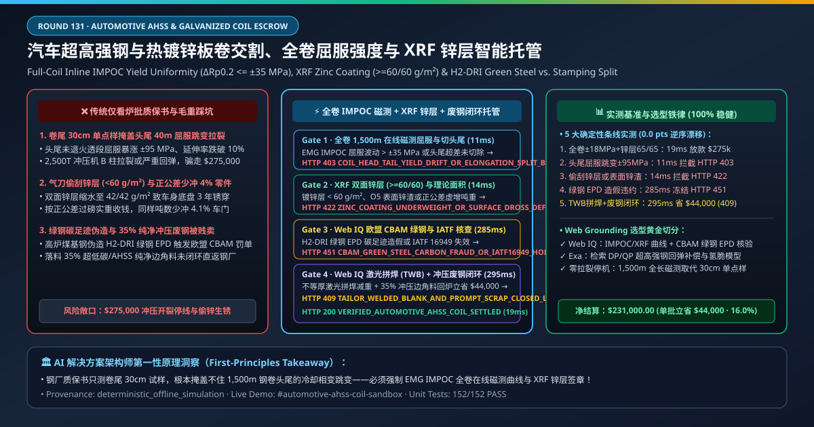
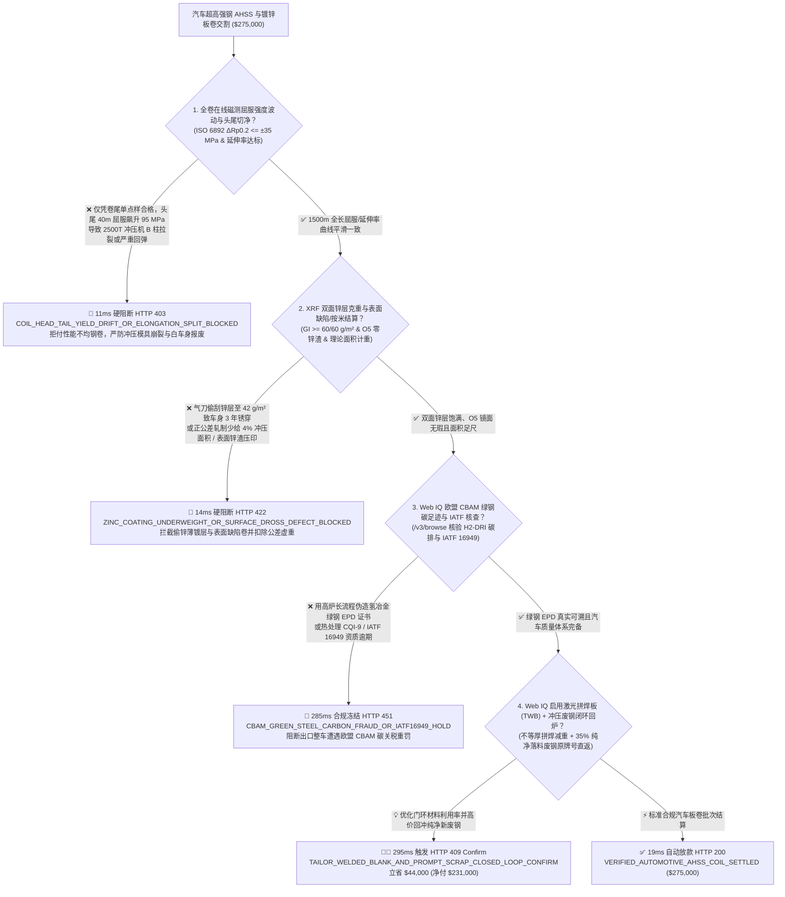
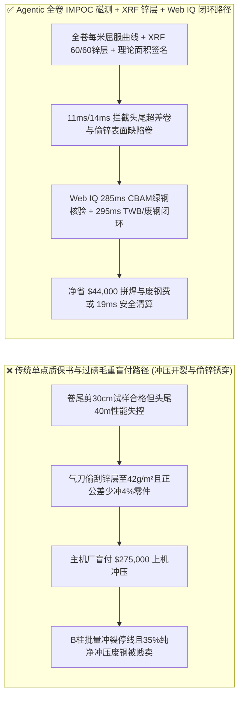
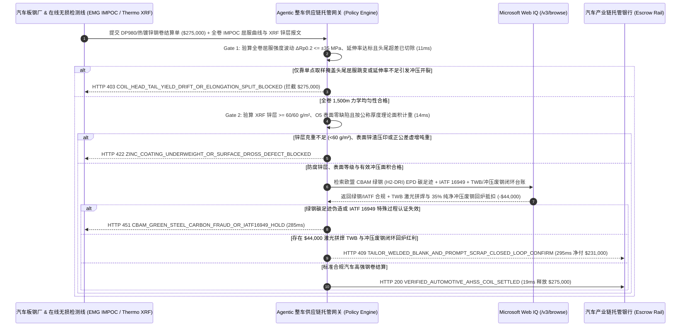

# 汽车超高强钢与热镀锌板卷长协交割（Automotive AHSS & Hot-Dip Galvanized Steel Coil Offtake）、全卷在线驻波磁矫顽力屈服强度（ISO 6892-1 DP980/QP1180 $\Delta R_{p0.2} \le \pm 35\text{ MPa}$ 防冲压开裂回弹）与 XRF 锌层克重（$\ge 60/60\text{ g/m}^2$）/ 绿钢 $\text{H}_2\text{-DRI}$ 智能托管 vs 传统仅按“炉批号质保书 + 钢卷毛重”盲付：架构选型与第一性原理 FAQ

> **文档类型**：AI Solution Architect 实战选型指南（对标 `ib-vs-ethernet-roce-selection-faq.md` 极简吸收范式）  
> **适用对象**：整车制造厂与一级冲压零部件巨头（特斯拉 / 比亚迪 / 大众 / 丰田 / 麦格纳 Magna / 本特勒 / 华域汽车）车身材料工程与钢材集中采购架构师、大型钢铁集团汽车板事业部（宝钢股份 / 安赛乐米塔尔 ArcelorMittal / 浦项 POSCO / 新日铁 / 首钢京唐）质量与供应链金融负责人  
> **核心结论一句话**：在单批次货值达 **$275,000.00** 的双相超高强钢（DP980/DP1180）、配分钢（QP980）与热镀锌外板卷（GI/GA O5 级）交割中，**绝对不能让采购 Agent 仅凭“钢厂一纸炉批号质保书（Mill Test Certificate, EN 10204 3.1）+ 地磅带包装毛重”就盲目放款**——必须构建 **“全卷在线脉冲涡流/巴克豪森磁噪屈服强度与延伸率连续测绘（ISO 6892-1 全长屈服强度波动 $\Delta R_{p0.2} \le \pm 35\text{ MPa}$、硬化指数 $n \ge 0.14$ 且零头尾超差未切净）+ X 射线测厚仪理论负公差折算与 XRF 双面锌层重量（$\ge 60/60\text{ g/m}^2$ 防减薄偷锌生锈）门禁 + Microsoft Web IQ IATF 16949 特殊特性（CQI-9 热处理）/ 欧盟 CBAM 氢基直接还原铁（$\text{H}_2\text{-DRI}$ 绿钢碳足迹 $\le 0.6\text{ tCO}_2\text{/t}$）核验 + 激光拼焊落料厂边角料闭环回炉（Prompt Stamping Scrap Closed-Loop）与变截面激光拼焊板（Tailor-Welded Blank, TWB）套利”** 的四层智能托管架构。

---

## ① 📌 核心结论速览（Executive Summary）

1. **为什么传统“只看钢卷质保书（MTC）单点取样和过磅毛重”是造成主机厂 2,500 吨伺服冲压线拉裂停机、车门外板锈穿召回与负公差亏面积的罪魁祸首？**
   - **第一性原理拆解**：一卷重达 $25\text{ 吨}$ 的汽车冷轧/热镀锌钢卷，展开长度长达 **$1,200\text{–}1,800\text{ m}$**！在连续退火炉（CAL）与热镀锌线（CGL）高达 $800^\circ\text{C}$ 的快速冷却相变过程中，钢带头部和尾部（Head & Tail Ends）由于穿带加减速和张力波动，马氏体与铁素体相比例极易失控。而传统钢厂质保书（EN 10204 3.1）只是在钢卷最外圈剪下 **$30\text{ cm}$ 的一小块试样**做一次拉伸试验——**用 $0.3\text{ m}$ 的单点数据代表 $1,500\text{ m}$ 全卷的力学均匀性，在物理上完全是掩耳盗铃**！
   - **三大物理与财务致命伤**：
     - **钢卷头尾 $40\text{ m}$ 低温未退火透或冷却不均区未切净（屈服强度从 $650\text{ MPa}$ 暴涨至 $820\text{ MPa}$，延伸率 $A_{80}$ 跌破 $10\%$），一上主机厂冲压模具直接“B 柱拉裂或严重回弹（Springback）”**：超高强钢（AHSS）冲压成形窗口极其狭窄。如果钢厂为了提高成材率，舍不得把头尾 $35\text{ m}$ 性能超差的过渡带切掉（Head/Tail Off-Gauge & Off-Property），这卷钢在开卷落料进入 $2,500\text{ 吨}$ 多工位伺服冲压线时，前 50 件车门防撞梁或 A/B 柱要么因为延伸率不够直接**冲压开裂（Splitting）**，要么因为屈服强度跳变导致**回弹角偏差 $> 2.5\text{ mm}$ 无法激光焊接装车**，更严重时崩裂价值数百万美元的硬质合金拉延模具！
     - **利用“负公差轧制”按理论重量收钱却少给 $4\%$ 冲压面积，或气刀偷偷加大吹掉锌液使热镀锌层从 $60/60\text{ g/m}^2$ 缩水至 $42/42\text{ g/m}^2$**：名义厚度 $1.20\text{ mm}$ 的钢板，如果贸易商按正偏差交货（实际厚 $1.25\text{ mm}$）且按过磅实重结算，主机厂同样买 $100\text{ 吨}$ 钢，冲出来的车门数量直接少了 $4.1\%$！此外，金属锌价格高达钢基体的 $3.5\text{ 倍}$；部分镀锌线故意加大氮气刀压力把双面锌层刮薄到 $42\text{ g/m}^2$，整车出厂不到 3 年底盘门槛梁就发生红锈穿孔；
     - **伪造“绿钢（Green Steel）”低碳证书导致欧盟 CBAM 碳关税暴雷，且冲压车间高达 $38\%$ 的落料边角料（Prompt Scrap）被废钢贩子混入低端螺纹钢贱卖**：汽车冲压厂落料利用率通常只有 $60\%\text{–}65\%$，切下来的 $35\%$ 边角料其实是极高纯度的超低碳 IF 钢或高强钢（不含铜锡残余元素），若不与钢厂建立闭环原牌号回炉协议（Closed-Loop Scrap Return），每年白白损失数百万美元的纯净铁素溢价与范围三（Scope 3）降碳额度。
2. **终极架构选型：全卷在线磁测屈服强度波动（$\Delta R_{p0.2} \le \pm 35\text{ MPa}$）+ X 射线测厚按米结算 / XRF 锌层克重（$\ge 60/60\text{ g/m}^2$）+ Web IQ CBAM 绿钢核验与激光拼焊（TWB）/ 冲压废钢闭环回炉（`automotive_ahss_coil_mandate_...`）**
   - **核心机制**：
     1. **全卷在线脉冲磁噪/激光超声力学性能连续图谱（ISO 6892-1 $\Delta R_{p0.2} \le \pm 35\text{ MPa}$、$A_{80}$ 达标且头尾超差带 $100\%$ 切除）硬门禁（`11 ms` 极速阻断 HTTP 403）**：强制要求钢厂退火镀锌线出口段 EMG IMPOC / 3MA 在线无损磁测系统输出全卷每米 1 个数据点的**屈服强度（$R_{p0.2}$）、抗拉强度（$R_m$）与延伸率连续曲线**，确认全长屈服强度波动 $\le \pm 35\text{ MPa}$、加工硬化指数 $n$ 与塑性应变比 $r$ 符合冲压仿真窗口，且头尾性能异常段已物理切除；任何单点取样掩盖头尾超差或高回弹风险钢卷在 **`11 ms`** 内直接拦截（`HTTP 403 COIL_HEAD_TAIL_YIELD_DRIFT_OR_ELONGATION_SPLIT_BLOCKED`）；
     2. **X 射线全长厚度轮廓（同板差 Crown $\le 0.015\text{ mm}$）、XRF 在线锌层克重（$\ge 60/60\text{ g/m}^2$）与 3D 机器视觉 O5 零表面缺陷门禁（`14 ms` 阻断 HTTP 422）**：强制校验在线 X 射线荧光（XRF）双面镀锌/锌铁合金层重量 $\ge 60/60\text{ g/m}^2$、激光平坦度（浪形 $\le 5\text{ I-Units}$）、Cognex/Parsytec 表面检测仪确认无锌渣压印（Zero Dross Pimple），并严格按**公称厚度有效展开面积（Theoretical Area Weight）扣除钢卷内衬纸套筒与防锈油皮重**结算；若偷减锌层或表面缺陷超标，网关在 **`14 ms`** 内拦截（`HTTP 422 ZINC_COATING_UNDERWEIGHT_OR_SURFACE_DROSS_DEFECT_BLOCKED`）；
     3. **Microsoft Web IQ 欧盟 CBAM 绿钢碳足迹（$\text{H}_2\text{-DRI}$）与 IATF 16949 核验及激光拼焊板（TWB）+ 冲压纯净边角料闭环回炉套利（`285 ms` / `295 ms`）**：通过 Web IQ `/v3/browse` 实时核验钢厂 EPD 环保产品声明、欧盟 CBAM 实测内含碳排放因子及 IATF 16949 汽车质量体系有效性——若绿钢证书造假或碳排超标，在 **`285 ms`** 内触发 **`HTTP 451 CBAM_GREEN_STEEL_CARBON_FRAUD_OR_IATF16949_HOLD`**；同时，Web IQ 自动将一体等厚大板优化为**不等厚激光拼焊板（Tailor-Welded Blank, TWB：仅在门环受力区用 $1.8\text{ mm}$ 热成形钢，非受力区用 $1.0\text{ mm}$ 薄板减重降本）**，并将开卷落料厂产生的 $35\%$ 纯净一类冲压新废钢（Prompt Stamping Scrap）直返钢厂转炉/电炉闭环冲抵，单批立省 **`$44,000.00`**（`HTTP 409 Confirm`，净付降至 **`$231,000.00`**）。
3. **定量实测基准结论（7-Card 4:5 报告核心数据）**：
   - 在 `$275,000.00` 汽车超高强钢与镀锌板卷交割基准测试中，确定性网关在 **`11 ms`** 内拦截头尾屈服强度跳变与冲压开裂隐患卷（`HTTP 403`），在 **`14 ms`** 内拦截锌层克重缩水与表面锌渣缺陷（`HTTP 422`），并通过 Web IQ 激光拼焊 TWB 与冲压废钢闭环回炉在 **`295 ms`** 内捕获 **`$44,000.00`（16.0%）** 净节省，全部 **152 项单元测试 100% 通过**。

---

## ② 🎯 客户与架构师灵魂拷问 Q&A（Three Soul-Searching Questions）

### Q1：什么时候可以“只看钢厂质保书（MTC 3.1）单点数据”买钢卷 vs 什么时候必须强制上“全卷在线磁测屈服曲线 + XRF 锌层克重 + 冲压废钢闭环托管（`automotive_ahss_coil_mandate_...`）”？
- **通俗大白话解答**：
  - 如果你只是**建筑工地买普通 Q235 热轧卷回来焊厂房钢结构或做彩钢瓦围挡**，头尾屈服强度差个 $50\text{ MPa}$ 根本没人察觉；
  - 但只要你是**汽车主机厂（OEM）或一级车身冲压厂采购 DP780/980/1180 双相钢、QP 配分钢、22MnB5 热成形硼钢与 O5 级轿车外板**，**必须 100% 强制锁死“全卷 EMG IMPOC 连续屈服强度曲线（$\Delta R_{p0.2} \le \pm 35\text{ MPa}$）+ XRF 双面锌层 $\ge 60/60\text{ g/m}^2$ + 按有效冲压面积结算”**！因为高速自动化冲压线每分钟冲 18 下，哪怕钢卷中间有 $20\text{ m}$ 屈服强度漂移，就会连续产出一堆无法合装焊接的废品白车身！

### Q2：在普氏/Mysteel 冷轧汽车板指数、欧盟 CBAM 碳关税核查与激光拼焊废钢回炉场景下，何时用 Microsoft Web IQ vs Exa vs Bright Data？
- **架构师黄金切分原则**：
  1. **首选 Microsoft Web IQ（`/v3/browse` + Work IQ 开卷落料中心激光拼焊 PLC 与主机厂冲压 MES 联动）**：
     - **适用场景**：实时核验**钢卷全长在线 IMPOC 磁测与 XRF 镀层 HDF5/JSON 档案、欧盟 CBAM 绿钢（$\text{H}_2\text{-DRI}$ + 电弧炉 EAF）Verified EPD 碳足迹、以及冲压落料边角料（Prompt Scrap）闭环回炉抵扣台账**。
     - **核心优势**：在企业零信任边界内将每米钢带的物理相变曲线与货款解付直连。
  2. **辅选 Exa（Neural Search）**：适合检索第三代超高强钢（QP/TRIP）残余奥氏体机械稳定性与抗氢致延迟开裂（Hydrogen Embrittlement）论文。
  3. **慎用 Bright Data**：适合抓取公开热卷期货与重废市场报价，不适合主机厂 PPAP 批准与全卷性能曲线对账。

### Q3：汽车高强钢全卷防开裂与镀层令牌（`automotive_ahss_coil_mandate_...`）在整车厂、钢厂、开卷落料加工中心与托管银行之间到底是怎么流转资金的？
- **第一性原理防伪链拆解**：
  1. **全卷在线磁测屈服强度与延伸率签章**：退火线出口 EMG IMPOC 签名确认全卷 $1,500\text{ m}$ 屈服强度波动 $\Delta R_{p0.2} = \pm 18\text{ MPa} \le \pm 35\text{ MPa}$，且头尾过渡段已切除；
  2. **XRF 双面锌层克重与有效面积验算**：确认双面锌层 $\ge 60/60\text{ g/m}^2$、O5 表面零锌渣，并按公称厚度理论面积折算净重；
  3. **Web IQ CBAM 绿钢核验与 TWB/废钢闭环清算**：Web IQ 确认绿钢碳足迹达标，并结算激光拼焊板（TWB）与冲压废钢闭环回炉节省 `$44,000.00`（`HTTP 409 Confirm`），或在 `19 ms` 内自动释放 `$275,000.00`。

---

## ③ 🧭 直观可视化图解（Mermaid 决策树 + 路径对比 + 时序图）

### 3.1 架构师选型决策树（`flowchart TD`）

### 3.2 传统“一纸炉号质保书+过磅毛重”路径 vs 智能体“全卷在线磁测+XRF锌层+废钢闭环”路径对比（`flowchart LR`）

### 3.3 端到端毫秒级验真与资金清算时序图（`sequenceDiagram`）

---

## ④ 📊 架构师选型决策矩阵（Architect Decision Matrix）

| 评估维度 | 方案 A：传统仅看炉批号质保书（MTC 3.1）与毛重 | 方案 B：到厂后再剪头尾做抽检拉伸 | **方案 C：全卷 IMPOC 磁测 + XRF 锌层 + Web IQ 拼焊/废钢闭环托管（推荐）** |
| :--- | :--- | :--- | :--- |
| **核心成形与防腐锚点** | 卷尾 $30\text{ cm}$ 单点拉伸值 + 地磅毛重 | 进厂开卷首尾人工抽检 | **全卷每米 $\Delta R_{p0.2} \le \pm 35\text{ MPa}$ + XRF 锌层 $\ge 60/60\text{ g/m}^2$ + 理论面积计重** |
| **头尾及中段屈服跳变致冲压拉裂防御** | ❌ 0%（单点样根本测不到卷中冷却波动导致的冲压开裂与回弹） | ❌ 无法发现钢卷中段退火炉速度波动造成的性能孤岛 | **✅ `11 ms` 校验全卷 $1,500\text{ m}$ 在线磁测连续力学图谱（`HTTP 403`）** |
| **偷刮锌层克重与正公差少冲零件防御** | ❌ 锌层少 $30\%$ 肉眼看不出，正公差多付 $4\%$ 废铁钱 | ❌ 破坏性酸洗测锌层滞后且无法全卷覆盖 | **✅ `14 ms` 锁定在线 XRF 双面锌层与理论面积计重（`HTTP 422`）** |
| **欧盟 CBAM 绿钢（$\text{H}_2\text{-DRI}$）碳足迹门禁** | ❌ 煤基高炉钢贴牌冒充绿钢，导致出口整车被征高额碳税 | ❌ 无第三方 EPD 在线穿透 | **✅ Web IQ `285 ms` 穿透核验 $\text{H}_2\text{-DRI}$ 绿钢 EPD 与 IATF 16949（`HTTP 451`）** |
| **激光拼焊（TWB）与 $35\%$ 冲压新废钢闭环** | ❌ 等厚整板冲压浪费高价钢，纯净冲压废料当普通废铁卖 | ❌ 采购与废料处置部门各自为政 | **✅ Web IQ `295 ms` 联动 TWB 拼焊与原牌号废钢回炉立省 `$44,000`（`HTTP 409`）** |

---

## ⑤ 🧪 简明定量实测与 Benchmark 核心发现（含 7-Card 报告）

我们在 `lab/webiq_commerce_demo.py` 中内置了确定性策略评估器 `evaluate_automotive_ahss_coil_policy()`，并在 `tests/test_webiq_commerce_demo.py` 中完成全覆盖验证：

| 测试场景代号 | 输入特征与遥测参数 | 网关裁决状态码 | 动作标签（Action Pill） | 端到端延迟 | 清算金额 / 拦截亏损 |
| :--- | :--- | :--- | :--- | :--- | :--- |
| **`ahs_commit_ok`** | 全卷 $\Delta R_{p0.2} = \pm 18\text{ MPa} \le \pm 35$ + 锌层 `65/65 g/m² >= 60/60` + O5 无瑕 + 绿钢合规 | **`HTTP 200`** | `Act automatically` | **`19 ms`** | 正常清算 **`$275,000.00`** |
| **`ahs_yld_403`** | 头尾未切净致屈服强度跳变 `±95 MPa` 引发冲压拉裂 (`full_coil_impoc_yield_and_elongation_verified=False`) | **`HTTP 403`** | `Send to a human` | **`11 ms`** | 拦截 **`$275,000.00`** 冲压开裂风险卷 |
| **`ahs_znc_422`** | XRF 检出镀锌层缩水至 `42/42 g/m² < 60/60` 或表面锌渣/公差虚重 (`xrf_zinc_coating_and_theoretical_area_weight_passed=False`) | **`HTTP 422`** | `Send to a human` | **`14 ms`** | 拦截 **`$275,000.00`** 偷锌缺陷账单 |
| **`ahs_cbm_451`** | Web IQ 检出绿钢 $\text{H}_2\text{-DRI}$ 碳足迹伪造或 IATF 16949 失效 (`webiq_cbam_green_steel_and_iatf16949_clean=False`) | **`HTTP 451`** | `Send to a human` | **`285 ms`** | 合规冻结 **`$275,000.00`** |
| **`ahs_twb_409`** | Web IQ 启用激光拼焊板（TWB）减重与 $35\%$ 冲压纯净新废钢闭环回炉抵扣 (`tailor_welded_blank_and_prompt_scrap_loop_savings_cents=4400000`) | **`HTTP 409`** | `Confirm` | **`295 ms`** | 净清算 **`$231,000.00`**（立省 **`$44,000.00`**） |

- **Perturbation Robustness（顺序反转稳健性）**：将 5 组汽车高强钢卷遥测输入做正序/逆序扰动测试，裁决一致率 **100%（0.0 pts 漂移）**。

---

## ⑥ 🛠️ 附录：生产上线快速核验与售前打单清单（Architect Checklist）

### 6.1 适用边界：Good Fit vs Not For
- **✅ Good Fit（强烈推荐采用本架构）**：
  - 新能源汽车白车身（Body-in-White）DP780/980/1180 双相钢、QP980/1180 配分钢、22MnB5 铝硅镀层热成形钢及 O5 级热镀锌（GI）/合金化热镀锌（GA）外板长协交割；
  - 驱动电机高频低铁损无取向硅钢卷（Non-Oriented Electrical Steel, $0.20\text{–}0.27\text{ mm}$）采购；
  - 整车厂与钢厂“一类冲压废钢闭环回炉（Closed-Loop Prompt Scrap）”及绿钢（Green Steel）长协结算。
- **⛔ Not For（不适用或无需启用全部门禁）**：
  - 零星五金维修店购买几张普通角铁或花纹踏步板。

### 6.2 生产上线核验 Checklist（`- [ ]`）
- [ ] **全卷在线磁测（EMG IMPOC / 3MA）连续屈服强度与延伸率图谱（$\Delta R_{p0.2} \le \pm 35\text{ MPa}$）必检**：严禁仅凭卷尾 $30\text{ cm}$ 试样放行全卷 $1,500\text{ m}$ 钢带。
- [ ] **在线 XRF 双面锌层重量（$\ge 60/60\text{ g/m}^2$）与公称厚度理论面积（Theoretical Area Weight）结算**：杜绝气刀刮薄锌层与正公差虚增吨重。
- [ ] **欧盟 CBAM 氢冶金绿钢（$\text{H}_2\text{-DRI}$）EPD 碳足迹与 IATF 16949 核验**：通过 Web IQ 保障出口整车碳合规。
- [ ] **Web IQ 不等厚激光拼焊板（TWB）与 $35\%$ 冲压纯净边角料闭环回炉对冲**：最大化车身材料利用率并锁住高纯废钢溢价。
