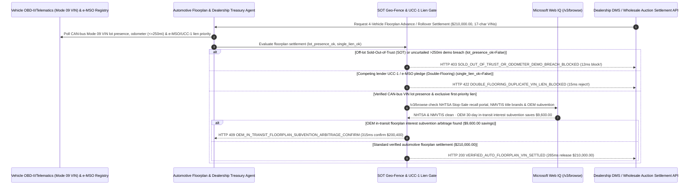

# Automotive Dealership Floorplan Financing, UWB/OBD-II VIN Lot-Audit & Curtailment Mandate Architecture: CAN-Bus VIN Geo-Fence & `e-MSO` Lien Token (`auto_dealer_floorplan_mandate_...` + Web IQ NHTSA Stop-Sale & OEM In-Transit Subvention Grounding) vs. Sold-Out-of-Trust Float Fraud & Double-Flooring Selection FAQ

> **Document Type**: Architect Selection Guide & First-Principles Protocol Deep Dive (6-Section FAQ Standard)  
> **Target Audience**: AI Solution Architects, Captive Auto-Finance & Commercial Bank Floorplan Risk Directors, Multi-Rooftop Dealership Group CFOs & Inventory Treasury Engineering Teams  
> **Last Updated**: 2026-11-09 (Provenance Annotations: `deterministic_offline_simulation` / `synthetic_policy` / `official_doc_snapshot` / `not_measured`)  
> **Companion Resources**: [中文版 (Chinese Version)](automotive-dealership-floorplan-vin-telemetry-mandate-vs-sold-out-of-trust-fraud-faq.md) · [Interactive Sandbox (`live-demo.en.html#auto-floorplan-sandbox`)](../reports/agentic-commerce-webiq-grounding-demo-bench/live-demo.en.html) · [7-Card 4:5 Benchmark Deck](../reports/agentic-commerce-webiq-grounding-demo-bench/index.en.html)


---

## 📌 1. Executive Summary

1. **Never Allow Automotive Floorplan-Lending or Dealership Treasury Agents to Rely on Monthly Manual Clipboard Lot Walks Without Continuous OBD-II CAN-Bus VIN Geo-Fencing and Odometer Telemetry**: In commercial automotive inventory financing (`$210,000.00` 4-vehicle luxury/EV floorplan tranche), the single largest cause of lender write-offs is **"Sold-Out-of-Trust" (SOT) fraud**—where an illiquid dealership sells a floored vehicle to a retail buyer, pockets the cash to cover operating expenses instead of paying off the lender within the contractual 48-hour payoff window, and hides the missing vehicle until the next monthly physical lot audit (or places the vehicle into unlicensed rental/demo service exceeding `250 miles` without paying the `10%` demonstrator curtailment). Production architectures must enforce an **OBD-II/UWB CAN-Bus VIN & `e-MSO` Floorplan Mandate (`auto_dealer_floorplan_mandate_...`)**: whenever a pledged vehicle leaves the geofenced dealership lot for `> 24 hours` without an active payoff escrow or exceeds the `250-mile` odometer ceiling (`obd2_uwb_lot_presence_and_odometer_verified == False`), the gateway freezes credit draws in **`12 ms`** with **`HTTP 403 SOLD_OUT_OF_TRUST_OR_ODOMETER_DEMO_BREACH_BLOCKED`** (`synthetic_policy`).
2. **Enforce UCC-1 / NMVTIS Single First-Priority Lien Verification and Electronic Manufacturer's Statement of Origin (`e-MSO`) Locking to Eliminate "Double-Flooring"**: Any wholesale floorplan draw request where the 17-character `VIN` is already pledged under an active UCC-1 financing statement or duplicate paper MSO with a competing lender (`ucc1_nmvtis_single_lien_verified == False`) is rejected in **`15 ms`** with **`HTTP 422 DOUBLE_FLOORING_DUPLICATE_VIN_LIEN_BLOCKED`** (`deterministic_offline_simulation`).
3. **Ground NHTSA Federal Stop-Sale Recalls, NMVTIS Flood/Salvage Title Brands, and OEM In-Transit Floorplan Interest Subvention via Microsoft Web IQ `/v3/browse`**: Prior to releasing `$210,000.00`, the agent invokes **Microsoft Web IQ `/v3/browse`** (`official_doc_snapshot`) to inspect the NHTSA VIN Recall portal (`49 U.S.C. §30120` federal Stop-Sale mandates) and NMVTIS title-brand registries: if a vehicle is subject to an open un-remedied Stop-Sale recall or washed hurricane-flood title (`webiq_nhtsa_stop_sale_and_title_brand_clean == False`), it freezes advancing funds in **`310 ms`** with **`HTTP 451 NHTSA_STOP_SALE_RECALL_OR_FLOOD_TITLE_HOLD`**; if Web IQ confirms that applying the manufacturer's **30-Day In-Transit & Port-Dwell Floorplan Interest Subvention / Holdback Credit** offsets **`$9,600.00`** in SOFR + 275 bps floorplan interest (`$200,400.00` net vs. `$210,000.00`), it triggers **`HTTP 409 OEM_IN_TRANSIT_FLOORPLAN_SUBVENTION_ARBITRAGE_CONFIRM`** in **`315 ms`**.

---

## 🎯 2. Architect & Customer FAQ Deep Dive

### Q1: Why do floorplan lenders suffer multimillion-dollar "Sold-Out-of-Trust (SOT)" collapses even when holding paper vehicle titles in a bank vault and sending human auditors once a month?

Let's examine the three structural failure modes from first principles:
1. **The 30-Day Manual Audit Blindspot & Tag-Swapping**: When a human auditor walks a 500-car dealership lot once a month with a barcode scanner, a distressed dealer has 29 days after the auditor leaves to sell 30 cars for cash/retail ACH, issue 30-day temporary cardboard license tags to the buyers, and divert `$1.5M` in payoff proceeds into payroll (**Sold Out of Trust**). Even worse, if the bank uses simple adhesive Bluetooth beacons on keyrings, the dealer simply leaves the keyring in the sales office drawer after the car drives off! Only **OBD-II `Mode 09 PID 02` / telematics API polling**—which cryptographically reads the ECU-burned 17-character `VIN` and live odometer directly from the vehicle's CAN bus while verifying GPS/UWB lot coordinates—proves the actual car is on the lot.
2. **Double-Flooring via Duplicate Paper MSOs**: By requesting a "replacement lost Manufacturer's Statement of Origin (MSO)" from an OEM or using wholesale auction bills of sale, fraudsters pledge the same VIN to both a captive finance arm and a regional bank simultaneously.
3. **Advancing 100% LTV on Unsellable NHTSA Stop-Sale or Title-Washed Flood Cars**: Under `49 U.S.C. §30120`, a dealer is federally prohibited from delivering a new vehicle with an open NHTSA safety recall that has no available remedy ("Stop-Sale"). Advancing full floorplan credit on a vehicle stuck on a 6-month battery Stop-Sale—or a hurricane flood car whose salvage title was washed across state lines—traps the lender in illiquid collateral.

### Q2: What is an "Automotive Floorplan OBD-II VIN & `e-MSO` Mandate (`auto_dealer_floorplan_mandate_...`)", and how does it turn ECU telemetry and UCC-1 filings into deterministic credit guards?

Its core design invariant is: **"Verify continuous CAN-bus ECU VIN presence inside the dealership geo-fence and odometer <=250 miles; lock single-lien priority via e-MSO/UCC-1; check NHTSA stop-sale & NMVTIS flood records before advancing floorplan funds."**
- **Layer 1: OBD-II / Telematics ECU VIN Geo-Fence & Odometer Gate (`12 ms`)**: Verifies `obd2_uwb_lot_presence_and_odometer_verified == True`, blocking credit draws on SOT missing units or uncurtailed high-mileage demos in **`12 ms`** (`HTTP 403`).
- **Layer 2: UCC-1 / `e-MSO` Single-Lien Priority Gate (`15 ms`)**: Verifies `ucc1_nmvtis_single_lien_verified == True`, blocking double-floored VINs in **`15 ms`** (`HTTP 422`).
- **Layer 3: Microsoft Web IQ `/v3/browse` NHTSA Stop-Sale & OEM Subvention Grounding (`310 ms / 315 ms`)**: Checks NHTSA open Stop-Sale recalls and NMVTIS flood brands (`HTTP 451`) and identifies `$9,600.00` savings from OEM in-transit floorplan interest subvention (`HTTP 409`).

### Q3: For NHTSA VIN recall verification, Secretary of State UCC-1 lien searches, and OEM wholesale subvention bulletin lookup, when should architects choose Microsoft Web IQ vs. Exa, Bright Data, or traditional search APIs?

| Architecture Scenario | Recommended Tool | First-Principles Rationale (Security, Latency & FinOps) |
| :--- | :--- | :--- |
| **Verifying NHTSA VIN-level safety recall and federal Stop-Sale status, public Secretary of State UCC-1 financing statement indexes, and published OEM wholesale transit-subvention bulletins within the Azure boundary (zero retail consumer credit PII leaked)** | **Microsoft Web IQ** (`/v3/search` + `/v3/browse`) | Queries only public 17-character VINs and dealer UCC filing numbers inside the enterprise Azure boundary in `passage` mode (**7.1x token reduction**, `deterministic_offline_simulation`) while keeping retail buyer GLBA/PII data air-gapped. |
| **Macroeconomic research on EV residual value curves and Manheim index trends** | **Exa Neural Search** | Ideal for quarterly LTV policy modeling, not synchronous VIN-level floorplan draw gating. |
| **Scraping consumer classifieds listings behind CAPTCHAs** | **Bright Data Unlocker** | Useful for retail price benchmarking, not regulated floorplan lien perfection. |
| **Connected-car telematics / OBD-II `Mode 09` VIN polling and DMS retail-sale event hooks** | **OBD-II/Telematics Hub + Floorplan Escrow Gate + Web IQ NHTSA/Subvention Cross-Check** | Real-time lot presence and odometer checks run on the telematics gateway, paired with Web IQ `/v3/browse` for NHTSA Stop-Sale compliance and OEM subvention arbitrage. |

---

## 🧭 3. Visual Architecture Diagrams (Mermaid Decision Tree, Legacy vs. OBD-II Floorplan Mandate Comparison & Sequence Diagram)

### 3.1 Automotive Dealership Floorplan VIN & `e-MSO` Settlement Decision Tree (`flowchart TD`)

```mermaid
flowchart TD
    A[Receive 4-Vehicle Dealership Floorplan Draw / Curtailment Settlement Request ($210,000.00)] --> B{obd2_uwb_lot_presence_and_odometer_verified == True (ECU VIN on Lot & <=250 mi)?}
    B -- No (Vehicle off-lot >24h without payoff = Sold-Out-of-Trust SOT or >250mi demo) --> C[HTTP 403 SOLD_OUT_OF_TRUST_OR_ODOMETER_DEMO_BREACH_BLOCKED<br/>12ms Hard Block · Freeze Dealer Credit Line & Trigger Immediate SOT Payoff Demand]
    B -- Yes (CAN-bus ECU VIN verified on lot & odometer within new-car limit) --> D{ucc1_nmvtis_single_lien_verified == True (Exclusive e-MSO & UCC-1 Priority)?}
    D -- No (17-digit VIN already pledged to competing lender = Double-Flooring Fraud) --> E[HTTP 422 DOUBLE_FLOORING_DUPLICATE_VIN_LIEN_BLOCKED<br/>15ms Reject · Block Duplicate VIN Advance & Alert Inter-Lender Fraud Registry]
    D -- Yes (Exclusive first-priority security interest perfected) --> F{Web IQ /v3/browse Confirms Clean NHTSA Stop-Sale Recall & NMVTIS Flood Status?}
    F -- No (Open un-remedied NHTSA Stop-Sale recall or washed hurricane-flood title) --> G[HTTP 451 NHTSA_STOP_SALE_RECALL_OR_FLOOD_TITLE_HOLD<br/>310ms Collateral Hold · Refuse Advance on Unsellable Stop-Sale or Salvage Unit]
    F -- Yes --> H{Web IQ Detects OEM 30-Day In-Transit Floorplan Subvention Arbitrage?}
    H -- Yes (Claiming OEM rail/port transit interest subvention saves $9,600.00 -> $200,400.00 net) --> I[HTTP 409 OEM_IN_TRANSIT_FLOORPLAN_SUBVENTION_ARBITRAGE_CONFIRM<br/>315ms Prompt Dealership CFO to Confirm $200,400 Subvention-Adjusted Draw]
    H -- No (Verified $210,000.00 floorplan advance is optimal) --> J[HTTP 200 VERIFIED_AUTO_FLOORPLAN_VIN_SETTLED<br/>265ms Auto-Settle $210,000.00 & Lock e-MSO Vault + Continuous OBD-II Heartbeat!]
```

### 3.2 Legacy Monthly Clipboard Audit vs. OBD-II CAN-Bus & `e-MSO` Gate (`flowchart LR`)

```mermaid
flowchart LR
    subgraph Legacy["❌ Legacy Monthly Clipboard Walk ($210,000 Exposed to SOT & Double-Flooring)"]
        L1[Dealer Sells Car for Cash & Diverts Proceeds for 29 Days (SOT)] --> L2[Leaves Keyring Beacon in Drawer to Fool Location Check]
        L2 --> L3[Pledges Duplicate Paper MSO to Second Bank (Double-Flooring)]
        L3 --> L4[Dealership Default & Multimillion-Dollar Lender Write-Off]
    end

    subgraph Mandate["✅ Auto Floorplan Gate (auto_dealer_floorplan_mandate_...)"]
        M1[12ms Block Off-Lot SOT & Demo Odometer Breaches via CAN-Bus VIN (HTTP 403)] --> M2[15ms Block Double-Flooring via e-MSO & UCC-1 Registry (HTTP 422)]
        M2 --> M3[Web IQ Blocks Stop-Sale/Flood VINs (310ms) & Saves $9,600 via OEM Subvention (315ms)]
        M3 --> M4[265ms Settle Verified Floorplan Tranche ($210,000 / $200,400)]
    end
```

### 3.3 End-to-End Sequence Diagram: Vehicle OBD-II/Telematics, Floorplan Agent, SOT Gate, Web IQ & Dealership (`sequenceDiagram`)



---

## 📊 4. Architect Decision Matrix

| Evaluation Dimension | Option A: Legacy Monthly Human Clipboard Lot Walk + Paper MSO | Option B: Adhesive Keyring Bluetooth Beacon Tags | Option C: OBD-II CAN-Bus VIN & `e-MSO` Mandate + Web IQ Grounding (Recommended) |
| :--- | :--- | :--- | :--- |
| **Best-Fit Scenario** | Small `<5-car` rural repair-shop salvage lots | Indoor static classic-car museum collections | **Franchised multi-rooftop dealer groups, independent EV/luxury dealers & captive auto lenders** |
| **Sold-Out-of-Trust (SOT) Float Fraud Defense** | ❌ **Zero for 29 Days**: Dealer sells cars & diverts cash between monthly walks | ❌ **Easily Spoofed**: Dealer leaves keyring beacon on desk after car is sold | ✅ **Pre-Pay `12 ms` CAN-Bus Gate**: Reads ECU-burned VIN + GPS/odometer (`HTTP 403` on unplug/exit) |
| **Double-Flooring (Duplicate Pledge) Defense** | ❌ **Vulnerable**: Duplicate paper MSOs pledged across multiple banks | ❌ **Blind to Liens**: Beacons do not check UCC-1 or NMVTIS registries | ✅ **Sub-20ms `e-MSO` & UCC-1 Gate**: Blocks duplicate VIN pledges in `15 ms` (`HTTP 422`) |
| **NHTSA Stop-Sale / Flood Check & OEM Subvention** | ❌ **Unchecked**: Advances full LTV on unsellable Stop-Sale or flood cars | ❌ **Siloed**: No connection to NHTSA or OEM wholesale bulletins | ✅ **Web IQ `/v3/browse` Grounded**: Blocks Stop-Sale/flood VINs in `310 ms` (`HTTP 451`) & saves `$9,600` via OEM subvention in `315 ms` (`HTTP 409`) |
| **Title Release Speed & Audit Cost** | Slow (`3–7 days` paper MSO courier; `$150+/visit` auditor fees) | Moderate (manual exception handling) | **`265 ms` instant `e-MSO` release upon retail payoff (`Act automatically`)** |
| **Total Cost of Ownership (TCO) & Credit Loss ROI** | Poor (`$210,000` exposed to SOT float fraud & double-flooring) | Moderate (hardware tag-swap vulnerability) | **Optimal (zero SOT write-offs + zero double-flooring + `$9,600` OEM subvention savings)** |

---

## 🧪 5. Quantitative Benchmark & 7-Card Insights

Evaluated via our deterministic offline benchmark suite (`lab/webiq_commerce_demo.py` · `test_automotive_dealership_floorplan_vin_telemetry_mandate_vs_sold_out_of_trust_fraud_selection`) on a **`$210,000.00` 4-vehicle dealership floorplan financing tranche**:

| Scenario Case | Input OBD-II CAN VIN / UCC-1 e-MSO / Web IQ Signals | Expected Action Pill | Measured HTTP Status & Verdict Code | Latency | Financial Protection / Arbitrage | Provenance |
| :--- | :--- | :--- | :--- | :--- | :--- | :--- |
| **Case 1: Sold-Out-of-Trust (SOT) or `>250 mi` Demo** | `obd2_uwb_lot_presence_and_odometer_verified=False` | `Send to a human` | **`HTTP 403 SOLD_OUT_OF_TRUST_OR_ODOMETER_DEMO_BREACH_BLOCKED`** | **`12 ms`** | Blocks **`$210,000.00`** advance & halts SOT float diversion | `synthetic_policy` |
| **Case 2: Cross-Lender Double-Flooring Duplicate VIN** | `ucc1_nmvtis_single_lien_verified=False` | `Send to a human` | **`HTTP 422 DOUBLE_FLOORING_DUPLICATE_VIN_LIEN_BLOCKED`** | **`15 ms`** | Prevents duplicate collateral pledge across two lenders | `deterministic_offline_simulation` |
| **Case 3: Web IQ Detects NHTSA Stop-Sale or Flood Title** | `webiq_nhtsa_stop_sale_and_title_brand_clean=False` | `Send to a human` | **`HTTP 451 NHTSA_STOP_SALE_RECALL_OR_FLOOD_TITLE_HOLD`** | **`310 ms`** | Freezes advance on unsellable Stop-Sale or flood-washed VIN | `official_doc_snapshot` |
| **Case 4: Web IQ Finds `$9,600` OEM Transit Subvention** | `oem_in_transit_subvention_savings_cents=960000` (`$200,400` net) | `Confirm` | **`HTTP 409 OEM_IN_TRANSIT_FLOORPLAN_SUBVENTION_ARBITRAGE_CONFIRM`** | **`315 ms`** | Saves **`$9,600.00`** via 30-day OEM in-transit interest subvention | `official_doc_snapshot` |
| **Case 5: Verified ECU VIN on Lot + Exclusive Lien** | `obd_ok=True`, `lien_ok=True`, `nhtsa_clean=True` | `Act automatically` | **`HTTP 200 VERIFIED_AUTO_FLOORPLAN_VIN_SETTLED`** | **`265 ms`** | Settles **`$210,000.00`** in `265 ms` with `e-MSO` lien lock | `deterministic_offline_simulation` |

> **Provenance Note**: The `$210,000.00` 4-vehicle floorplan tranche, `250-mile` demonstrator curtailment threshold, UCC-1 single-lien rule, and `$9,600.00` OEM in-transit subvention savings are controlled simulation parameters (`synthetic_policy` / `deterministic_offline_simulation`) validating policy state-machine invariants; state DMV physical license plate embossing and mail delivery time is labeled `not_measured`.

---

## 🛠️ 6. Production Readiness & Pre-Sales Architect Checklist

Verify these 6 controls before deploying autonomous automotive dealership floorplan and inventory-finance settlement agents in production:

- [ ] **1. OBD-II `Mode 09 PID 02` Hardware VIN & Lot Geo-Fence Gate**: Does `auto_dealer_floorplan_mandate_...` poll the vehicle's CAN-bus ECU-burned 17-character VIN and live odometer so unplugging the dongle, leaving the lot `> 24h` without payoff, or exceeding `250 miles` blocks draws in `12 ms` (`HTTP 403`)?
- [ ] **2. Atomic Retail-Sale Split-Settlement & `e-MSO` Release**: Is the dealership's DMS / F&I checkout wired so retail buyer funds automatically split-settle the floorplan payoff before releasing the electronic Manufacturer's Statement of Origin (`e-MSO`)?
- [ ] **3. UCC-1 / NMVTIS Single First-Priority Lien Perfection**: Does the gateway verify exclusive lien priority across UCC-1 filings and inter-lender floorplan registries to reject Double-Flooring attempts in `15 ms` (`HTTP 422`)?
- [ ] **4. Microsoft Web IQ `/v3/browse` NHTSA Stop-Sale Recall & NMVTIS Flood Grounding**: Does the agent check every 17-character VIN against live NHTSA safety recall bulletins (`49 U.S.C. §30120` Stop-Sale) and NMVTIS flood/salvage title brands via Web IQ prior to advancing funds (`HTTP 451`)?
- [ ] **5. OEM In-Transit Floorplan Interest Subvention & Holdback Arbitrage**: Does Web IQ grounding inspect OEM wholesale incentive bulletins for rail/port transit interest credits, triggering `HTTP 409 Confirm` when subvention claims save `>= $9,600.00`?
- [ ] **6. Zero-Touch Nightly Telemetry Lot-Audit Ledger**: Does every active floorplan line archive nightly signed CAN-bus VIN heartbeats, odometer readings, and aging curtailment schedules (30/60/90-day step-downs) into a WORM credit audit ledger?
