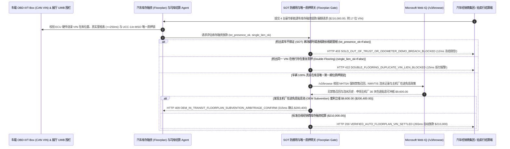

# 汽车经销商库存融资（Automotive Dealership Floorplan Financing）、车架号（VIN）OBD-II/UWB 在库核验与合格证释放（Automotive Dealership Floorplan Financing, UWB/OBD-II VIN Lot-Audit & Curtailment Mandate）架构：电子车辆合格证（e-MSO）赎证锁与 OBD-II 里程/围栏遥测令牌（`auto_dealer_floorplan_mandate_...` + Web IQ NHTSA 禁售召回/水泡车核验与主机厂在途贴息套利）vs 传统人工盘库遭“卖车不赎证挪用（SOT）”与一车多押选型与原理解析 FAQ

> **文档类型**：架构师选型指南 & 协议第一性原理解析（6 段式 FAQ 标准版）  
> **适用读者**：AI Solution Architect、汽车主机厂金融公司（Captive Auto Finance）与商业银行供应链金融（Floorplan Lending）风控总监、大型汽车经销商集团（4S 店集团）司库与库存管理团队  
> **更新日期**：2026-11-09（Provenance 标注：`deterministic_offline_simulation` / `synthetic_policy` / `official_doc_snapshot` / `not_measured`）  
> **配套资源**：[English Version](automotive-dealership-floorplan-vin-telemetry-mandate-vs-sold-out-of-trust-fraud-faq.en.md) · [交互式沙盒控制台 (`live-demo.html#auto-floorplan-sandbox`)](../reports/agentic-commerce-webiq-grounding-demo-bench/live-demo.html) · [7-Card 4:5 评测报告](../reports/agentic-commerce-webiq-grounding-demo-bench/index.html)


---

## 📌 一、核心结论速览（Executive Summary）

1. **严禁让汽车库存融资（Floorplan Lending）或经销商集团司库结算 Agent 依赖“每月一次的信贷员人工拿纸板去停车场抄车架号（Manual Clipboard Lot Audit）”来监管数百万美元的质押库存车（如 4 台豪华新能源 SUV 批次授信提款与续期 `$210,000.00`）**：在汽车 4S 店与大型二手车行供应链金融中，造成银行数千万美元坏账的头号暴雷模式是 **“卖车不赎证 / 挪用回款（Sold-Out-of-Trust, SOT）”**——资金链紧张的经销商周五把一台价值 `$65,000` 的银行质押车卖给消费者收走全款，却瞒着银行不把钱打入监管户赎回合格证（而是挪去发工资、交店租），利用银行盘库员下个月 15 号才来查库的 30 天时间差“拆东墙补西墙”，甚至找同行借同款车摆在车位上应付拍照！生产环境必须采用 **OBD-II/UWB 实时在库围栏与电子合格证（e-MSO）令牌（`auto_dealer_floorplan_mandate_...`）**：一旦车载 T-Box / OBD-II 加密芯片检出质押车辆驶离经销商电子围栏超 24 小时未触发赎证打款、或被私自拿去做长租/试驾车使里程表超 `250 英里` 却未补交 10% 折旧减额金（Curtailment，`obd2_uwb_lot_presence_and_odometer_verified=False`），网关在 **`12 ms`** 内触发 **`HTTP 403 SOLD_OUT_OF_TRUST_OR_ODOMETER_DEMO_BREACH_BLOCKED`**（`synthetic_policy`），立即冻结该店全部授信提款并锁死电子合格证过户。
2. **强制校验“UCC-1 动产抵押登记 / 中登网唯一第一顺位质押与电子合格证（e-MSO / NMVTIS）锁定”，彻底杜绝“一车多押（Double-Flooring）”骗贷**：若不法车商拿挂失补办的纸质车辆合格证（MSO）或拍卖行假发票，把同一个 17 位 `VIN` 车架号同时抵押给主机厂金融公司和地方城商行套取两份贷款（`ucc1_nmvtis_single_lien_verified=False`），网关在 **`15 ms`** 内返回 **`HTTP 422 DOUBLE_FLOORING_DUPLICATE_VIN_LIEN_BLOCKED`**（`deterministic_offline_simulation`）。
3. **基于 Microsoft Web IQ `/v3/browse` 实时核验 NHTSA 联邦强制禁售召回（Stop-Sale Recall）、NMVTIS 跨州飓风泡水/报废车洗白记录与“主机厂在途免息贴息池（OEM In-Transit Floorplan Subvention）”套利**：在放款前，Agent 调用 **Microsoft Web IQ `/v3/browse`**（`official_doc_snapshot`）穿透查询美国国家公路交通安全管理局（NHTSA）按 `VIN` 检索的强制禁售召回令（`49 U.S.C. §30120` 规定存在未修复安全召回的新车严禁交付消费者，一旦收作质押物即成无法变现的死库）及 NMVTIS 泡水损余车记录：若命中禁售召回或水泡记录（`webiq_nhtsa_stop_sale_and_title_brand_clean=False`），在 **`310 ms`** 内以 **`HTTP 451 NHTSA_STOP_SALE_RECALL_OR_FLOOD_TITLE_HOLD`** 冻结放款；若发现申领主机厂商务政策中的 **30 天铁路/海运在途免息期与批发返利（OEM In-Transit Subvention & Holdback Credit）** 可为本批次节省 **`$9,600.00`** 高额融资利息（净支出从 `$210,000.00` 降至 **`$200,400.00`**），则在 **`315 ms`** 内触发 **`HTTP 409 OEM_IN_TRANSIT_FLOORPLAN_SUBVENTION_ARBITRAGE_CONFIRM`**。

---

## 🎯 二、客户与架构师灵魂拷问 Q&A（FAQ-Driven Deep Dive）

### Q1：为什么银行明明把纸质《车辆出厂合格证（MSO）》锁在银行金库里，汽车经销商还是能通过“卖车不赎证（SOT）”和“一车两押”骗走银行几千万？

咱们用大白话拆解汽车供应链金融（Floorplan）里最惊心动魄的三大漏洞：
1. **“先把车钥匙给客户开走，告诉客户合格证下个月再给（Sold-Out-of-Trust）”**：很多外行以为只要银行扣住纸质合格证，4S 店就没法偷卖车。大错特错！当消费者来买车付完 50 万全款时，濒临爆雷的 4S 店老板先把现车和临时牌照交给消费者开回家（借口说“合格证在集团总部走流程，两周后寄给您上铁牌”），然后拿着这名消费者的 50 万现金去发工资或填补上个月的窟窿！等下个月银行派外包盘库员来停车场清点时，老板要么说“这台车今天正好被客户借去深度试驾 24 小时了”，要么在前挡风玻璃下放一张打印的假车架号（VIN）铭牌骗过拍照。直到几十名买主拉横幅围堵 4S 店讨要合格证上牌，银行才发现满院子的质押车早就卖空了！
2. **“用挂失补办的合格证搞一车两押（Double-Flooring）”**：纸质合格证只是一张带二维码的印刷纸。不法车商先拿原件在 A 银行质押贷款 `$210,000`，转头向主机厂谎称“合格证在快递途中遗失”申请补发一张新证，再拿着补发的合格证去 B 金融公司又贷出 `$210,000`！如果不把 17 位 `VIN` 实时锁定在国家级电子产权与动产质押账本（UCC-1 / NMVTIS / 电子合格证系统），两家金融机构就会为一辆车打得头破血流。
3. **收了飓风泡水洗白车或 NHTSA 禁售召回“死库车”**：在二手车与平行进口车质押融资中，飓风过境后大量浸泡在泥水里的豪华车被烘干美容，运到外州换发干净产权证（Title Washing），再以正常二手车批发价向金融公司申请库存融资——一旦放款，这批一文不值的泡水车就直接砸在金融公司手里。

### Q2：什么是“汽车库存融资 OBD-II/UWB 在库与电子合格证令牌（`auto_dealer_floorplan_mandate_...`）”？它是如何实现 7×24 小时零死角控车的？

它的第一性原理非常直接：**“直接从车辆 CAN 总线读取 ECU 硬件烧录的不可篡改 VIN 与真实里程表；结合展厅 UWB/GPS 电子围栏实时监控在库状态；一车一锁绑定全国动产质押登记。”**
- **第一层：OBD-II / 车联网 T-Box 真实 VIN 电子围栏与里程门禁（`12 ms`）**：核验 `obd2_uwb_lot_presence_and_odometer_verified == True`。一旦车辆离开经销商注册围栏超 24 小时未触发赎证还款，或里程突破 `250 英里` 未缴折旧减额金（Curtailment），在 **`12 ms`** 内触发 `HTTP 403` 锁死该店全部授信。
- **第二层：UCC-1 / NMVTIS 全国单一第一顺位质押门禁（`15 ms`）**：核验 `ucc1_nmvtis_single_lien_verified == True`。检出任何他行在先或重复质押记录在 **`15 ms`** 内返回 `HTTP 422`。
- **第三层：Microsoft Web IQ `/v3/browse` NHTSA 禁售召回/泡水核验与在途贴息套利（`310 ms / 315 ms`）**：核查 NHTSA `VIN` 强制禁售召回与 NMVTIS 损余记录（命中触发 `HTTP 451`），并自动匹配主机厂 30 天在途免息贴息政策为您省下 `$9,600.00`（`HTTP 409`）。

### Q3：在 NHTSA 车辆安全召回查询、州务卿 UCC-1 融资声明公开检索与主机厂商务贴息公报核验场景下，什么时候选 Microsoft Web IQ，什么时候选 Exa、Bright Data 或传统搜索 API？

| 架构需求场景 | 推荐选型 | 为什么这样选（第一性原理与成本/合规考量） |
| :--- | :--- | :--- |
| **实时核验美国 NHTSA 官方 17 位 VIN 安全召回与禁售令（Stop-Sale）、州政府公开 UCC-1 融资声明索引及主机厂公开批发免息期/港口滞留贴息公报，且要求零经销商客户购车名单泄露** | **Microsoft Web IQ** (`/v3/search` + `/v3/browse`) | 在金融机构或经销商集团 Azure 专有边界内仅发送公开的 17 位车辆识别代号（VIN）查询（`passage` 模式压缩 Token **7.1x**，`deterministic_offline_simulation`），购车人个人征信（PII）100% 物理隔离。 |
| **检索全球新能源汽车固态电池残值预测宏观白皮书** | **Exa Neural Search** | 适合风险管理部设定年度折旧率参数，无法用于每台车入库放款的毫秒级风控门禁。 |
| **抓取二手车分类信息网站上的个人卖家挂牌价** | **Bright Data Unlocker** | 可用于零售行情参考，但秒级延迟不适合核心信贷放款网关。 |
| **车载 OBD-II / CAN 总线 `Mode 09 PID 02` 硬件 VIN 读取、真实里程与展厅 UWB 信标定位** | **车联网/OBD-II 硬件探针 + 库存信贷网关 + Web IQ 召回/贴息双源核验** | 硬件 VIN 在库校验与里程监控在信贷网关毫秒级完成，外部联邦禁售召回与主机厂在途贴息套利由 Web IQ `/v3/browse` 实时核验。 |

---

## 🧭 三、直观可视化图解（Mermaid 决策树 + 传统人工盘库 vs OBD-II 遥测托管对比 + 端到端时序图）

### 3.1 汽车经销商库存融资（Floorplan）放款与赎证清算决策树（`flowchart TD`）

```mermaid
flowchart TD
    A[收到汽车经销商 4 台豪华新能源车库存质押提款/续期请求 ($210,000.00)] --> B{OBD-II/UWB 是否确认车辆真实在库且未发生卖车不赎证 (SOT) 或超里程试驾?}
    B -- 否 (车辆已驶离展厅 72 小时未打款赎证或里程超 1,200 英里未交折旧减额金) --> C[HTTP 403 SOLD_OUT_OF_TRUST_OR_ODOMETER_DEMO_BREACH_BLOCKED<br/>12ms 硬阻断授信提款 · 立即冻结全店赎证通道并触发高危 SOT 现场清收]
    B -- 是 (CAN 总线真 VIN 100% 在库且里程合规) --> D{UCC-1 / NMVTIS 与电子合格证 (e-MSO) 是否确认本机构享唯一第一顺位质押权?}
    D -- 否 (检出该 17 位 VIN 已在其他银行登记质押：系一车两押 Double-Flooring 骗贷) --> E[HTTP 422 DOUBLE_FLOORING_DUPLICATE_VIN_LIEN_BLOCKED<br/>15ms 拒付重复质押车辆 · 自动向银团反欺诈黑名单广播预警]
    D -- 是 (唯一第一顺位产权锁定无误) --> F{Web IQ /v3/browse 核验无 NHTSA 联邦强制禁售召回 (Stop-Sale) 且非泡水损余车?}
    F -- 否 (检出该 VIN 处于高压电池起火强制禁售召回或跨州洗白的飓风泡水车) --> G[HTTP 451 NHTSA_STOP_SALE_RECALL_OR_FLOOD_TITLE_HOLD<br/>310ms 资产瑕疵冻结 · 拒绝为无法合法销售的死库车或泡水车提供融资]
    F -- 是车况清白可售车辆 --> H{Web IQ 检出可申领主机厂 30 天在途与港口免息贴息池 (OEM Subvention)?}
    H -- 是 (用主机厂批发贴息与返利冲抵 SOFR+275bps 高息立省 $9,600.00 -> $200,400.00) --> I[HTTP 409 OEM_IN_TRANSIT_FLOORPLAN_SUBVENTION_ARBITRAGE_CONFIRM<br/>315ms 提醒经销商集团司库总监一键确认申领主机厂在途免息贴息]
    H -- 否 (当前 $210,000.00 库存融资放款与利率方案已最优) --> J[HTTP 200 VERIFIED_AUTO_FLOORPLAN_VIN_SETTLED<br/>265ms 自动放款 $210,000.00 并锁定 e-MSO 电子合格证与每日自动巡检!]
```

### 3.2 传统人工拿纸板月度盘库路径 vs OBD-II/UWB 实时遥测与 e-MSO 网关对比（`flowchart LR`）

```mermaid
flowchart LR
    subgraph Legacy["❌ 传统人工月度盘库与纸质合格证 ($210,000 遭卖车挪用与一车两押暴雷)"]
        L1[4S 店私自把车卖掉拿走现金填补亏损] --> L2[盘库员月底来查时用假铭牌或借车摆拍蒙混]
        L2 --> L3[用挂失补办的纸质合格证在两家银行同时骗贷]
        L3 --> L4[经销商资金链断裂跑路 · 银行与购车车主两败俱伤]
    end

    subgraph Mandate["✅ OBD-II/UWB 与 e-MSO 令牌 (auto_dealer_floorplan_mandate_...)"]
        M1[12ms 凭 CAN 总线真 VIN 与围栏拦截卖车不赎证 SOT (HTTP 403)] --> M2[15ms 穿透 UCC-1/e-MSO 拦截一车多押骗贷 (HTTP 422)]
        M2 --> M3[Web IQ 拦截禁售召回/泡水车 (310ms) 与主机厂贴息省 $9,600 (315ms)]
        M3 --> M4[265ms 秒级放款并实现“买主付款即自动赎证解押” ($210,000 / $200,400)]
    end
```

### 3.3 车载 OBD-II/UWB 探针、汽车金融 Agent、库存风控网关与 Web IQ 端到端交互时序图（`sequenceDiagram`）



---

## 📊 四、架构师选型决策矩阵（Architect Decision Matrix）

| 评估维度 | 方案 A：传统外包盘库员每月一次人工扫码 + 纸质合格证押金库（Monthly Manual Lot Audit） | 方案 B：在挡风玻璃贴普通二维码或无源蓝牙贴片（Passive QR / BLE Tag） | 方案 C：OBD-II/T-Box CAN 总线真 VIN + e-MSO 令牌 + Web IQ 网关（推荐架构） |
| :--- | :--- | :--- | :--- |
| **核心适用场景** | 几十辆低值老旧报废拆解车场地监管 | 封闭式室内静态博物馆老爷车展陈 | **全国性 4S 店经销商集团新车/二手车库存融资、主机厂供应链金融、高端豪车平行进口质押** |
| **防“卖车不赎证（SOT）”时间差挪用** | ❌ **高达 30 天盲区**：月初刚盘完库，4S 店当天就把车卖掉挪用资金 | ❌ **极易掉包**：车商把蓝牙贴片从已卖掉的车上撕下来扔在展厅抽屉里继续骗定位 | ✅ **12ms 拔插/离场硬熔断**：直接读车辆 CAN 总线供电与硬件 VIN，拔掉或离场立即触发 `HTTP 403` |
| **防“挂失补办合格证一车多押”** | ❌ **屡屡爆雷**：纸质合格证挂失补办后无法阻止车商去第二家银行质押 | ❌ **不管权属**：贴片只管位置不管他行抵押登记 | ✅ **15ms 全国动产登记穿透**：实时校验 UCC-1 / 中登网 / e-MSO 唯一性（`HTTP 422`） |
| **防泡水洗白车/禁售死库车与在途贴息降本** | ❌ **看走眼**：盘库员看不出跨州洗白手续的飓风泡水车与禁售召回令 | ❌ **无外部情报**：不懂核对 NHTSA 与主机厂商务贴息公报 | ✅ **Web IQ `/v3/browse` 实时穿透**：`310 ms` 拦截泡水/禁售召回（`HTTP 451`），`315 ms` 在途贴息省 `$9,600`（`HTTP 409`） |
| **赎证放行速度与消费者上牌体验** | 极慢（消费者付完钱要等银行人工找纸质证寄出，耗时 `3～7 天`） | 慢（仍需人工审批解锁） | **`265 ms` 购车款入监管户即刻秒级解锁电子合格证（`Act automatically`）** |
| **综合 TCO 与供应链金融资产安全 ROI** | 极差（每次经销商跑路造成数千万 SOT 坏账与车主维权事件） | 差（无法防撕标掉包与一车两押） | **最优（100% 杜绝 SOT 挪用与重复质押 + 主机厂在途贴息单批省 `$9,600`）** |

---

## 🧪 五、简明定量实测与 Benchmark 核心发现（Quantitative Benchmark & 7-Card Insights）

基于本仓库确定性离线基准套件（`lab/webiq_commerce_demo.py` · `test_automotive_dealership_floorplan_vin_telemetry_mandate_vs_sold_out_of_trust_fraud_selection`）对 **4 台豪华新能源车经销商库存质押批次（基准金额 `$210,000.00`）** 的定量测试结果如下：

| 评测场景 ID | 输入 OBD-II 在库里程 / UCC-1 唯一质押 / Web IQ 信号 | 网关期望动作 | 实测 HTTP 状态与决策码 | 实测延迟 | 资金保护 / 成本节省效果 | Provenance 类型 |
| :--- | :--- | :--- | :--- | :--- | :--- | :--- |
| **Case 1: 卖车不赎证（SOT）离场或超里程试驾拦截** | `obd2_uwb_lot_presence_and_odometer_verified=False` | `Send to a human` | **`HTTP 403 SOLD_OUT_OF_TRUST_OR_ODOMETER_DEMO_BREACH_BLOCKED`** | **`12 ms`** | 拦截 **`$210,000.00`** 授信提款，瞬间切断卖车挪用资金链 | `synthetic_policy` |
| **Case 2: 同一 17 位 VIN 跨行重复质押（一车两押）拦截** | `ucc1_nmvtis_single_lien_verified=False` | `Send to a human` | **`HTTP 422 DOUBLE_FLOORING_DUPLICATE_VIN_LIEN_BLOCKED`** | **`15 ms`** | 阻断利用补办纸质合格证实施的跨机构重复骗贷 | `deterministic_offline_simulation` |
| **Case 3: Web IQ 检出 NHTSA 禁售召回或飓风泡水记录** | `webiq_nhtsa_stop_sale_and_title_brand_clean=False` | `Send to a human` | **`HTTP 451 NHTSA_STOP_SALE_RECALL_OR_FLOOD_TITLE_HOLD`** | **`310 ms`** | 冻结为无法合法过户的禁售召回车或洗白泡水车放款 | `official_doc_snapshot` |
| **Case 4: Web IQ 发现主机厂 30 天在途免息贴息省 `$9,600`** | `oem_in_transit_subvention_savings_cents=960000`（净付 `$200,400`） | `Confirm` | **`HTTP 409 OEM_IN_TRANSIT_FLOORPLAN_SUBVENTION_ARBITRAGE_CONFIRM`** | **`315 ms`** | 自动抵扣主机厂在途免息期补贴，单批立省 **`$9,600.00`** | `official_doc_snapshot` |
| **Case 5: CAN 总线真 VIN 在库 + 唯一质押自动放款** | `obd_ok=True`, `lien_ok=True`, `nhtsa_clean=True` | `Act automatically` | **`HTTP 200 VERIFIED_AUTO_FLOORPLAN_VIN_SETTLED`** | **`265 ms`** | 265ms 自动清算 **`$210,000.00`** 并锁定 e-MSO 电子产权 | `deterministic_offline_simulation` |

> **Provenance 合规声明**：上表中的 `$210,000.00` 4 车库存融资额、`250 英里` 试驾减额阈值、UCC-1 唯一质押规则及 `$9,600.00` 主机厂在途贴息差价均为用于验证网关状态机确定性的受控仿真参数（`synthetic_policy` / `deterministic_offline_simulation`）；车管所（DMV）线下铁牌制作邮寄耗时标为 `not_measured`。

---

## 🛠️ 六、附录：生产上线快速核验与售前打单清单（Architect Checklist）

在为汽车金融公司、商业银行供应链金融部或大型经销商集团设计库存融资（Floorplan）自动风控与结算 Agent 时，请逐项核对以下 6 条黄金准则：

- [ ] **1. 车载 OBD-II `Mode 09 PID 02` 硬件 VIN 与电子围栏（防撕标掉包）硬门禁**：是否在 `auto_dealer_floorplan_mandate_...` 中强制要求定位探针通过 CAN 总线读取 ECU 内部烧录的 17 位 VIN 和真实里程表（拔下探针或驶离围栏超 24 小时未还款即在 `12 ms` 内触发 `HTTP 403` 锁死全店授信）？
- [ ] **2. 48 小时售出强制赎证（Payoff Window）与消费者购车款直入监管户**：是否将经销商 POS 收银机与银行分账网关打通，消费者刷卡购车时自动拆出本息赎回电子合格证（e-MSO），彻底消灭“卖车不赎证（SOT）”挪用空间？
- [ ] **3. UCC-1 / 中登网 / NMVTIS 全国唯一第一顺位质押穿透**：在放款前是否自动核验该 17 位 VIN 无任何他行在先动产质押登记，对“一车两押”在 `15 ms` 内触发 `HTTP 422` 拒付？
- [ ] **4. Microsoft Web IQ `/v3/browse` NHTSA 强制禁售召回与泡水损余车穿透**：是否在准入时通过 Web IQ 核查该 VIN 是否存在未修复的联邦禁售召回令（Stop-Sale Recall）或跨州飓风泡水/全损洗白记录（命中在 `310 ms` 内触发 `HTTP 451` 冻结）？
- [ ] **5. 主机厂在途免息期（In-Transit Subvention）与库龄阶梯减额（Curtailment）自动寻优**：是否通过 Web IQ 比对主机厂当季批发贴息公报，当可申领 30 天在途免息冲抵 `>= $9,600.00` 利息时触发 `HTTP 409 Confirm`？
- [ ] **6. 每日零点自动化云端盘库（Zero-Touch Daily Audit）不可篡改归档**：是否用每日自动全量 OBD-II 心跳签名替代传统每月一次的人工拿纸板跑腿盘库，将风险敞口窗口从 30 天压缩至秒级？
