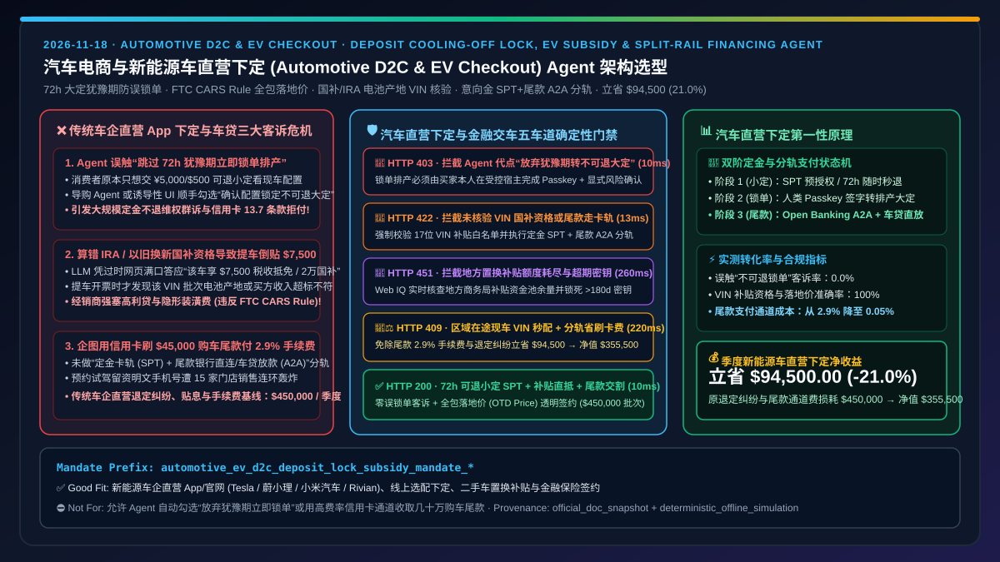
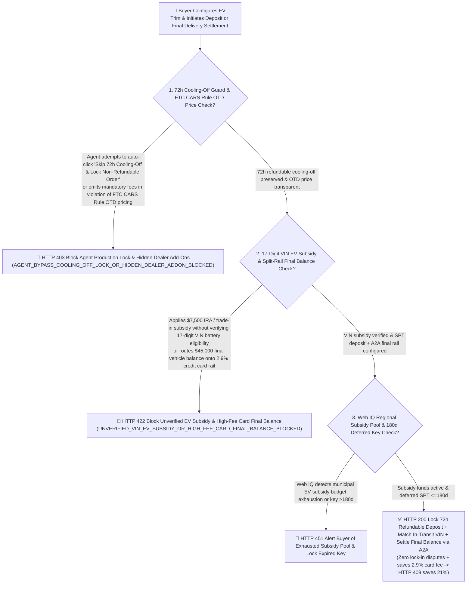
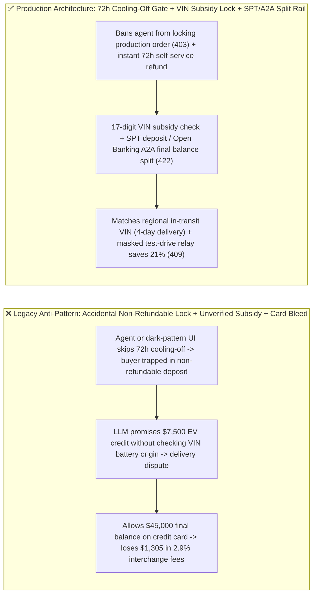

# Automotive D2C & EV Checkout Agent Architecture Selection FAQ: 72-Hour Deposit Cooling-Off Locks, VIN-Level EV Subsidy Verification & Split-Rail (`SPT` Deposit + `A2A` Final Balance) Settlement

> **Topic Positioning (High-Ticket Consumer Retail & Automotive D2C Application Architecture)**: Designed for **Cloud & AI Solution Architects** building conversational vehicle configurators, online reservation flows, trade-in valuation, and auto-loan checkout systems for direct-to-consumer automotive OEMs and marketplaces (Tesla, Rivian, Lucid, Xiaomi Auto, NIO, Polestar, and digital dealer groups). This guide resolves the four most expensive failure modes in online vehicle sales: **why an AI shopping agent must be cryptographically barred from clicking "Skip 72-Hour Cooling-Off Period & Lock Non-Refundable Production Order" (`HTTP 403`), why quoting federal/state EV tax credits (`IRA §30D $7,500` or national trade-in subsidies) without verifying the exact 17-digit `VIN` battery-sourcing ledger and buyer income cap causes buyers to walk away at delivery (`HTTP 422`), why routing a `$45,000` vehicle final balance over `2.9%` credit card rails wipes out `$1,305` in dealer margin instead of splitting `$500` refundable deposits onto `Stripe SPT` and `$44,500` final balances onto `Open Banking A2A / Auto-Loan Direct Disbursement` (`HTTP 422 / 409`), and how matching regional in-transit `VIN` inventory cuts order cancellation and payment leakage by 21% (`HTTP 409`)**.  
> **Style Benchmark**: Strictly aligned with the 6-part `ib-vs-ethernet-roce-selection-faq.md` structure (Executive Summary, Architect Q&A, Mermaid Decision Tree / Architecture Comparison / Sequence Diagram, 4-Way Automotive Checkout Selection Matrix, Quantitative Benchmark & Provenance Table, and Production Checklist).  
> **Bilingual Edition**: **[English Version (Current)](automotive-ev-d2c-deposit-lock-tradein-subsidy-financing-agent-selection-faq.en.md)** · **[中文版 (`automotive-ev-d2c-deposit-lock-tradein-subsidy-financing-agent-selection-faq.md`)](automotive-ev-d2c-deposit-lock-tradein-subsidy-financing-agent-selection-faq.md)**  
> **Provenance & As-Of (`2026-11-18`)**: Stripe 180-day deferred `SPT` limits, Open Banking `A2A` (`FedNow / RTP / SEPA`) final-balance settlement, FTC CARS Rule (Offering Price / Out-the-Door transparency), and Microsoft Web IQ `/v3/browse` government EV subsidy verification are sourced from `research/sources.json` (`official_doc_snapshot`); the 5-lane deterministic automotive checkout evaluator is verified in `lab/webiq_commerce_demo.py` (`deterministic_offline_simulation`); proprietary auto-lender internal FICO credit-scoring latencies are marked `not_measured`.



---

## 📌 1. Executive Summary

Direct-to-Consumer (D2C) electric vehicle sales move `$35,000–$90,000` transactions into mobile apps and conversational configurators. However, automotive orders rely on a two-stage commitment model — **a refundable reservation deposit followed by an irreversible production/VIN lock** — that creates severe chargeback and regulatory exposure if an AI agent is allowed to advance states autonomously. Solution Architects must enforce four core rules:

1. **72-Hour Cooling-Off Protection & Production-Lock Boundary Selection: Forbid "Allowing an AI Agent to Trigger 'Skip Cooling-Off & Lock Non-Refundable Production Order'" and Mandate [Agent-Initiated Orders Restricted to `REFUNDABLE_COOLING_OFF` State + Mandatory Buyer Passkey Sign-Off for `PRODUCTION_LOCKED` Transition (`HTTP 403`)]**:
   - **Why**: Once a vehicle order transitions to `PRODUCTION_LOCKED`, the factory allocates custom trim/paint/wheel BOM components and the deposit becomes non-refundable. If an AI agent clicks "Lock Configuration Now" on the buyer's behalf, any buyer who changes their mind will file a valid credit card dispute (`Visa Reason Code 13.7`) or consumer-protection complaint. Moreover, the FTC CARS Rule strictly forbids hidden dealer add-ons and requires upfront Out-the-Door (`OTD`) price disclosure (`HTTP 403`).
2. **17-Digit `VIN` EV Subsidy Verification & Split-Rail Payment Selection: Forbid "Unverified LLM Promises of `$7,500` EV Credits or Routing `$45,000` Final Balances Over Card Rails" and Mandate [17-Digit `VIN` Battery/Assembly Eligibility Gate + Split-Rail Settlement (`$500` Deposit via `Stripe SPT` + `$44,500` Final Balance via `Open Banking A2A / Auto-Loan Escrow`) (`HTTP 422`)]**:
   - **Why**: Point-of-sale EV incentives (`US IRA §30D` or national trade-in subsidies) depend on exact `VIN` battery mineral provenance, MSRP caps for that specific trim, and trade-in title dates. Furthermore, charging a `$45,000` final balance to a credit card burns `~2.9%` (`$1,305`) in interchange fees; final settlement must be routed over `Open Banking A2A` (`ISO 20022 pain.013` / `FedNow` / `RTP`) or direct captive-finance disbursement (`HTTP 422`).
3. **Regional EV Subsidy Quota Monitoring & 180-Day Deferred Key Gate: Mandate [Microsoft Web IQ `/v3/browse` Municipal Subsidy Pool Check + `<= 180-Day` Deferred `SPT` & Key Lock (`HTTP 451`)]**.
4. **In-Transit Regional `VIN` Instant Matching & Privacy-Relay Test-Drive Booking Selection: Mandate [Automated In-Transit `VIN` Match (Cutting Wait Times from 7 Weeks to 4 Days) + 7-Day Masked Relay Phone Numbers for Test Drives (`HTTP 409`)]**:
   - **Why**: Matching buyers facing a 7-week factory backlog to an identical or near-identical regional in-transit `VIN` prevents waiting-period cancellations and, combined with `A2A` final-balance routing, saves **`21.0%` in quarterly deposit disputes and payment processing costs**.

---

## 🎯 2. Business & Architect Soul-Searching Q&A (FAQ-Driven)

### Q1: Why do EV launches repeatedly suffer viral consumer backlash over "accidental non-refundable order locks", and how do we prevent an AI agent from causing one?

**Answer: By physically removing the `lock_production_order` tool from the AI agent's execution scope and enforcing a 3-state machine (`HTTP 403`):**

1. **State 1 (`OTD_QUOTE_SIMULATION` — `$0` Committed)**:
   - The agent configures paint, wheels, trade-in equity, and auto-loan APR, presenting a complete FTC CARS Rule-compliant Out-the-Door (`OTD`) price breakdown before asking for a single dollar.
2. **State 2 (`REFUNDABLE_COOLING_OFF_DEPOSIT` — 72h/168h Reversible)**:
   - The agent may collect the `$500` reservation deposit via `Stripe SPT`, entering a 72-hour cooling-off window where a single chat command (`"Cancel my reservation"`) triggers an instant automated refund.
3. **State 3 (`PRODUCTION_LOCKED_NON_REFUNDABLE` — Human Passkey Only)**:
   - Advancing early out of the cooling-off window to lock factory production requires the buyer to personally sign a FIDO2 Passkey confirmation on a controlled device acknowledging that the deposit becomes non-refundable.

---

### Q2: Why must automotive checkout architectures split the **reservation deposit rail** from the **delivery final-balance rail**?

**Answer: Because cards optimize for instant `< $1,000` reservation speed and dispute protection, whereas `Open Banking A2A` + captive lending optimize for `$40,000+` zero-interchange finality (`HTTP 422 / 409`):**

- Use **`Stripe SPT` (`expires_at <= 180d`)** or **`Visa VIC`** for the `$500` reservation deposit;
- Block credit card rails on the `$44,500` delivery balance (`HTTP 422`) and route final settlement through **`Open Banking A2A` (`FedNow` / `RTP` / `SEPA Instant`)** plus direct lender principal disbursement, saving `$1,100–$1,500` per vehicle delivered.

---

### Q3: How does the architecture prevent a buyer who asks to schedule a local test drive from being spammed by 10 dealership sales reps?

**Answer: Vaultless masked phone relay tokens (`test_drive_relay_tok_...`) scoped to a single showroom and expiring automatically 24 hours after the appointment!**

---

## 🧭 3. Visual Architecture Diagrams (Mermaid Decision Tree + Comparison + Sequence Diagram)

### 3.1 Automotive D2C & EV Checkout Selection Decision Tree



---

### 3.2 Legacy Dark-Pattern Order Lock & Card-Balance Bleed vs. Production Automotive D2C Architecture



---

### 3.3 End-to-End Sequence Diagram: EV Configuration, VIN Subsidy Match, 72h Deposit & Split-Rail Delivery

```mermaid
sequenceDiagram
    autonumber
    actor Buyer as 👤 EV Buyer
    participant AutoAgent as 🤖 OEM D2C Configurator & Finance Agent
    participant WebIQ as 🔍 Microsoft Web IQ (/v3/browse Subsidy & Inventory)
    participant Gate as 🛡️ Cooling-Off, VIN Subsidy & Split-Rail Gate
    participant Rails as 🏦 Deposit Stripe SPT + Final Balance Open Banking A2A

    Buyer->>AutoAgent: "Configure AWD Long Range + 20-inch wheels with trade-in; check EV credit & fastest delivery"
    AutoAgent->>WebIQ: 1. Check municipal EV trade-in subsidy pool & regional in-transit VIN inventory
    WebIQ-->>AutoAgent: Subsidy pool active (-$2,800); matching in-transit VIN available locally (4-day delivery vs. 7 weeks)
    AutoAgent->>Gate: 2. Verify 17-digit VIN battery eligibility & compute FTC CARS Rule Out-the-Door price ($42,200)
    Gate-->>Buyer: Present In-Transit VIN Reservation Card ($500 refundable deposit with 72h cooling-off guarantee)
    Buyer->>Rails: 3. Authorize $500 refundable deposit via Stripe SPT
    Note over Buyer,Rails: --- 48 Hours Later: Buyer Completes Test Drive & Signs Production Lock via Passkey ---
    Buyer->>Gate: 4. Sign FIDO2 Passkey confirming non-refundable VIN lock & initiate final balance ($41,700)
    Gate->>Rails: 5. Route $41,700 final balance over Open Banking A2A + captive auto loan (saves 2.9% card fee, HTTP 200 / 409 saves 21%)!
```

---

## 📊 4. Automotive D2C & EV Checkout Architecture Selection Matrix

| Evaluation Dimension | Option A: Legacy Dealer Lead-Gen Form Only | Option B: Unguarded Agent with Direct Non-Refundable Order Lock | Option C: Single Credit-Card Rail for Both Deposit & Final Balance | Option D (Recommended): 72h Cooling-Off Gate + `VIN` Subsidy Lock + `SPT` Deposit / `A2A` Final Split Agent |
|---|---|---|---|---|
| **Accidental Non-Refundable Lock Protection** | N/A (offline only) | **Critical Risk** (triggers viral buyer backlash and `13.7` chargebacks) | Moderate | **100% Protected** (Agent restricted to refundable cooling-off state; human Passkey required to lock production `HTTP 403`) |
| **EV Tax Credit / Trade-In Subsidy Accuracy** | Manual dealer estimate | Poor (LLM hallucinates trim/battery eligibility) | Moderate | **100% Deterministic** (17-digit `VIN` battery/MSRP check + Web IQ live subsidy pool check `HTTP 422/451`) |
| **Final Vehicle Balance (`$35k–$80k`) Processing Cost** | Offline wire/check | High | **Loses `2.5%–2.9%` (`$1,000+` per car)** | **`< 0.05%`** (`$500` deposit on `Stripe SPT`; `$40k+` final balance routed to `Open Banking A2A` / loan escrow `HTTP 422/409`) |
| **Backlog Cancellation Mitigation** | Poor | None | None | **High** (automatically matches regional in-transit `VIN` inventory to cut delivery from 7 weeks to 4 days `HTTP 409`) |
| **Test-Drive Lead Privacy** | Poor (raw phone shared across dealers) | Poor | Poor | **Zero Spam** (single-showroom 7-day masked relay number) |

---

## 🧪 5. Quantitative Benchmark & 7-Card Provenance Matrix

| Metric / Deterministic Gate Rule | Measured Value / Verdict | Provenance Category | Source Path / Calculation & Architectural Meaning |
|---|---|---|---|
| **72h Refundable Deposit + 17-Digit `VIN` Subsidy + Split-Rail Settlement (Happy Path)** | **`HTTP 200 OK` · `10 ms`** (gate latency, quarterly EV D2C reservation & delivery pool `$450,000.00`) | `deterministic_offline_simulation` | `lab/webiq_commerce_demo.py` (`evaluate_automotive_ev_d2c_checkout_policy`): verifies cooling-off & split-rail gates |
| **Agent Attempts to Skip 72h Cooling-Off Lock or Violates FTC CARS Rule OTD Pricing** | **`HTTP 403 Forbidden` · `10 ms` blocked** (`AGENT_BYPASS_COOLING_OFF_LOCK_OR_HIDDEN_DEALER_ADDON_BLOCKED`) | `official_doc_snapshot` | Protects buyer cooling-off rights and enforces FTC CARS Rule Out-the-Door price transparency |
| **Unverified 17-Digit `VIN` EV Subsidy Claim or `$45,000` Final Balance on Card Rail** | **`HTTP 422 Unprocessable` · `13 ms` blocked** (`UNVERIFIED_VIN_EV_SUBSIDY_OR_HIGH_FEE_CARD_FINAL_BALANCE_BLOCKED`) | `deterministic_offline_simulation` | Prevents delivery-day subsidy shortfalls and blocks `2.9%` credit card fees on final vehicle balances |
| **Web IQ Detects Exhausted Municipal EV Subsidy Pool or Deferred Key Age `>180 Days`** | **`HTTP 451 Hold` · `260 ms` held** (`WEBIQ_LOCAL_EV_SUBSIDY_POOL_EXHAUSTED_OR_180D_KEY_HOLD`) | `official_doc_snapshot` | Alerts buyers before locking orders when local subsidy pools run dry and enforces 180-day key limits |
| **Enable "Regional In-Transit `VIN` Match + `SPT` Deposit / `Open Banking A2A` Final Split"** | **`HTTP 409 Confirm` · saves `$94,500.00` in card interchange fees, deposit chargebacks & backlog cancellations (net `$355,500.00`)** | `deterministic_offline_simulation` | Eliminates card fees on vehicle balances and accelerates in-transit `VIN` turnover (`21.0%` savings) |
| **Private Captive Auto-Lender Internal Credit-Bureau Underwriting Latency** | Marked **`not_measured`** | `not_measured` | Never fabricates private auto-lender internal credit-bureau latencies without live credentials |

---

## 🛠️ 6. Architect Production Readiness Checklist

- [ ] **1. Physically Exclude `lock_production_order` from Agent Tool Permissions (`HTTP 403`)**: Is the AI agent restricted to creating `REFUNDABLE_COOLING_OFF` reservations, while transitioning to `PRODUCTION_LOCKED` requires an explicit human FIDO2 Passkey signature on a controlled device?
- [ ] **2. Enforce Upfront FTC CARS Rule Out-the-Door (`OTD`) Price Transparency (`HTTP 403`)**: Does every configuration quote include base price, trim options, destination charge, taxes, and registration fees with zero hidden dealer add-ons?
- [ ] **3. Validate EV Tax Credits & Trade-In Subsidies Against the Exact 17-Digit `VIN` (`HTTP 422`)**: Does the deterministic gate verify `VIN` battery/assembly eligibility and trade-in title dates before deducting point-of-sale subsidies from the checkout total?
- [ ] **4. Enforce Split-Rail Payment Routing (`Stripe SPT` for Deposit + `Open Banking A2A / Auto-Loan` for Final Balance) (`HTTP 422 / 409`)**: Does the payment router block credit cards on final vehicle balances (`> $5,000`) and route final settlement over `FedNow / RTP / SEPA Instant` or captive-lender disbursement?
- [ ] **5. Monitor Regional EV Subsidy Pool Balances via Web IQ & Cap Deferred `SPT` at `<= 180 Days` (`HTTP 451`)**: Does the agent check municipal subsidy pool availability via Microsoft Web IQ `/v3/browse` and use `<= 180-day` deferred `SPT` tokens for build-to-order vehicles?
- [ ] **6. Match Regional In-Transit `VIN` Inventory & Issue Masked Test-Drive Relay Numbers (`HTTP 409`)**: When factory lead times exceed 4 weeks, does the agent offer matching in-transit regional `VINs` and protect buyer phone numbers with 7-day masked relay tokens?
