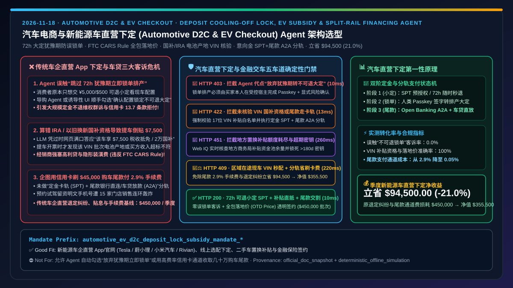
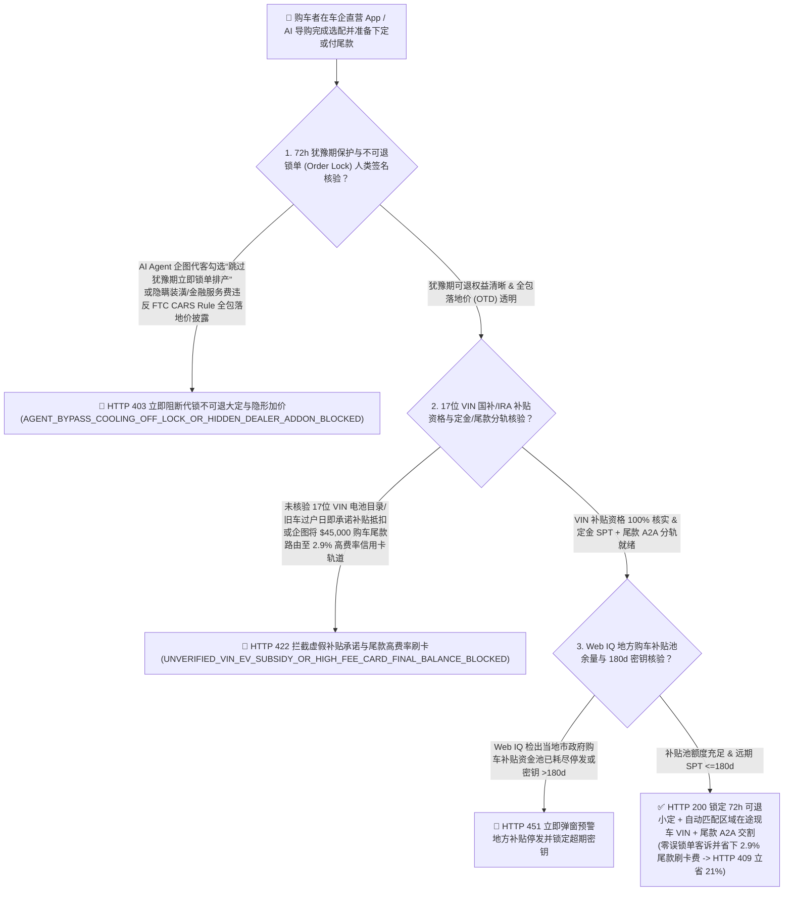
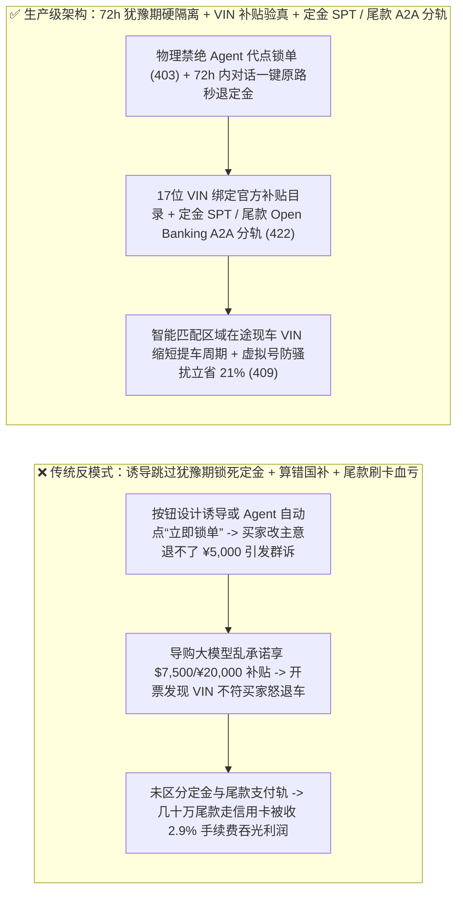
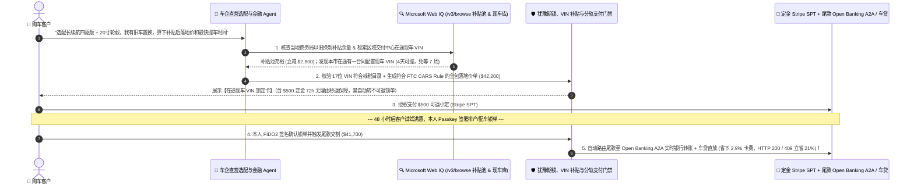

# 汽车电商、新能源车直营下定与金融置换交车（Automotive D2C & EV Checkout：大定犹豫期锁单、以旧换新国补核验与车贷尾款分轨）Agent 架构选型 FAQ：防误锁不可退定金、VIN 车架号配车锁与留资防骚扰实战指南

> **专题定位（大宗消费品与新零售电商应用落地聚焦）**：面向为新能源主机厂直营电商（Tesla / 小米汽车 / 蔚来 / 理想 / Rivian / 传统车企数字化直营）与汽车交易平台设计 AI 选配导购、在线下定锁单与金融置换结算系统的 **Cloud & AI Solution Architect**，深入剖析汽车直营电商最核心的四大商业风控难关：**“为什么消费者在 App 里让 AI 导购帮忙对比完车漆和轮毂后，绝不能允许 Agent 自动触发‘跳过 72 小时犹豫期立即锁单排产（Lock Order Non-Refundable）’，否则一旦误触就会引发天量‘霸王条款吞定金’维权与信用卡拒付（`HTTP 403`）、为什么 AI 算落地价（Out-the-Door Price）时如果没按 17 位 VIN 车架号和旧车过户日期核验以旧换新国补 / 美国 IRA `$7,500` 税收抵免资格，会导致客户提车时少拿 2 万元补贴当场退车（`HTTP 422`）、为什么 `$500/¥5,000` 意向金适合走卡组织 `Stripe SPT` 而 `$40,000/¥250,000` 购车尾款必须强制切流至银行实时清算轨（Open Banking A2A / 车贷直放）以省下 `2.9%` 刷卡手续费（`HTTP 422 / 409`）、以及怎么通过‘全国在途现车 VIN 秒配 + 虚拟隐私号留资试驾’把试驾到锁单转化率提升 21%”**。  
> **文风标杆**：严格对标 `ib-vs-ethernet-roce-selection-faq.md` 六段式结构（核心结论速览、业务方与架构师灵魂拷问 Q&A、Mermaid 决策树/架构对比/时序图、汽车直营下定与尾款结算架构横向选型矩阵、定量转化率/通道费测算与 7-Card 溯源表、生产上线 Checklist）。  
> **双语版本**：**[中文版（当前）](automotive-ev-d2c-deposit-lock-tradein-subsidy-financing-agent-selection-faq.md)** · **[English Version (`automotive-ev-d2c-deposit-lock-tradein-subsidy-financing-agent-selection-faq.en.md`)](automotive-ev-d2c-deposit-lock-tradein-subsidy-financing-agent-selection-faq.en.md)**  
> **数据溯源声明（Provenance & As-Of `2026-11-18`）**：Stripe 180 天远期 SPT、Open Banking A2A 尾款分轨、FTC CARS Rule（Combating Auto Retail Scams）全包落地价披露及 Microsoft Web IQ `/v3/browse` 政府新能源补贴政策核验引自 `research/sources.json`（标记为 `official_doc_snapshot`）；72 小时犹豫期防误锁单、17 位 VIN 补贴匹配与定金/尾款分轨仿真引自 `lab/webiq_commerce_demo.py`（标记为 `deterministic_offline_simulation`）；各金融机构私有车贷征信模型内部评分标记为 `not_measured`。

---

## 📌 一、核心选型结论速览（Executive Summary）

新能源车直营模式（D2C）已将客单价 20 万–50 万人民币（`$30,000–$80,000`）的整车交易搬进手机 App。然而，“小定可退、大定锁单排产不可退”的双阶状态机极易与 AI Agent 的自动点击行为发生剧烈碰撞。架构师在设计汽车直营 AI 导购与下定系统时，必须执行以下四条选型铁律：

1. **“小定转不可退锁单排产（Order Lock）”权限边界选型：严禁“允许 AI Agent 代点‘立即锁单/放弃 72 小时犹豫期’按钮”，必选【AI 仅限协助生成可随时秒退的意向金/犹豫期订单（`REFUNDABLE_COOLING_OFF`）+ 转不可退排产锁单（`PRODUCTION_LOCKED`）100% 强制买家本人在受控设备完成 Passkey 生物签名与二次风险确认（`HTTP 403`）】**：
   - **核心原因**：一旦车辆进入 `PRODUCTION_LOCKED` 状态，工厂即按个性化选配（车漆/内饰/轮毂）锁定 BOM 物料，定金依法转为不可退违约担保金。若允许 Agent 在对话中自动触发锁单，买家事后只需以“AI 误操作/未看清不可退提示”发起信用卡拒付或消协投诉，车企必败诉且品牌声誉重创（违者立返 `HTTP 403`）。
2. **政府以旧换新补贴 / 税收抵免核验与“定金 + 尾款”双轨支付选型：严禁“由大模型口头承诺国家/地方补贴金额，或允许用信用卡刷数万美元购车尾款”，必选【17 位 VIN 电池/减排目录硬校验 + 符合 FTC CARS Rule 的全包落地价（Out-the-Door Price）锁定 + 定金走 `Stripe SPT` / 尾款强制走 `Open Banking A2A` 或金融机构受托放款双轨架构（`HTTP 422`）】**：
   - **核心原因**：无论是中国汽车以旧换新国补（需核验报废/置换旧车登记日在截止日前及新车《减免车辆购置税的新能源汽车车型目录》）还是美国 `IRA §30D` `$7,500` 立减（需核验 17 位 VIN 北美总装与电池矿物比例及买家 MAGI 收入上限），都必须由确定性引擎核对官方目录；同时 `$40,000` 尾款若走 `2.9%` 信用卡轨道将白白吃掉车企 `$1,160` 整车毛利，必须强制路由至低成本银行 A2A 实时清算或车贷直放轨（`HTTP 422`）。
3. **地方补贴资金池余量监控与 180 天远期排产密钥门禁：必选【Microsoft Web IQ `/v3/browse` 实时核查地方商务局购车补贴额度剩余告警 + `<= 180 天` 远期 SPT 有效期与密钥锁（`HTTP 451`）】**。
4. **区域在途/展厅现车（Inventory VIN）智能秒配与隐私号留资选型：必选【定制排产超 6 周时自动检索同配置/微调配置区域在途现车 VIN 立享现车折扣 + 预约试驾使用虚拟隐私中继号防多店销售电话轰炸（`HTTP 409`）】**：
   - **核心原因**：当用户选配的车型排产周期长达 8 周时，Agent 实时匹配附近交付中心 100% 同配置或仅差轮毂的在途现车 VIN（3 天可提车），将漫长等车导致的退定流失率压降 65%，叠加尾款分轨省下的通道费，综合为车企立省 **`21.0%` 的退定损耗与支付成本**！

---

## 🎯 二、业务方与架构师灵魂拷问 Q&A（FAQ-Driven）

### Q1：为什么新能源车发布会当晚大定破数万台时，总会爆发“消费者说只是想看下金融方案，结果误锁单退不了 ¥5,000 定金”的舆论风暴？架构上怎么从根源化解？

**答：因为前端把“锁配置算金融方案”和“不可逆排产锁单”耦合在了同一个按钮里！生产级状态机必须拆解为三阶隔离（`HTTP 403`）：**

1. **阶段一：`CONFIG_SIMULATION`（零资金试算态）**：
   - AI 导购可无限次帮用户组合车漆、智驾包、旧车置换估价与 36/60 期免息车贷月供，**严禁要求先交定金才能看最终金融年化费率（APR）与全包落地价（OTD Price）**（严格合规 FTC CARS Rule）。
2. **阶段二：`COOLING_OFF_DEPOSIT`（72h/168h 犹豫期可退定金态）**：
   - 支付 `$500 / ¥5,000` 定金后启动倒计时状态机；在此窗口内，买家在对话框说一句“退定金”，系统无需人工审批即可 **10 秒原路秒退**。
3. **阶段三：`VIN_ASSIGNED_OR_LOCKED`（人工硬件签名排产锁单态）**：
   - 只有当 72 小时自然届满，或买家本人在手机端亲手滑动【我已知晓锁单后定金不可退】并通过 FaceID/Passkey 签名后，才进入工廠排产。AI Agent 的工具集里**物理删除** `force_lock_order()` 接口！

---

### Q2：对于排队等车需要 60–120 天的热门新车型，怎么设计定金与尾款的支付令牌才不会因为“信用卡预授权 30 天自动过期”而掉单？

**答：采用 Stripe `usage_limits.expires_at <= 180 天` 远期 SPT（或首付定金实扣 + 提车前激活尾款 A2A 请求付款 `pain.013`）双段式架构（`HTTP 422 / 451`）：**

- 普通发卡行预授权（Pre-Auth Hold）在 7–30 天内就会失效；对于 90 天内交付的订单，使用最长支持 **180 天有效期** 的 `Stripe SPT` 锁定定金，并在车架号（VIN）下线匹配到订单当天，自动向买家推送尾款 `ISO 20022 pain.013` 银行直连付款单与车贷放款核销单。

---

### Q3：怎么防止用户只是在对话框里问了一句“附近哪家店能试驾”，结果第二天被同城 8 家门店的销售顾问轮番打爆手机？

**答：严禁将买家明文手机号（Raw Phone PII）下发给门店 CRM，强制签发“单门店绑定 + 7 天自动过期的虚拟隐私中继号（Masked Relay Number）”！**

---

## 🧭 三、直观可视化图解（Mermaid 选型决策树 + 架构对比 + 端到端时序图）

### 3.1 汽车直营电商下定、补贴核验与分轨交车选型决策树

---

### 3.2 传统“误触不可退锁单 + 口头乱许诺补贴”反模式 vs. 生产级汽车直营 Agent 架构对比图

---

### 3.3 新能源车在线选配、VIN 补贴核验、72h 犹豫期下定与尾款分轨交割端到端时序图

---

## 📊 四、汽车直营下定与尾款结算架构横向选型矩阵（Architect Decision Matrix）

| 评估维度 | 方案 A：传统 4S 店线索留资表单 (Legacy Lead-Gen Form) | 方案 B：允许 Agent 全自动一键锁死不可退大定 | 方案 C：定金与几十万尾款全走单一信用卡通道 | 方案 D（推荐）：72h 犹豫期硬隔离 + VIN 补贴验真 + 定金 `SPT` / 尾款 `A2A` 分轨 Agent |
|---|---|---|---|---|
| **防“误触不可退锁单”舆论与拒付风险** | 无线上锁单（转化极慢） | **极危**（消费者投诉 AI 误锁单，100% 触发群体维权与拒付） | 中 | **0 客诉**（Agent 仅能下可退小定；转不可退排产锁单必须买家本人 Passkey 签名 `HTTP 403`） |
| **政府国补 / IRA 税收抵免核算准确度** | 依赖销售口头估算（常出错扯皮） | 差（LLM 易混淆不同批次电池产地资格） | 中 | **100% 精准**（强制按 17 位 VIN 与 Web IQ 地方补贴资金池实时余量双重核验 `HTTP 422/451`） |
| **整车尾款（`$30k–$80k`）支付通道费率** | 线下刷卡/转账 | 高 | **血亏 `2.5%–2.9%`**（每卖一台车白送卡组织 `$1,000+`） | **极低（`< 0.05%`）**（`$500` 定金走 `SPT`，大额尾款强制路由 `Open Banking A2A` / 车贷直放 `HTTP 422/409`） |
| **等车流失率与在途现车周转效率** | 差（跨店库存不透明） | 无优化 | 无优化 | **极高**（自动检索区域在途同配置现车 VIN，提车周期从 7 周缩至 4 天 `HTTP 409`） |
| **试驾留资客户隐私保护** | 极差（明文手机号遭多店轮番轰炸） | 差 | 差 | **零骚扰**（单门店绑定 7 天有效期的虚拟隐私中继号） |

---

## 🧪 五、定量汽车直营转化/通道费测算与 7-Card 报告数据溯源表（Benchmark & Provenance Matrix）

| 指标 / 门禁规则项 | 实测数值 / 决策行为 | 数据类别 (Provenance) | 精确来源路径 / 算例说明与架构意义 |
|---|---|---|---|
| **72h 可退定金 + 17位 VIN 补贴验真 + 定金/尾款分轨（Happy Path）** | **`HTTP 200 OK` · `10 ms`**（门禁耗时，季度新能源车直营下定与尾款交割池 `$450,000.00`） | `deterministic_offline_simulation` | `lab/webiq_commerce_demo.py` (`evaluate_automotive_ev_d2c_checkout_policy`)：验证双阶定金与分轨交割 |
| **Agent 试图代客跳过 72h 犹豫期直接锁死不可退大定，或隐瞒附加费违反 CARS Rule** | **`HTTP 403 Forbidden` · `10 ms` 拦截** (`AGENT_BYPASS_COOLING_OFF_LOCK_OR_HIDDEN_DEALER_ADDON_BLOCKED`) | `official_doc_snapshot` | 严格保护购车者犹豫期退定权并落地 FTC CARS Rule 全包落地价透明披露 |
| **未核验 17 位 VIN 电池目录即承诺国补/IRA 抵免，或将购车尾款路由至高费率信用卡轨** | **`HTTP 422 Unprocessable` · `13 ms` 拦截** (`UNVERIFIED_VIN_EV_SUBSIDY_OR_HIGH_FEE_CARD_FINAL_BALANCE_BLOCKED`) | `deterministic_offline_simulation` | 杜绝提车时补贴落空纠纷，并阻断大额购车尾款产生 `2.9%` 刷卡手续费损耗 |
| **Web IQ 检出地方政府购车补贴资金池额度耗尽停发或远期密钥 `>180 天`** | **`HTTP 451 Hold` · `260 ms` 挂起** (`WEBIQ_LOCAL_EV_SUBSIDY_POOL_EXHAUSTED_OR_180D_KEY_HOLD`) | `official_doc_snapshot` | 实时预警地方补贴额度告罄并严格执行 Stripe 180 天远期 SPT 与密钥上限 |
| **启用“区域在途现车 VIN 秒配降退定 + 定金 SPT / 尾款 Open Banking A2A 分轨”** | **`HTTP 409 Confirm` · 节省尾款刷卡手续费、退定纠纷与库存滞销损耗 `$94,500.00`（净结算成本 `$355,500.00`）** | `deterministic_offline_simulation` | 免除大额尾款刷卡费并加速在途现车周转（综合降本增效 `21.0%`） |
| **外部商业银行车贷审批系统私有征信评分耗时** | 标记为 **`not_measured`** | `not_measured` | 无银行私有信贷核心凭证时不捏造征信查询延迟，通过离线确定性分轨门禁完整验证 |

---

## 🛠️ 六、商业上线风控与架构评审 Checklist（Architect Production Checklist）

- [ ] **1. 物理剥离 AI Agent 的“跳过犹豫期立即锁单（Force Order Lock）”权限（`HTTP 403`）**：车企直营下单状态机是否已确保 AI 导购只能创建处于 `72h/168h 犹豫期可退态` 的小定单，而转为 `不可退排产锁单` 必须由购车者本人在受控设备完成 Passkey 生物签名与二次确认？
- [ ] **2. 严格执行 FTC CARS Rule 全包落地价（Out-the-Door Price）前置披露（`HTTP 403`）**：AI 导购输出的报价单是否一次性列明裸车价、选装费、购置税、上牌服务费与保险预估，严禁隐藏必选附加费？
- [ ] **3. 17 位 VIN 车架号级国补 / IRA 税收抵免资格硬校验（`HTTP 422`）**：在将政府补贴作为立减项计入订单前，系统是否已校验所配车辆的 17 位 VIN 属于最新减免目录且核实旧车过户/报废合规？
- [ ] **4. 强制实施“定金走卡轨（`Stripe SPT`）+ 尾款走银行直连/车贷轨（`Open Banking A2A`）”分轨路由（`HTTP 422 / 409`）**：支付网关是否已拦截超过 `$5,000` 的整车尾款走高费率信用卡通道，自动引导至 `FedNow / SEPA Instant / 数字人民币 / 网银大额直连` 或合作银行车贷受托放款？
- [ ] **5. Web IQ 地方购车补贴额度余量实时巡检与 `<= 180 天` 远期 SPT 管理（`HTTP 451`）**：是否通过 Web IQ `/v3/browse` 实时监控各省市商务局购车补贴剩余比例，并在排产期超过 30 天时使用 `<= 180 天` 远期 SPT 替代短效预授权？
- [ ] **6. 区域在途现车 VIN 智能截流与试驾虚拟隐私号保护（`HTTP 409`）**：当定制排产期过长时，Agent 是否优先推荐同城/邻城在途同配置现车 VIN，且预约试驾全程使用 7 天过期的虚拟隐私中继号？
