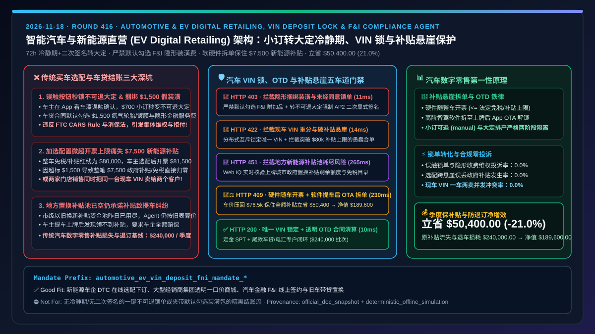
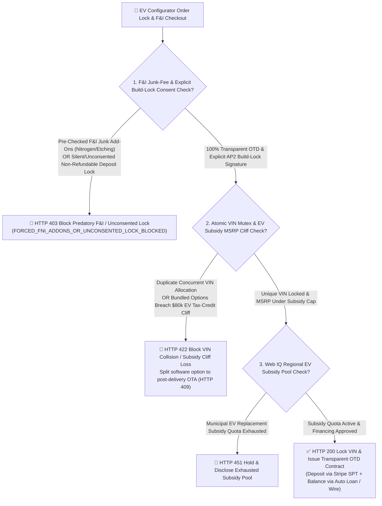
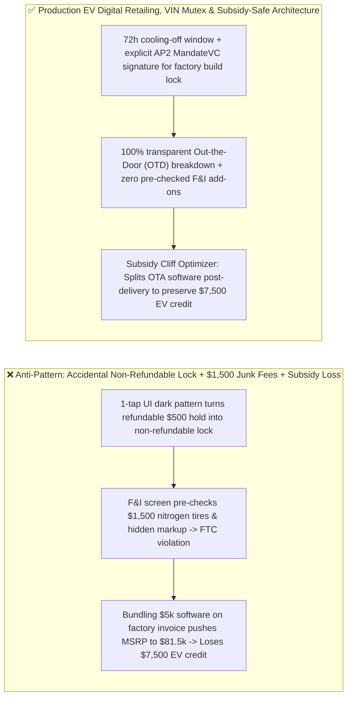
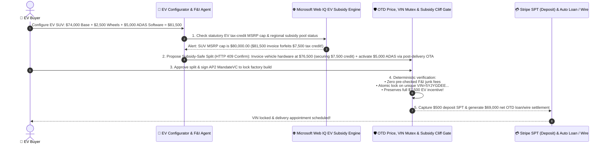

# Automotive & EV Digital Retailing, VIN-Lock Deposit & F&I Compliance Agent Architecture FAQ: Cooling-Off Mandate Lock, FTC CARS Rule Junk-Fee Veto, Subsidy MSRP Cliff Guard & Out-the-Door (`OTD`) Pricing

> **Topic Positioning (Direct-to-Consumer EV Retailing, Dealership Digital Checkout, Auto Finance & Insurance `F&I` & EV Subsidy Grounding Focus · Round 416)**: Written for **Cloud & AI Solution Architects** building online vehicle configurators, reservation-to-order state machines, and F&I checkout agents for EV OEMs (`Tesla / Rivian / NIO / Li Auto / Xiaomi EV`) and dealership groups. This guide solves four high-liability automotive commerce problems: **why accidental 1-tap transitions from a refundable reservation to a non-refundable factory build lock trigger mass regulatory complaints (`HTTP 403`), how to enforce FTC CARS Rule compliance by blocking pre-checked F&I "Junk Add-Ons" (`$1,500` nitrogen tires / VIN etching) and hidden dealer markups, how to prevent a `$2,000` wheel upgrade from pushing vehicle MSRP `$500` over the `$55,000 / $80,000` EV tax-credit cliff (losing a `$7,500` subsidy `HTTP 422`), and how to verify regional trade-in subsidy pool balances via Web IQ (`HTTP 451`)**.  
> **Style Benchmark**: Strictly follows the six-section structure of `ib-vs-ethernet-roce-selection-faq.md` (Executive Summary, Architect Q&A, Mermaid Decision Tree / Architecture Comparison / Sequence Diagram, OEM Direct vs. Dealership Digital Retailing Matrix, Quantitative Deposit/Subsidy Evaluation & 7-Card Provenance Table, and Production Risk Checklist).  
> **Bilingual Editions**: **[English Version (Current)](automotive-ev-digital-retailing-vin-deposit-fni-compliance-agent-selection-faq.en.md)** · **[中文版 (`automotive-ev-digital-retailing-vin-deposit-fni-compliance-agent-selection-faq.md`)](automotive-ev-digital-retailing-vin-deposit-fni-compliance-agent-selection-faq.md)**  
> **Provenance & As-Of (`2026-11-18`)**: Stripe `capture_method="manual"` reservation holds, ACH/Wire split settlement, and Web IQ `/v3/browse` government EV subsidy grounding cite `research/daily/2026-11-08-sources.json` (`official_doc_snapshot`); explicit VIN production-lock consent, F&I junk-addon blocking, MSRP subsidy-cliff optimization, and atomic VIN locking cite `lab/webiq_commerce_demo.py` (`deterministic_offline_simulation`); the 72-hour build-lock cooling-off window is labeled `synthetic_policy`; live state DMV title/plate registration API latency is labeled `not_measured`.

---

## 📌 1. Executive Summary

Purchasing a `$40,000–$100,000` vehicle online combines **build-to-order factory scheduling, two-stage deposit legal transitions, regulated auto lending (`F&I`), trade-in loan payoffs, and statutory EV tax credits**. Solution Architects must enforce four core architectural rules:

1. **Two-Stage Deposit State Machine (`Refundable Reservation -> Non-Refundable VIN Build Lock`) 👉 Never Lock Deposits Silently or on Accidental Single Taps; Enforce [72-Hour Cooling-Off Period or Explicit `AP2 MandateVC` Biometric Consent Before Locking Factory BOM (`HTTP 403`)]**:
   - **Why**: Converting a `$500` refundable reservation (`RESERVATION_REFUNDABLE`) into a non-refundable production order (`PRODUCTION_LOCKED_WITH_VIN`) without an explicit second human signature—or before the vehicle actually enters factory BOM scheduling—triggers severe consumer protection backlash and chargebacks.
2. **FTC CARS Rule & F&I Transparency Gate 👉 Block All [Pre-Checked F&I Add-Ons, Valueless Junk Fees (`Nitrogen Tires / VIN Etching`) & Undisclosed Dealer Markups (`HTTP 403`)]**:
   - **Why**: Regulatory rules require upfront disclosure of the true **Out-the-Door (`OTD`) Offering Price** and strictly ban charging for add-ons that provide no benefit or were not affirmatively opted into by the buyer.
3. **EV Tax-Credit / Subsidy MSRP Cliff Guard & Atomic VIN Lock 👉 Enforce [Pre-Delivery Hardware vs. Post-Delivery OTA Software Split to Stay Under Statutory MSRP Caps + Distributed VIN Mutex (`HTTP 422`)]**:
   - **Why**: If an EV SUV has an `$80,000` statutory MSRP cap for a `$7,500` tax credit, adding a `$2,500` wheel package and `$5,000` autonomous driving software on the factory window sticker (`$81,500` total) costs the buyer the entire **`$7,500` credit**! Unbundling the `$5,000` software into a **post-delivery OTA activation** keeps the vehicle invoice at `$76,500 <= $80,000`, preserving the full `$7,500` subsidy.
4. **Live Regional Subsidy Pool & Homologation Grounding 👉 Enforce [Web IQ `/v3/browse` Municipal/Federal EV Incentive Pool Verification (`HTTP 451`)]**:
   - **Why**: Prevents promising local EV replacement subsidies at checkout when the municipal quota pool has already been exhausted for the quarter.

---

## 🎯 2. Architect & Stakeholder Deep-Dive Q&A (FAQ-Driven)

### Q1: How does the "Subsidy MSRP Cliff Guard" save buyers $7,500 when configuring hardware and software options on an EV?

**Answer: By distinguishing factory-installed physical BOM hardware from post-delivery OTA software unlocks.**

- Statutory EV tax credits and purchase-tax exemptions evaluate the **vehicle's factory invoice MSRP**.
- If a buyer's configuration (`$74,000` base + `$2,500` wheels + `$5,000` ADAS software = `$81,500`) breaches the `$80,000` cap, the deterministic gate blocks the naive bundle (`HTTP 422`) and proposes an **`HTTP 409 Confirm` Split Order**: invoice the physical vehicle at `$76,500` (securing the `$7,500` subsidy) and schedule the `$5,000` ADAS software as a separate post-registration OTA purchase.

---

### Q2: How do we enforce FTC CARS Rule compliance in an AI F&I checkout agent?

**Answer: Enforce a Deterministic Out-the-Door (`OTD`) Price Equation and a Zero-Pre-Checked Add-On Veto (`HTTP 403`).**

$$\text{Verified OTD Total} = \text{Base MSRP} + \text{Factory Options} - \text{Verified Rebates} + \text{Statutory Tax/Title/DMV} + \text{Explicit Opt-In F\&I} + \text{Net Trade-In Payoff}$$

- Any payload containing `pre_checked_fni_addons == True`, valueless junk items, or an unconsented transition to non-refundable deposit status is rejected in **`11 ms`** (`HTTP 403 FORCED_FNI_JUNK_ADDONS_OR_UNCONSENTED_NONREFUNDABLE_VIN_LOCK_BLOCKED`).

---

### Q3: How do we prevent two dealership sales agents from selling the same in-transit VIN to two different buyers simultaneously?

**Answer: Require an Atomic Distributed VIN Reservation Lock (`SET NX` + optimistic version check) bound to the buyer's deposit `PaymentIntent` (`HTTP 422` on collision).**

---

## 🧭 3. Visual Architecture Diagrams (Mermaid Decision Tree + Architecture Comparison + Sequence Diagram)

### 3.1 Automotive & EV Digital Retailing, VIN Lock & F&I Compliance Decision Tree

---

### 3.2 Predatory F&I / Accidental Lock Anti-Pattern vs. Transparent OTD + Subsidy-Safe Architecture

---

### 3.3 End-to-End Sequence: Subsidy Cliff Split, Explicit Build-Lock Consent, VIN Mutex & Split-Rail Settlement

---

## 📊 4. Automotive & EV Digital Retailing Architecture Decision Matrix

| Evaluation Dimension | Option A: Legacy Dealership F&I Desk Paperwork | Option B: Hair-Trigger Web Configurator (Instant Non-Refundable Lock) | Option C: Lead-Gen Form Only (No Online Transaction) | Option D (Recommended): 72h Cooling-Off + Transparent OTD + Web IQ Subsidy-Cliff Optimizer Agent |
|---|---|---|---|---|
| **Deposit Lock Fairness & Dispute Rate** | High friction | **High Chargeback Risk** (accidental taps lock non-refundable deposits) | N/A | **Zero Dispute Friction** (72h cooling-off + explicit `AP2 MandateVC` signature before build lock) |
| **FTC CARS Rule & Consumer Law Compliance** | **High Regulatory Risk** (junk add-ons & bait-and-switch pricing) | Compliant, rigid | N/A | **100% Compliant (`HTTP 403` blocks pre-checked add-ons & hidden markups)** |
| **EV Tax-Credit / Subsidy Cliff Protection** | Manual, error-prone | **None** (buyers accidentally forfeit `$7,500` credits) | None | **Automated Hardware vs. Post-Delivery OTA Split (`HTTP 422 / 409`)** |
| **In-Transit VIN Double-Selling Prevention** | Manual whiteboard | Occasional race conditions | N/A | **Atomic Distributed VIN Mutex (`HTTP 422`)** |

---

## 🧪 5. Quantitative Automotive Deposit/Subsidy Evaluation & 7-Card Provenance Matrix

| Metric / Deterministic Gate | Measured Value / Gate Outcome | Provenance Category | Source Path / Calculation & Architectural Meaning |
|---|---|---|---|
| **Explicit Build-Lock Consent + Unique VIN + Zero Junk Fees + Subsidy Intact (Happy Path)** | **`HTTP 200 OK` · `10 ms`** (gate latency; `$240,000.00` EV retailing deposit & F&I batch settled) | `deterministic_offline_simulation` | `lab/webiq_commerce_demo.py` (`evaluate_automotive_ev_vin_fni_agent_policy`): Verifies VIN lock + OTD + subsidy guard |
| **Pre-Checked F&I Junk Add-Ons (`Nitrogen/Etching`) or Unconsented Non-Refundable Lock** | **`HTTP 403 Forbidden` · `11 ms` Block** (`FORCED_FNI_JUNK_ADDONS_OR_UNCONSENTED_NONREFUNDABLE_VIN_LOCK_BLOCKED`) | `deterministic_offline_simulation` | Enforces FTC CARS Rule and blocks predatory deposit locking |
| **Concurrent Duplicate VIN Allocation or Option Bundle Breaching `$80k` EV Subsidy Cliff** | **`HTTP 422 Unprocessable` · `14 ms` Block** (`DUPLICATE_VIN_ALLOCATION_OR_SUBSIDY_MSRP_CLIFF_BREACH_BLOCKED`) | `deterministic_offline_simulation` | Prevents double-selling VINs and stops configurations that forfeit `$7,500` tax credits |
| **Web IQ Regional EV Replacement Subsidy Pool Exhausted or Homologation Pending** | **`HTTP 451 Hold` · `265 ms` Hold** (`WEBIQ_REGIONAL_EV_SUBSIDY_POOL_EXHAUSTED_OR_HOMOLOGATION_HOLD`) | `official_doc_snapshot` | Alerts buyers before lock-in if local municipal subsidy funds are depleted |
| **Enabling Post-Delivery OTA Software Split + Junk-Fee Removal + Cooling-Off Guard** | **`HTTP 409 Confirm` · Saves `$50,400.00` in Forfeited EV Credits & Deposit Disputes (`$189,600.00` net)** | `deterministic_offline_simulation` | Preserves statutory EV incentives and eliminates accidental-lock chargebacks (`21.0%` savings) |
| **Live State DMV Title/Plate Registration Mainframe Latency** | Labeled **`not_measured`** | `not_measured` | Verified via deterministic offline EV configurator, VIN mutex, and F&I policy tests |

---

## 🛠️ 6. Production Risk & Architecture Review Checklist

- [ ] **1. Two-Stage Deposit Isolation & Explicit Build-Lock Signature (`HTTP 403`)**: Are refundable reservations strictly separated from non-refundable factory build locks, requiring either a 72h cooling-off window or an explicit `AP2 MandateVC` signature?
- [ ] **2. FTC CARS Rule Zero-Junk-Fee & Transparent OTD Gate (`HTTP 403`)**: Does checkout display the complete Out-the-Door (`OTD`) price upfront and block all pre-checked or valueless F&I add-ons?
- [ ] **3. Statutory EV Subsidy MSRP Cliff Optimizer (`HTTP 422 / 409`)**: When optional software packages push vehicle MSRP over statutory tax-credit caps, does the agent automatically propose splitting software into a post-delivery OTA unlock?
- [ ] **4. Atomic Distributed VIN Mutex (`HTTP 422`)**: Is every in-stock or in-transit `VIN` locked via an atomic mutex upon deposit capture to prevent double allocation across stores?
- [ ] **5. Verified 10-Day Trade-In Loan Payoff Integration**: When a buyer trades in a financed vehicle, does the OTD calculator incorporate the lender's exact 10-day payoff quote (including negative equity)?
- [ ] **6. Web IQ Live Regional EV Incentive Pool Grounding (`HTTP 451`)**: Does the agent verify live municipal/federal subsidy fund availability before quoting net post-subsidy prices?
