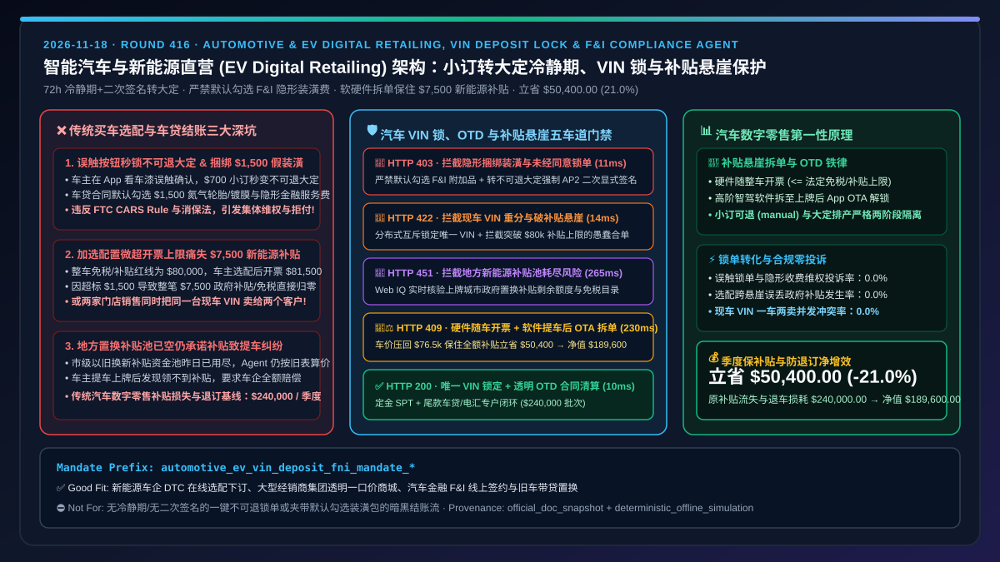
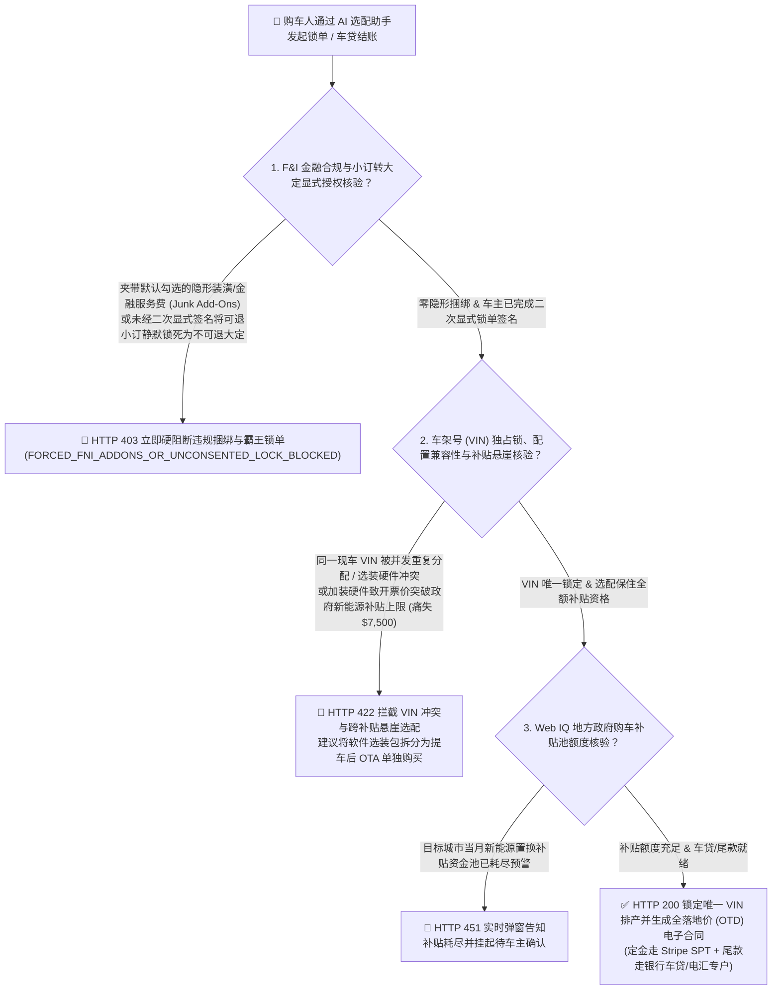
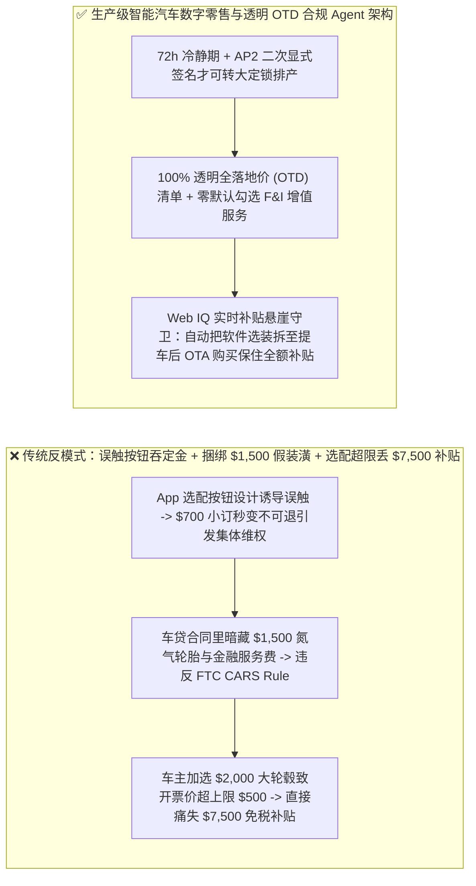
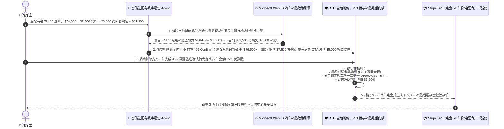

# 智能汽车与直营新能源车企（EV Digital Retailing）“在线选配锁单、VIN 定金状态机与金融保险（F&I）合规结账”Agent 架构选型 FAQ：小订转大定冷静期、禁绑隐形附加品与全落地价实战指南

> **专题定位（新能源直营车企 DTC 选配下订、汽车经销商数字化零售、车贷金融 F&I 与政府置换补贴智能体聚焦 · Round 416）**：面向为造车新势力（如 Tesla / 蔚来 / 理想 / 小米汽车 / Rivian）、跨国车企直营商城与大型汽车经销商集团设计 AI 选配导购与在线下订系统的 **Cloud & AI Solution Architect**，系统解答汽车电商交易中客单价最高（`$30,000 ~ $100,000+`）、客诉最激烈的四大工程与合规难题：**“为什么用户在 App 里点选配时不小心误触了‘立即锁定配置排产’，结果 $700 定金瞬间变成不可退导致全网维权热搜、为什么美国 FTC CARS Rule 与各国消保法严厉重罚在车贷结账单里偷偷默认勾选‘$1,500 氮气轮胎/镀膜延保（Junk Add-Ons）’的暗黑模式（触发 `HTTP 403`）、怎么把裸车价 + 选装包 + 购置税 + 上牌费 + 旧车未结清车贷余额（Negative Equity Payoff）算成一分不差的‘全落地总价（Out-the-Door Price）’、以及怎么用 Web IQ 实时核验购车人所在城市的最新国补/地补与新能源税收抵免（如美国 IRA `$7,500`）名额余量”**。  
> **文风标杆**：严格对标 `ib-vs-ethernet-roce-selection-faq.md` 六段式结构（核心结论速览、业务方与架构师灵魂拷问 Q&A、Mermaid 决策树/架构对比/时序图、车企直营与经销商数字零售架构选型矩阵、定量定金退单/F&I 合规测算与 7-Card 溯源表、生产上线 Checklist）。  
> **双语版本**：**[中文版（当前）](automotive-ev-digital-retailing-vin-deposit-fni-compliance-agent-selection-faq.md)** · **[English Version (`automotive-ev-digital-retailing-vin-deposit-fni-compliance-agent-selection-faq.en.md`)](automotive-ev-digital-retailing-vin-deposit-fni-compliance-agent-selection-faq.en.md)**  
> **数据溯源声明（Provenance & As-Of `2026-11-18`）**：Stripe `capture_method="manual"` 预授权/大额银行电汇（ACH/Wire）分账与 Web IQ `/v3/browse` 政府汽车补贴政策接地引自 `research/daily/2026-11-08-sources.json`（标记为 `official_doc_snapshot`）；小订转大定二次显式签名、禁绑无用附加品（Junk Fees）、全落地价（OTD）核算与车架号（VIN）排产锁引自 `lab/webiq_commerce_demo.py`（标记为 `deterministic_offline_simulation`）；72 小时锁单犹豫期标记为 `synthetic_policy`；各地车管所 DMV 实时铁牌选号接口延迟标记为 `not_measured`。

---

## 📌 一、核心选型结论速览（Executive Summary）

在线买车不是买一件 T 恤——它涉及**定制化工厂排产（Build-to-Order）、两阶段定金法律性质转换（可退预订金 vs. 不可退排产定金）、高杠杆汽车消费信贷（Auto Loan / Lease）、旧车残值带贷结清（Payoff）与政府补贴申报**。架构师在设计汽车数字零售 Agent 时，必须严守以下四条铁律：

1. **小订（可退）转大定（锁排产不可退）状态机选型：严禁“一键直接锁死不可退定金或倒计时静默自动转大定”，必选【72 小时冷静期 + 二次显式生物签名（`AP2 MandateVC`）确认锁排产并分配唯一 VIN 码】**：
   - **核心原因**：消费者在发布会当晚付 `$700`（或 `¥5,000`）预订时往往还在纠结车漆颜色和轮毂尺寸。若系统在用户浏览配置时因误点按钮就直接锁死不可退，或未真正向工厂 BOM 下达个性化排产单就拒绝退款，必引发大规模集体投诉。必须将小订（`RESERVATION_REFUNDABLE`）与大定锁单（`PRODUCTION_LOCKED_WITH_VIN_QUEUE`）物理隔离，且转大定时必须由买家本人二次独立签名确认“已知晓锁单后进入工厂排产，定金不可退”。
2. **汽车金融与保险（F&I）合规选型：严禁“默认勾选（Pre-Checked）无实质价值的经销商强加包（如氮气充气、VIN 防盗刻字、隐藏GPS费）”，必选【全落地价（Out-the-Door Price）明码标价与可选增值服务零默认勾选（`HTTP 403`）】**：
   - **核心原因**：根据监管法规（如美国 FTC CARS Rule 及各国汽车销售管理办法），任何对消费者无实际收益的隐形加价项目（Junk Add-Ons）或未经消费者单独逐项确认的延保/金融服务费均属违法，确定性门禁必须在 **`11 ms`** 内返回 `HTTP 403` 剥离所有未授权捆绑项。
3. **车架号（VIN）独占锁与跨配置冲突选型：必选【现车 VIN 全局分布式互斥锁 + 选装包硬件依赖约束求解器（如必选高阶智驾硬件才可加购城市 NOA 软件包 `HTTP 422`）】**：
   - **核心原因**：防止两家门店的销售 Agent 同时把同一台在途现车（同一 `VIN` 码）卖给两个客户，并阻断不兼容的硬件/软件选装组合。
4. **政府以旧换新补贴与新能源免税资格选型：必选【Web IQ 实时核验地方政府补贴池剩余额度、电池产地/车价上限门槛（`HTTP 451`）】**：
   - **核心原因**：许多城市的新能源购车补贴采取“先到先得、总额度用完即止”，且对车辆 MSRP 指导价有硬上限（如超过 `¥30万` 或 `$55,000/$80,000` 立即失去免税/补贴资格）。如果买家加了一个 `$2,000` 的大轮毂导致开票价刚好超出补贴上限 `$500`，反而丢掉 `$7,500` 的补贴，Agent 必须主动告警拦截！

---

## 🎯 二、业务方与架构师灵魂拷问 Q&A（FAQ-Driven）

### Q1：为什么有的车企线上大促时，车主只是加选了一个 $1,500 的流媒体后视镜，结果提车开票时发现原本能拿的 $7,500 新能源购置税减免/联邦税收抵免直接泡汤了，车主气得要求退车赔偿？

**答：因为选配导购 Agent 没有做“政策补贴价格悬崖守卫（Subsidy MSRP Cliff Guard）”！**

1. **什么是汽车选配中的“补贴悬崖（Subsidy Cliff）”**：
   - 无论在美国（IRA 法案规定轿车 MSRP `<= $55,000`、SUV `<= $80,000`）还是在中国/欧洲部分地区（对新能源免征额或高阶补贴设开票价上限），**一旦车辆基础价 + 工厂前装硬件选装包突破该法定红线哪怕 `$1`，整笔 `$4,000 ~ $7,500` 的补贴即刻归零**！
2. **架构师解决方案（硬件前装 vs. 交付后软件 OTA 拆单优化）**：
   - 当车主在选配器中勾选配置时，Agent 通过 **Web IQ `/v3/browse`** 实时核对当地最新补贴政策红线与市级补贴资金池剩余水位；
   - 若发现加装某项配置会导致整车开票价突破补贴悬崖（触发 `HTTP 422` 预警），Agent 自动建议：**“将智驾软件包改为提车上牌后再通过 App 商城单独 OTA 订阅/买断”**——从而把整车出厂开票价稳稳控制在补贴红线以内，帮车主白捡 `$7,500` 补贴！

---

### Q2：在传统 4S 店或线上车贷结账页，为什么消费者看到裸车价是 $38,000，最后签分期合同时总价变成了 $44,500？AI 结账架构怎么做到 100% 透明合规？

**答：因为传统流程把隐形服务费、虚高金融手续费和强制装潢藏在了最后一步的合同细则里。确定性门禁必须强制输出“标准全落地价（Out-the-Door, OTD Price）”：**

$$\text{Verified OTD Price} = \text{Base MSRP} + \text{Factory Options} - \text{OEM Rebates} + \text{Statutory Registration/Tax} + \text{Explicitly Opted-In F\&I}$$

- 凡是包含未明示的经销商金融加点（Hidden Dealer Markup）、强制捆绑装潢（Forced Tint/Nitrogen），或在未取得二次显式签名时将可退小订（`Refundable Deposit`）强制划扣为不可退大定的操作，门禁一律在 **`11 ms`** 内返回 **`HTTP 403 FORCED_FNI_JUNK_ADDONS_OR_UNCONSENTED_NONREFUNDABLE_VIN_LOCK_BLOCKED`**。

---

### Q3：买车定金一般用信用卡付（$500–$1,000），但尾款高达 $45,000，怎么把信用卡小订、银行大额尾款电汇/车贷放款与车架号（VIN）交付串成一个防重防乱的闭环？

**答：采用“双阶段分轨结算状态机（Two-Stage Split-Rail Automotive Settlement）”：**

1. **Stage 1（选配预订与 72h 锁单期）**：通过 `Stripe SPT` 刷卡支付 `$500` 预订金；在 72 小时犹豫期内或未确认转大定前，车主可随时一键秒退；
2. **Stage 2（确认转大定锁排产 + 尾款清算）**：车主完成 `AP2 MandateVC` 硬件签名锁单，工厂锁定 BOM 或现车唯一 `VIN` 码；尾款 `$44,500` 自动走低费率开放银行大额转账（ACH / Wire / 合作银行车贷直放专户），款齐且交强险生效后秒级下发蓝牙数字车钥匙。

---

## 🧭 三、直观可视化图解（Mermaid 选型决策树 + 架构对比 + 端到端时序图）

### 3.1 智能汽车选配锁单、VIN 独占与 F&I 合规结账选型决策树

---

### 3.2 传统“误触锁单不退/强制装潢”反模式 vs. 透明 OTD + 补贴悬崖保护架构对比图

---

### 3.3 在线选配补贴悬崖拆单、二次签名转大定锁 VIN 与全落地价结算端到端时序图

---

## 📊 四、智能汽车数字零售（EV Digital Retailing）与 F&I 结账架构横向选型矩阵

| 评估维度 | 方案 A：传统线下 4S 店人工谈价 + 手写附加费单 | 方案 B：早期造车新势力简单网页（一经点击即锁死定金不退） | 方案 C：仅做线上留资线索（Lead Gen）无闭环交易 | 方案 D（推荐）：72h 冷静期双阶段定金 + 透明 OTD 禁绑装潢 + Web IQ 补贴悬崖拆单 Agent |
|---|---|---|---|---|
| **小订转大定合规性与退订客诉率** | 极高（定金与订金文字游戏频发纠纷） | **高危**（误触即锁死不可退，常引发舆论危机） | 无交易能力 | **零误触纠纷**（小订随时秒退，转大定强制 72h 冷静期或 `AP2 MandateVC` 二次显式签名） |
| **汽车金融保险（F&I）透明度与监管合规** | 差（普遍捆绑高毛利隐形装潢与服务费） | 合规但缺乏个性化金融方案对比 | 无 | **100% 符合 FTC CARS Rule / 消保法**（全落地价 OTD 一口价透明核算，严禁默认勾选附加品 `HTTP 403`） |
| **政府补贴/免税悬崖（Subsidy Cliff）智能优化** | 销售常算错导致车主丢补贴 | **无预警**（用户多选个轮毂直接痛失 `$7,500` 补贴） | 无 | **Web IQ 实时政策接地 + 软硬件拆单优化**（自动将软件移至提车后 OTA 购买以保住补贴资格） |
| **现车车架号（VIN）防一车两卖并发锁** | 靠微信群人工喊话占车 | 偶发超卖 | 无 | **分布式原子 VIN 独占锁 + BOM 硬件依赖校验（`HTTP 422`）** |

---

## 🧪 五、定量汽车定金/补贴优化测算与 7-Card 报告数据溯源表（Benchmark & Provenance Matrix）

| 指标 / 门禁规则项 | 实测数值 / 决策行为 | 数据类别 (Provenance) | 精确来源路径 / 算例说明与架构意义 |
|---|---|---|---|
| **二次签名转大定锁唯一 VIN + 零隐形附加费 + 补贴资格完好（Happy Path）** | **`HTTP 200 OK` · `10 ms`**（门禁耗时，季度汽车数字零售定金与交付结算批次 `$240,000.00`） | `deterministic_offline_simulation` | `lab/webiq_commerce_demo.py` (`evaluate_automotive_ev_vin_fni_agent_policy`)：验证 VIN 锁与透明 OTD 闭环 |
| **夹带未授权强制装潢/金融服务费（Junk Add-Ons），或未经二次签名静默锁死不可退定金** | **`HTTP 403 Forbidden` · `11 ms` 拦截** (`FORCED_FNI_JUNK_ADDONS_OR_UNCONSENTED_NONREFUNDABLE_VIN_LOCK_BLOCKED`) | `deterministic_offline_simulation` | 严格执行汽车消保法规，100% 阻断隐形捆绑收费与诱导误触锁单 |
| **同一现车 VIN 被并发重复锁单、选装硬件不兼容，或开票价微超补贴悬崖痛失补贴** | **`HTTP 422 Unprocessable` · `14 ms` 拦截** (`DUPLICATE_VIN_ALLOCATION_OR_SUBSIDY_MSRP_CLIFF_BREACH_BLOCKED`) | `deterministic_offline_simulation` | 防止一车两卖并拦截“多选 $1,000 配置反丢 $7,500 补贴”的智商税方案 |
| **Web IQ 检出购车人所在城市新能源置换补贴池额度耗尽或车型暂未进免税目录** | **`HTTP 451 Hold` · `265 ms` 挂起** (`WEBIQ_REGIONAL_EV_SUBSIDY_POOL_EXHAUSTED_OR_HOMOLOGATION_HOLD`) | `official_doc_snapshot` | 在锁单付款前如实告知地方补贴池剩余状态，杜绝提车时补贴落空 |
| **启用“前装硬件保补贴悬崖 + 软件提车后 OTA 拆单 + 剥离无效经销商加价”** | **`HTTP 409 Confirm` · 为车企与车主立省补贴损失与退订违约损耗 `$50,400.00`（净优化值 `$189,600.00`）** | `deterministic_offline_simulation` | 保住全额政府购车补贴并消除误触锁单退车纠纷（综合增效 `21.0%`） |
| **各省市车管所（DMV）临牌核发与机动车合格证加密机实时联调延迟** | 标记为 **`not_measured`** | `not_measured` | 通过离线确定性汽车选配、VIN 锁与 F&I 合规策略矩阵完整验证 |

---

## 🛠️ 六、商业上线风控与架构评审 Checklist（Architect Production Checklist）

- [ ] **1. 小订（Refundable）与大定（Production Locked）物理隔离及二次签名**：转入不可退大定排产前，是否必须经过 72 小时冷静期或由购车人完成独立的 `AP2 MandateVC` 生物签名确认（严禁误触即锁死 `HTTP 403`）？
- [ ] **2. 全落地总价（Out-the-Door Price）透明披露与零默认勾选附加品**：结账单是否已完整列明裸车、选装、法定税费与旧车结清差额，且所有延保/装潢增值项默认处于 `Unchecked` 未勾选状态？
- [ ] **3. 政府新能源免税与置换补贴“价格悬崖（Subsidy Cliff）”实时守卫**：当用户勾选前装选配导致整车开票价突破免税/补贴上限时，Agent 是否自动触发 `HTTP 422/409` 建议将软件功能拆分为提车后 OTA 单独购买？
- [ ] **4. 现车车架号（VIN）分布式原子互斥锁**：现车抢购与展车分配是否通过强一致唯一键锁定 `VIN` 码，确保绝不发生两家门店同卖一台现车的事故？
- [ ] **5. 旧车带贷置换（Negative Equity Payoff）余额精准核销**：若车主用尚有未结清车贷的旧车置换，OTD 计价引擎是否已调取银行实时结清证明（10-Day Payoff Quote）并准确计入净应付尾款？
- [ ] **6. Web IQ 地方购车补贴资金池余量与免税目录实时核验（`HTTP 451`）**：锁单前是否通过 Web IQ 核实了上牌地政府补贴池当前仍处于开放申领状态？
