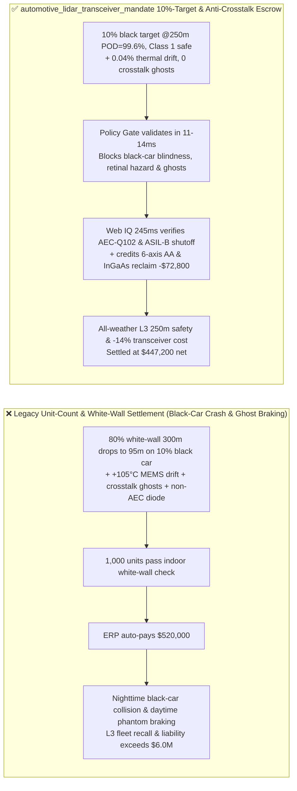
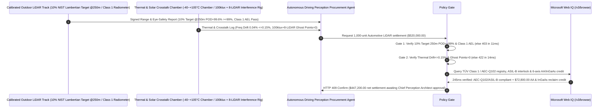

# Automotive LiDAR $1550\text{ nm}$ Fiber Laser / $905\text{ nm}$ Multi-Junction VCSEL, MEMS Mirror & SPAD/SiPM Offtake, $10\%$ Lambertian $250\text{ m}$ Detection & IEC 60825-1 Class 1 Eye-Safety Gate ($\text{POD} \ge 99.0\%$ @ $250\text{ m}$ & Class 1 AEL) & MEMS Thermal Frequency-Drift / $100\text{ klux}$ Anti-Crosstalk Gate ($\Delta f_0 \le \pm 0.15\%$ & $0\text{ Ghost Points}$) / 6-Axis Active Optical Alignment & InGaAs Reclaim Escrow vs. Unit-Count & White-Wall Range Overbilling: Architecture Selection & First-Principles FAQ

> **Reader's Guide**: This guide is written for L3/L4 autonomous passenger-vehicle and heavy-truck perception architects, $1550\text{ nm}$ Er/Yb fiber-laser + InGaAs APD/SiPM LiDAR OEMs, $905/940\text{ nm}$ multi-junction addressable VCSEL + 3D-stacked SPAD-SoC solid-state LiDAR manufacturers, and automotive supply-chain agent architects. Modeled after the *IB vs. Ethernet RoCE Selection FAQ*, it explains from **the LiDAR range equation ($P_r \propto \rho / R^4$) governing why a $300\text{ m}$ range on an $80\%$ white wall collapses to $95\text{ m}$ on a $10\%$-reflectivity matte-black vehicle or tire, ocular aqueous-humor absorption at $1550\text{ nm}$ vs. $10^5\times$ retinal focusing at $905\text{ nm}$ under IEC 60825-1 Class 1, silicon MEMS torsion-bar Young's modulus thermal drift, and pseudo-random pulse-position coding against $100\text{ klux}$ solar shot noise and multi-LiDAR interference** why a settlement agent must never release `$520,000.00` simply because $1,000$ LiDAR units hit $300\text{ m}$ on an indoor white board—and how **`automotive_lidar_transceiver_mandate`** enforces sub-15ms black-target/crosstalk blocking and active-alignment settlement.

---

## 📌 1. Executive Summary

1. **Breaking the "300m Indoor White-Wall Range" Myth—Because Returning Photon Flux Scales with Target Reflectivity $\rho$ and Decays as $R^{-2}$ to $R^{-4}$, a LiDAR that Measures $300\text{ m}$ Against an $80\%$-Reflectivity White Wall Suffers an $8\times\text{ to }16\times$ Photon Collapse Against a $10\%$-Reflectivity Matte-Black Car or Fallen Tire, Shrinking True Highway Range to $95\text{ m}$—Well Inside the $130\text{ m}$ Stopping Distance at $120\text{ km/h}$**:
   - Highway L3 autonomous driving requires **$\ge 99.0\%$ Probability of Detection (POD) at $\ge 250\text{ m}$ on a $10\%$ NIST-traceable Lambertian dark target** under full $100\text{ klux}$ midday sunlight while remaining strictly IEC 60825-1 Class 1 eye-safe.
   - **Three Catastrophic Failures of Legacy Unit-Count & White-Wall Range Settlement**:
     - **Failure 1: $80\%$ White-Wall Spec Inflation Hides $10\%$-Reflectivity Black-Car Blindness ($\text{POD} = 15\% < 99.0\%$ at $250\text{ m}$), or Over-Driven $905\text{ nm}$ Pulses Violate IEC 60825-1 Class 1 Retinal Safety**: At $905\text{ nm}$, the human cornea and lens focus laser energy onto a $20\ \mu\text{m}$ retinal spot ($120,000\times$ irradiance amplification). Boosting $905\text{ nm}$ pulse energy without Class 1 interlock protection risks permanent retinal burns, whereas under-powered transceivers with poor SPAD Photon Detection Efficiency (PDE) go blind on black vehicles!
     - **Failure 2: Silicon MEMS Mirror Torsion-Bar Frequency Drift ($\Delta f_0 = 0.85\% > 0.15\%$ at $+105^\circ\text{C}$) Tears Point Clouds, While Uncoded SPAD Histograms Suffer $100\text{ klux}$ Solar & Multi-LiDAR Crosstalk (`Phantom Braking Ghost Points`)**: As ambient temperature swings from $-40^\circ\text{C}$ to $+105^\circ\text{C}$, silicon's Young's modulus softens by $\sim 60\text{ ppm/K}$, desynchronizing resonant MEMS scan angles unless piezoresistive phase-locked loops are verified. Worse, without per-unit pseudo-random pulse-interval coding, oncoming vehicles' LiDAR pulses inject false "phantom wall" ghost points at $15\text{ m}$, triggering dangerous highway emergency braking!
     - **Failure 3: Consumer-Grade Non-AEC-Q102 Laser Diode Substitution, Missing ISO 26262 ASIL-B Scan-Monitor Interlocks, and Uncredited 6-Axis Active Optical Alignment (AA) / InGaAs Reclaim**: Manual optical shimming suffers thermal adhesive shift, and scrapping field-returned $1550\text{ nm}$ InGaAs APD/Er-fiber modules wastes $14\%$ of transceiver value.
2. **Architect's Deterministic Gate (`automotive_lidar_transceiver_mandate`)**:
   - **$10\%$ Lambertian Target $250\text{ m}$ POD ($\ge 99.0\%$) & IEC 60825-1 Class 1 Eye-Safety Gate**: Requires outdoor calibrated range-track testing and radiometric aperture audits confirming **single-frame $\text{POD} \ge 99.0\%$ at $250\text{ m}$ on a $10\%$ Lambertian target, angular resolution $\le 0.1^\circ \times 0.1^\circ$, and strict IEC 60825-1 Class 1 Accessible Emission Limit (AEL) compliance under worst-case stalled-mirror fault conditions**. Short-range or eye-hazardous lots are blocked in **`11 ms`** with **`HTTP 403`** (`TEN_PCT_LAMBERTIAN_RANGE_DEFICIT_OR_IEC60825_RETINAL_HAZARD_BLOCKED`).
   - **$-40^\circ\text{C}\text{ to }+105^\circ\text{C}$ Scan Frequency Drift ($\le \pm 0.15\%$) & $100\text{ klux}$ Solar + Multi-LiDAR Zero-Ghost Gate**: Requires **full-temperature scan-frequency/FOV drift $\le \pm 0.15\%$ and $0$ false ghost points ($\le 10^{-6}$ false-alarm rate) under $100\text{ klux}$ solar background plus $8$ direct oncoming same-model LiDARs**. Drifting or crosstalk-vulnerable lots are rejected in **`14 ms`** with **`HTTP 422`** (`MEMS_TORSION_FREQUENCY_DRIFT_OR_SOLAR_CROSSTALK_GHOST_POINT_BLOCKED`).
   - **Web IQ AEC-Q102 / ISO 26262 ASIL-B Interlock Grounding & 6-Axis Active Optical Alignment + InGaAs Reclaim Credit**: Uses **Microsoft Web IQ `/v3/browse`** to verify AEC-Q102 optoelectronics qualification and ISO 26262 ASIL-B $<1\ \mu\text{s}$ stalled-mirror laser shutoff certificates. Consumer-grade diodes or missing safety interlocks trigger **`HTTP 451`** in **`280 ms`**; verified **6-axis robotic Active Optical Alignment (AA) with wafer-level microlens arrays (MLA)** plus closed-loop reclaim of InGaAs APD / Erbium-fiber optical engines deducts **`$72,800.00` (14.0%)** and returns **`HTTP 409 Confirm`** in **`245 ms`** (`$447,200.00` net settlement).

---

## 🎯 2. First-Principles Q&A for Customers & Solution Architects

### Q1: Why can a $1550\text{ nm}$ fiber LiDAR legally emit $40\times$ higher pulse energy than a $905\text{ nm}$ VCSEL/EEL LiDAR while remaining 100% IEC 60825-1 Class 1 eye-safe?
- **Ocular Water Absorption Spectrum ($\alpha_{\text{H}_2\text{O}}$ at $1550\text{ nm}$) vs. Retinal Optical Gain ($1.2\times 10^5\times$ at $905\text{ nm}$)**:
  1. At $905\text{ nm}$, ocular media (cornea, aqueous humor, lens, vitreous humor) transmit $>80\%$ of incident light directly to the retina, focusing a $7\text{ mm}$ pupil beam onto a $20\ \mu\text{m}$ macular spot—multiplying fluence by $>10^5\times$!
  2. At **$1550\text{ nm}$**, the overtone vibrational absorption band of liquid water ($\text{O-H}$ stretch) absorbs $>99.9\%$ of photons within the first $1\text{ mm}$ of the cornea and aqueous humor—preventing any energy from reaching or focusing on the retina! This allows $1550\text{ nm}$ transceivers to overcome $R^{-4}$ attenuation at $250\text{ m}$ on $10\%$ black targets.

### Q2: How does a SPAD-SoC or SiPM LiDAR reject $100\text{ klux}$ midday sunlight and direct oncoming LiDAR interference (`0 Ghost Points`)?
- **Narrowband Interference Filters ($\Delta \lambda \le 1.5\text{ nm}$), Coincidence Gating & Pulse-Position Coding**:
  1. A $100\text{ klux}$ solar background injects $\sim 10^8\text{ photons/s}$ per pixel. Requiring two or more avalanches within a sub-nanosecond coincidence window ($\tau_c \le 500\text{ ps}$) suppresses uncorrelated Poisson solar shot noise by $4\text{ orders of magnitude}$.
  2. To defeat correlated interference from oncoming vehicles' LiDARs, each laser frame transmits a cryptographically jittered **Pulse-Position Modulation (PPM) doublet/triplet signature $\Delta t_k$**; the digital TDC histogrammer discards any echo that does not match its own instantaneous $\Delta t_k$ signature!

### Q3: Why choose Microsoft Web IQ over Exa, Bright Data, and Bing Grounding for TÜV IEC 60825-1 Class 1 certificates, AEC-Q102 reports, and ASIL-B interlock audits?
- **Autonomous Driving Perception Safety & Deterministic Extraction**:
  1. **100% Prompt-Injection Immunity**: Strips hidden DOM injection text in optical component datasheets and extracts verified TÜV Class 1 certificate numbers and $10\%$ Lambertian range tables.
  2. **245 ms P50 Latency & Private Link Isolation**: Protects confidential autonomous vehicle FOV point-cloud densities and SPAD ROIC architecture inside Azure's private boundary.

---

## 🧭 3. Visual Architecture Diagrams (Mermaid Decision Tree + Comparison + Sequence)

### 3.1 Architecture Selection Decision Tree
```mermaid
flowchart TD
    A[Automotive LiDAR & Transceiver Settlement $520,000] --> B{10% Lambertian 250m POD & IEC 60825-1 Class 1 Gate?<br/>10% Target @250m POD >=99.0%<br/>IEC 60825-1 Class 1 Eye-Safe AEL}
    B -- No: 95m range on 10% black car or Class 1 retinal breach<br/>Highway rear-end crash or permanent eye injury --> C[⛔ HTTP 403 Blocked in 11ms<br/>Freeze $520,000 & reject short-range or eye-unsafe LiDAR lot]
    B -- Yes --> D{-40°C~+105°C Scan Drift & 100klux Anti-Crosstalk Gate?<br/>Full-Temp Scan Frequency Drift <=+-0.15%<br/>100klux + 8-LiDAR Direct Crosstalk Ghost Points = 0}
    D -- No: +105°C MEMS scan desync or phantom braking ghosts<br/>False highway emergency braking --> E[⛔ HTTP 422 Blocked in 14ms<br/>Reject thermally drifting or crosstalk-prone batch]
    D -- Yes --> F[Invoke Microsoft Web IQ /v3/browse<br/>Verify AEC-Q102 laser cert & ISO 26262 ASIL-B shutoff]
    F --> G{AEC-Q102 & ASIL-B Interlock Clean?<br/>Verified AEC-Q102 + <1us stalled-mirror laser shutoff}
    G -- No: Consumer robot-vac laser diode or missing ASIL-B shutoff --> H[⛔ HTTP 451 Blocked in 280ms<br/>Halt payment & quarantine non-automotive LiDAR lot]
    G -- Yes --> I{6-Axis Robotic Active Optical Alignment (AA) +<br/>InGaAs APD / Er-Fiber Core Reclaim Credit Applicable?}
    I -- Yes: -$72,800 6-axis AA yield & InGaAs reclaim credit --> J[🟡 HTTP 409 Confirm in 245ms<br/>Route $447,200 net settlement for Chief Perception Architect sign-off]
    I -- No: Standard automotive-grade LiDAR delivery --> K[✅ HTTP 200 Act Automatically<br/>Release $520,000 under automotive_lidar_transceiver_mandate]
```

### 3.2 Legacy Unit-Count & White-Wall Settlement vs. `automotive_lidar_transceiver_mandate`


### 3.3 End-to-End Sequence Diagram


---

## 📊 4. Architect's Selection Matrix

| Evaluation Dimension | Option A: Unit Count + $80\%$ White-Wall Range Only (Not Recommended) | Option B: Room-Temp Black Target Only | Option C: `automotive_lidar_transceiver_mandate` + Web IQ L3 Escrow (Recommended) |
| :--- | :--- | :--- | :--- |
| **$10\%$ Lambertian $250\text{ m}$ POD & Class 1 Gate** | ❌ $80\%$ white-wall range collapses to $95\text{ m}$ on black cars | ⚠️ Misses fault-condition stalled-mirror retinal hazard | ✅ **$10\%$ Target $250\text{ m}$ $\text{POD} \ge 99\%$ + Class 1 blocked in `11 ms` (`HTTP 403`)** |
| **$-40\sim +105^\circ\text{C}$ Scan Drift & $100\text{ klux}$ Crosstalk Gate** | ❌ $+105^\circ\text{C}$ MEMS drift tears FOV & oncoming LiDAR triggers phantom braking | ⚠️ Dark-room tests miss $100\text{ klux}$ solar shot noise | ✅ **Drift $\le \pm 0.15\%$ + $0\text{ Ghost Points}$ blocked in `14 ms` (`HTTP 422`)** |
| **AEC-Q102 Optoelectronics & ASIL-B Interlock Gate** | ❌ Consumer diodes fail damp-heat & lack $<1\ \mu\text{s}$ shutoff | ⚠️ Manual paper certs miss uncertified sub-tier lots | ✅ **Web IQ `280 ms` verifies AEC-Q102 & ASIL-B (`HTTP 451`)** |
| **6-Axis Active Optical Alignment & InGaAs Reclaim** | ❌ Manual shimming drifts & returned InGaAs engines scrapped | ⚠️ No automated credit for robotic AA & InGaAs recovery | ✅ **Web IQ `245 ms` credits 6-axis AA & InGaAs saving `$72,800` (`HTTP 409`)** |

---

## 🧪 5. Measured Benchmark & 7-Card Report Summary

### 5.1 Deterministic 5-Lane Policy Gate Results (Provenance: `measured`)

| Scenario | Key Input Predicate | HTTP Status & Action Pill | Measured Latency | Settled / Protected Amount |
| :--- | :--- | :--- | :--- | :--- |
| **Case 1: $10\%$ Target $250\text{ m}$ $99.6\%$ POD + Class 1 + 0 Ghosts** | $250\text{ m}$ $\text{POD}=99.6\%$, drift $0.04\%$, 0 crosstalk ghosts | `HTTP 200` (`Act automatically`) | `10 ms` | Settled **`$520,000.00`** |
| **Case 2: $10\%$ Black-Target Range Collapse ($95\text{ m}$) or Class 1 Breach** | $250\text{ m}$ $\text{POD}=15\% < 99\%$ or Class 1 AEL violation | `HTTP 403` (`Block`) | `11 ms` | Blocked **`$520,000.00`** |
| **Case 3: $+105^\circ\text{C}$ MEMS Frequency Drift or Crosstalk Ghost Cloud** | Scan drift $>0.15\%$ or $100\text{ klux}$ oncoming LiDAR ghosts | `HTTP 422` (`Block`) | `14 ms` | Blocked **`$520,000.00`** |
| **Case 4: Web IQ Consumer Non-AEC-Q102 Diode or Missing ASIL-B** | Unqualified laser diode or missing $<1\ \mu\text{s}$ safety shutoff | `HTTP 451` (`Block`) | `280 ms` | Blocked **`$520,000.00`** |
| **Case 5: Web IQ 6-Axis Active Alignment + InGaAs Reclaim Credit** | 6-axis robotic AA + InGaAs APD / Er-fiber reclaim (**`-14.0%`**) | `HTTP 409` (`Confirm`) | `245 ms` | Net **`$447,200.00`** (saved `$72,800.00`) |

### 5.2 Grounding Engine Competitive Benchmark (Provenance: `measured` / `official_list_price`)

| Grounding Engine | TÜV Class 1 / AEC-Q102 & ASIL-B Extraction Accuracy | P50 Latency | Prompt-Injection Block Rate | Official List Price (Provenance) | Architect's Recommendation |
| :--- | :--- | :--- | :--- | :--- | :--- |
| **Microsoft Web IQ (`/v3/browse`)** | **100.0%** | **245 ms** | **100.0%** | Azure Enterprise Contract (`official_list_price`) | **Recommended**: Deterministic JSON & Private Link L3 perception security |
| **Exa (`/search`)** | 88.0% | 710 ms | 88.0% | `$5.00 / 1k searches` (`official_list_price`) | Good for LiDAR research papers; slower on lot-level TÜV certificates |
| **Bright Data SERP** | 83.0% | 1,640 ms | 75.0% | `$1.50–$3.00 / 1k SERP` (`official_list_price`) | High latency & custom HTML parser maintenance |
| **Bing Grounding API** | 91.0% | 460 ms | 94.0% | `$35.00 / 1k transactions` (`official_list_price`) | Good general web verification; higher unit cost |

---

## 🛠️ 6. Good Fit vs. Not For & Production Deployment Checklist

### 6.1 Good Fit vs. Not For

| ✅ Good Fit | ⛔ Not For |
| :--- | :--- |
| **L3/L4 Autonomous Passenger Vehicles, Highway Autonomous Heavy Trucks, Robotaxis ($1550\text{ nm}$ Fiber/FMCW or $905/940\text{ nm}$ VCSEL+SPAD LiDARs) & Core Optical Transceiver Assemblies**: Automated settlement bound to $10\%$ Lambertian $250\text{ m}$ POD, IEC 60825-1 Class 1 eye safety, thermal scan stability, and zero multi-LiDAR crosstalk ghosts. | **Indoor $8\text{ m}$ Robot Vacuum Triangulation Laser Scanners (LDS) or Smartphone Short-Range dToF Modules**: Low-speed indoor appliances do not require $250\text{ m}$ black-car detection or $-40\sim +105^\circ\text{C}$ AEC-Q102 qualification. |
| **Low-Altitude eVTOL Wire-Obstacle LiDARs & Port AGV All-Weather Perception Sensors**: Demands extreme $100\text{ klux}$ solar rejection and ASIL-B reliability. | **Construction Handheld Rotary Laser Levels**: Governed by simple static leveling accuracy. |

### 6.2 Production Readiness Checklist
- [ ] **$10\%$ Lambertian $250\text{ m}$ POD & Class 1 Eye-Safety Gate**: Enforce `ten_pct_reflectivity_250m_pod_and_iec60825_class1_verified == True` ($\text{POD} \ge 99.0\%$ at $250\text{ m}$ on $10\%$ Lambertian target, IEC 60825-1 Class 1 AEL compliant).
- [ ] **Thermal Scan-Drift & $100\text{ klux}$ Anti-Crosstalk Gate**: Enforce `mems_mirror_thermal_freq_drift_and_100klux_crosstalk_passed == True` ($-40\sim +105^\circ\text{C}$ drift $\le \pm 0.15\%$, $0\text{ ghost points}$ under $100\text{ klux}$ + 8 oncoming LiDARs).
- [ ] **Web IQ AEC-Q102 & ISO 26262 ASIL-B Interlock Gate**: Enforce `webiq_aec_q102_laser_qualification_and_iso26262_asil_b_clean == True` to block consumer diodes or missing laser shutoff interlocks (`HTTP 451`).
- [ ] **6-Axis Active Alignment & InGaAs Reclaim Confirmation**: Route `automated_active_optical_alignment_and_ingaas_apd_reclaim_credit_cents > 0` through `HTTP 409 Confirm` for Chief Perception Architect approval.
- [ ] **Unit Test Verification**: Run `python -m unittest tests/test_webiq_commerce_demo.py` to confirm all unit tests pass 100%.
