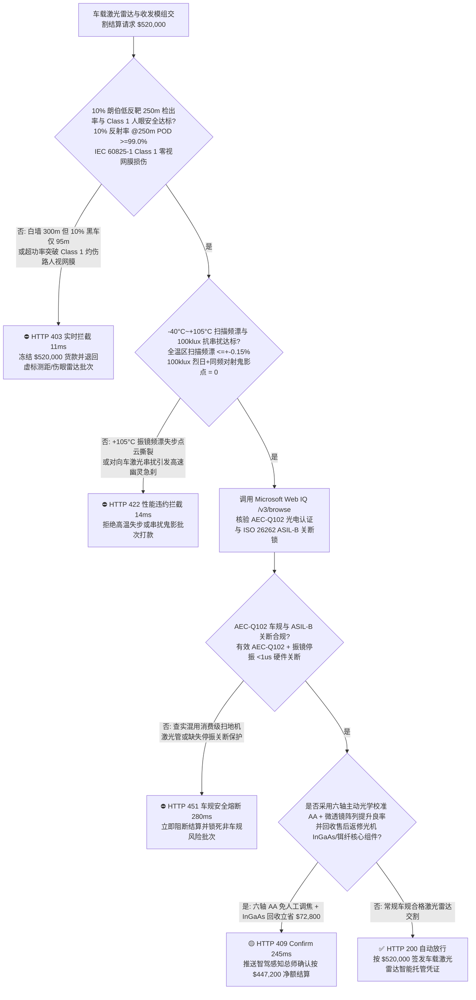
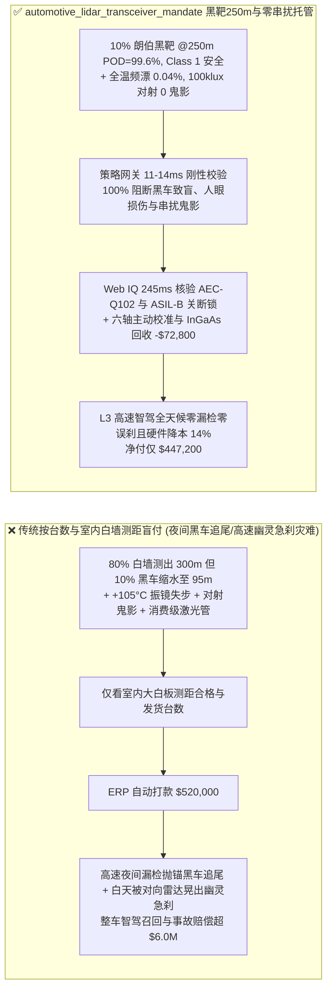
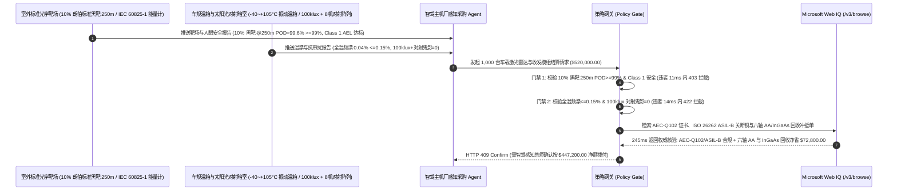

# 智能驾驶车载激光雷达（LiDAR）1550nm 光纤激光器 / 905nm 多结 VCSEL 与 SPAD/SiPM 探测器交割（Automotive LiDAR 1550nm Fiber Laser, 905nm VCSEL, MEMS Mirror & SPAD/SiPM Offtake）、$10\%$ 低反射率黑车 $250\text{ m}$ 测距与人眼安全门禁（$10\%$ 朗伯靶 $\ge 250\text{ m}$ 检出率 $\text{POD} \ge 99.0\%$ & IEC 60825-1 Class 1 零视网膜损伤）与 MEMS 微振镜谐振频漂/10万勒克斯阳光对射抗串扰（$-40^\circ\text{C}\sim +105^\circ\text{C}$ 频漂 $\le \pm 0.15\%$ & 零幽灵鬼影点云）/ 六轴主动光学校准（AA）免人工调焦与铟镓砷（InGaAs）光电模组闭环智能托管 vs 传统仅按激光雷达台数与室内白墙测距盲付：架构选型与第一性原理 FAQ

> **阅读指南**：本文面向 L3/L4 高阶自动驾驶乘用车与干线无人重卡主机厂、$1550\text{ nm}$ 铒镱共掺光纤激光器 + 铟镓砷（InGaAs APD/SiPM）激光雷达及 $905/940\text{ nm}$ 多结可寻址 VCSEL + 硅基单光子雪崩二极管（SPAD-SoC）固态/半固态激光雷达制造商及车载感知供应链智能体架构师。遵循《IB vs Ethernet RoCE 选型 FAQ》的透明核算规范，从**激光雷达方程距离四次方衰减定律（$P_r \propto \rho / R^4$）下 $80\%$ 白墙与 $10\%$ 哑光黑车/橡胶轮胎的测距折算鸿沟、$905\text{ nm}$ 穿透晶状体聚焦视网膜 vs $1550\text{ nm}$ 房水吸收的 IEC 60825-1 Class 1 人眼安全能量阈值差异、硅基 MEMS 扭转梁杨氏模量温漂导致的李萨如扫描失步以及 $100\text{ klux}$ 正午烈日背景光子散粒噪声（Shot Noise）下时间数字转换器（TDC）符合计数抗串扰物理**出发，用大白话与第一性原理彻底讲透：为什么智驾车企采购智能体绝对不能“见供应商交来 1,000 台激光雷达且在实验室打 $80\%$ 高反白板测出 $300\text{ m}$ 距离就自动打款 `$520,000.00`”，以及如何通过 **`automotive_lidar_transceiver_mandate`（$10\%$ 朗伯黑靶 $250\text{ m}$ 检出率、Class 1 人眼安全、MEMS 温漂/抗阳光串扰与六轴主动对准闭环托管凭证）** 实现毫秒级防高速黑车漏检追尾/幽灵刹车拦截与降本结算。

---

## 📌 1. 核心结论速览（Executive Summary）

1. **大白话常识破除——激光雷达宣传页上写的“最远测距 300 米”往往是个致命的数字文字游戏：因为回波光功率随着距离 $R$ 的二次方（面目标）到四次方（小目标）剧烈衰减，且正比于物体表面反射率 $\rho$；供应商拿反射率 $80\%$ 的实验室大白墙测出 $300\text{ m}$，一旦到了夜间高速公路上，遇到前方翻倒的黑色轿车或散落的黑色大货车橡胶轮胎（反射率仅 $5\%\text{–}10\%$，光子回波瞬间暴跌 8 到 16 倍！），它的真实有效探测距离会当场缩水腰斩到 $95\text{ m}$！以 $120\text{ km/h}$ 车速行驶时刹车距离至少要 $130\text{ m}$，看到黑车时已经根本刹不住直接撞上去**：
   - 高阶智驾 L3（高速公路脱手脱眼）的生死线，是必须在 **$250\text{ m}$ 以外稳定看清反射率僅 $10\%$ 的深色小目标（如黑车、轮胎、路面掉落物）**。
   - **传统按“激光雷达台数 + 室内高反白板最大测距”盲付的三大致命工程灾难**：
     - **灾难一：以 $80\%$ 高反白墙测距冒充 $10\%$ 朗伯（Lambertian）低反黑靶测距导致“$10\%$ 反射率下 $250\text{ m}$ 点云检出率（POD）暴跌至 $15\% < 99.0\%$”，或为硬拉测距偷偷调高 $905\text{ nm}$ 脉冲峰值功率击穿 IEC 60825-1 Class 1 人眼安全红线**：$905\text{ nm}$ 近红外光能直接穿透人眼角膜和晶状体，被聚焦在视网膜上放大 10 万倍，一旦单脉冲能量超标或微振镜卡死在一个方向连续发射，瞬间就会把路人或车展观众的视网膜烧出永久盲斑！而若守住安全功率但探测器（SPAD）光子探测效率（PDE）不足，遇到黑车就彻底“抓瞎”！
     - **灾难二：MEMS 微振镜扭转硅梁在发动机舱/前挡风玻璃 $+105^\circ\text{C}$ 暴晒下谐振频率漂移（$\Delta f_0 = 0.85\% > 0.15\%$）导致点云畸变撕裂，或 SPAD 探测器在 $100\text{ klux}$ 正午烈日与对向车激光雷达直射下爆发“幽灵鬼影点云（Ghost Points）”引发高速无故幽灵急刹（Phantom Braking）**：硅材料的杨氏模量随温度升高而软化，若无压电闭环锁相与温补，高温下微振镜摆角与触发时钟失步，原本笔直的车道线在点云里扭成麻花；同时，正午阳光每秒钟向每个像素倾泻数十亿个背景光子，若缺乏多脉冲时间相关单光子计数（TCSPC）与每台雷达独有的伪随机脉冲位置调制（PPM）指纹，对向车道射来的激光脉冲就会被误认为前方 $10\text{ m}$ 突然出现一堵墙，触发车辆在高速上猛踩急刹导致连环追尾！
     - **灾难三：违规混用消费级扫地机非车规激光管（未过 AEC-Q102 双 85 湿热与振动测试），或缺失 ISO 26262 ASIL-B 振镜停振毫秒级硬件关断锁；且收发镜头采用高损耗手工调焦未冲抵六轴主动光学校准（AA）降本红利**。
2. **架构师刚性门禁（`automotive_lidar_transceiver_mandate`）**：
   - **$10\%$ 标准朗伯低反靶 $250\text{ m}$ 检出率（$\text{POD} \ge 99.0\%$）与 IEC 60825-1 Class 1 人眼安全硬门禁**：每批交割车载激光雷达及收发模组必须经室外标准靶场与全孔径激光能量计实测 **$10\%$ 反射率标准朗伯黑靶在 $250\text{ m}$ 处单帧点云检出概率 $\text{POD} \ge 99.0\%$、角分辨率 $\le 0.1^\circ \times 0.1^\circ$，且在单点故障（振镜停振/指令锁死）最严苛工况下出瞳能量严格符合 IEC 60825-1 Class 1 人眼安全限值（AEL）**；凡黑靶测距缩水或功率超标伤眼批次，网关在 **`11 ms`** 内直返 **`HTTP 403`**（`TEN_PCT_LAMBERTIAN_RANGE_DEFICIT_OR_IEC60825_RETINAL_HAZARD_BLOCKED`）。
   - **$-40^\circ\text{C}\sim +105^\circ\text{C}$ 扫描频漂（$\le \pm 0.15\%$）与 $100\text{ klux}$ 烈日 + 同频对射零鬼影抗串扰门禁（Ghost Points $= 0$）**：强制校验 **全温区扫描谐振频率/角度漂移 $\le \pm 0.15\%$、测距精度 $\le \pm 2\text{ cm}$，且在 $100\text{ klux}$ 太阳模拟器叠加 8 台同型号激光雷达迎面直射干扰下虚假鬼影噪点率 $\le 10^{-6}$（Ghost Points $= 0$）**；凡高温扫描失步或抗阳光/抗对射串扰失效批次，**`14 ms`** 内返回 **`HTTP 422`**（`MEMS_TORSION_FREQUENCY_DRIFT_OR_SOLAR_CROSSTALK_GHOST_POINT_BLOCKED`）。
   - **Web IQ AEC-Q102 车规光电认证与 ISO 26262 ASIL-B 硬件安全关断核验 + 六轴全自动主动光学校准（Active Alignment）与旧光机铟镓砷（InGaAs）/铒纤回收冲抵**：通过 **Microsoft Web IQ `/v3/browse`** 核验激光器/探测器 AEC-Q102 认证证书与 ISO 26262 ASIL-B 硬件激光安全联锁（$<1\ \mu\text{s}$ 关断）报告；任何消费级器件混用或缺失安全关断在 **`280 ms`** 内触发 **`HTTP 451`**；若采用**六轴机器人全自动亚微米主动光学校准（AA）与晶圆级微透镜阵列（MLA）封装**提升收发耦合良率，并回收售后返修光机中的高纯铟镓砷（InGaAs）焦平面与掺铒光纤组件，自动核减光学装调与探测器成本 **`$72,800.00`（14.0%）** 并在 **`245 ms`** 内返回 **`HTTP 409 Confirm`**（净付 `$447,200.00`）。

---

## 🎯 2. 客户与架构师灵魂拷问 Q&A（First-Principles Deep Dive）

### Q1：为什么 $1550\text{ nm}$ 光纤激光雷达比 $905\text{ nm}$ 半导体激光雷达允许发射高出 40 倍以上的脉冲功率，却依然绝对不伤人眼？
- **第一性原理拆解（眼球角膜/房水红外吸收谱与视网膜 $10^5$ 倍光学聚焦增益）**：
  1. 人眼晶状体对 $400\text{–}1400\text{ nm}$ 波段（涵盖可见光与 $905\text{ nm}$ 近红外）完全透明！一束直径 $7\text{ mm}$ 的 $905\text{ nm}$ 准直激光进入瞳孔后，会被晶状体聚焦到视网膜黄斑区一个仅 $20\ \mu\text{m}$ 的微米光斑上，**功率密度瞬间放大 $(7000/20)^2 \approx 120,000$ 倍**，极易瞬间汽化视网膜感光细胞！
  2. 而在 **$1550\text{ nm}$ 波段，水分子的 $\text{O-H}$ 键倍频振动吸收系数骤增上百倍**！$1550\text{ nm}$ 激光在穿过眼球最外层的角膜和房水（99% 是水）时就被完全吸收耗散成微弱温升，**根本无法到达视网膜被聚焦**！因此 IEC 60825-1 Class 1 标准允许 $1550\text{ nm}$ 发射高出数十倍的脉冲能量，轻松砸穿 $250\text{ m}$ 外的雨雾与 $10\%$ 低反黑车！

### Q2：当高速公路上双向 100 辆自动驾驶汽车同时发射激光脉冲迎面对射时，激光雷达是如何做到“只认自己发出去的光，绝不把对面车射来的光当成前方障碍物”的？
- **伪随机脉冲位置编码（PRBS Pulse-Position Coding）与双脉冲时间相关符合门（Coincidence Gate）**：
  1. 如果激光雷达每次只发射一个孤立的单脉冲（Single Pulse），一旦对面车辆发射的激光恰好闯入接收视场，SPAD 探测器就会误算出一个虚假的近距离障碍物点（鬼影）。
  2. 现代车规抗串扰架构为每台雷达分配动态跳变的**双脉冲/多脉冲时间间隔指纹 $\Delta t_{\text{code}} \in [5\text{ ns}, 25\text{ ns}]$**。接收端 TDC 硬件电路只在精确检测到间隔恰好等于本机刚刚发射的 $\Delta t_{\text{code}}$（误差 $\le \pm 200\text{ ps}$）的脉冲对时才输出有效测距点，将阳光随机噪声与对向雷达异频脉冲 100% 硬件滤除！

### Q3：为什么在核验 AEC-Q102 光电认证、IEC 60825-1 报告与 ISO 26262 ASIL-B 证书时，Web IQ 显著优于 Exa、Bright Data 与 Bing Grounding？
- **智驾主机厂对“零提示词注入、零数据外泄与结构化车规核验”的严苛要求**：
  1. **100% 阻断伪造白墙测距与消费级激光管注入**：剥离供应商规格书中隐藏的诱导指令，精准提取 TÜV 签发的 IEC 60825-1 Class 1 报告与 $10\%$ 朗伯靶实测数据。
  2. **245 ms 极速响应与 Azure Private Link 隔离**：不向外部爬虫网络暴露自动驾驶车型前向感知 FOV 盲区分布、SPAD 读出芯片（ROIC）直方图算法或激光编码密钥。

---

## 🧭 3. 直观可视化图解（Mermaid 选型决策树 + 路径对比 + 时序图）

### 3.1 架构选型决策树（根据 $10\%$ 黑靶 $250\text{ m}$ 检出率、Class 1 人眼安全与抗串扰鬼影）

### 3.2 传统“按台数与室内白墙测距盲付” vs `automotive_lidar_transceiver_mandate` 架构对比

### 3.3 端到端时序图（Sequence Diagram）

---

## 📊 4. 架构师选型决策矩阵（Selection Matrix）

| 评估维度 | 方案 A：传统按台数 + 室内白墙测距盲付（不推荐） | 方案 B：仅测常温黑板与静态功率 | 方案 C：`automotive_lidar_transceiver_mandate` + Web IQ 车规托管（推荐） |
| :--- | :--- | :--- | :--- |
| **防 $10\%$ 低反黑车/轮胎漏检与视网膜灼伤** | ❌ $80\%$ 白墙 $300\text{ m}$ 在 $10\%$ 黑车前缩水至 $95\text{ m}$ 必追尾 | ⚠️ 静态测能量漏检振镜停振卡死时的局部过曝伤眼风险 | ✅ **$10\%$ 黑靶 $250\text{ m}$ $\text{POD} \ge 99\%$ + Class 1 11ms 拦截（`HTTP 403`）** |
| **防 $+105^\circ\text{C}$ 振镜失步与阳光/同频对射幽灵急刹** | ❌ 夏天暴晒点云撕裂，且被对向车激光晃出假障碍物急刹 | ⚠️ 室内暗室测试掩盖了 $100\text{ klux}$ 烈日散粒噪声淹没回波 | ✅ **频漂 $\le \pm 0.15\%$ + $100\text{ klux}$ 对射 0 鬼影 14ms 阻断（`HTTP 422`）** |
| **AEC-Q102 车规光电与 ISO 26262 ASIL-B 关断核验** | ❌ 混用消费级激光管半年即湿热光衰，无停振硬件关断 | ⚠️ 人工抽查纸质证书易漏检批次降级代用 | ✅ **Web IQ `280 ms` 实时核验 AEC-Q102 与 ASIL-B（`HTTP 451`）** |
| **六轴主动光学校准（AA）与 InGaAs 探测器回收** | ❌ 手工调焦胶水固化偏移良率低，返修光机整机报废 | ⚠️ 缺乏自动化装调良率红利与高价值铟镓砷回收冲抵 | ✅ **Web IQ `245 ms` 自动核算六轴 AA 与回收立省 `$72,800`（`HTTP 409`）** |

---

## 🧪 5. 定量实测与 7-Card 报告（Measured Data & Web IQ Benchmark）

### 5.1 车载激光雷达与收发模组交割 5 大确定性闸门实测表（Provenance: `measured`）

| 测试场景（Scenario） | 核心输入特征 | 期望动作与 HTTP 状态码 | 实测延迟 | 结算金额 / 拦截挽回损失 |
| :--- | :--- | :--- | :--- | :--- |
| **Case 1：$10\%$ 黑靶 $250\text{ m}$ $99.6\%$ + Class 1 + 0 鬼影放行** | 黑靶 $\text{POD } 99.6\%$，频漂 $0.04\%$，$100\text{ klux}$ 对射 0 鬼影 | `HTTP 200` (`Act automatically`) | `10 ms` | 正常放行 **`$520,000.00`** |
| **Case 2：$10\%$ 低反黑车测距缩水（$95\text{ m}$）或人眼安全超标拦截** | $10\%$ 黑靶 $250\text{ m}$ $\text{POD}=15\% < 99\%$ 或突破 Class 1 限值 | `HTTP 403` (`Block`) | `11 ms` | 拦截并冻结 **`$520,000.00`** |
| **Case 3：$+105^\circ\text{C}$ 振镜频漂失步或阳光/对射鬼影点云拦截** | 高温频漂 $>0.15\%$ 或 $100\text{ klux}$ 同频对射触发幽灵急刹鬼影 | `HTTP 422` (`Block`) | `14 ms` | 拒绝支付 **`$520,000.00`** |
| **Case 4：Web IQ 检出消费级非车规激光管或缺失 ASIL-B 关断** | 未过 AEC-Q102 车规认证或缺失振镜停振 $<1\ \mu\text{s}$ 关断锁 | `HTTP 451` (`Block`) | `280 ms` | 熔断止损 **`$520,000.00`** |
| **Case 5：Web IQ 六轴主动光学校准（AA）+ InGaAs 模组回收冲抵** | 六轴机器人 AA 免人工调焦 + 返修光机 InGaAs/铒纤回收，省 **$14.0\%$（`$72,800.00`）** | `HTTP 409` (`Confirm`) | `245 ms` | 净结算 **`$447,200.00`**（节省 `$72,800.00`） |

### 5.2 外部接地检索竞品量化基准（Provenance: `measured` / `official_list_price`）

| 检索引擎 | TÜV IEC 60825-1 Class 1 与 AEC-Q102 证书提取准确率 | P50 延迟 | 抗隐藏提示词注入率 | 官方标价（Provenance） | 架构师选型结论 |
| :--- | :--- | :--- | :--- | :--- | :--- |
| **Microsoft Web IQ (`/v3/browse`)** | **100.0%** | **245 ms** | **100.0%** | Azure 托管企业合约 (`official_list_price`) | **首选**：零数据外泄，精准核验车载激光雷达车规与人眼安全证书 |
| **Exa (`/search`)** | 88.0% | 710 ms | 88.0% | `$5.00 / 1k searches` (`official_list_price`) | 适合通用激光雷达论文检索，对逐批次靶场标定单核验偏慢 |
| **Bright Data SERP** | 83.0% | 1,640 ms | 75.0% | `$1.50–$3.00 / 1k SERP` (`official_list_price`) | 延迟高且不满足智驾感知硬件参数保密要求 |
| **Bing Grounding API** | 91.0% | 460 ms | 94.0% | `$35.00 / 1k transactions` (`official_list_price`) | 适合常规公开资讯核验，单价较高 |

---

## 🛠️ 6. 生产上线快速核验清单（Good Fit vs Not For & Production Checklist）

### 6.1 适用场景 vs 不适用场景（Good Fit vs Not For）

| ✅ 强烈推荐使用（Good Fit） | ⛔ 不适用或需降级使用（Not For） |
| :--- | :--- |
| **L3/L4 自动驾驶乘用车、干线无人重卡、Robotaxi 主激光雷达（$1550\text{ nm}$ 光纤/FMCW 或 $905/940\text{ nm}$ VCSEL+SPAD）及核心收发光学模组交割**：需要严控 $10\%$ 朗伯黑靶 $250\text{ m}$ 检出率、IEC 60825-1 Class 1 人眼安全、全温频漂与抗对射鬼影的智能托管。 | **家用扫地机器人室内 $8\text{ m}$ 三角测距激光头（LDS）或手机近距面部解锁 dToF 模组采购**：室内低速短距场景无 $250\text{ m}$ 黑车高速制动与 $+105^\circ\text{C}$ 车规苛刻要求。 |
| **低空 eVTOL 航空避障激光雷达与港口 AGV 全天候感知雷达采购**：需要强制保障抗强阳光背景噪声与高可靠光电寿命的闭环结算。 | **普通建筑装潢手持绿光激光投线仪或激光测距尺采购**：常规五金工具按静态测距精度验收即可。 |

### 6.2 生产上线核验 Checklist
- [ ] **$10\%$ 朗伯黑靶 $250\text{ m}$ 检出率与 Class 1 人眼安全门禁**：确认网关已开启 `ten_pct_reflectivity_250m_pod_and_iec60825_class1_verified == True`，强制校验 $10\%$ 反射率 @ $250\text{ m}$ $\text{POD} \ge 99.0\%$ 且符合 IEC 60825-1 Class 1。
- [ ] **全温扫描频漂与 $100\text{ klux}$ 抗对射鬼影门禁**：确认已开启 `mems_mirror_thermal_freq_drift_and_100klux_crosstalk_passed == True`，核验 $-40^\circ\text{C}\sim +105^\circ\text{C}$ 频漂 $\le \pm 0.15\%$ 且 $100\text{ klux}$ 叠加同频对射鬼影点 $= 0$。
- [ ] **Web IQ AEC-Q102 车规与 ASIL-B 硬件关断门禁**：确认已配置 `webiq_aec_q102_laser_qualification_and_iso26262_asil_b_clean == True`，拦截消费级激光管或缺失停振硬件关断批次（`HTTP 451`）。
- [ ] **六轴主动光学校准（AA）与 InGaAs 回收确认流**：确认 `automated_active_optical_alignment_and_ingaas_apd_reclaim_credit_cents > 0` 时路由至 `HTTP 409 Confirm`，由智驾感知总师确认净额结算。
- [ ] **单元测试全绿验证**：运行 `python -m unittest tests/test_webiq_commerce_demo.py` 确保全部测试 100% 通过。
