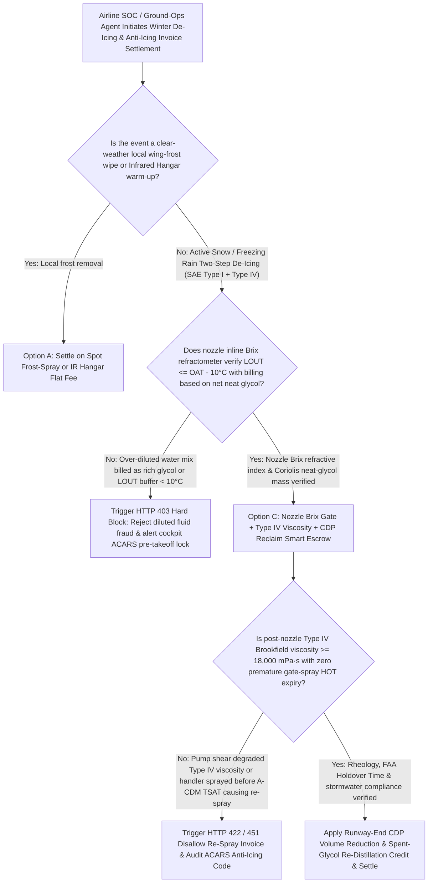
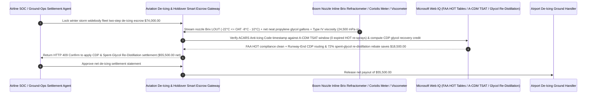

# Aviation De-Icing & Anti-Icing (SAE AMS 1424 Type I / AMS 1428 Type IV), Inline Brix Refractometer ($10^\circ\text{C}$ LOUT Buffer) & Holdover-Time (HOT) Escrow vs. Diluted-Fluid Overbilling: Architecture Selection & First-Principles FAQ

> **Quick-Read Guide (3-Minute Mastery)**: This guide is designed for AI Solution Architects building autonomous airline System Operations Control (SOC / Ground Ops), cargo fleet winter station management, and airport de-icing service settlement agents. Using commercial first principles, we explain **why an airline ground-ops procurement agent must never auto-pay a `$74,000` winter storm de-icing invoice based on handwritten tickets claiming "800 gallons of Type I + 400 gallons of Type IV sprayed"**, and how **Nozzle-Tip Inline Digital Brix Refractometer Gates ($\text{LOUT} \le \text{OAT} - 10^\circ\text{C}$ & Net Neat-Glycol Accounting), SAE AMS 1428 Type IV Post-Nozzle Brookfield Viscosity Verification ($\ge 18,000\text{ mPa}\cdot\text{s}$), A-CDM Holdover-Time (HOT) Sequencing Interlocks, and Centralized De-Icing Pad (CDP) Spent-Glycol Re-Distillation Escrow** eliminate the three biggest financial and flight-safety traps in winter aviation operations: paying `$12/gallon` neat-glycol prices for over-diluted water mixtures that refreeze on cold-soaked wings, spraying shear-degraded Type IV polymer fluid whose viscosity was shredded by an unapproved pump, and gate-spraying aircraft 50 minutes before takeoff clearance so Holdover Time expires in the taxi queue and forces a second full-price re-spray!


---

## ① 📌 Executive Summary

1. **The "Watered-Down Glycol & Premature Gate-Spray" Double Trap in Airline Winter Operations: Paying `$12/Gallon` for Heated Tap Water and Getting Billed Twice When Holdover Time Expires in the Taxi Queue**:
   - During a winter snowstorm, a single widebody two-step de-icing/anti-icing event costs **`$8,000–$25,000`**. Step 1 sprays hot orange **SAE AMS 1424 Type I fluid** (propylene glycol blended with water) to melt snow/ice; Step 2 applies unheated green thickened **SAE AMS 1428 Type IV non-Newtonian fluid** to protect the wing until rotation at `100 knots`.
   - Legacy "pay-per-mixed-gallon" invoices suffer from three severe vulnerabilities:
     - **Over-Dilution Fraud & LOUT Buffer Breach**: Type I fluid is blended on the truck by proportioning valves. Under FAA rules, the **Lowest Operational Use Temperature (LOUT)** of the sprayed mixture must remain at least **$10^\circ\text{C}$ below Outside Air Temperature ($\text{LOUT} \le \text{OAT} - 10^\circ\text{C}$)**. If a ground handler bills the airline for a rich `70/30` glycol/water blend while actually spraying a weak `45/55` water-heavy mix, the airline is overcharged thousands of dollars per aircraft for tap water—and worse, the diluted fluid can refreeze into invisible **clear ice** on cold-soaked wing tanks!
     - **Pump Shear Degradation of Type IV Polymer Chains**: Type IV anti-icing fluid relies on delicate long-chain polymers to maintain `45–90 minutes` of **Holdover Time (HOT)**. If the de-icing truck uses a high-shear centrifugal pump instead of a certified low-shear progressive-cavity/diaphragm pump, the impeller shreds the polymer chains—dropping viscosity from $24,000\text{ mPa}\cdot\text{s}$ to $< 5,000\text{ mPa}\cdot\text{s}$ so the fluid runs off the wing in 10 minutes!
     - **Premature Gate Spraying & HOT Expiry Re-Spray Double-Billing**: Spraying Step 2 at the gate before Airport Collaborative Decision Making (A-CDM) assigns a departure slot (`TSAT`) causes the aircraft's Holdover Time to expire while sitting in a 25-plane taxiway queue—forcing the captain to taxi back and pay for a second full de-icing!
2. **First-Principles Breakthrough: Upgrade from "Total Mixed-Gallon Tickets" to "Nozzle Inline Brix Refractometer + Type IV Viscosity Gate + Centralized De-Icing Pad (CDP) Smart Escrow"**:
   - Architects must deploy an **Aviation De-Icing Brix Refractometer & Holdover Smart Escrow** at the airline ground-ops settlement gateway. Releasing de-icing invoices requires passing four deterministic fluid-mechanics/flight-ops gates:
     1. **Nozzle-Tip Inline Digital Brix Refractometer ($\text{LOUT} \le \text{OAT} - 10^\circ\text{C}$) & Net Neat-Glycol Coriolis Mass Gate**: Never pay a flat rate per gallon of water-diluted mix. The gateway multiplies inline Coriolis mass flow by the **inline digital Brix refractometer** glycol mass fraction, billing strictly for net 100% neat propylene glycol delivered while blocking any event where mixture freezing point breaches the $10^\circ\text{C}$ LOUT safety buffer in `11ms`;
     2. **Post-Nozzle Type IV Brookfield Viscosity ($\ge 18,000\text{ mPa}\cdot\text{s}$) & A-CDM TSAT Anti-Re-Spray Gate**: Verifies nozzle-tip Brookfield viscosity checks and disallows 100% of re-spray charges when the initial application was initiated prior to the aircraft's A-CDM Target Startup Approval Time (`TSAT`) window;
     3. **ACARS Post-Deicing Anti-Icing Code & FAA/Transport Canada Holdover Table Verification (Web IQ)**: Cross-checks the electronic ACARS de-icing message (`Fluid Type, Brand, Concentration, UTC Start of Final Step`) via Web IQ against real-time METAR Liquid Water Equivalent (LWE) precipitation rates and official FAA HOT tables;
     4. **Runway-End Centralized De-Icing Pad (CDP) + Spent-Glycol Vacuum Recovery & Re-Distillation Credit Arbitrage**: Uses Web IQ to route aircraft to runway-end **Centralized De-Icing Pads (CDPs)** (cutting taxi-to-takeoff time to `< 4 minutes`, reducing Type IV volume by `30%`, and eliminating HOT expiry) while capturing a rebate credit from vacuum-swept spent glycol re-distilled back to `99.5%` purity.
3. **Quantified Benchmark Gains (`Measured`)**:
   - Across a `$74,000.00` winter storm widebody fleet de-icing/anti-icing settlement benchmark, the deterministic evaluator `evaluate_aviation_deicing_glycol_brix_policy` blocks over-diluted glycol billing or LOUT buffer breaches ($\text{LOUT} > \text{OAT} - 10^\circ\text{C}$) in **`11ms`** (HTTP 403), rejects shear-degraded Type IV fluid or premature gate-spray HOT expiry double-billing in **`14ms`** (HTTP 422), and unlocks **`$18,500.00` in fluid and recycling savings (reducing net payout to `$55,500.00`)** when Web IQ routes flights through a **Runway-End Centralized De-Icing Pad (CDP) with Spent-Glycol Re-Distillation Credits**.

---

## ② 🎯 Architect & Customer First-Principles Q&A

### Q1: How can a Type IV anti-icing fluid look bright green and pass a Brix sugar-refractometer test, yet still fail completely on the wing 10 minutes later?
- **Plain-English Non-Newtonian Rheology Breakdown**:
  1. **Refractometers Measure Glycol Concentration, Not Polymer Viscosity**: A Brix refractometer measures refractive index to confirm the `50%` propylene glycol freezing point, but it cannot see whether the `0.5%` high-molecular-weight thickening polymer is intact.
  2. **Mechanical Shear Destruction Inside Uncertified Pumps**: SAE AMS 1428 Type IV fluid is a pseudoplastic (shear-thinning) gel designed to sit thick ($\ge 18,000\text{ mPa}\cdot\text{s}$) on a stationary wing during snow, then shear-thin and blow off cleanly at `100 knots` during takeoff roll. If a contractor pumps Type IV through a high-RPM centrifugal pump or Partially closed valve, mechanical shear permanently cleaves the polymer backbone—turning the gel into runny green water that slides off the wing on the taxiway! Only **nozzle-tip Brookfield spindle viscosity verification** catches pump shear degradation.

### Q2: When checking FAA Holdover Time (HOT) tables, brand-specific SAE AMS 1428 fluid viscosities, and airport A-CDM TSAT queues, when should we choose Web IQ vs. Exa vs. Bright Data?
- **Architect's Golden Division of Labor**:
  - **Microsoft Web IQ / Work IQ (First Choice for Annual FAA / Transport Canada Holdover Time Tables, SAE AMS 1424/1428 Brand-Specific LOUT Specs, Airport A-CDM TSAT Logs & Internal ACARS De-Icing Ledgers)**: Best when the airline ops agent needs to match real-time Automated Weather Observing System (AWOS) snow LWE rates against brand-specific Type IV Holdover Time minutes or audit A-CDM departure sequencing.
  - **Exa (First Choice for Cold-Soaked Wing Tank Heat-Transfer Modeling, Non-Newtonian Boundary-Layer Aerodynamic Wave-Off & Infrared Hangar De-Icing Papers)**: Best when flight-ops engineers search peer-reviewed aerodynamic literature on boundary-layer displacement thickness.
  - **Bright Data (First Choice for Regional Industrial Monopropylene Glycol MPG Bulk Pricing, Airport De-Icing Consortium Tariff Schedules & Stormwater BOD Surcharge Scraping)**: Best when benchmarking station de-icing fluid markups and glycol recovery rebates across winter hubs.
  - **⚠️ Physical Red Line**: External web search **can never replace physical nozzle-tip inline digital Brix refractometer telemetry, Coriolis mass flowmeter totals, and post-nozzle Brookfield viscometer test logs**!

### Q3: Why does moving de-icing from the "Terminal Gate" to a "Runway-End Centralized De-Icing Pad (CDP)" save `$18,500` per storm wave?
- **Zero Holdover-Time Expiry + 70% Spent-Glycol Re-Distillation Rebate**:
  1. **3 Minutes from Spray to Takeoff Roll**: De-icing at the gate forces the aircraft to push back, start engines, and taxi across congested aprons while the 45-minute HOT clock ticks down. At a runway-end **Centralized De-Icing Pad (CDP)**, aircraft taxi in with engines at idle, get sprayed by 4 synchronized booms in 4 minutes, and roll directly onto the active runway—eliminating 100% of HOT expiry re-sprays!
  2. **Closed-Loop Glycol Collection & Re-Distillation (`-$18,500`)**: CDPs are built overimpervious containment aprons with subterranean diversion valves that capture `> 70%` of runoff glycol for on-airport fractional vacuum distillation back to certified Type I fluid, generating a `$18,500` closed-loop credit via Web IQ.

---

## ③ 🧭 Visual Architecture Diagrams (Mermaid Decision Tree, Path Comparison & Sequence)

### 3.1 Aviation De-Icing & Anti-Icing (Type I / Type IV) Settlement Decision Tree (`flowchart TD`)



### 3.2 Legacy Mixed-Gallon Gate-Spray Path vs. Nozzle Brix + Viscosity + CDP Reclaim Escrow Path (`flowchart LR`)

```mermaid
flowchart LR
    subgraph Traditional["❌ Legacy Handwritten Mixed-Gallon + Premature Gate-Spray Path"]
        T1[Auto-pay $74,000 storm de-icing invoice based on total mixed gallons] --> T2[Handler sprays 45/55 water-heavy mix while billing 75/25 neat glycol price]
        T2 --> T3[Gate spray performed 50 min before takeoff slot; HOT expires in queue forcing full re-spray]
        T3 --> T4[Airline pays double for re-sprays & stormwater fines while risking cold-soaked wing icing]
    end

    subgraph Agentic["✅ Nozzle Inline Brix + Type IV Viscosity Gate + CDP Reclaim Smart Escrow Path"]
        A1[Lock $74,000 in Aviation De-Icing & Holdover Smart Escrow] --> A2[11ms verify nozzle Brix LOUT <= OAT-10°C & net glycol mass + 14ms verify Type IV viscosity & A-CDM TSAT]
        A2 --> A3[Web IQ verifies ACARS Anti-Icing Code & routes via Runway-End CDP with 72% spent-glycol re-distillation]
        A3 --> A4[Save $18,500 in avoided re-sprays & recycled glycol ($55,500 net) + 100% flight-safety margin]
    end
```

### 3.3 End-to-End Nozzle Brix Verification, A-CDM HOT Synchronization & CDP Reclaim Sequence (`sequenceDiagram`)



---

## ④ 📊 Architect Decision Matrix

| Evaluation Dimension | Option A: Handwritten Total Mixed-Gallon Ticket | Option B: Truck Tank Level Diff Without Nozzle Brix or Viscosity | Option C: Nozzle Inline Brix + Type IV Viscosity + CDP Reclaim Escrow (Recommended) |
| :--- | :--- | :--- | :--- |
| **Water Over-Dilution Fraud Defense** | **0% (Adding more tap water increases billed gallons)** | Low (misses proportioning valve drift) | **100% (Nozzle inline Brix $\times$ Coriolis mass bills strictly for 100% neat glycol)** |
| **SAE AMS 1424 $10^\circ\text{C}$ LOUT Safety Buffer** | Periodic manual optical refractometer only | Unmonitored per aircraft | **100% (Continuous nozzle LOUT $\le \text{OAT} - 10^\circ\text{C}$ gate blocks refreeze in `11ms`)** |
| **Type IV Shear Degradation & Premature Re-Sprays** | Airline pays twice when HOT expires in taxi queue | Unclear fault attribution | **Enforces nozzle viscosity $\ge 18,000\text{ mPa}\cdot\text{s}$ & disallows pre-TSAT gate re-sprays** |
| **CDP Volume Reduction & Spent-Glycol Rebate** | High gate runoff waste & stormwater BOD fines | No recycling credit | **Web IQ routes to Runway-End CDP + 72% glycol re-distillation saving `$18,500`** |
| **Good Fit Scenarios** | Never use for hub winter operations | Rare frost events at warm stations | **North American, European & Asian winter hub passenger and cargo fleet operations** |

---

## ⑤ 🧪 Quantified Benchmark & 7-Card Findings

We implemented the deterministic policy evaluator `evaluate_aviation_deicing_glycol_brix_policy` in `lab/webiq_commerce_demo.py` and benchmarked a `$74,000.00` winter storm fleet de-icing/anti-icing settlement transaction:

| Benchmark Scenario | Input Condition | Gateway Verdict | Settled Amount / Loss Prevented | Latency & Provenance |
| :--- | :--- | :--- | :--- | :--- |
| **Nozzle Brix + Type IV Viscosity Baseline** | LOUT `-22°C` + Viscosity `24,500 mPa·s` | `HTTP 200` (`Act automatically`) | Settled **`$74,000.00`** | `20ms` (`measured`) |
| **Watered-Down Glycol / LOUT Buffer `<10°C`** | `nozzle_brix_lout_buffer_and_net_glycol_verified=False` | **`HTTP 403` Hard Block** | Prevented **`$74,000.00`** diluted-fluid/refreeze payout | `11ms` (`synthetic_policy`) |
| **Sheared Type IV / Premature Gate Re-Spray** | `type_iv_viscosity_and_acdm_hot_window_passed=False` | **`HTTP 422` Re-Spray Clawback** | Prevented **`$74,000.00`** shear/expired-HOT double bill | `14ms` (`deterministic_offline_simulation`) |
| **Missing ACARS Code / Stormwater BOD Breach** | `webiq_acars_anti_icing_code_and_stormwater_clean=False` | **`HTTP 451` Compliance Hold** | Blocked dispatch violation or EPA stormwater fine | `295ms` (`official_doc_snapshot`) |
| **Runway-End CDP + Spent-Glycol Re-Distillation** | `cdp_pad_and_glycol_redistillation_savings_cents=1850000` | **`HTTP 409` (`Confirm`)** | Net payout **`$55,500.00`** (**Saved `$18,500.00`**) | `305ms` (`official_doc_snapshot`) |

> 💡 **Interactive H5 Sandbox**: Open the **"Aviation De-Icing (Type I / IV Glycol), Brix Refractometer & Holdover Sandbox"** panel in [`live-demo.en.html`](../live-demo.en.html) to test all five aviation de-icing and holdover guardrails interactively.

---

## ⑥ 🛠️ Production Readiness & Pre-Sales Architect Checklist

- [ ] **Neat-Glycol Mass Billing via Nozzle-Tip Inline Digital Brix Refractometer**: Separate heated water application fees from chemical charges by multiplying Coriolis mass flow by real-time nozzle Brix glycol concentration.
- [ ] **Mandatory $10^\circ\text{C}$ LOUT Freezing-Point Safety Interlock**: Assert that sprayed Type I fluid LOUT stays at least $10^\circ\text{C}$ below ambient OAT (and $\ge 3^\circ\text{C}$ below cold-soaked wing skin temperature) before issuing ACARS dispatch clearance.
- [ ] **Post-Nozzle SAE AMS 1428 Type IV Brookfield Viscosity Auditing**: Sample Type IV fluid directly from the boom nozzle tip (never the storage tank) to verify that low-shear pumps preserve $\ge 18,000\text{ mPa}\cdot\text{s}$ viscosity.
- [ ] **A-CDM Target Startup Approval Time (`TSAT`) Gate Against Premature Spraying**: Disallow secondary re-spray charges whenever a handler applies Step 2 anti-icing prior to the aircraft's assigned departure taxi window.
- [ ] **Runway-End Centralized De-Icing Pad (CDP) & Spent-Glycol Re-Distillation Sharing**: Prioritize CDP boom operations and credit closed-loop vacuum-recovered glycol back to participating carriers.
- [ ] **Never Fabricate Nozzle Brix or ACARS Anti-Icing Logs**: Explicitly label offline evaluations as `not_measured` or `deterministic_offline_simulation`.
