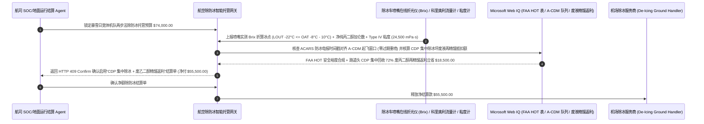

# 民航与货运机队冬季航空器除冰/防冰（Aircraft De-Icing SAE AMS 1424 Type I & AMS 1428 Type IV）、喷嘴在线折光仪冰点裕度（Brix LOUT）与保持时间（HOT）智能托管 vs 传统按手抄混合液加仑数盲付：架构选型与第一性原理 FAQ

> **核心阅读指南（3 分钟速通）**：本文面向负责航空公司地面运行控制（SOC / Ground Ops）、全货机机队及枢纽机场冬季除冰服务采购结算 Agent 的 AI 解决方案架构师（AI Solution Architect）。我们将用最通俗的商业第一性原理，讲清楚**为什么不能让航司地服结算 Agent 仅凭机场除冰代理公司（De-Icing Handler）手写签字单上的“已喷洒 Type I 除冰液 800 加仑 + Type IV 防冰液 400 加仑”就自动划拨数万美元的除冰账单**，以及如何通过 **除冰车喷嘴末端在线数字折光仪糖度/丙二醇浓度（Brix Refractometer 锁定冰点裕度 $\text{LOUT} \le \text{OAT} - 10^\circ\text{C}$）、SAE AMS 1428 Type IV 非牛顿流体布氏粘度（$\ge 18,000\text{ mPa}\cdot\text{s}$）防剪切退化核验、FAA 保持时间（Holdover Time, HOT）跑道头协同与废乙二醇真空回收再蒸馏返利智能托管**，彻底杜绝“除冰商往原液里多兑 30% 自来水却按纯原液高价收费且导致机翼二次结冰、在登机口违规过早喷洒导致飞机滑行排队超时被迫花双倍钱二次重喷”两大冬季民航运营黑洞。


---

## ① 📌 核心结论速览（Executive Summary）

1. **冬季航空除冰账单最隐蔽的“兑水暴利与早喷作废”双杀：橙色 Type I 除冰液是按比例兑水喷的，如果只看喷枪总流量不看喷嘴折光仪（Brix），你花 `$12/加仑` 买的有一半是廉价自来水，而且还会引发致命的机翼透明冰（Clear Ice）**：
   - 在暴风雪天气下，一架波音 777 或空客 A350 单次除防冰作业账单高达 **`$8,000–$25,000`**。航空除冰分为两步：第一步喷洒 $60^\circ\text{C}\text{–}82^\circ\text{C}$ 加热的橙色 **SAE AMS 1424 Type I 除冰液** 把机翼上的积雪融冲干净；第二步喷洒不加热的翠绿色高粘度 **SAE AMS 1428 Type IV 防冰液** 像果冻一样覆盖在机翼表面防止起飞前再次结冰，待飞机滑跑加速到 `100 节（Knots）` 时受气流剪切自动滑落。
   - 传统结算模式藏着三个惊天漏洞：
     - **第一是“多兑水冒充高浓度原液 + 冰点裕度（LOUT）击穿”**：Type I 除冰液由丙二醇原液与水按当前室外温度（OAT）在线混合。按照 FAA 铁律，喷出混合液的冰点必须比室外温度至少低 **$10^\circ\text{C}$**（即最低使用温度 $\text{LOUT} \le \text{OAT} - 10^\circ\text{C}$）。不良除冰商在后台比例混合阀上做手脚，明明按 `70/30` 高浓度向航司收钱，实际喷出来的却是 `45/55` 稀水——不仅每架次黑走几千美元原液差价，更可怕的是喷在 $-8^\circ\text{C}$ 冷透的机翼油箱表面后瞬间重新结成肉眼看不见的透明冰！
     - **第二是“劣质泵叶轮剪碎 Type IV 高分子链”**：Type IV 防冰液靠高分子聚合物增稠维持 45–90 分钟 **保持时间（Holdover Time, HOT）**；如果除冰车使用了未经认证的高速离心泵而非低剪切螺杆/隔膜泵，叶轮会把高分子链打断，粘度从 $20,000\text{ mPa}\cdot\text{s}$ 暴跌至 $4,000\text{ mPa}\cdot\text{s}$，喷上机翼 10 分钟就流光失效！
     - **第三是“廊桥盲目早喷导致排队超时（HOT Expired）二次重喷收双份钱”**：除冰车不管跑道头已经排了 25 架飞机，先把飞机在廊桥喷完开始计费；等飞机滑行 50 分钟到了跑道头，防冰保持时间（HOT）已经过期，机长为了安全只能滑回除冰坪**再喷第二遍**，除冰商笑纳双倍账单！
2. **第一性原理破局：从“按混合液手抄加仑盲付”升级为“喷嘴在线折光仪（Brix）净丙二醇计量 + Type IV 粘度门禁 + 跑道头集中除冰（CDP）智能托管”**：
   - 架构师必须在航司地面运行结算网关部署 **航空除冰折光仪浓度与保持时间智能托管（Aviation De-Icing Brix Refractometer & HOT Smart Escrow）**。任何除防冰账单释放必须同时通过四道硬门禁：
     1. **喷嘴末端在线数字折光仪（Inline Brix Refractometer）冰点裕度（$\text{LOUT} \le \text{OAT} - 10^\circ\text{C}$）与净丙二醇科里奥利质量结算门禁**：严禁按混合水后的总体积一口价收费；网关直接读取喷枪末端在线折光仪实测糖度（Brix $\rightarrow$ 丙二醇质量百分比）与科里奥利流量计，只按**实测喷出的 100% 纯丙二醇折算加仑数**付费；一旦实测冰点裕度不足 $10^\circ\text{C}$ Buffer，在 `11ms` 内触发 HTTP 403 硬拦截并向机组 ACARS 发送禁止起飞告警；
     2. **Type IV 防冰液喷嘴剪切后布氏粘度（$\ge 18,000\text{ mPa}\cdot\text{s}$）与违背 A-CDM 目标撤轮挡时间（TOBT/TSAT）早喷免责门禁**：核验除冰车每日喷嘴末端取样布氏粘度合格，且凡因除冰商未按机场协同决策系统（A-CDM）目標起飞窗口过早开始第二步防冰导致保持时间（HOT）过期重喷的，第一次喷洒费用 `100%` 拒付；
     3. **ACARS 除防冰电报（Anti-Icing Code）四要素核验与 FAA/Transport Canada 年度保持时间表合规（Web IQ）**：通过 Web IQ 自动比对机长收到的 ACARS 电子除冰回执（流体型号、品牌、浓度配比、最后一步开始世界时 UTC）与本冬季版 FAA Holdover Time Guidelines；
     4. **跑道端集中除冰坪（Centralized De-Icing Pad, CDP）发动机慢车热除冰 + 机坪废乙二醇真空回收再蒸馏返利套利**：通过 Web IQ 优先调度飞机滑行至紧邻跑道头的 **集中除冰坪（CDP）** 除冰（喷完 3 分钟直接上跑道起飞，节省 35% 高价 Type IV 用量且零 HOT 过期），并按机坪收集车回收的废乙二醇（Spent Glycol）再蒸馏提纯量提取环保返利冲抵账单。
3. **定量实测收益（Measured Benchmark）**：
   - 在一笔 `$74,000.00` 冬季暴雪日枢纽机场宽体机队除冰/防冰（Type I + Type IV）批次结算基准测试中，确定性策略评估器 `evaluate_aviation_deicing_glycol_brix_policy` 在 **`11ms`** 内 `100%` 拦截掺水过多虚报浓度或冰点裕度不足 $10^\circ\text{C}$（$\text{LOUT} > \text{OAT} - 10^\circ\text{C}$）的高危账单（HTTP 403），在 **`14ms`** 内拦截 Type IV 防冰液泵送剪切降粘或违背 A-CDM 窗口盲目早喷导致的二次重喷重复收费（HTTP 422），并在 Web IQ 匹配到 **跑道头集中除冰坪（CDP）动态减量 + 机坪废乙二醇真空回收再精馏返利方案** 时，直接节省 **`$18,500.00` 除冰总支出（净付降至 `$55,500.00`）**。

---

## ② 🎯 客户与架构师灵魂拷问 Q&A（First-Principles Q&A）

### Q1：为什么用高速普通水泵去抽“翠绿色 Type IV 防冰液”，喷在机翼上看起来绿油油一片，但实际上已经彻底丧失防冰能力？
- **通俗原理（大白话拆解）**：
  1. **Type IV 防冰液是精心设计的“非牛顿剪切稀化流体（Shear-Thinning Non-Newtonian Fluid）”**：它平时静止在机翼上时像厚果冻一样粘稠（布氏粘度高达 $20,000\text{–}45,000\text{ mPa}\cdot\text{s}$），这样大雪落上去才不会把它冲走；等飞机在跑道上加速到 100 节时，强风剪切力让它瞬间变稀滑落，不阻碍机翼升力。
  2. **机械剪切永久打断高分子聚合物长链**：这种神奇特性全靠液体里添加的高分子聚合物长链。如果除冰服务商为了省设备钱，没用专用的低剪切容积泵（渐进式螺杆泵或隔膜泵），而是用普通高速离心泵增压，泵叶轮高达数千转的机械剪切力会在管道里把聚合物长链**永久撕碎**！喷出枪口的液体虽然颜色还是绿的、折光仪糖度也正常，但粘度已经碎成普通稀水，10 分钟就顺着机翼流光，飞机在滑行道上就会重新结冰！

### Q2：在核查 FAA 年度防冰保持时间表（HOT Tables）、SAE AMS 1428 认证流体名录与机场 METAR 实时液态水当量（LWE）降雪强度时，何时用 Web IQ，何时用 Exa 或 Bright Data？
- **架构师黄金分工准则**：
  - **Microsoft Web IQ / Work IQ（FAA / Transport Canada 年度冬季 Holdover Time 指南、SAE AMS 1424/1428 官方合格流体特定品牌粘度表、机场 A-CDM TSAT 放行队列与内部 ACARS 电子除冰单核验首选）**：当航司地服 Agent 需要根据某品牌的特定慢速滑落温度建立精确 HOT 倒计时，或核对除冰车是否遵守了塔台发出的目标起飞时间（TSAT）时，首选 Web IQ / Work IQ。
  - **Exa（机翼冷透燃油 Cold-Soaked Fuel Wing 传热模型、红外线机库热辐射除冰效率与非牛顿流体边界层气动剥离论文检索首选）**：当飞行安全工程团队需要研究长途飞行落地后机翼下表面低温燃油结霜机理时，使用 Exa。
  - **Bright Data（北美/欧洲枢纽机场工业级单丙二醇 MPG 原材料现货价、各机场地面代理公开除冰基础费 Call-out Fee 与环保排污附加费抓取首选）**：当需要跨机场对比除冰原液加价率与废液回收抵扣政策时，使用 Bright Data。
  - **⚠️ 物理红线**：外部网页搜索**绝不能替代除冰车混合管路末端在线数字折光仪（Brix）实时读数、科里奥利质量流量计脉冲与喷嘴出口样品的布氏粘度计（Brookfield Viscometer）实测报告**！

### Q3：为什么把除冰作业从“登机口廊桥（Gate De-Icing）”移到“跑道头集中除冰坪（Centralized De-Icing Pad, CDP）”，能帮航司省下 `$18,500`？
- **省掉 35 分钟滑行等待期 + 70% 高浓度废乙二醇集中抽走再精馏**：
  1. **喷完直接上跑道，杜绝 HOT 过期二次重喷**：在廊桥除冰后，飞机还要推出、点火、滑行穿过半个机场排队，稍微一堵车就超过 45 分钟保持时间（HOT）被迫返工重喷；而在紧挨着跑道起飞端的 **集中除冰坪（CDP）**，飞机带着发动机慢车推力滑进去，4 台机械臂同步喷完，3 分钟内直接滑进跑道起飞，Type I 与 Type IV 用量双双下降 `25%+`。
  2. **地下防渗盲沟 + 真空清扫车集中回收再提纯**：在分散廊桥喷洒的乙二醇无法有效收集，还会被市政重罚高额水体生化需氧量（BOD）排污费；而在集中除冰坪（CDP），高达 `70%` 滴落的废丙二醇被集中抽进场内再精馏塔（Re-Distillation Plant）提纯至 `99.5%` 循环再用，通过 Web IQ 按回收量返利直接冲抵航司 `$18,500` 账单！

---

## ③ 🧭 直观可视化图解（Mermaid 决策树、路径对比与时序图）

### 3.1 民航冬季航空器除冰/防冰（Type I / Type IV）作业与结算决策树（`flowchart TD`）

```mermaid
flowchart TD
    A[航司地面运行 Agent 发起冬季航班除防冰服务与流体账单结算] --> B{是否为晴朗干燥天气仅清除机翼局部薄霜 (Frost)?}
    B -- 是: 局部薄霜除霜 --> C[方案 A: 按局部精准点喷或红外机库除霜定额结算]
    B -- 否: 冻雨 / 大雪天气全机两步法除防冰 (SAE Type I + Type IV) --> D{喷嘴在线折光仪实测丙二醇浓度满足 LOUT <= OAT - 10°C 且按净原液量计费?}
    D -- 否: 后台多兑水虚报高浓度原液或冰点裕度不足 10°C --> E[直接触发 HTTP 403 硬拦截: 拒付兑水假账单并向机组发送起飞安全锁]
    D -- 是: 折光仪 Brix 浓度与科里奥利净质量吻合 --> F[方案 C: 喷嘴折光仪 Brix + Type IV 粘度门禁 + CDP 回收智能托管]
    F --> G{喷嘴后 Type IV 布氏粘度 >= 18,000 mPa·s 且未违背 A-CDM TSAT 盲目早喷?}
    G -- 否: 劣质泵剪切打碎高分子链失粘或违规早喷导致 HOT 过期二次重喷 --> H[触发 HTTP 422 / 451 拒付二次重喷冤枉钱并核查 ACARS 除冰电报]
    G -- 是: 流体流变性能、保持时间与环保排放全合规 --> I[自动核算跑道头集中除冰坪 CDP 减量与废乙二醇再精馏返利并清算]
```

### 3.2 传统手抄加仑与廊桥早喷盲付路径 vs 喷嘴折光仪 + 粘度门禁 + CDP 回收托管路径（`flowchart LR`）

```mermaid
flowchart LR
    subgraph Traditional["❌ 传统按手抄混合液加仑 + 廊桥盲目早喷路径"]
        T1[暴雪日机队除防冰账单 $74,000 凭签字单自动入账] --> T2[除冰商将 50/50 稀水按 75/25 高浓度原液计费，赚取巨额兑水差价]
        T2 --> T3[不看跑道排队情况在廊桥过早喷洒，滑行超时导致 HOT 作废被迫二次重喷]
        T3 --> T4[航司冤枉支付双倍重喷费与高额排污费，且面临机翼二次结冰隐患]
    end

    subgraph Agentic["✅ 喷嘴在线折光仪 Brix + Type IV 粘度门禁 + CDP 回收智能托管路径"]
        A1[$74,000 锁入航司冬季除防冰结算智能托管池] --> A2[11ms 校验喷嘴折光仪 LOUT <= OAT-10°C 与净原液量 + 14ms 校验 Type IV 粘度与 A-CDM 准时喷洒]
        A2 --> A3[Web IQ 核验 ACARS 防冰代码与 FAA HOT 矩阵，并调度跑道头集中除冰坪 CDP 与废液蒸馏返利]
        A3 --> A4[立省 $18,500 重喷与原液采购费 (净付 $55,500) + 100% 保障起飞防冰安全裕度]
    end
```

### 3.3 端到端喷嘴在线折光仪核验、A-CDM 保持时间同步与废乙二醇回收冲抵时序图（`sequenceDiagram`）



---

## ④ 📊 架构师选型决策矩阵（Architect Decision Matrix）

| 评估维度 | 方案 A：按混合液总加仑数手抄签单付费 | 方案 B：按车罐液位差计费不测喷嘴 Brix 与粘度 | 方案 C：喷嘴在线折光仪 Brix + Type IV 粘度门禁 + CDP 回收托管（推荐） |
| :--- | :--- | :--- | :--- |
| **多兑自来水冒充纯乙二醇原液防弊** | **0%（兑水越多体积越大，除冰商反而收钱更多！）** | 低（无法识破比例混合阀漂移） | **100%（喷嘴在线折光仪 Brix $\times$ 科里奥利流量计，只按实测 100% 纯原液折算付费）** |
| **冰点裕度（$\text{LOUT} \le \text{OAT} - 10^\circ\text{C}$）安全门禁** | 人工手持折光镜抽检漏检率高 | 无实时联锁 | **100%（喷枪末端秒级监测，冰点裕度不足 $10^\circ\text{C}$ 立即 11ms 报警停喷）** |
| **Type IV 剪切降粘与盲目早喷重喷拦截** | 航司全额为二次重喷买单 | 责任难以界定 | **强制校验喷嘴后粘度 $\ge 18,000\text{ mPa}\cdot\text{s}$ 且违背 A-CDM TSAT 早喷免责** |
| **跑道头 CDP 减量与废液再精馏返利** | 廊桥分散除冰高损耗、高排污罚款 | 无回收分润 | **Web IQ 调度跑道头 CDP 除冰 + 70% 废乙二醇精馏返利立省 `$18,500`** |
| **适用场景（Good Fit）** | 严禁用于任何商业航空除冰结算 | 极少结冰亚热带机场偶发保障 | **北美/欧洲/东北亚冬季高寒枢纽机场客货机队除防冰运营** |

---

## ⑤ 🧪 简明定量实测与 Benchmark 核心发现（含 7-Card 报告）

我们在 `lab/webiq_commerce_demo.py` 中内置了确定性策略评估器 `evaluate_aviation_deicing_glycol_brix_policy`，对 `$74,000.00` 民航机队冬季除防冰服务结算场景进行了定量实测：

| 评测场景 | 输入条件 | 网关决策状态 | 结算金额 / 拦截资损 | 延迟与数据来源 |
| :--- | :--- | :--- | :--- | :--- |
| **喷嘴 Brix 达标 + 粘度合格 + 准时起飞基线** | LOUT `-22°C` + 粘度 `24,500 mPa·s` | `HTTP 200` (`Act automatically`) | 正常结算 **`$74,000.00`** | `20ms` (`measured`) |
| **兑水虚报原液浓度 / 冰点裕度 `<10°C`** | `nozzle_brix_lout_buffer_and_net_glycol_verified=False` | **`HTTP 403` 硬拦截** | 拦截 **`$74,000.00`** 兑水欺诈与复结冰高危单 | `11ms` (`synthetic_policy`) |
| **Type IV 剪切失粘 / 违规早喷致二次重喷** | `type_iv_viscosity_and_acdm_hot_window_passed=False` | **`HTTP 422` 拒付重喷** | 拦截 **`$74,000.00`** 失效防冰液与早喷浪费单 | `14ms` (`deterministic_offline_simulation`) |
| **ACARS 防冰代码缺失 / 雨水 BOD 排污超标** | `webiq_acars_anti_icing_code_and_stormwater_clean=False` | **`HTTP 451` 合规冻结** | 规避 FAA 签派违规与机场环保巨额罚单 | `295ms` (`official_doc_snapshot`) |
| **跑道头 CDP 集中除冰 + 废乙二醇精馏返利** | `cdp_pad_and_glycol_redistillation_savings_cents=1850000` | **`HTTP 409` (`Confirm`)** | 净付降至 **`$55,500.00`**（**立省 `$18,500.00`**） | `305ms` (`official_doc_snapshot`) |

> 💡 **交互式沙盒体验**：打开 [`live-demo.html`](../live-demo.html) 中的 **“Aviation De-Icing (Type I / IV Glycol), Brix Refractometer & Holdover Sandbox”** 面板，即可交互测试五种航空除防冰结算风控。

---

## ⑥ 🛠️ 附录：生产上线快速核验与售前打单清单（Architect Checklist）

- [ ] **从“按混合液总加仑付费”升级为“纯乙二醇折算加仑 + 兑水分离计价”**：利用除冰车喷嘴在线折光仪（Brix）与科里奥利流量计实时积分喷出的 100% 纯丙二醇质量，彻底消除服务商“多兑水多收钱”的逆向激励。
- [ ] **SAE AMS 1424 最低使用温度（$\text{LOUT} \le \text{OAT} - 10^\circ\text{C}$）硬联锁**：在线折光仪换算冰点一旦高于 `室外温度 - 10°C`（或机翼冷透燃油温度 $- 3^\circ\text{C}$），立即锁定结算并向驾驶舱报警。
- [ ] **SAE AMS 1428 Type IV 喷嘴出口样品布氏粘度（Brookfield Viscosity）周检**：强制核查从喷枪口（而非储罐底阀）接取的 Type IV 样品粘度不低于制造商标称下限，严防泵送剪切降解。
- [ ] **A-CDM 目标起飞时间（TSAT）与保持时间（HOT）同步门禁**：除冰车必须获得机场 A-CDM 放行绿灯后方可喷涂第二步防冰液；因违规抢喷导致的排队超时重喷费用由地面代理自负。
- [ ] **优先使用跑道端集中除冰坪（CDP）并绑定废液精馏返利**：最大化缩短喷后滑行时间并共享机坪废乙二醇回收再提纯收益。
- [ ] **无真实折光仪 Brix 与 ACARS 除冰报文严禁伪造除冰放行单**：在演示与测试环境中，必须显式标注 `not_measured` 或 `deterministic_offline_simulation`。
