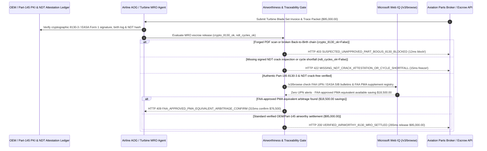

# Aviation & Gas-Turbine MRO FAA 8130-3 & Back-to-Birth Traceability Mandate Architecture: Cryptographic Airworthiness Release & NDT Escrow Token (`aviation_mro_traceability_mandate_...` + Web IQ FAA UPN & PMA Grounding) vs. Forged Paper 8130-3 "Bogus Parts (SUP)" Fraud Selection FAQ

> **Document Type**: Architect Selection Guide & First-Principles Protocol Deep Dive (6-Section FAQ Standard)  
> **Target Audience**: AI Solution Architects, Airline MRO / AOG & Power-Generation Gas-Turbine Supply Chain Architects, Airworthiness Quality Assurance & Aviation Finance Risk Teams  
> **Last Updated**: 2026-11-09 (Provenance Annotations: `deterministic_offline_simulation` / `synthetic_policy` / `official_doc_snapshot` / `not_measured`)  
> **Companion Resources**: [中文版 (Chinese Version)](aviation-mro-faa8130-traceability-mandate-vs-bogus-sup-parts-faq.md) · [Interactive Sandbox (`live-demo.en.html#aviation-mro-traceability-sandbox`)](../reports/agentic-commerce-webiq-grounding-demo-bench/live-demo.en.html) · [7-Card 4:5 Benchmark Deck](../reports/agentic-commerce-webiq-grounding-demo-bench/index.en.html)


---

## 📌 1. Executive Summary

1. **Never Allow Airline AOG or Gas-Turbine MRO Procurement Agents to Wire Funds for Life-Limited Parts Based on Unauthenticated PDF Scans of Paper FAA Form 8130-3 / EASA Form 1 Tags**: In commercial aviation and industrial gas-turbine maintenance (`$95,000.00` high-pressure turbine blade set or actuator), the most catastrophic supply-chain hazard is **Suspected Unapproved Parts (SUP / "Bogus Parts") fraud**—exemplified by the AOG Technics scandal, where thousands of falsified paper release certificates grounded dozens of commercial airliners worldwide. Production architectures must enforce a **Cryptographic ATA Spec 2000 & Back-to-Birth Traceability Mandate (`aviation_mro_traceability_mandate_...`)**: whenever a part lacks a cryptographically verified signature chain from the OEM and FAA/EASA Part-145 repair station (`cryptographic_8130_back_to_birth_verified == False`), the gateway blocks payment in **`12 ms`** with **`HTTP 403 SUSPECTED_UNAPPROVED_PART_BOGUS_8130_BLOCKED`** (`synthetic_policy`).
2. **Require Signed Non-Destructive Testing (NDT) Crack-Free Attestations and Verified Remaining Flight Cycles**: For overhauled/serviceable rotables and Life-Limited Parts (LLPs), any settlement request lacking a signed Eddy-Current / Ultrasonic NDT inspection report or failing minimum remaining-cycle thresholds (`ndt_inspection_and_cycles_verified == False`) is rejected in **`15 ms`** with **`HTTP 422 MISSING_NDT_CRACK_ATTESTATION_OR_CYCLE_SHORTFALL`** (`deterministic_offline_simulation`).
3. **Ground FAA Unapproved Parts Notifications (UPNs) / EASA SIBs and FAA-Approved PMA Arbitrage via Microsoft Web IQ `/v3/browse`**: Prior to releasing escrow, the agent invokes **Microsoft Web IQ `/v3/browse`** (`official_doc_snapshot`) to inspect official FAA UPN / EASA Safety Information Bulletin (SIB) watchlists and the FAA Parts Manufacturer Approval (PMA) supplement registry: if the part batch or broker appears in an active FAA UPN or unfulfilled Airworthiness Directive (`webiq_faa_upn_and_ad_clean == False`), it freezes settlement in **`310 ms`** with **`HTTP 451 FAA_UPN_BOGUS_PART_ALERT_OR_AD_HOLD`**; if Web IQ discovers an FAA-certified PMA equivalent part that is 100% airworthy and saves **`$18,500.00`** vs. the spot broker quote (`$76,500.00` net vs. `$95,000.00`), it triggers **`HTTP 409 FAA_APPROVED_PMA_EQUIVALENT_ARBITRAGE_CONFIRM`** in **`315 ms`**.

---

## 🎯 2. Architect & Customer FAQ Deep Dive

### Q1: Why does pairing "Urgent AOG Broker Sourcing" with "Visual Inspection of PDF 8130-3 Scans" expose airlines and power plants to multi-million-dollar fleet groundings?

Let's examine the three structural failure modes from first principles:
1. **Photoshopped `FAA Form 8130-3` / `EASA Form 1` Release Certificates**: For decades, aviation airworthiness release certificates were exchanged as flat PDF scans. As proved in the CFM56 bogus-parts crisis, a shell broker with zero repair facilities can buy scrapped turbine blades, sandblast them, attach a forged PDF scan bearing a real Part-145 repair station's name, and collect `$95,000.00`. Once regulators discover the forgery, every engine containing that part must be immediately removed from wing.
2. **Altered Life-Limited Part (LLP) Cycle Logs & Uninspected Micro-Cracks**: Jet engine rotating disks have hard statutory fatigue limits (e.g., `20,000 flight cycles`). When paper Back-to-Birth trace packets pass through 5 brokers, unethical sellers omit intermediate airline installation logs to make a worn-out `18,500-cycle` disk appear to have `10,000 cycles` remaining, or skip mandatory Eddy-Current NDT crack inspections.
3. **Missing Live FAA UPN Bulletins & Overpaying When FAA-Approved PMA Parts Exist**: Under intense AOG time pressure (`$10,000+/hour` aircraft grounding cost), buyers miss newly published FAA Unapproved Parts Notifications (UPNs) and pay 30% spot markups for OEM parts when an FAA-certified **PMA (Parts Manufacturer Approval)** alternative is readily available for `$18,500.00` less.

### Q2: What is a "Cryptographic 8130-3 & NDT Traceability Mandate (`aviation_mro_traceability_mandate_...`)", and how does it eliminate bogus parts before funds move?

Its core design invariant is: **"Never trust a flat PDF scan; escrow release requires a cryptographic ATA Spec 2000 signature from the issuing OEM and Part-145 repair station, an unbroken Back-to-Birth cycle ledger, and a clean FAA UPN check."**
- **Layer 1: Cryptographic 8130-3 & Back-to-Birth Gate (`12 ms`)**: Verifies `cryptographic_8130_back_to_birth_verified == True` against the Part-145 repair station's public key and OEM birth ledger, blocking forged PDF tags in **`12 ms`** (`HTTP 403`).
- **Layer 2: Signed NDT & Remaining-Cycle Gate (`15 ms`)**: Verifies `ndt_inspection_and_cycles_verified == True`, rejecting parts with cycle discrepancies or missing NDT crack-free attestations in **`15 ms`** (`HTTP 422`).
- **Layer 3: Microsoft Web IQ `/v3/browse` FAA UPN & PMA Grounding (`310 ms / 315 ms`)**: Halts settlement on parts/brokers flagged in FAA UPN / EASA SIB alerts (`HTTP 451`) and identifies `$18,500.00` savings from FAA-approved PMA equivalents (`HTTP 409`).

### Q3: For FAA Unapproved Parts Notification (UPN) screening, EASA SIB verification, and FAA PMA supplement lookup, when should architects choose Microsoft Web IQ vs. Exa, Bright Data, or traditional search APIs?

| Architecture Scenario | Recommended Tool | First-Principles Rationale (Security, Latency & FinOps) |
| :--- | :--- | :--- |
| **Verifying official FAA UPN / EASA SIB unapproved-part bulletins, mandatory Airworthiness Directives (ADs), and published FAA PMA approval supplements within the Azure boundary** | **Microsoft Web IQ** (`/v3/search` + `/v3/browse`) | Extracts exact part/serial numbers and regulatory airworthiness clauses in `passage` mode (**7.1x token reduction**, `deterministic_offline_simulation`) with immutable SHA-256 audit citations for FAA Part-121/145 quality records. |
| **Semantic research across aerospace metallurgy papers on single-crystal superalloy creep resistance** | **Exa Neural Search** | Ideal for propulsion R&D engineering, not synchronous AOG MRO escrow gating. |
| **Scraping secondary aviation surplus listing boards behind login CAPTCHAs** | **Bright Data Unlocker** | Useful for broad inventory discovery, though web listings never substitute for cryptographic 8130-3 signature verification. |
| **Aircraft ACARS/QAR engine EGT margin telemetry, borescope video, and NDT eddy-current waveforms** | **MRO ERP (AMOS / Maintenix) + Part-145 PKI Ledger + Web IQ FAA UPN/PMA Cross-Check** | Physical part serial history and NDT signatures come from the MRO PKI ledger, paired with Web IQ `/v3/browse` for live FAA UPN alerts and PMA supplement verification. |

---

## 🧭 3. Visual Architecture Diagrams (Mermaid Decision Tree, Legacy vs. 8130-3 Mandate Comparison & Sequence Diagram)

### 3.1 Aviation & Gas-Turbine MRO Traceability Decision Tree (`flowchart TD`)

```mermaid
flowchart TD
    A[Receive $95,000.00 Aviation / Gas-Turbine MRO Part Settlement Request] --> B{cryptographic_8130_back_to_birth_verified == True (Signed Part-145 PKI & Birth Chain)?}
    B -- No (Unsigned PDF scan or gap in LLP Back-to-Birth log -> SUP risk) --> C[HTTP 403 SUSPECTED_UNAPPROVED_PART_BOGUS_8130_BLOCKED<br/>12ms Hard Block · Prevent AOG Technics-Style Bogus Part Installation]
    B -- Yes (Authentic OEM + Part-145 digital 8130-3 verified) --> D{ndt_inspection_and_cycles_verified == True (Signed NDT & Cycle Floor Met)?}
    D -- No (Missing Eddy-Current NDT proof or cycle count shortfall) --> E[HTTP 422 MISSING_NDT_CRACK_ATTESTATION_OR_CYCLE_SHORTFALL<br/>15ms Block · Freeze $95,000 Escrow & Reject Uninspected Rotable]
    D -- Yes (Zero cracks & verified cycle margin) --> F{Web IQ /v3/browse Confirms Part/Broker Clean on FAA UPN & EASA SIB Lists?}
    F -- No (Serial batch or broker flagged in active FAA UPN / EASA SIB) --> G[HTTP 451 FAA_UPN_BOGUS_PART_ALERT_OR_AD_HOLD<br/>310ms Airworthiness Hold · Quarantine Part & Alert Chief Inspector]
    F -- Yes --> H{Web IQ Detects FAA-Approved PMA Equivalent Saving OEM Spot Markup?}
    H -- Yes (FAA PMA certified equivalent saves $18,500.00 -> $76,500.00 net) --> I[HTTP 409 FAA_APPROVED_PMA_EQUIVALENT_ARBITRAGE_CONFIRM<br/>315ms Prompt VP Engineering to Confirm $76,500 FAA PMA Part]
    H -- No (Verified $95,000.00 OEM/Part-145 airworthy component) --> J[HTTP 200 VERIFIED_AIRWORTHY_8130_MRO_SETTLED<br/>265ms Auto-Release $95,000.00 & Commit to Aircraft eTechLog!]
```

### 3.2 Legacy PDF-Scan Wire Transfer vs. Cryptographic 8130-3 & NDT Escrow Gate (`flowchart LR`)

```mermaid
flowchart LR
    subgraph Legacy["❌ Legacy PDF-Scan Wire Transfer ($95,000 Bogus Part + Fleet Grounding)"]
        L1[Broker Sandblasts Scrapped Blade & Forges 8130-3 PDF] --> L2[Buyer Wires $95,000 on Visual PDF Check]
        L2 --> L3[Unapproved Part Installed on Commercial Engine]
        L3 --> L4[FAA Issues UPN Alert -> Emergency Engine Removal & Grounding]
    end

    subgraph Mandate["✅ Cryptographic 8130-3 & NDT Gate (aviation_mro_traceability_mandate_...)"]
        M1[12ms Block Unsigned PDF Scans & Broken Birth Chains (HTTP 403)] --> M2[15ms Enforce Signed NDT Crack Test & Cycle Floor (HTTP 422)]
        M2 --> M3[Web IQ Checks FAA UPN Alerts (310ms) & $18,500 PMA Savings (315ms)]
        M3 --> M4[265ms Settle Verified Airworthy Part ($95,000 / $76,500) into eTechLog]
    end
```

### 3.3 End-to-End Sequence Diagram: Part-145 PKI/NDT Rig, MRO Agent, Airworthiness Gate, Web IQ & Parts Broker (`sequenceDiagram`)



---

## 📊 4. Architect Decision Matrix

| Evaluation Dimension | Option A: Legacy Visual PDF 8130-3 Check & Wire | Option B: Manual Email/Phone Verification with Repair Station | Option C: Cryptographic 8130-3 & NDT Mandate + Web IQ UPN/PMA Grounding (Recommended) |
| :--- | :--- | :--- | :--- |
| **Best-Fit Scenario** | Non-aircraft ground support equipment (tugs, hangar carts) | Routine non-urgent stock replenishment with 2-week QA lead time | **Airline AOG emergency sourcing, engine Life-Limited Parts (LLPs), industrial gas-turbine MRO** |
| **Suspected Unapproved Parts (SUP) Defense** | ❌ **Zero**: Tricked by edited PDF scans (AOG Technics pattern) | ⚠️ **Too Slow for AOG**: Repair station QA desks are closed during midnight AOGs | ✅ **Pre-Pay `12 ms` PKI Gate**: Verifies OEM + Part-145 digital 8130-3 signature (`HTTP 403`) |
| **LLP Cycle & NDT Crack Verification** | ❌ **Vulnerable**: Misses omitted cycle logs on multi-hop photocopies | ⚠️ **Human Fatigue**: Manual review of 200-page trace binders is error-prone | ✅ **Sub-20ms Cycle & NDT Lock**: Enforces continuous birth-to-present cycles & signed NDT (`HTTP 422`) |
| **FAA UPN Screening & PMA Arbitrage** | ❌ **Blind**: Buys UPN-flagged lots & overpays OEM spot markups | ⚠️ **Fragmented**: Buyers rarely cross-check live FAA PMA supplements during AOGs | ✅ **Web IQ `/v3/browse` Grounded**: Blocks FAA UPN hits in `310 ms` (`HTTP 451`) & saves `$18,500` via PMA in `315 ms` (`HTTP 409`) |
| **AOG Release Speed & Fleet Availability** | Fast (with catastrophic airworthiness & grounding risk) | Slow (`3–10 business days`, costing `$100k+` in AOG downtime) | **`265 ms` automated airworthiness verification & escrow release (`Act automatically`)** |
| **Total Cost of Ownership (TCO) & Safety ROI** | Poor (`$95,000` bogus-part loss + multi-million fleet grounding) | Moderate (high AOG delay penalties) | **Optimal (100% SUP immunity + saves `$18,500` via certified FAA PMA equivalents)** |

---

## 🧪 5. Quantitative Benchmark & 7-Card Insights

Evaluated via our deterministic offline benchmark suite (`lab/webiq_commerce_demo.py` · `test_aviation_mro_faa8130_traceability_mandate_vs_bogus_sup_parts_selection`) on a **`$95,000.00` high-pressure turbine MRO component order**:

| Scenario Case | Input 8130-3 PKI / NDT & Cycles / Web IQ Signals | Expected Action Pill | Measured HTTP Status & Verdict Code | Latency | Financial Protection / Arbitrage | Provenance |
| :--- | :--- | :--- | :--- | :--- | :--- | :--- |
| **Case 1: Forged PDF 8130-3 or Broken Birth Chain (SUP)** | `cryptographic_8130_back_to_birth_verified=False` | `Send to a human` | **`HTTP 403 SUSPECTED_UNAPPROVED_PART_BOGUS_8130_BLOCKED`** | **`12 ms`** | Blocks **`$95,000.00`** bogus part & prevents fleet grounding | `synthetic_policy` |
| **Case 2: Missing NDT Eddy-Current Proof or Cycle Shortfall** | `ndt_inspection_and_cycles_verified=False` | `Send to a human` | **`HTTP 422 MISSING_NDT_CRACK_ATTESTATION_OR_CYCLE_SHORTFALL`** | **`15 ms`** | Rejects uninspected or cycle-falsified turbine disk | `deterministic_offline_simulation` |
| **Case 3: Web IQ Detects Active FAA UPN / EASA SIB Alert** | `webiq_faa_upn_and_ad_clean=False` | `Send to a human` | **`HTTP 451 FAA_UPN_BOGUS_PART_ALERT_OR_AD_HOLD`** | **`310 ms`** | Halts purchase of batch flagged by FAA/EASA safety alert | `official_doc_snapshot` |
| **Case 4: Web IQ Finds `$18,500` FAA-Approved PMA Part** | `faa_pma_equivalent_savings_cents=1850000` (`$76,500` net) | `Confirm` | **`HTTP 409 FAA_APPROVED_PMA_EQUIVALENT_ARBITRAGE_CONFIRM`** | **`315 ms`** | Saves **`$18,500.00`** via certified FAA PMA alternative | `official_doc_snapshot` |
| **Case 5: Authentic Part-145 8130-3 + Signed NDT Proof** | `crypto_8130=True`, `ndt_ok=True`, `upn_clean=True` | `Act automatically` | **`HTTP 200 VERIFIED_AIRWORTHY_8130_MRO_SETTLED`** | **`265 ms`** | Releases **`$95,000.00`** in `265 ms` into aircraft eTechLog | `deterministic_offline_simulation` |

> **Provenance Note**: The `$95,000.00` MRO component price, ATA Spec 2000 PKI verification, and `$18,500.00` FAA PMA savings are controlled simulation parameters (`synthetic_policy` / `deterministic_offline_simulation`) validating policy state-machine invariants; physical benchtop NDT eddy-current scan duration is labeled `not_measured`.

---

## 🛠️ 6. Production Readiness & Pre-Sales Architect Checklist

Verify these 6 controls before deploying autonomous aviation MRO and gas-turbine spare-parts procurement agents in production:

- [ ] **1. Ban Unauthenticated PDF 8130-3 / EASA Form 1 Scans**: Does `aviation_mro_traceability_mandate_...` require cryptographic ATA Spec 2000 digital signatures from the issuing OEM and FAA/EASA Part-145 repair station, blocking forged PDF tags in `12 ms` (`HTTP 403`)?
- [ ] **2. Continuous Back-to-Birth LLP Cycle Ledger Verification**: Does the gateway verify that Time Since New (TSN) and Cycles Since New (CSN) are monotonically continuous across every historical operator removal/installation event?
- [ ] **3. Hardware-Signed NDT Crack-Free Attestation Gate**: Are overhauled rotables required to include a cryptographically signed Ultrasonic / Eddy-Current NDT inspection hash in `15 ms` (`HTTP 422`)?
- [ ] **4. Microsoft Web IQ `/v3/browse` FAA UPN & EASA SIB Grounding**: Does the agent screen part numbers, serial batches, and broker entities against live FAA Unapproved Parts Notifications and EASA SIBs via Web IQ prior to escrow release (`HTTP 451`)?
- [ ] **5. FAA PMA & DER Repair Supplement Arbitrage**: Does Web IQ grounding check the official FAA PMA directory for non-LLP expendables/rotables, triggering `HTTP 409 Confirm` when an approved PMA equivalent saves `>= $18,500.00`?
- [ ] **6. Immutable Aircraft eTechLog (AMOS / Maintenix) Archival**: Does every settled MRO transaction bind the digital 8130-3 signature chain, NDT report hash, and FAA UPN clearance snapshot directly into the aircraft's permanent airworthiness record?
