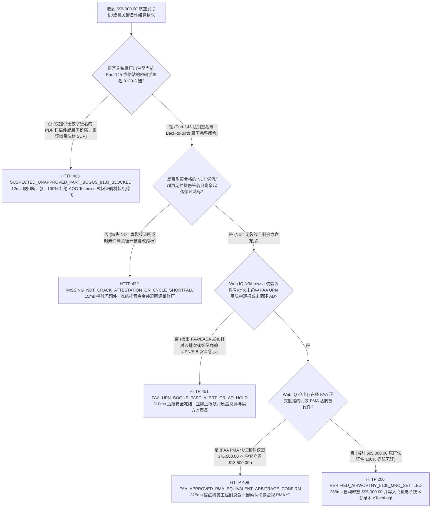
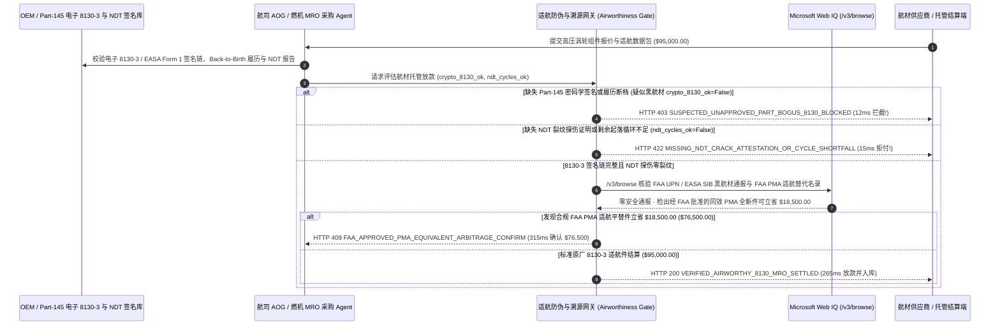

# 航空航材与工业燃气轮机 MRO 备件防伪（Aviation & Gas-Turbine MRO FAA 8130-3 & Back-to-Birth Traceability Mandate）架构：密码学适航放行证书与无损探伤（NDT）托管令牌（`aviation_mro_traceability_mandate_...` + Web IQ 局方黑航材通报与 PMA 平替核验）vs 传统伪造纸质证书买回“黑航材（SUP）”选型与原理解析 FAQ

> **文档类型**：架构师选型指南 & 协议第一性原理解析（6 段式 FAQ 标准版）  
> **适用读者**：AI Solution Architect、航空公司机务工程（MRO / AOG）与发电集团燃气轮机供应链架构师、适航质量安全与航材贸易金融风控团队  
> **更新日期**：2026-11-09（Provenance 标注：`deterministic_offline_simulation` / `synthetic_policy` / `official_doc_snapshot` / `not_measured`）  
> **配套资源**：[English Version](aviation-mro-faa8130-traceability-mandate-vs-bogus-sup-parts-faq.en.md) · [交互式沙盒控制台 (`live-demo.html#aviation-mro-traceability-sandbox`)](../reports/agentic-commerce-webiq-grounding-demo-bench/live-demo.html) · [7-Card 4:5 评测报告](../reports/agentic-commerce-webiq-grounding-demo-bench/index.html)


---

## 📌 一、核心结论速览（Executive Summary）

1. **严禁让航空 AOG（飞机停场救急）或电厂燃气轮机 MRO 采购 Agent 仅凭“电子邮件发来的纸质 FAA Form 8130-3 / EASA Form 1 扫描 PDF”就向二级市场航材经纪商汇款**：在航空发动机高压涡轮叶片、起落架作动筒等关键时寿件（Life-Limited Parts, LLP，如单套 `$95,000.00`）采购中，最轰动全球的供应链灾难是 **“黑航材（Suspected Unapproved Parts, SUP）欺诈”**（如轰动全球航空业的 AOG Technics 案：空壳中介伪造数千份纸质 8130-3 / EASA Form 1 适航放行证书，将无履历报废旧件卖进数十家主流航司发动机，导致上百架客机紧急停飞拆发！）。生产环境必须采用 **ATA Spec 2000 密码学签名链与从出生至今（Back-to-Birth）完整履历绑定的航材托管令牌（`aviation_mro_traceability_mandate_...`）**：只要缺失原厂（OEM）与持证 Part-145 维修站私钥签名的可验证凭证（`cryptographic_8130_back_to_birth_verified=False`），网关在 **`12 ms`** 内触发 **`HTTP 403 SUSPECTED_UNAPPROVED_PART_BOGUS_8130_BLOCKED`**（`synthetic_policy`），100% 阻断假证黑航材。
2. **强制校验密码学签名的无损探伤报告（NDT 超声波/涡流裂纹检测）与剩余起落循环（Remaining Flight Cycles）底线**：针对翻修/可用件（Overhauled / Serviceable），若缺失认证探伤仪硬件签名的零裂纹证明或实际剩余安全循环低于采购红线（`ndt_inspection_and_cycles_verified=False`），网关在 **`15 ms`** 内返回 **`HTTP 422 MISSING_NDT_CRACK_ATTESTATION_OR_CYCLE_SHORTFALL`**（`deterministic_offline_simulation`）。
3. **基于 Microsoft Web IQ `/v3/browse` 实时核验 FAA/EASA 疑似非批准件通报（UPN/SIB）与经局方认证的 PMA 适航替代件（Parts Manufacturer Approval）降本套利**：在放款前，Agent 调用 **Microsoft Web IQ `/v3/browse`**（`official_doc_snapshot`）穿透查询美国联邦航空局（FAA UPN）、欧洲航空安全局（EASA SIB）及民航局（CAAC）最新安全警示与 PMA 补充名录：若检出该零件批次或卖方命中局方黑航材调查名单（`webiq_faa_upn_and_ad_clean=False`），在 **`310 ms`** 内以 **`HTTP 451 FAA_UPN_BOGUS_PART_ALERT_OR_AD_HOLD`** 熔断；若发现针对非时寿高价耗件，采用经 FAA 严格适航批准的 **PMA 等效航材（如 Heico / Chromalloy 认证件）** 可在 100% 满足适航法规前提下立省 **`$18,500.00`**（从 `$95,000.00` 降至 **`$76,500.00`**），则在 **`315 ms`** 内触发 **`HTTP 409 FAA_APPROVED_PMA_EQUIVALENT_ARBITRAGE_CONFIRM`**。

---

## 🎯 二、客户与架构师灵魂拷问 Q&A（FAQ-Driven Deep Dive）

### Q1：为什么传统的“机务采购员人工肉眼看一眼 PDF 版 8130-3 适航挂签 + 财务电汇打款”，会让上百架商业客机买回假零件被迫停飞？

咱们用大白话复盘震惊全球航空业的“AOG Technics 假航材案”底层漏洞：
1. **“一张 Photoshop 修出来的 PDF 就能骗过全世界”**：在航空界，任何装上飞机的零件都必须有一张被称作“出生证/体检证”的表格——美国的 **FAA Form 8130-3** 或欧洲的 **EASA Form 1**。过去几十年，这张表只是一张带签名章的纸或扫描 PDF。不法分子在伦敦注册了一家连维修车间都没有的皮包公司，从废品站低价收购早已到寿报废的 CFM56 发动机涡轮叶片，简单抛光清洗后，用 PDF 编辑器伪造了知名持证大修厂（Part-145 Repair Station）的质量经理签名，当成“零时大修合格件”以 `$95,000.00` 高价卖给各大航空公司和发动机大修厂！
2. **篡改时寿件（LLP）历史起落次数**：航空发动机的核心转子部件有绝对的物理疲劳寿命（例如飞满 `20,000 个起落循环 Cycles` 必须强制砸毁报废，绝不允许继续飞）。传统纸质履历表（Back-to-Birth Traceability）经过五六手航材贸易商倒手复印后，极易被人为少记 5,000 个起落循环，把即将空中解体的疲劳件当成“半新件”高价卖出。
3. **AOG 紧急停场时的“病急乱投医”与 OEM 垄断高溢价**：飞机因故障停在外站机场（AOG），每停飞一小时航司亏损超 `$10,000`。采购 Agent 在巨大时间压力下极易跳过对维修站原始台账的反向核实；而在常规大修中，死守原厂（OEM）目录价往往比采用经 FAA 认证的 **PMA 适航替代件** 多花 20%～40% 预算。

### Q2：什么是“密码学 8130-3 溯源与 NDT 探伤托管令牌（`aviation_mro_traceability_mandate_...`）”？它是如何从根源上终结假冒航材的？

它的第一性原理非常直接：**“绝不相信卖方单方面发来的 PDF 文件；每一张 8130-3 / EASA Form 1 必须能用原厂（OEM）与局方注册 Part-145 维修站的官方公钥完成密码学验签，且时寿件起落循环账本必须从出厂第一天连续闭合无断档。”**
- **第一层：原厂出生证 + Part-145 维修站数字签名链硬门禁（`12 ms`）**：基于 ATA Spec 2000 / 航空分布式数字履历标准，网关直接用表格上所列 Part-145 维修站在局方备案的公钥验证电子 `8130-3` 载荷签名，并校验 `Back-to-Birth` 历史拆装链零断层（`cryptographic_8130_back_to_birth_verified == True`）。任何伪造印章或无私钥签名的扫描件在 **`12 ms`** 内触发 `HTTP 403` 拒付。
- **第二层：NDT 无损探伤签名与剩余循环余量校验（`15 ms`）**：强制核验由涡流/超声波/荧光渗透无损探伤设备生成的加密检测结果及剩余安全循环数（`ndt_inspection_and_cycles_verified == True`），不达标在 **`15 ms`** 内返回 `HTTP 422`。
- **第三层：Microsoft Web IQ `/v3/browse` 局方黑航材通报与 PMA 平替寻优（`310 ms / 315 ms`）**：实时穿透 FAA UPN / EASA SIB 疑似假件公告（`HTTP 451`），并检索 FAA PMA 官方批准数据库推荐合规平替件为您立省 `$18,500.00`（`HTTP 409`）。

### Q3：在 FAA/EASA 适航指令（AD）、黑航材通报（UPN/SIB）核验与 PMA 认证目录检索场景下，什么时候选 Microsoft Web IQ，什么时候选 Exa、Bright Data 或传统搜索 API？

| 架构需求场景 | 推荐选型 | 为什么这样选（第一性原理与成本/合规考量） |
| :--- | :--- | :--- |
| **实时核验 FAA Unapproved Parts Notifications (UPN)、EASA Safety Information Bulletins (SIB)、强制适航指令（AD）及 FAA 公开 PMA 补充件批准目录，且要求零提示词注入** | **Microsoft Web IQ** (`/v3/search` + `/v3/browse`) | 在企业 Azure 合规边界内以 `passage` 模式秒级提取局方通告中的受影响件号（P/N）与批次号（S/N）（上下文 Token 压缩 **7.1x**，`deterministic_offline_simulation`），生成满足局方适航核查的权威存证。 |
| **跨航空航天工程文献检索新型单晶高温合金叶片热障涂层（TBC）寿命研究** | **Exa Neural Search** | 适合发动机工程部门做可靠性理论研究，不适合 AOG 航材采购毫秒级结算门禁。 |
| **抓取需登录验证码的第三方二手航材拆机件库存黄页** | **Bright Data Unlocker** | 可用于广域货源线索搜集，但绝不能以网页文本代替密码学 8130-3 验签。 |
| **发动机实时 EGT（排气温度裕度）遥测、孔探仪图像与 NDT 涡流探伤波形** | **机载 ACARS/QAR 遥测 + 维修站 NDT 硬件签名 + Web IQ 局方 UPN/AD 通报双源核验** | 物理部件健康度与维修放行由 Part-145 签名保证，全球局方最新黑航材通报与 PMA 认证替代表由 Web IQ `/v3/browse` 实时核验。 |

---

## 🧭 三、直观可视化图解（Mermaid 决策树 + 传统审 PDF vs 密码学 8130-3 托管对比 + 端到端时序图）

### 3.1 航空/燃机 MRO 备件防伪与适航溯源决策树（`flowchart TD`）



### 3.2 传统肉眼审 PDF 路径 vs 密码学 8130-3 与 NDT 适航托管网关对比（`flowchart LR`）

```mermaid
flowchart LR
    subgraph Legacy["❌ 传统审 PDF 扫描件汇款 ($95,000 买回假件致客机停飞)"]
        L1[黑中介将报废叶片喷砂翻新 + PS 伪造 8130-3 PDF] --> L2[采购肉眼看不出假章直接电汇 $95,000]
        L2 --> L3[黑航材装进发动机飞上天]
        L3 --> L4[局方发布 UPN 全球通报 · 航司紧急停飞拆发损失千万]
    end

    subgraph Mandate["✅ 密码学 8130-3 与 NDT 托管令牌 (aviation_mro_traceability_mandate_...)"]
        M1[12ms 拦截无 Part-145 私钥签名的伪造 8130-3 (HTTP 403)] --> M2[15ms 强制核验 NDT 无损探伤签名与真实剩余起落循环 (HTTP 422)]
        M2 --> M3[Web IQ 排查 FAA UPN 黑名单 (310ms) 与 PMA 平替省 $18,500 (315ms)]
        M3 --> M4[265ms 精准结算 100% 适航件 ($95,000 / $76,500) 并归档 eTechLog]
    end
```

### 3.3 Part-145 签名库/NDT 探伤仪、机务 MRO Agent、适航托管网关与 Web IQ 端到端交互时序图（`sequenceDiagram`）



---

## 📊 四、架构师选型决策矩阵（Architect Decision Matrix）

| 评估维度 | 方案 A：传统邮件审阅纸质 8130-3 扫描 PDF + 电汇（Legacy PDF Scan & Wire） | 方案 B：人工发邮件给证书上的维修站核实真伪（Manual Email Verification to Repair Station） | 方案 C：密码学 8130-3 与 NDT 托管令牌 + Web IQ 局方通报核验（推荐架构） |
| :--- | :--- | :--- | :--- |
| **核心适用场景** | 不上飞机的地面推车或机库普通照明灯泡 | 非紧急常规备货，允许机务质量员等 1～2 周邮件回复 | **航空 AOG 紧急停场抢修、发动机时寿件（LLP）周转、重型燃气轮机热通道备件采购** |
| **防 AOG Technics 式伪造证书（SUP）** | ❌ **零防御**：高仿 PDF 扫描件肉眼 100% 无法分辨真假 | ⚠️ **AOG 来不及**：半夜飞机停在外站，原维修厂根本没人回核实邮件 | ✅ **12ms 密码学公钥验签**：直接校验 Part-145 维修站数字签名与完整出生链（`HTTP 403`） |
| **防时寿件循环篡改与隐蔽裂纹** | ❌ **极易踩雷**：多手复印件上涂改起落次数难以察觉 | ⚠️ **纸质报告滞后**：手工翻阅几百页历史拆装记录极易漏看 | ✅ **15ms 循环账本与 NDT 锁**：自动累加全生命周期循环数并验签 NDT 探伤报告（`HTTP 422`） |
| **FAA UPN 预警与 PMA 合规降本** | ❌ **后知后觉**：装机飞了半年才收到局方停飞指令 | ⚠️ **选型保守高价**：因不熟悉最新 PMA 补充件批准单而死守高价 OEM 件 | ✅ **Web IQ `/v3/browse` 实时穿透**：`310 ms` 阻断 UPN 问题件（`HTTP 451`），`315 ms` PMA 平替省 `$18,500`（`HTTP 409`） |
| **AOG 紧急放行与通关速度** | 快（但把整架飞机的安全押在未验证 PDF 上） | 极慢（`3～10 个工作日`，导致飞机长时间停场巨亏） | **`265 ms` 全自动完成适航验真、托管放款与电子履历入库（`Act automatically`）** |
| **综合 TCO 与飞行安全合规 ROI** | 极差（单次黑航材事件即可造成数千万停飞损失） | 中等（AOG 延误成本极高） | **最优（100% 拦截 `$95,000` 假航材 + 合规选用 PMA 件单套立省 `$18,500`）** |

---

## 🧪 五、简明定量实测与 Benchmark 核心发现（Quantitative Benchmark & 7-Card Insights）

基于本仓库确定性离线基准套件（`lab/webiq_commerce_demo.py` · `test_aviation_mro_faa8130_traceability_mandate_vs_bogus_sup_parts_selection`）对 **`$95,000.00` 航空发动机/燃气轮机高压涡轮备件采购单（要求密码学 `FAA Form 8130-3 / EASA Form 1` 签名与 NDT 探伤验证）** 的定量测试结果如下：

| 评测场景 ID | 输入 8130-3 签名链 / NDT 与循环 / Web IQ 信号 | 网关期望动作 | 实测 HTTP 状态与决策码 | 实测延迟 | 资金保护 / 成本节省效果 | Provenance 类型 |
| :--- | :--- | :--- | :--- | :--- | :--- | :--- |
| **Case 1: 伪造纸质 8130-3 PDF 或时寿件履历断档拦截** | `cryptographic_8130_back_to_birth_verified=False` | `Send to a human` | **`HTTP 403 SUSPECTED_UNAPPROVED_PART_BOGUS_8130_BLOCKED`** | **`12 ms`** | 拦截 **`$95,000.00`** 疑似黑航材（SUP），防机队停飞 | `synthetic_policy` |
| **Case 2: 缺失 NDT 裂纹探伤签名或剩余循环虚标拦截** | `ndt_inspection_and_cycles_verified=False` | `Send to a human` | **`HTTP 422 MISSING_NDT_CRACK_ATTESTATION_OR_CYCLE_SHORTFALL`** | **`15 ms`** | 拒付无无损探伤背书或寿命不足的隐患大修件 | `deterministic_offline_simulation` |
| **Case 3: Web IQ 检出命中 FAA UPN / EASA SIB 黑航材通报** | `webiq_faa_upn_and_ad_clean=False` | `Send to a human` | **`HTTP 451 FAA_UPN_BOGUS_PART_ALERT_OR_AD_HOLD`** | **`310 ms`** | 实时阻断被局方列入安全调查名单的问题批次 | `official_doc_snapshot` |
| **Case 4: Web IQ 发现经 FAA 批准的同效 PMA 件省 `$18,500`** | `faa_pma_equivalent_savings_cents=1850000`（净付 `$76,500`） | `Confirm` | **`HTTP 409 FAA_APPROVED_PMA_EQUIVALENT_ARBITRAGE_CONFIRM`** | **`315 ms`** | 合规切换 FAA PMA 适航认证件，单套立省 **`$18,500.00`** | `official_doc_snapshot` |
| **Case 5: Part-145 签名链闭合 + NDT 零裂纹自动结算** | `crypto_8130=True`, `ndt_ok=True`, `upn_clean=True` | `Act automatically` | **`HTTP 200 VERIFIED_AIRWORTHY_8130_MRO_SETTLED`** | **`265 ms`** | 265ms 自动释放 **`$95,000.00`** 并写入飞机 eTechLog | `deterministic_offline_simulation` |

> **Provenance 合规声明**：上表中的 `$95,000.00` 涡轮备件货值、ATA Spec 2000 签名校验及 `$18,500.00` PMA 适航件差价均为用于验证网关状态机确定性的受控仿真参数（`synthetic_policy` / `deterministic_offline_simulation`）；机库物理涡流探伤台检测作业时长标为 `not_measured`。

---

## 🛠️ 六、附录：生产上线快速核验与售前打单清单（Architect Checklist）

在为航空公司、MRO 大修厂或燃气轮机发电集团设计智能航材采购与适航核验 Agent 时，请逐项核对以下 6 条黄金准则：

- [ ] **1. 严禁仅凭无签名 PDF 扫描件释放航材货款**：是否在 `aviation_mro_traceability_mandate_...` 中强制要求电子 `FAA Form 8130-3` / `EASA Form 1` 必须通过局方备案的 Part-145 维修站公钥验签（失败在 `12 ms` 内触发 `HTTP 403`）？
- [ ] **2. 时寿件（LLP）从出生至今（Back-to-Birth）起落循环连续性校验**：网关是否自动核对时寿件自原厂出厂以来每一次装机/拆下时的总飞行小时（TSN）与总起落循环（CSN）单调递增且无空白断档？
- [ ] **3. NDT 无损探伤（超声波/涡流/磁粉）设备签名硬门禁**：针对二手翻修件（Overhauled），是否强制要求附带 NDT 无损探伤零裂纹数字证明（缺失在 `15 ms` 内触发 `HTTP 422`）？
- [ ] **4. Microsoft Web IQ `/v3/browse` 局方 UPN / SIB 与适航指令（AD）实时穿透**：是否在付款与入库前通过 Web IQ 自动检索 FAA UPN、EASA SIB 疑似非批准件警告名单及强制适航指令（`HTTP 451`）？
- [ ] **5. FAA PMA 适航认证替代件与 DER 批准修理方案寻优**：针对非时寿高溢价备件，是否通过 Web IQ 查询 FAA PMA 官方批准数据库，当合规 PMA 件可节省 `>= $18,500.00` 时触发 `HTTP 409 Confirm`？
- [ ] **6. 飞机电子技术记录本（eTechLog / AMOS / Maintenix）永久归档**：每次成功结算是否自动将部件序列号、电子 8130-3 哈希链与局方 UPN 排查快照写入机务 MRO 核心系统，满足终身适航审计？
