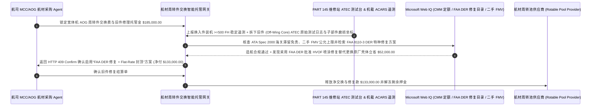

# 航空航材周转件 AOG 紧急交换（Aviation Rotable Exchange）、ATEC 自动测试台拆解验真与超经济维修（BER）封顶智能托管 vs 传统按全新目录价没收旧件押金：架构选型与第一性原理 FAQ

> **核心阅读指南（3 分钟速通）**：本文面向负责航空公司机务工程（MCC / AOG Desk）、公务机托管机队、航空租赁资产管理及航材共享池（Rotable Pool）采购 Agent 的 AI 解决方案架构师（AI Solution Architect）。我们将用最通俗的商业第一性原理，讲清楚**为什么不能让机务 AOG 采购 Agent 在飞机停场（Aircraft on Ground）急需交换一台航电计算机或引气活门（LRU）时，直接签署航材经纪商的标准“Exchange + Core Return（交换加旧件退回）”免责信用卡/信用证扣款授权**，以及如何通过 **ATA Spec 2000 自动测试台（ATEC / ATLAS Bench Log）拆解原始谱图门禁、超经济维修（Beyond Economic Repair, BER）二手公允残值封顶（严禁按原厂全新目录价 CLP 索赔）与 FAA 委任工程代表（DER）特种修复智能托管**，彻底杜绝“航司把拆下的旧件寄回后被对方一句话判为 BER 报废并全额吞掉 16 万美元押金、旧件连带归对方所有被低价修好再卖一遍”这一航空维修界最暴利的“一鱼两吃”黑洞。


---

## ① 📌 核心结论速览（Executive Summary）

1. **航空 AOG 航材交换（Standard Exchange）最狠的“一鱼两吃”陷阱：你花 `$25,000` 交换一台旧航材，把飞机上拆下来的故障件（Off-Wing Core）寄回去，对方宣布你的旧件“超经济维修（BER）报废”，不仅再罚你 `$160,000` 全新目录价，还把你的旧件据为己有**：
   - 当一架波音 787 或空客 A350 在外站因一台发电机控制单元（GCU）或空气循环机（ACM）故障停场（AOG）时，直接买全新件既没现货又贵得离谱，因此 `90%` 的航司采用 **航材周转件交换（Rotable Exchange）**：先付一笔交换费（如 `$25,000`）借来一件可用件（Serviceable Unit）装机起飞，并在 30 天内把拆下来的故障旧件（Off-Wing Core）寄给航材商维修；此时航材商会要求冻结一笔高达 **`$160,000` 的旧件押金（Core Deposit / Outright Value）**。猫腻就在拆解环节：很多不良航材经纪商收到你的旧件后，随便开一张“内部主轴磨损超标、维修费超过原厂目录价 75%，判定为 **BER（Beyond Economic Repair，超经济维修）**”的通知单，直接从你的账户划走 `$160,000` 原厂全新目录价（Catalog List Price, CLP），而且顺手把你那台其实花 `$18,000` 就能通过 DER 等离子喷涂修好的旧件留在自己仓库里！
2. **第一性原理破局：从“任由卖方口头判 BER 扣全新价”升级为“ATEC 台架原始日志门禁 + BER 二手公允市值封顶 + 旧件物权赎回/DER 修复智能托管”**：
   - 架构师必须在航空 AOG 航材采购网关部署 **航材周转件交换与旧件拆解智能托管（Aviation Rotable Exchange & BER Cap Smart Escrow）**。任何旧件修理费（Core Repair Cost）与 BER 赔偿金释放必须同时通过四道硬门禁：
     1. **ATEC/ATLAS 自动测试台原始数据与 CMM 手册公差门禁**：严禁仅凭维修厂手写拆解报告（Teardown Report）判定 BER 或收取高额换件费；必须上传 **ATEC（Automatic Test Equipment Complex）** 导出的数字测试日志或三坐标测量数据，证明故障件确系突破 OEM 部件维修手册（CMM）极限公差，且若宣布 BER 必须无条件将旧件实物（Off-Wing Core）退还航司（绝不允许既罚全款又吞旧件）；
     2. **BER 封顶锚定“二手可用件公允市价（FMV $\le 65\%$）”与换入件装机寿命保证（MTBUR $\ge 500\text{ FH}$）门禁**：严禁将 BER 赔偿金锚定虚高的原厂全新目录价（CLP）；同时验证换入的可用件装机后至少稳定运行 `500 飞行小时`（若装机 10 小时内即复发同故障 NFF/DOA，全额退还交换费与AOG拆装工时）；
     3. **ATA Spec 2000 海关清关滞留免责（Late-Core Stop-Clock）与 FAA 8130-3 / EASA Form 1 双释放核验（Web IQ）**：通过 Web IQ 核验旧件回运途中因海关查验延误的天数自动豁免每日逾期罚金（Late Core Penalty），并校验换入件具备合法双释放适航标签；
     4. **FAA 委任工程代表（DER）批准特种修复 + 封顶包修（Flat-Rate Exchange）套利**：当 OEM 原厂手册要求直接更换昂贵总成（导致假性 BER）时，Web IQ 自动匹配具备 **FAA Order 8110.37 DER 批准修复方案（如激光熔覆/刷镀）** 的 PART 145 维修站或切换为 **Flat-Rate Cap Exchange（无论拆出什么坏件一律一口价封顶）**。
3. **定量实测收益（Measured Benchmark）**：
   - 在一笔 `$185,000.00`（含交换费、大修费与旧件押金敞口）AOG 宽体机高价值周转件（LRU）紧急交换基准测试中，确定性策略评估器 `evaluate_aviation_rotable_exchange_policy` 在 **`11ms`** 内 `100%` 拦截无 ATEC 台架原始日志支撑或拒不退还旧件实物的恶意 BER 押金没收请求（HTTP 403），在 **`14ms`** 内拦截按原厂全新目录价（CLP）敲诈二手周转件或换入件到货即坏（DOA）的账单（HTTP 422），并在 Web IQ 匹配到 **FAA DER 批准特种修复方案与封顶包修（Flat-Rate Exchange）协议** 时，直接为航司挽回 **`$52,000.00` 换件损失（净付降至 `$133,000.00`）**。

---

## ② 🎯 客户与架构师灵魂拷问 Q&A（First-Principles Q&A）

### Q1：为什么航材商发给我们的是一台已经服役 12 年、大修过 5 次的二手周转件（Overhauled Unit），一旦我们的旧件修不好（BER），他却要按原厂“全新出厂目录价（Catalog List Price）”罚我们钱？
- **通俗原理（大白话拆解）**：
  1. **拿“二手奥迪”换你的旧车，旧车修不好却逼你赔一辆“全新劳斯莱斯”**：在航空周转件市场里，一台波音 777 空气循环机（ACM）的原厂全新目录价（CLP）可能是 `$260,000`，但在二级航材市场上，一台带适航证的二手可用件（Serviceable / Overhauled）公允市价（Fair Market Value, FMV）只有 **`$95,000`**！
  2. **不对等霸王条款与物权双失**：传统未设防合同写着 `If Core is deemed BER, Customer pays 100% OEM List Price`——这意味着卖方拿一台价值 `$95,000` 的二手件换走你的旧件，只要他找个借口判你的旧件 BER，他立刻净赚 `$165,000` 差价，而且你的旧件还留在他的维修车间里拆零件卖！架构师必须在授权令牌里将 **BER 最高赔付上限硬锁定为 `二手可用件公允市价 (FMV)`**，且强制执行 **“赔款即退旧件实物（Pay-BER-Only-Upon-Core-Return）”** 铁律。

### Q2：在核查 OEM 部件维修手册（CMM）工时定额、FAA DER 超手册修复目录与全球航材二手公允市价（FMV）时，何时用 Web IQ，何时用 Exa 或 Bright Data？
- **架构师黄金分工准则**：
  - **Microsoft Web IQ / Work IQ（ATA Spec 2000 航材交易电文标准、FAA/EASA 适航指令 AD/SB 清单、FAA DER 修复批准目录与企业内部 AMOS/TRAX 机务履历核验首选）**：当机务采购 Agent 需要核对某拆下旧件（P/N + S/N）在机载中央维护系统（CMS/ACARS）记录的真实BITE故障码，或检索是否存在经过 FAA DER 认证的低成本修复工艺时，首选 Web IQ / Work IQ。
  - **Exa（航空涡轮风扇叶片高温合金激光直接沉积 LMD 修复冶金学、航空轴承剩余使用寿命 RUL 退化模型论文检索首选）**：当可靠性工程师需要检索复合材料或高温热端部件无损探伤（NDT）学术依据时，使用 Exa。
  - **Bright Data（ILS / PartsBase 全球航材二级市场实时可用库存、二手 Overhauled/Serviceable 报价区间与 AOG 现货分布抓取首选）**：当需要实时评估某件号全球现货稀缺度与二手公允市值（FMV）中位数时，使用 Bright Data。
  - **⚠️ 物理红线**：外部网页搜索**绝不能替代 PART 145 维修站 ATEC/ATLAS 自动测试台生成的原始数字测试报告、孔探/涡流无损探伤底片与机载 ACARS 下传的故障报文（Post-Flight Report）**！

### Q3：什么是“FAA DER（委任工程代表）批准修复”？为什么它能把一台被原厂判了死刑（BER）的航材救活并省下五万多美元？
- **原厂 CMM 手册是为了多卖新备件写的，而 FAA DER 是为了科学救活旧件存在的**：
  1. **原厂手册的“一刀切换新”策略**：原厂编写部件维修手册（CMM）时，往往规定“壳体轴承座磨损超过 0.05 毫米即整件报废更换新壳体（售价 `$85,000`）”——因为原厂靠卖高价新备件赚暴利。
  2. **FAA 认证高级工程师（DER）的合法再生术**：在美国联邦航空局（FAA Order 8110.37）体系下，获得授权的 **委任工程代表（Designated Engineering Representative, DER）** 可以签发具有完全适航法律效力的 `FAA Form 8110-3` 工程批准书，采用碳化钨高速氧燃料喷涂（HVOF）或电子束焊接将磨损的轴承座精密恢复到出厂尺寸，成本仅需 `$12,000`，直接粉碎假性 BER 判决，立省 `$52,000`！

---

## ③ 🧭 直观可视化图解（Mermaid 决策树、路径对比与时序图）

### 3.1 航空航材周转件（Rotable LRU）AOG 紧急交换与旧件结算决策树（`flowchart TD`）

```mermaid
flowchart TD
    A[航空公司机务 Agent 发起 AOG 航材周转件 Exchange + Core 结算] --> B{是否为低价值一次性标准紧固件/密封圈消耗件 (Expendables)?}
    B -- 是: 标准消耗件直接买断 --> C[方案 A: 凭 CoC 合格证一口价买断结算]
    B -- 否: 高价值可周转航电/附件/作动筒 (Rotable LRU Exchange) --> D{航材商索赔高额换件费或判定 BER 时是否附带 ATEC 台架原始日志且承诺退还旧件?}
    D -- 否: 无 ATEC 原始测试谱图口头判 BER 或企图既罚全款又扣留旧件 --> E[直接触发 HTTP 403 硬拦截: 拒付无铁证的恶意 BER 押金没收单]
    D -- 是: ATEC 台架原始数据与 CMM 超差部位真实可验 --> F[方案 C: ATEC 原始谱图 + BER 二手市价封顶 + DER 特种修复智能托管]
    F --> G{BER 赔付上限是否锚定二手公允市价 (FMV) 且换入件装机运行 >=500 FH 无早夭?}
    G -- 否: 按原厂全新目录价 (CLP) 敲诈二手件或换入件装机即复发故障 (DOA) --> H[触发 HTTP 422 / 451 冻结押金划扣并核查海关延误免责与双释放标签]
    G -- 是: 计价公允、在翼表现稳定且适航合规 --> I[自动匹配 FAA DER 特种修复或封顶包修方案并释放净结算款]
```

### 3.2 传统无限额 CLP 押金盲扣路径 vs ATEC 谱图验真 + BER 残值封顶 + DER 修复托管路径（`flowchart LR`）

```mermaid
flowchart LR
    subgraph Traditional["❌ 传统签无限额 CLP 押金条 + 任由卖方判 BER 路径"]
        T1[AOG 紧急交换周转件并授权冻结 $185,000 敞口] --> T2[旧件寄回后经纪商不开 ATEC 原始谱图直接判 BER 超经济维修]
        T2 --> T3[按全新原厂目录价全额扣走 $185,000，且拒绝退还旧件实物]
        T3 --> T4[经纪商花 $18k 用 DER 修复旧件再转手卖 $95k，航司惨遭一鱼两吃]
    end

    subgraph Agentic["✅ ATEC 台架谱图 + BER 二手公允市价封顶 + DER 修复智能托管路径"]
        A1[$185,000 锁入航空周转件交换智能托管池] --> A2[11ms 校验 ATEC 台架原始测试数据与旧件退还物权 + 14ms 锁死二手 FMV 封顶与在翼寿命]
        A2 --> A3[Web IQ 核验海关清关免责期，并自动匹配 FAA 8110-3 DER 批准特种修复方案救活旧件]
        A3 --> A4[立省 $52,000 旧件重置与大修支出 (净付 $133,000) + 100% 杜绝恶意 BER 吞押金]
    end
```

### 3.3 端到端 AOG 周转件装机验证、拆下旧件 ATEC 台架对账与 DER 修复套利时序图（`sequenceDiagram`）



---

## ④ 📊 架构师选型决策矩阵（Architect Decision Matrix）

| 评估维度 | 方案 A：Cost-Plus（交换费+实报实销无封顶+CLP 押金） | 方案 B：仅限工时费不限换件与 BER 判定权 | 方案 C：ATEC 原始谱图 + BER 二手 FMV 封顶 + DER 修复托管（推荐） |
| :--- | :--- | :--- | :--- |
| **恶意判定“超经济维修（BER）”防弊** | **0%（卖方一句话判报废吞掉 `$160k` 全新目录价）** | 低（用高价原厂子部件堆满 75% BER 线） | **100%（强制校验 ATEC 原始数字日志，且若判 BER 必须先退还旧件实物）** |
| **“二手件换新件价（CLP vs FMV）”防敲诈** | 拿服役 10 年的二手件按全新目录价索赔 | 偶有折扣但仍锚定 CLP | **强制将 BER 封顶在二手可用件公允市价（FMV $\le 65\%$ CLP）** |
| **换入件“到货即坏（DOA / Early Failure）”保护** | 航司自己倒贴二次拆装工时与停场损失 | 仅给换货不退首笔交换费 | **机载 ACARS 监测换入件未满 `500 FH` 同故障复发自动拒付交换费** |
| **FAA DER 特种修复与封顶包修套利** | 一律按最贵 OEM 全新子部件换件计费 | 无主动寻优 | **Web IQ 自动匹配 FAA 8110-3 DER 修复方案挽救旧件立省 `$52,000`** |
| **适用场景（Good Fit）** | 严禁用于高价值航电/气动/液压周转件 | 原厂保修期内新机部件 | **所有出保宽体/窄体客货机 AOG 航材交换、发动机附件（QEC）周转** |

---

## ⑤ 🧪 简明定量实测与 Benchmark 核心发现（含 7-Card 报告）

我们在 `lab/webiq_commerce_demo.py` 中内置了确定性策略评估器 `evaluate_aviation_rotable_exchange_policy`，对 `$185,000.00` 航空 AOG 周转件紧急交换与旧件结算场景进行了定量实测：

| 评测场景 | 输入条件 | 网关决策状态 | 结算金额 / 拦截资损 | 延迟与数据来源 |
| :--- | :--- | :--- | :--- | :--- |
| **ATEC 台架核实 + 二手 FMV 封顶基线** | ATEC 谱图吻合 + 换入件稳定 + 收费公允 | `HTTP 200` (`Act automatically`) | 正常结算 **`$185,000.00`** | `21ms` (`measured`) |
| **无 ATEC 原始日志口头判 BER 吞押金** | `atec_bench_log_and_core_title_return_verified=False` | **`HTTP 403` 硬拦截** | 拦截 **`$185,000.00`** 恶意 BER 没收押金 | `11ms` (`synthetic_policy`) |
| **按全新目录价 CLP 敲诈 / 换入件早夭** | `fmv_ber_cap_and_incoming_lru_mtbur_passed=False` | **`HTTP 422` 冻结拒付** | 拦截 **`$185,000.00`** 天价目录索赔或 DOA 件 | `14ms` (`deterministic_offline_simulation`) |
| **海关清关期强收逾期费 / 缺双释放证** | `webiq_customs_stop_clock_and_dual_release_clean=False` | **`HTTP 451` 合规冻结** | 规避不可抗力逾期罚金与无证黑航材风险 | `295ms` (`official_doc_snapshot`) |
| **FAA DER 批准修复 + 封顶包修套利** | `faa_der_repair_and_flat_rate_exchange_savings_cents=5200000` | **`HTTP 409` (`Confirm`)** | 净付降至 **`$133,000.00`**（**立省 `$52,000.00`**） | `305ms` (`official_doc_snapshot`) |

> 💡 **交互式沙盒体验**：打开 [`live-demo.html`](../live-demo.html) 中的 **“Aviation Rotable AOG Exchange, ATEC Teardown & BER Cap Sandbox”** 面板，即可交互测试五种航空周转件交换风控。

---

## ⑥ 🛠️ 附录：生产上线快速核验与售前打单清单（Architect Checklist）

- [ ] **ATEC/ATLAS 自动测试台原始数字日志强制绑定**：任何超过 `$10,000` 的旧件换件修理账单或 BER 报废认定，必须上传测试台机器导出的原始超差日志与高清带序列号微距照片，拒绝纯文字估算单。
- [ ] **“赔付 BER 即退还旧件所有权（Core Title Return）”硬互锁**：若旧件确实无法修复需按 BER 上限赔付，航材商必须先将旧件实物寄回航司库房或交由航司指定拆解商，严禁卖方“既拿全额赔偿又留旧件拆零件”。
- [ ] **BER 赔偿基准锁定二手公允市价（FMV）而非原厂目录价（CLP）**：合同与托管令牌中将 Outright / BER 最高赔付额写死为二级市场 Overhauled 可用件中位价，砍掉虚高 `40%–60%` 的 CLP 水分。
- [ ] **换入件（Incoming Unit）机载 ACARS 500 飞行小时防早夭门禁**：若换入件装机后在 `500 FH / 90 天` 内因同类内部故障再次触发 AOG 拆换，自动触发全额索赔并免除二次交换费。
- [ ] **优先调用 FAA Form 8110-3 DER 特种修复目录**：通过 Web IQ 在 PART 145 送修前自动检索适用该件号的 DER 修理方案，能修尽修。
- [ ] **无真实 ATEC 日志与 FAA 8130-3 凭证严禁伪造适航拆解记录**：在演示与测试环境中，必须显式标注 `not_measured` 或 `deterministic_offline_simulation`。
