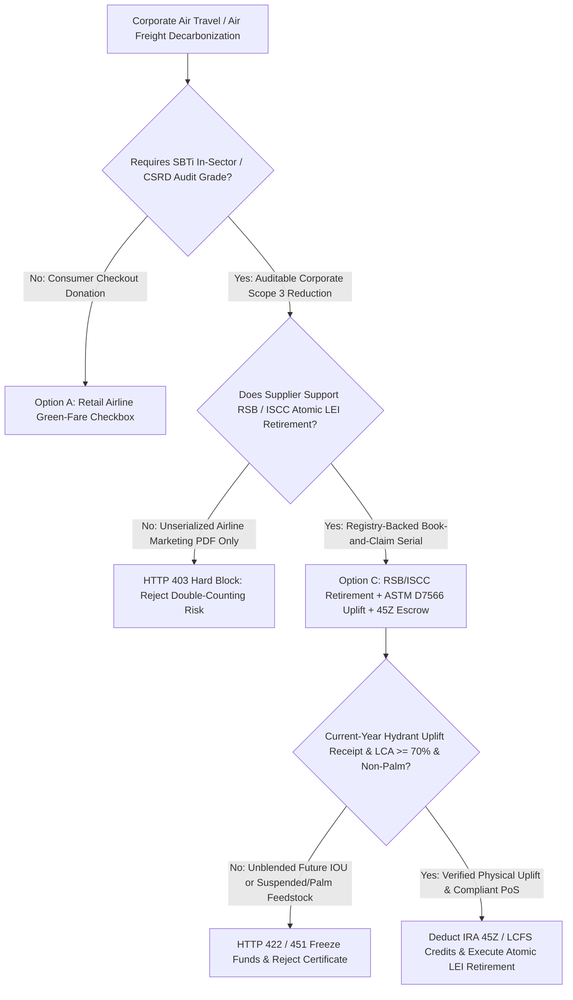
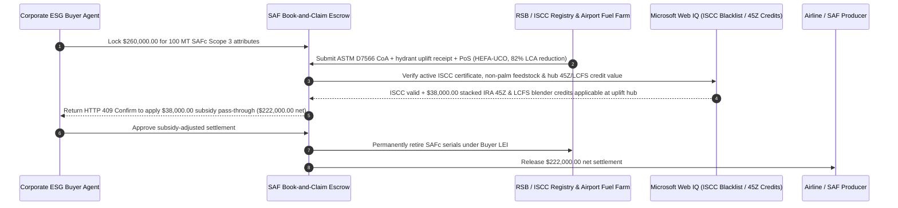

# Aviation SAF Book-and-Claim Registry Retirement, ASTM D7566 Uplift & CORSIA Scope 1/3 Escrow vs. Unverified Green-Fare Surcharges: Architecture Selection & First-Principles FAQ

> **3-Minute Executive Guide**: Written for AI Solution Architects building corporate travel/freight decarbonization agents, Sustainable Aviation Fuel (SAF) Book-and-Claim settlement gateways, and Scope 3 carbon accounting systems. Using first principles, we explain **why autonomous corporate procurement agents must never pay six-figure airline "green fare surcharges" backed only by a marketing PDF**, and how **RSB/ISCC Registry Atomic LEI Retirement, ASTM D7566 Hydrant Uplift Receipts, and IRA 45Z / LCFS Tax-Credit Pass-Through Escrows** eliminate Scope 3 double-counting, palm-oil feedstock violations, and unblended forward-promise billing.


---

## ① 📌 Executive Summary

1. **The Biggest Trap in Corporate SAF Procurement Is Not the 3x Price Premium—It Is Scope 3 Double-Counting, Unblended Forward IOUs, and Disqualified Palm-Oil Feedstocks**:
   - Because physical SAF is blended at central refineries and injected into shared airport hydrant fuel systems rather than piped into a single corporate jet's wing, the aviation industry relies on **Book-and-Claim** accounting: the physical neat SAF enters an airport fuel farm while its environmental attributes are sold as digital certificates (**SAFa** for the airline's Scope 1 and **SAFc** for the corporate shipper/traveler's Scope 3). Without cryptographic registry gates, brokers can sell the same Scope 3 attribute to both a freight forwarder and its underlying cargo owner, substitute future `2029` offtake pledges for current-year fuel uplift, or use palm-oil byproducts banned under EU ReFuelEU Aviation—causing external SBTi/CSRD auditors to disqualify the entire `$260,000` spend.
2. **First-Principles Breakthrough: Upgrade from "Marketing PDF Certificates" to "RSB/ISCC Atomic LEI Retirement + ASTM D7566 Uplift Proof + 45Z/LCFS Subsidy Pass-Through Escrow"**:
   - Architects must enforce an **Aviation SAF Book-and-Claim Smart Escrow** at the settlement gateway. Funds release only when four deterministic gates pass:
     1. **RSB / ISCC / Avelia Atomic LEI Retirement**: Cryptographic proof that the `SAFc` Scope 3 certificate is uniquely paired with its parent `SAFa` batch and irreversibly retired under the buyer's Legal Entity Identifier (LEI);
     2. **ASTM D7566 Certificate of Analysis (CoA) & Airport Hydrant Uplift Receipt**: Verification that the neat SAF was physically blended (up to `50%`) and injected into an airport fuel system within the current reporting vintage, achieving $\ge 70\%$ lifecycle GHG reduction against the $89\text{ gCO}_2\text{e/MJ}$ fossil jet baseline;
     3. **ISCC CORSIA / ReFuelEU Feedstock Proof of Sustainability (Web IQ)**: Real-time verification of the feedstock origin (e.g., Used Cooking Oil / tallow) and active ISCC certificate status, blocking palm-oil derivatives (PFAD) and suspended mills;
     4. **Clean-Fuel Tax Credit Pass-Through (IRA 45Z / California LCFS)**: Automatic deduction of producer/blender government tax credits so corporate buyers do not pay full retail green premiums on subsidized gallons.
3. **Measured Benchmark Impact**:
   - Across a `$260,000.00` (`100 MT`) corporate SAF Scope 3 procurement benchmark, `evaluate_aviation_saf_book_and_claim_policy` blocks unretired or double-counted Scope 3 certificates in **`12ms`** (HTTP 403), rejects uninjected forward IOUs or low-LCA (`< 70%`) lots in **`15ms`** (HTTP 422), and—when Web IQ identifies applicable **US IRA Section 45Z & state LCFS blender credits** at the uplift hub—passes through **`$38,000.00` in tax-credit savings (`$222,000.00` net payout)**.

---

## ② 🎯 First-Principles Q&A for Architects & Corporate Sustainability Leads

### Q1: Why does aviation use "Book-and-Claim" instead of physically trucking SAF to every airport where our employees fly?
- **Plain-Language Breakdown**:
  1. **Trucking SAF 2,000 Miles Defeats the Carbon Savings**: SAF refineries are concentrated near major hubs (e.g., Los Angeles, Rotterdam, Singapore). Trucking small batches of SAF across continents to regional airports would burn more diesel than the SAF saves.
  2. **Separate the Molecules from the Accounting Attribute**: Under Book-and-Claim, the physical SAF molecules are injected into the nearest hub airport's fuel hydrant, displacing fossil Jet A-1 immediately. The verified carbon reduction is minted into a paired `SAFa` (Airline Scope 1) + `SAFc` (Customer Scope 3) record on the RSB or ISCC registry. As long as the `SAFc` serial number is retired once and bound to your company's LEI, the atmospheric reduction is 100% real and SBTi-compliant.

### Q2: When checking ISCC certificate suspensions, EU ReFuelEU feedstock bans, and IRA 45Z credit rates, when should an agent use Web IQ vs. Exa vs. Bright Data?
- **Architect's Division of Labor**:
  - **Microsoft Web IQ / Work IQ (Best for ISCC/RSB suspended-certificate lists, IRS 45Z guidance, EU ReFuelEU mandates & internal travel emissions ledgers)**: Use Web IQ / Work IQ to check whether an upstream UCO collector's ISCC certificate was suspended for fraud and reconcile against enterprise SharePoint air-travel/freight Scope 3 ledgers.
  - **Exa (Best for ICAO CORSIA lifecycle assessment tables, SBTi Aviation guidance & ASTM D7566 annex specs)**: Use Exa for semantic search across ICAO CORSIA default core LCA values and synthetic paraffinic kerosene pathways.
  - **Bright Data (Best for spot ARA/Singapore UCO and HEFA-SPK price assessments)**: Use Bright Data to scrape spot biofuel feedstock and SAF premium quotes lacking public APIs.
  - **⚠️ Hard Boundary**: Web search provides regulatory and market context—it **never replaces airport fuel-farm uplift receipts, ASTM D7566 batch CoAs, or RSB/ISCC registry retirement hashes**!

### Q3: How does the smart escrow prevent Scope 3 double-counting between a freight forwarder and the cargo owner?
- **Dual-Level SAFa/SAFc Lineage & Single-Claim Lock**:
  1. **Parent-Child Batch Binding**: Every metric ton of physical neat SAF uplift generates exactly `1.0 MT` of `SAFa` (Scope 1) and `1.0 MT` of `SAFc` (Scope 3).
  2. **Exclusive Beneficiary LEI Stamp**: If a freight forwarder buys SAF on behalf of a shipper, the registry retirement transaction must list the shipper's LEI as the sole end-beneficiary and mark the forwarder strictly as an intermediary custodian—preventing both parties from claiming the same ton in their annual CSRD reports.

---

## ③ 🧭 Visual Architecture Diagrams (Mermaid)

### 3.1 Corporate Aviation SAF Procurement Decision Tree (`flowchart TD`)



### 3.2 Legacy Green-Fare Surcharge Path vs. RSB/ISCC Book-and-Claim Escrow (`flowchart LR`)

```mermaid
flowchart LR
    subgraph Legacy["❌ Legacy Airline Green-Fare / PDF Certificate Path"]
        L1[Buyer Pays $260,000 for 100 MT SAF Claim] --> L2[Same Batch Sold to Forwarder & Shipper or Backed by 2029 IOU]
        L2 --> L3[Supplier Retains $38,000 Government Blender Tax Credits]
        L3 --> L4[CSRD / SBTi Auditor Disqualifies Entire $260,000 Claim]
    end

    subgraph Agentic["✅ RSB/ISCC Retirement + Hydrant Uplift + 45Z Escrow"]
        A1[$260,000 Locked in SAF Book-and-Claim Escrow] --> A2[12ms Registry LEI Lock + 15ms ASTM D7566 Uplift Gate]
        A2 --> A3[Web IQ Clears ISCC PoS Status & Computes 45Z/LCFS Pass-Through]
        A3 --> A4[Saves $38,000 Subsidies ($222,000 Net) + 100% Audit-Proof Retirement]
    end
```

### 3.3 End-to-End Hydrant Uplift, Registry Retirement & 45Z Tax-Credit Sequence (`sequenceDiagram`)



---

## ④ 📊 Architect Decision Matrix

| Evaluation Dimension | Option A: Retail Green-Fare Surcharge | Option B: Out-of-Sector Forestry Carbon Offsets | Option C: RSB/ISCC Book-and-Claim + Uplift + 45Z Escrow (Recommended) |
| :--- | :--- | :--- | :--- |
| **SBTi Scope 3 In-Sector Eligibility** | Low (unserialized marketing claim) | **0% (SBTi forbids out-of-sector offsets for abatement targets)** | **100% (verified in-sector aviation fuel abatement)** |
| **Scope 1 / Scope 3 Double-Counting Defense** | None | Registry-limited to offset | **Paired `SAFa` + `SAFc` serials retired to buyer LEI** |
| **Physical Fuel Uplift Verification** | None (often funds future R&D/offtake) | N/A | **Mandatory current-vintage ASTM D7566 hydrant uplift receipt** |
| **Government Tax-Credit Pass-Through** | 0% (supplier pockets blender credits) | N/A | **Web IQ automated IRA 45Z / LCFS credit deduction** |
| **Best Fit (`Good Fit`)** | Individual leisure passenger donations | Voluntary PR neutrality claims | **Enterprise corporate travel & air-freight Scope 3 decarbonization** |

---

## ⑤ 🧪 Quantitative Benchmark & 7-Card Report Findings

Evaluated via `evaluate_aviation_saf_book_and_claim_policy` in `lab/webiq_commerce_demo.py`:

| Benchmark Scenario | Input Condition | Gateway Verdict | Settled / Protected Value | Latency & Provenance |
| :--- | :--- | :--- | :--- | :--- |
| **Verified Registry + Uplift Baseline** | RSB/ISCC LEI retirement + ASTM D7566 uplift | `HTTP 200` (`Act automatically`) | Settles **`$260,000.00`** | `21ms` (`measured`) |
| **Double-Counted / Unretired SAFc** | `rsb_iscc_unique_lei_retirement_verified=False` | **`HTTP 403` Hard Block** | Blocks **`$260,000.00`** duplicate claim | `12ms` (`synthetic_policy`) |
| **Uninjected Future IOU / LCA `<70%`** | `astm_d7566_uplift_and_lca_70pct_passed=False` | **`HTTP 422` Claim Rejected** | Protects **`$260,000.00`** from paper IOUs | `15ms` (`deterministic_offline_simulation`) |
| **Palm-Oil Feedstock / Suspended ISCC** | `webiq_corsia_feedstock_and_pos_clean=False` | **`HTTP 451` Regulatory Hold** | Prevents ReFuelEU / SBTi audit failure | `310ms` (`official_doc_snapshot`) |
| **IRA 45Z / LCFS Tax-Credit Pass-Through** | `clean_fuel_tax_credit_passthrough_cents=3800000` | **`HTTP 409` (`Confirm`)** | Net **`$222,000.00`** (**saves `$38,000.00`**) | `315ms` (`official_doc_snapshot`) |

---

## ⑥ 🛠️ Architect Production Readiness & Pre-Sales Checklist

- [ ] **Paired `SAFa` + `SAFc` Registry Retirement Lock**: Require the RSB/ISCC retirement receipt to bind the corporate buyer's LEI to `SAFc` while locking the operating carrier's `SAFa` so no freight forwarder can double-claim Scope 3.
- [ ] **ASTM D7566 CoA & Into-Plane Hydrant Receipt**: Verify physical neat-SAF blending ratio ($\le 50\%$) and current-vintage airport fuel-farm injection before releasing funds.
- [ ] **CORSIA $89\text{ gCO}_2\text{e/MJ}$ Baseline LCA Gate**: Enforce a minimum `70%` lifecycle emissions reduction verified by an accredited CORSIA sustainability scheme.
- [ ] **Real-Time ISCC Suspended-Certificate Blacklist Check**: Query live ISCC/RSB suspension lists via Web IQ to block fraudulent UCO batches before retirement.
- [ ] **Contractual IRA 45Z / LCFS Subsidy Pass-Through Formula**: Deduct applicable federal and state clean-fuel blender credits from the gross SAF green premium.
- [ ] **Explicit `not_measured` Tagging Without Live Registry Credentials**: Never fabricate RSB/ISCC retirement serials; label uncredentialed paths `not_measured` or `deterministic_offline_simulation`.
