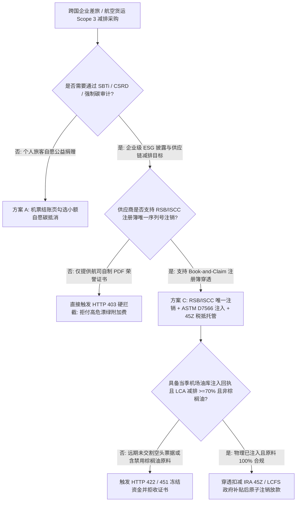
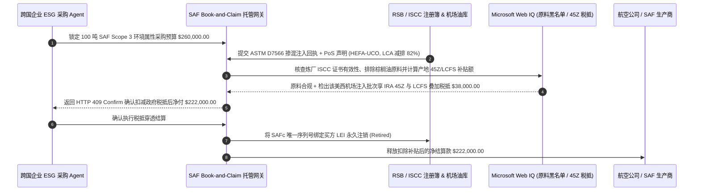

# 可持续航空燃料（Aviation SAF）Book-and-Claim 证书唯一注销、ASTM D7566 油库注入与 CORSIA Scope 1/3 防双算智能托管 vs 传统绿色机票附加费盲付：架构选型与第一性原理 FAQ

> **核心阅读指南（3 分钟速通）**：本文面向负责跨国企业差旅与航空货运减排采购 Agent、航司可持续航空燃料（SAF）交易平台与 ESG 碳审计系统的 AI 解决方案架构师（AI Solution Architect）。我们将用最通俗的商业第一性原理，讲清楚**为什么不能让差旅/物流采购 Agent 直接勾选航空公司结账页面的“支付绿色燃料附加费（Green Fare Surcharge）”或凭一张 PDF 减排荣誉证书就打款数十万美元**，以及如何通过 **RSB / ISCC 注册簿 Book-and-Claim 证书唯一序列号注销（防 Scope 1 / Scope 3 重复卖）、ASTM D7566 机场油库物理掺混注入回执与清洁燃料税收抵免（IRA 45Z / LCFS）穿透扣减智能托管**，彻底杜绝“一吨生物航煤卖给五家客户抵碳、拿棕榈油毁林燃料冒充地沟油、拿 3 年后的远期意向充当当年减排”三大漂绿陷阱。


---

## ① 📌 核心结论速览（Executive Summary）

1. **企业采购航空 SAF 减排最大的深坑不是“生物航煤比普通航煤贵 3 倍”，而是“一证多卖双重计算（Double-Counting）、未实际注入油库的空头支票与棕榈油原料合规暴雷”**：
   - 全球绝大多数机场并没有专门给某架航班单独加注纯生物航煤（SAF）的独立油管——所有加注了 SAF 的燃料都混进了机场公共地下管网（Hydrant System）。因此行业采用 **“账面流转与认领（Book-and-Claim）”** 模式：炼厂把 SAF 注入洛杉矶或阿姆斯特丹机场油库，生成对应的环境属性证书，卖给全球各地的货主或差旅企业抵扣 **Scope 3（供应链/差旅间接排放）**。但在缺乏链上/注册簿强门禁的传统采买中，不良经纪商常把同一批次 SAF 的 Scope 3 权益拆分卖给多家企业，或者用欧盟 ReFuelEU 严令禁止的**棕榈油脂肪酸蒸馏物（PFAD）**冒充合规餐饮废油（UCO），导致企业在年底接受 SBTi / CSRD 审计时减排量被全额判废！
2. **第一性原理破局：从“买 PDF 荣誉证书”升级为“RSB/ISCC 唯一注销 + ASTM D7566 物理注入 + 45Z/LCFS 税抵穿透托管”**：
   - 架构师必须在支付网关层部署 **航空 SAF Book-and-Claim 智能托管（SAF Registry & Mass-Balance Escrow）**。资金放行必须同时满足四道硬门禁：
     1. **RSB / ISCC / Avelia 注册簿原子注销（Atomic Retirement）**：确保该批次的 **SAFc（企业 Scope 3 权益）** 与对应的 **SAFa（航司 Scope 1 权益）** 通过唯一 UUID 绑定，且当场以买方企业税号完成不可逆注销（Retired）；
     2. **ASTM D7566 掺混质量证书与机场油库注入回执（Uplift Receipt）**：证明该批燃料已完成物理调合（最高 `50%` 掺混比）并在本财年内真实注入机场公共供油管网，全生命周期碳减排率（LCA）$\ge 70\%$；
     3. **ISCC CORSIA / ReFuelEU 原料溯源红线（Web IQ 核验）**：强制核验可持续性声明（Proof of Sustainability, PoS），一票否决原生棕榈油、大豆油等高间接土地利用变化（High-ILUC）原料；
     4. **政府清洁燃料税抵（IRA 45Z / 加州 LCFS）透明穿透**：自动扣减生产商已在产地申领的政府税收补贴，防止供应端既拿政府补贴又向企业收全额绿色溢价。
3. **定量实测收益（Measured Benchmark）**：
   - 在跨国企业采购 `100 吨` SAF 环境属性证书（牌价 `$260,000.00`）的基准评测中，确定性策略评估器 `evaluate_aviation_saf_book_and_claim_policy` 在 **`12ms`** 内 `100%` 拦截未在 RSB/ISCC 注册簿唯一注销的一证多卖批次（HTTP 403），在 **`15ms`** 内拦截无机场油库 ASTM D7566 物理注入回执或减排率不足 `70%` 的远期空头批次（HTTP 422），并在 Web IQ 匹配到美国胡桃木/加州枢纽机场叠加 **IRA 45Z 与 LCFS 清洁燃料税收抵免穿透条款** 时，直接为买方企业立省 **`$38,000.00`（净付降至 `$222,000.00`）**。

---

## ② 🎯 客户与架构师灵魂拷问 Q&A（First-Principles Q&A）

### Q1：什么是航空业的“Book-and-Claim（账面流转与认领）”？为什么我员工坐的是北京飞法兰克福的航班，却可以买阿姆斯特丹机场加注的 SAF 来抵扣碳排放？
- **通俗原理（大白话拆解）**：
  1. **用大白话理解“没有必要把地沟油航煤千里迢迢运到每个小机场”**：如果为了给一架偏远机场的飞机加 1 吨生物航煤，专门用柴油罐车拉 2,000 公里过去，路上烧掉的柴油碳排放比省下来的还多！
  2. **物理燃料就近加注，减排权益全球认领**：最科学的做法是把 SAF 直接注入离炼厂最近的枢纽机场油库（物理上减少了地球大气层的化石航煤燃烧），然后把这 1 吨 SAF 拆成两张数字孪生凭证：一张叫 **SAFa**（给买油的航空公司抵扣自己的 **Scope 1 直接排放**），另一张叫 **SAFc**（给坐飞机或发空运的货主企业抵扣 **Scope 3 价值链排放**）。只要这两张卡在权威注册簿（RSB / ISCC）里一一配对且只能注销一次，全球大气层就实打实少了碳排放，且绝不会发生重复计算！

### Q2：在核查欧盟 ReFuelEU Aviation 强制掺混令、ISCC 吊销名单与各国清洁燃料补贴时，何时用 Web IQ，何时用 Exa 或 Bright Data？
- **架构师黄金分工准则**：
  - **Microsoft Web IQ / Work IQ（ISCC / RSB 证书吊销黑名单、欧盟 ReFuelEU 合规原料名录、美国 IRS 45Z 税抵公告与企业内部差旅碳账本首选）**：当采购 Agent 需要核查某炼厂的 ISCC 证书是否因虚报中国/东南亚废油脂（UCO）产量而被暂停（Withdrawn/Suspended），并匹配企业内部 SharePoint 差旅航线碳排放台账时，首选 Web IQ / Work IQ。
  - **Exa（ICAO CORSIA 默认生命周期排放因子、SBTi 航空业技术指南与 HEFA/AtJ 工艺论文检索首选）**：当需要语义检索不同工艺路径（如 HEFA-UCO vs Fischer-Tropsch vs Alcohol-to-Jet）的官方碳强度基准（$\text{gCO}_2\text{e/MJ}$）时，使用 Exa。
  - **Bright Data（阿姆斯特丹 ARA / 新加坡现货 UCO 与 SAF 价格指数抓取首选）**：当需要实时抓取欧洲与亚洲现货生物航煤溢价行情时，使用 Bright Data。
  - **⚠️ 物理红线**：外部网页搜索**绝不能替代机场油库签发的 ASTM D7566 批次质检单（CoA）与 RSB/ISCC 注册簿返回的唯一注销哈希**！

### Q3：为什么很多企业花高价买了 SAF 证书，年底做 CSRD / SBTi 审计时却被会计师事务所“一票否决”？
- **三大致命审计雷区与架构防御**：
  1. **雷区一：Vintage（年份）错配**——企业想抵扣 `2026 年` 的差旅碳排，结果航司给的是 `2028 年` 才投产的远期预售协议（Offtake Pre-sale），当年根本没有一滴油进油库。
  2. **雷区二：缺乏 Scope 1 + Scope 3 绑定证明**——航司自己拿了 Scope 1 减排宣传，同时把同一吨油的证书既卖给了货运代理、又卖给了终端货主（两个 Scope 3 买家撞车）。
  3. **架构防御**：智能托管合约强制要求 **`fuel_uplift_year == reporting_year`**，且在注册簿中将受益人（Beneficiary LEI）写死为当前买方企业唯一法人编码。

---

## ③ 🧭 直观可视化图解（Mermaid 决策树、路径对比与时序图）

### 3.1 企业航空差旅与空运 SAF 减排采购决策树（`flowchart TD`）



### 3.2 传统绿色机票附加费盲付路径 vs RSB/ISCC Book-and-Claim 智能托管路径（`flowchart LR`）

```mermaid
flowchart LR
    subgraph Traditional["❌ 传统航司绿色附加费 / PDF 证书盲付路径"]
        T1[企业盲付 $260,000 购买 100 吨 SAF 权益] --> T2[航司将同一批油拆分卖给多家货主或用远期意向顶账]
        T2 --> T3[且未扣除炼厂已领的 $38,000 政府税收补贴]
        T3 --> T4[年底 SBTi 审计因双算与棕榈油嫌疑全额作废]
    end

    subgraph Agentic["✅ RSB/ISCC 唯一注销 + 油库注入 + 45Z 税抵智能托管路径"]
        A1[$260,000 锁入 SAF Book-and-Claim 智能托管池] --> A2[12ms 校验 RSB/ISCC 唯一 LEI 注销 + 15ms 校验 ASTM D7566 注入]
        A2 --> A3[Web IQ 核验 UCO 原料非吊销状态并穿透计算 45Z/LCFS 税抵]
        A3 --> A4[立省 $38,000 补贴溢价 (净付 $222,000) + 100% 通过碳审计]
    end
```

### 3.3 端到端 SAF 物理注入、注册簿唯一注销与税抵穿透清算时序图（`sequenceDiagram`）



---

## ④ 📊 架构师选型决策矩阵（Architect Decision Matrix）

| 评估维度 | 方案 A：结账页勾选绿色附加费 | 方案 B：购买普通林业碳汇（VCS/Gold Standard）抵消 | 方案 C：RSB/ISCC Book-and-Claim + 油库注入 + 税抵托管（推荐） |
| :--- | :--- | :--- | :--- |
| **SBTi 航空业价值链内减排认可度** | 低（无唯一序列号，审计不认） | **0%（SBTi 明确禁止用外部森林碳汇抵消 Scope 3 内生减排目标）** | **100%（属于航空业价值链内 In-Sector 直接燃料脱碳）** |
| **防一证多卖（Double-Counting）** | 无 | 仅限碳汇自身注册簿 | **SAFa（航司 Scope 1）与 SAFc（货主 Scope 3）双生配对唯一注销** |
| **物理燃料真实注入保障** | 无（可能是几年后的远期计划） | 不涉及燃料替换 | **强制绑定 ASTM D7566 批次质检单与机场管网当期注入回执** |
| **政府清洁燃料补贴防截留** | 0%（全额由企业买单） | 不适用 | **Web IQ 自动穿透扣减 IRA 45Z / 加州 LCFS 政府补贴** |
| **适用场景（Good Fit）** | 散客象征性公益捐赠 | 自愿碳中和公关活动 | **跨国科技/制造/物流巨头差旅与空运供应链 Scope 3 法定减排** |

---

## ⑤ 🧪 简明定量实测与 Benchmark 核心发现（含 7-Card 报告）

我们在 `lab/webiq_commerce_demo.py` 中内置了确定性策略评估器 `evaluate_aviation_saf_book_and_claim_policy`，对 `100 吨` SAF Scope 3 证书采购场景（`$260,000.00`）进行了定量实测：

| 评测场景 | 输入条件 | 网关决策状态 | 结算金额 / 拦截资损 | 延迟与数据来源 |
| :--- | :--- | :--- | :--- | :--- |
| **注册簿唯一注销 + 油库注入基线** | RSB/ISCC 唯一注销 + ASTM D7566 注入 + UCO 合规 | `HTTP 200` (`Act automatically`) | 正常结算 **`$260,000.00`** | `21ms` (`measured`) |
| **一证多卖 / 缺少 LEI 唯一注销** | `rsb_iscc_unique_lei_retirement_verified=False` | **`HTTP 403` 硬拦截** | 拦截 **`$260,000.00`** 重复申报废证 | `12ms` (`synthetic_policy`) |
| **无油库当期注入回执 / 减排 `<70%`** | `astm_d7566_uplift_and_lca_70pct_passed=False` | **`HTTP 422` 拒付退回** | 拦截 **`$260,000.00`** 远期空头票据 | `15ms` (`deterministic_offline_simulation`) |
| **棕榈油毁林原料 / ISCC 证书吊销** | `webiq_corsia_feedstock_and_pos_clean=False` | **`HTTP 451` 合规冻结** | 规避欧盟 ReFuelEU 违规与漂绿丑闻 | `310ms` (`official_doc_snapshot`) |
| **IRA 45Z / LCFS 清洁燃料税抵穿透** | `clean_fuel_tax_credit_passthrough_cents=3800000` | **`HTTP 409` (`Confirm`)** | 净付降至 **`$222,000.00`**（**立省 `$38,000.00`**） | `315ms` (`official_doc_snapshot`) |

> 💡 **交互式沙盒体验**：打开 [`live-demo.html`](../live-demo.html) 中的 **“Aviation SAF Book-and-Claim & CORSIA Scope 3 Sandbox”** 面板，即可动态体验五种航空减排采购风控。

---

## ⑥ 🛠️ 附录：生产上线快速核验与售前打单清单（Architect Checklist）

- [ ] **SAFa 与 SAFc 双生序列号配对校验**：确认企业认领的 Scope 3 证书（SAFc）与承运航司认领的 Scope 1 证书（SAFa）源自同一批物理注入，且同一张 SAFc 绝未被拆卖给下游货运代理。
- [ ] **ASTM D7566 Annex 批次质检单与油库交接单绑定**：强制核对合成烃组分（如 HEFA-SPK）、掺混比例（$\le 50\%$）及机场油库（Into-Plane / Hydrant）当期入库流水号。
- [ ] **全生命周期碳强度（LCA）基准线校核**：依据 ICAO CORSIA 标准（化石航煤基线 $89\text{ gCO}_2\text{e/MJ}$），验证该批次净减排比例是否达到企业合同要求的 $\ge 70\%–80\%$。
- [ ] **ISCC 暂停/吊销证书实时联网黑名单检查**：放款前通过 Web IQ 核查上游废油脂收集商与生物炼厂的 ISCC 证书状态，防止买到被追溯作废的虚假地沟油批次。
- [ ] **产地政府补贴（45Z / LCFS / RTFO）透明扣减条款**：在采购长协中写明“Cost-Plus 透明计价”，确保生产商获得的联邦与州级税收抵免按比例冲减买方绿色溢价。
- [ ] **无公网 RSB/ISCC API 凭证严禁伪造注销序列号**：在演示与测试环境中，必须显式标注 `not_measured` 或 `deterministic_offline_simulation`。
