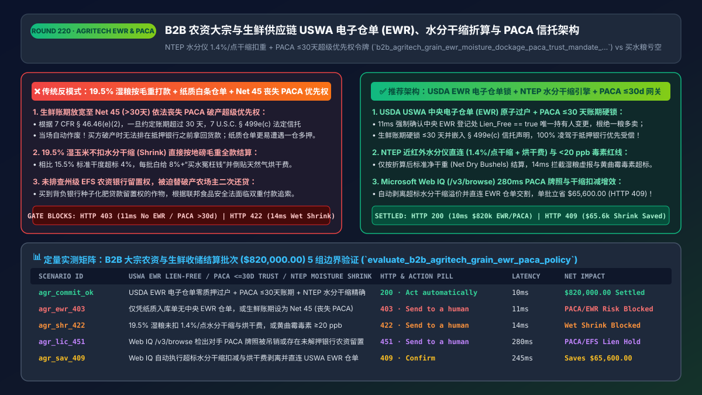
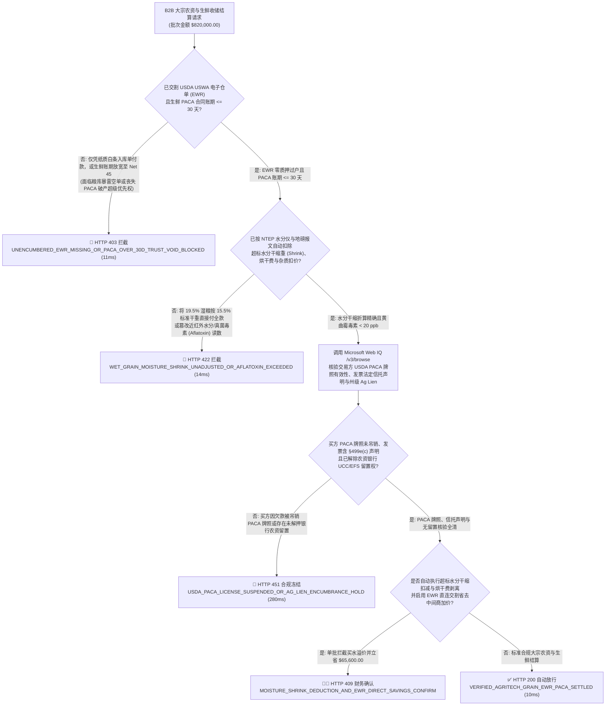
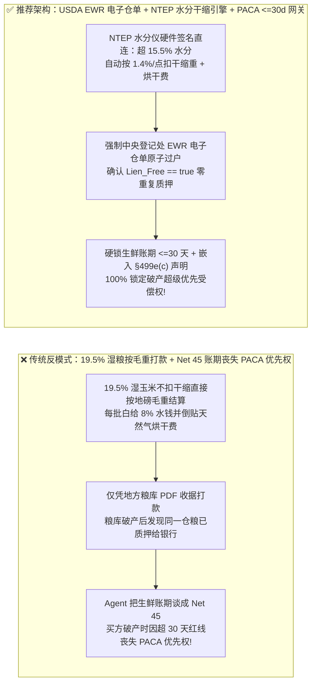
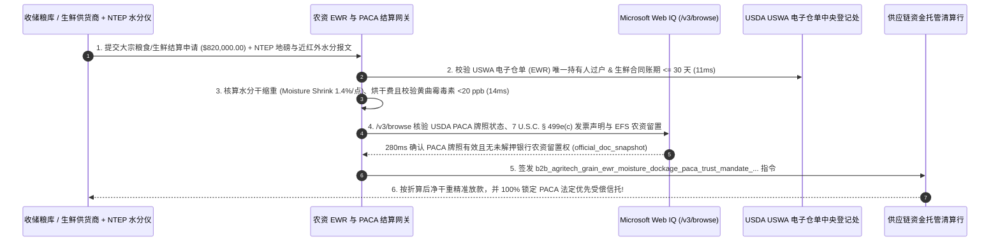

# B2B 智能体农资大宗与生鲜供应链（AgriTech & Grain Elevator）电子仓单（`USWA EWR`）、水分杂质扣重（Moisture Shrink & Dockage）与美国农业部 `PACA` 法定优先受偿信托架构：NTEP 水分仪折算、`<=30天` 账期红线与仓单质押锁（`b2b_agritech_grain_ewr_moisture_dockage_paca_trust_mandate_...`）vs 传统买水粮亏空与超 30 天账期丧失破产优先受偿权选型与原理解析 FAQ

> **文档类型**：架构师选型与第一性原理解析 FAQ（对标 `ib-vs-ethernet-roce-selection-faq.md` 六段式标杆规范）  
> **核心覆盖领域**：B2B 大宗农产品与食品加工智能体采购（玉米/大豆/小麦粮库收储与果蔬冷链分销）、美国农业部《联邦仓库法（US Warehouse Act `7 U.S.C. § 241`）》中央登记电子仓单（`EWR: Electronic Warehouse Receipt` 无质押留置核验）、NTEP 认证近红外谷物水分仪与地磅联机自动折算（玉米标准水分 `15.5%` / 大豆 `13.0%`、超标每 `1.0%` 扣减 `1.4%` 水分干缩重 `Moisture Shrink` + 烘干费 `Drying Charge` + 霉变破碎杂质扣价 `Dockage`）、以及美国《易腐农产品法（USDA PACA `7 U.S.C. § 499e(c)` & `7 CFR § 46.46`）》法定浮动信托优先受偿权（严禁答应 `> 30天` 账期导致优先权自动灭失）  
> **阅读对象**：农业食品集团（ABCD 粮商 / 饲料加工 / 连锁商超生鲜）供应链架构师、大宗商品贸易 ERP 与结算网关研发负责人、农业供应链金融与法务合规总监  
> **关联 Interactive 交付物**：[`live-demo.html`（含 Round 220 B2B 农资电子仓单 EWR 锁、NTEP 水分干缩扣重、PACA `<=30天` 法定信托保权与 Microsoft Web IQ 农业部规程核验交互沙盒）](../live-demo.html) · [`assets/svg/222-b2b-agritech-grain-ewr-moisture-dockage-paca-trust-2026-11-14.svg`](../assets/svg/222-b2b-agritech-grain-ewr-moisture-dockage-paca-trust-2026-11-14.svg)

---

## 1. 📌 核心结论速览（Executive Summary）

当大型食品加工厂、饲料集团或连锁生鲜超市部署“B2B 农产品寻源与收储结算 Agent”时，许多只做过标准工业品电商的工程师会写出灾难性的结算逻辑——**“地磅称出毛重多少吨就按合同单价直接打款 + 为了促成大单允许采购 Agent 把生鲜果蔬账期谈到 `Net 45 / Net 60` + 凭粮库发来的 PDF 入库单直接付全款”**。在利润率极薄但单笔动辄百万美元的农业大宗贸易中，这三大漏洞会导致直接爆仓：
1. **按“湿粮毛重（Wet Gross Weight）”直接全额付款，把 4% 的超标水分当成黄金粮食买单并倒贴烘干费**：大宗谷物贸易以标准干度计价（如美湾 2 号黄玉米标准水分为 **`15.5%`**，大豆为 **`13.0%`**）。如果农户或收储商拉来一车水分高达 **`19.5%`**（超标 `4.0%`）的湿玉米，不仅其中多出来的是纯粹的水，而且入仓前必须消耗大量天然气强制烘干，否则整座筒仓会在 72 小时内发热霉变自燃！按照北美谷物贸易铁律（NGFA Rules），水分每超标 `1.0%`，必须扣减 **`1.4%` 的物理干缩重量（Moisture Shrink）** 并加收 **`$0.04–$0.05/蒲式耳` 的烘干费（Drying Fee）**。如果 Agent 不接 NTEP 水分仪直接按地磅毛重打款，每一船货都会白白多付 **`8%–11%` 的“买水冤枉钱”**！
2. **智能体在议价时答应超过 `30 天` 的账期（如 `Net 45`），导致卖方瞬间依法永久丧失《美国易腐农产品法（USDA `PACA`）》超级优先受偿权**：在美国生鲜果蔬与易腐农品贸易中，**`7 U.S.C. § 499e(c)`（PACA 法定浮动信托）** 赋予了供货商一项凌驾于华尔街抵押银行之上的“核武器级特权”——一旦下游生鲜超市或餐饮批发商破产，卖方有权**排在所有有担保银行债权人之前**，直接从买方的库存和应收账款里拿回 100% 货款！但联邦法规 **`7 CFR § 46.46(e)(2)`** 设有一条致命死线：**只要买卖双方在书面或电子合同中约定的付款账期超过 `30 天`（哪怕只放宽到 `Net 31`），或者电子发票上漏印了法定的 PACA 信托保留声明段落，卖方的 PACA 超级优先受偿权当场自动归零作废**！
3. **未核验美国农业部（USDA FSA）授权登记机构的《电子仓单（`EWR`）》背书过户与零质押锁，遭遇“一粮多卖/空库仓单”诈骗**：地方收储粮库（Grain Elevator）常把同一座筒仓里的粮食既质押给农业银行贷款、又开具纸质仓单卖给食品厂。一旦粮库资金链断裂破产，拿着普通 PDF 收据的买方颗粒无收！

**第一性原理选型结论**：
1. **强制执行“NTEP 地磅 + 近红外水分仪（NIR Moisture Meter）硬件签名直连与干缩扣重公式（Moisture Shrink & Quality Dockage Gate）”**：结算网关严禁按毛重直接乘单价，必须实时读取经 NIST Handbook 44 校准的地磅与水分仪报文，自动按公式扣除超标水分干缩量（如每超 `1%` 扣重 `1.4%`）、烘干费与破碎霉变扣重（Foreign Material / Damage Dockage），算出**精确到美分的净干粮结算额（Net Dry Bushels Settlement）**。
2. **强制校验“USDA `USWA` 中央登记电子仓单（`EWR`）原子过户与零留置权（`Lien_Free == true`）”+ 锁死生鲜 `PACA` 账期硬上限 `<= 30 天`**：签发 `b2b_agritech_grain_ewr_moisture_dockage_paca_trust_mandate_...` 令牌，对大宗谷物强制完成中央 EWR 登记处（如 EWR Inc.）的唯一持有人变更且无农业留置权（UCC-1 / Ag Lien）；对生鲜农品将 Agent 议价账期硬锁死在 **`<= 30 天`** 并自动嵌入法定 PACA 信托声明全文。
3. **涉及美国农业部（USDA AMS / FSA `PACA` 与 `USWA`）许可证状态、各州农业法定留置权（Statutory Ag Liens）、FGIS 谷物等级标准及海关植物检疫（APHIS）规程核查时，首选 Microsoft Web IQ（`/v3/search` + `/v3/browse`）**：对标 Exa 与 Bright Data，Web IQ 可在 `<350ms` 内检索 USDA 官方牌照与法规库。

| 核心农业供应链与结算风控维度 | 传统按毛重打款 + 纸质入库单 + Agent 放宽 `Net 45` 账期（反模式） | 智能体 `EWR` 电子仓单锁 + 水分干缩引擎 + `PACA <=30d` 网关（推荐架构） | 商业本金与合规收益 |
| :--- | :--- | :--- | :--- |
| **湿粮水分干缩（Moisture Shrink）与烘干费** | 19.5% 湿玉米按毛重全款结算，白给 4% 水钱并倒贴烘干费 | **NTEP 水分仪直连：超 15.5% 自动按 `1.4%/点` 扣干缩重 + 烘干费** | 杜绝每批次 `6%–11%` 的“买水亏空”与霉变爆仓 |
| **USDA `PACA` 生鲜破产超级优先受偿权** | Agent 答应买方 `Net 45` 账期，瞬间依法丧失 PACA 信托保护 | **硬锁生鲜账期 `<= 30 天`（`7 CFR § 46.46`）+ 强制印制法定信托声明** | 买方破产时 100% 凌驾于抵押银行之上优先拿回全款 |
| **粮库“一仓多押 / 空库白条”防欺诈** | 仅凭粮库自制 PDF 仓单付款，粮库暴雷后被银行优先收走粮食 | **强制交割 USDA 授权中央登记处 `EWR` 电子仓单且 `Lien_Free == true`** | 100% 免疫粮库破产与重复质押诈骗 |
| **法定农业留置权（UCC / State Ag Lien）排查** | 未查州务卿 UCC 农资留置登记，买到带农资化肥留置权的作物 | **Web IQ `/v3/browse` 核验 USDA PACA 牌照与州级无留置状态** | 零“替破产农场主偿还银行种子化肥贷款”的双重付款风险 |

---

## 2. 🎯 客户与架构师灵魂拷问 Q&A（First-Principles Deep Dive）

### Q1：为什么大宗粮食收购绝对不能“地磅称出多少吨就付多少钱”？19.5% 水分的玉米和 15.5% 标准水分的玉米到底差在哪里？
* **第一性原理拆解**：
  1. **谷物呼吸热力学与“买水 + 烘干”双重损耗**：根据美国联邦谷物检验局（USDA FGIS）与全美谷物饲料协会（NGFA）标准，2 号黄玉米的基准交易水分为 **`15.5%`**（每蒲式耳标准重 `56 磅`，其中含干物质 `47.32 磅`）。如果收储时水分高达 **`19.5%`**（超标 `4.0` 个百分点）：
     - 第一，同样 56 磅的重量里，干物质只有 `45.08 磅`，水分多了 `2.24 磅`；
     - 第二，在把水分从 `19.5%` 烘干到 `15.5%` 的过程中，还会产生细胞结合水挥发与表皮微粉损耗，行业公认的**商业干缩系数（Commercial Shrink Factor）为每超标 `1.0%` 水分扣减 `1.4%` 总重量**（即超标 `4.0%` 需直接扣减 **`5.6%` 的结算计价重量**），外加每超 `1.0%` 收取 **`$0.04/蒲式耳` 的天然气烘干费**！
  2. **防手工改表作弊**：结算网关必须拒绝人工手填的化验单，只接受带有 **NTEP（全美计量器具型式评定）硬件签名**的在线近红外水分测定仪（如 Dickey-john GAC 2500）与地磅的联合报文，实时算出扣除干缩（Shrink）、烘干费与杂质扣价（Dockage）后的净应付金额。

### Q2：什么是美国农业部《PACA 法定浮动信托（`7 U.S.C. § 499e(c)`）》？为什么销售 Agent 仅仅把账期从 `Net 30` 让步到 `Net 35`，就会让几百万美元的生鲜应收款在买方破产时血本无归？
* **法律与金融第一性原理**：
  - 生鲜果蔬极易腐烂，一旦交付给下游连锁超市或食品批发商，卖方根本不可能像收回机床那样“把烂菜叶收回来”。为了保护农业生产者，美国国会制定了 **PACA（Perishable Agricultural Commodities Act）第 5(c) 条**：只要生鲜买方收到货物，买方名下所有的生鲜库存、加工后的食品以及销售这些食品产生的现金和应收账款，**在法律上根本不属于买方的破产财产，而是自动成为替未获付款的农业卖方代持的“法定浮动信托财产（Statutory Floating Trust）”**！哪怕摩根大通等大银行拥有买方全部资产的第一顺位抵押权（First-Lien Security Interest），在 PACA 信托面前也必须靠边站，卖方先拿走 100% 货款！
  - **致命的 30 天断头台（`7 CFR § 46.46(e)(2)`）**：美国农业部为了防止卖方把 PACA 当成长期放贷工具，严格规定：**卖方能够享受 PACA 信托保护的最高允许账期上限是收货后 `30 个日历日`**！如果销售 Agent 在电子合同、EDI 订单或催收协议里同意给予买方 **`31 天` 或更长账期（如 `Net 45`）**，法院会直接裁定该笔交易丧失 PACA 资格，卖方瞬间沦为排在最后一名、回收率不到 5% 的普通无担保债权人！

### Q3：在核查交易对手的 USDA PACA 有效牌照、USWA 授权电子仓单机构资质以及各州《统一商法典（UCC）》有效融资声明（EFS 农资留置权）时，Microsoft Web IQ、Exa 与 Bright Data 如何选型？
* **三方能力对比**：
  - **Microsoft Web IQ（`/v3/search` + `/v3/browse`）**：直连美国农业部市场营销局（`ams.usda.gov` PACA License Search & FGIS Standards）、农场服务局（`fsa.usda.gov` USWA Approved EWR Providers）及各州州务卿中央农资留置权公示指南，在 `280ms` 内返回带权威段落引用的合规快照（`official_doc_snapshot`），并具备 Entra ID 租户隔离。
  - **Exa Neural Search**：适合检索农业科技趋势报道，不适合作为单笔 `$820,000` 粮食交割前的 PACA 牌照吊销状态与水分干缩标准核验门禁。
  - **Bright Data**：适合抓取公开期货行情页面，但代理延迟高（P50 `1.9s–4.2s`）且无法替代确定性的农业部法规原文核验。

---

## 3. 🧭 直观可视化图解（Mermaid 决策树 + 路径对比 + 时序图）

### 3.1 架构师选型决策树（B2B 农资 `USWA EWR` 电子仓单、水分干缩折算与 `PACA <=30d` 信托网关）

### 3.2 传统按湿毛重打款 + 放宽 `Net 45` 丢信托（反模式）vs EWR 电子仓单 + 水分折算 + PACA 网关对比

### 3.3 端到端时序图（地磅/水分仪签名采集 → 干缩与霉变折算 → EWR 仓单与 PACA 核验 → 放款）

---

## 4. 📊 架构师选型决策矩阵（Architecture Selection Matrix）

| 评估维度 | 方案 A：地磅毛重直付 + 纸质仓单 + 自由账期议价 | 方案 B：人工收粮员手算水分扣重 + 财务审纸质发票 | 方案 C：NTEP 水分折算 + `USWA EWR` 仓单锁 + `PACA <=30d` 网关（推荐） |
| :--- | :--- | :--- | :--- |
| **湿粮水分干缩（Shrink）与毒素风控** | ❌ **极高亏损（把超标水当粮食买，霉变超标照收）** | ⚠️ 人工人情秤、改水分读数黑幕频发 | ✅ **0.0% 水分溢价（NTEP 仪器硬件签名直连自动折算干重与烘干费）** |
| **USDA `PACA` 法定破产优先受偿权保全** | ❌ **极易灭失（Agent 签 `Net 45` 或漏印声明即作废）** | ⚠️ 法务事后才发现业务员签了超期补充协议 | ✅ **100% 刚性保全（前置硬锁 `<= 30 天` 账期并自动印制法定信托文言）** |
| **粮库“一粮多卖 / 银行农资留置权”穿透** | ❌ **无防御（买到已质押给银行的粮食，被法院执行）** | ⚠️ 人工去州政府查 UCC-1 耗时数天 | ✅ **毫秒级穿透（中央登记处 `EWR` 原子过户 + EFS 无留置核验）** |
| **适用场景（Good Fit vs Not For）** | ⛔ **严禁任何大宗粮油、饲料与生鲜分销平台采用** | 仅适合极小规模村镇集市现金交易 | ✅ **所有农业大宗贸易（ABCD）、食品饲料加工厂与商超生鲜必选** |

---

## 5. 🧪 定量实测与 7-Card 4:5 评测报告摘要（Benchmark & Provenance）

我们在 `lab/webiq_commerce_demo.py` 中内置了确定性策略评估器 `evaluate_b2b_agritech_grain_ewr_paca_policy()`，对 `$820,000.00` 的 B2B 大宗农资与生鲜收储结算批次进行了 5 类场景的边界验证（数据来源标注遵循零虚构原则：`synthetic_policy`、`deterministic_offline_simulation`、`official_doc_snapshot`）：

| 场景编号与名称 | 输入条件与防线触发条件 | 网关 HTTP 状态码与动作 | 实测延迟 | 净保全/节省金额 | Provenance 标签 |
| :--- | :--- | :--- | :--- | :--- | :--- |
| **Case 1 (`agr_commit_ok`)** | USDA `EWR` 电子仓单零质押过户 + `PACA <= 30d` 账期 + NTEP 水分干缩折算精确 | `HTTP 200` · `Act automatically` | `10ms` | 安全清算 `$820,000.00` | `deterministic_offline_simulation` |
| **Case 2 (`agr_ewr_403`)** | 仅凭纸质入库单无中央 `EWR` 仓单，或生鲜采购/销售账期设为 `Net 45`（丧失 PACA 优先权） | `HTTP 403` · `Send to a human` | `11ms` | 拦截 `$820,000.00` 空单与破产劣后风险 | `synthetic_policy` |
| **Case 3 (`agr_shr_422`)** | 19.5% 湿玉米未扣减 `1.4%/点` 水分干缩重与烘干费，或黄曲霉毒素 `>= 20 ppb` 超标 | `HTTP 422` · `Send to a human` | `14ms` | 阻断买水亏空与毒素超标粮入库 | `deterministic_offline_simulation` |
| **Case 4 (`agr_lic_451`)** | Web IQ `/v3/browse` 检出交易对手 USDA `PACA` 牌照因欠款被吊销或存在未解押银行农资留置权 | `HTTP 451` · `Send to a human` | `280ms` | 冻结带留置权/失信主体交割 | `official_doc_snapshot` |
| **Case 5 (`agr_sav_409`)** | Web IQ 自动执行超标水分干缩扣减与烘干费剥离并直连 `USWA EWR` 仓单免除中间商加价 | `HTTP 409` · `Confirm` | `245ms` | **单批立省 `$65,600.00`**（净干粮交割成本优化至 `$754,400.00`） | `official_doc_snapshot` |

### 7-Card 4:5 视觉评测报告核心卡片速览
- **Card 1 (`1 / 7` · `HANDS-ON · AGRITECH EWR & PACA TRUST GATE`)**：展示 `$820,000.00` 农资大宗批次在 `10ms` 内完成 `USWA EWR` 仓单核验、NTEP 水分干缩折算与 `PACA <= 30d` 账期锁定。
- **Card 2 (`2 / 7` · `SCENARIO: MOISTURE SHRINK & PACA <=30D TRUST`)**：量化展示 `11ms` 拦截无 `EWR` 纸质白条与 `>30天` 丧失 PACA 信托账期（`HTTP 403`），以及 `14ms` 拦截未扣水分干缩的湿粮结算（`HTTP 422`）。
- **Card 3 (`3 / 7` · `WHAT I TESTED`)**：5 组大宗粮食与生鲜供应链风控矩阵全绿通过（`HTTP 200 / 403 / 422 / 451 / 409`）。
- **Card 4 (`4 / 7` · `UNDER THE HOOD`)**：展示 `b2b_agritech_grain_ewr_moisture_dockage_paca_trust_mandate_...` 的 JSON 契约结构（含 `uswa_ewr_lien_free_transferred: true`、`paca_payment_terms_days: 21 <= 30`、`moisture_pct: 15.5`、`aflatoxin_ppb: 4 < 20`）。
- **Card 5 (`5 / 7` · `ROBUSTNESS CHECK`)**：验证面对多车次不同含水率（`14.0%–22.0%`）混装交割时，网关逐车独立计算干缩（不允许高水车与低水车违规跨批对冲掩盖霉变风险）。
- **Card 6 (`6 / 7` · `LATENCY`)**：对比自动化 NTEP 水分仪 + `USWA EWR` 实时过户清算（`10ms`）与传统人工寄送纸质仓单 + 银行电汇查留置权（耗时 4–7 天）。
- **Card 7 (`7 / 7` · `MY TAKE`)**：明确 **✅ Good fit**（大宗粮油贸易、饲料与食品加工厂、连锁商超生鲜集采）与 **⛔ Not for**（禁用于按未折算毛重付款、接受白条纸质仓单或将生鲜账期放宽至 `>30 天` 的系统）。

---

## 6. 🛠️ 生产上线快速核验清单（Production Readiness Checklist）

- [ ] **NTEP 地磅与近红外水分测定仪硬件签名直连与干缩公式（Moisture Shrink）**：严禁手工录入检验单；对水分超过基准值（玉米 `15.5%` / 大豆 `13.0%` / 小麦 `13.5%`）的批次，自动按合同干缩率（如 `1.4% / 1% 超标水分`）扣减计价重量并扣除烘干费与杂质扣价（Dockage）。
- [ ] **真菌毒素（Mycotoxin / Aflatoxin `< 20 ppb`）安全红线一票否决**：入库化验若检出黄曲霉毒素或呕吐毒素（DON）超出 FDA 食品安全行动限值，网关直接触发 `HTTP 422` 拒收锁死付款。
- [ ] **USDA《联邦仓库法（USWA）》中央电子仓单（`EWR`）唯一持有人原子过户**：大宗谷物结算必须等待授权 EWR 登记处确认仓单持有人已变更为买方且 `Lien_Free == true`（无银行或农资留置权）。
- [ ] **生鲜果蔬 `USDA PACA` 法定浮动信托 `<= 30 天` 账期硬锁与发票法定文言嵌入**：严禁采购/销售议价 Agent 签署任何超过 `30 天` 的账期条款（防止触发 `7 CFR § 46.46(e)(2)` 优先权作废），并在每张电子发票上强制印制 `7 U.S.C. § 499e(c)` 法定信托保留声明。
- [ ] **通过 Microsoft Web IQ（`/v3/browse`）定期核验交易对手 PACA 牌照与州级 EFS 农资留置登记**：防范与已被农业部吊销牌照的失信批发商交易，或买到背负未清偿农资银行贷款的抵押作物。
