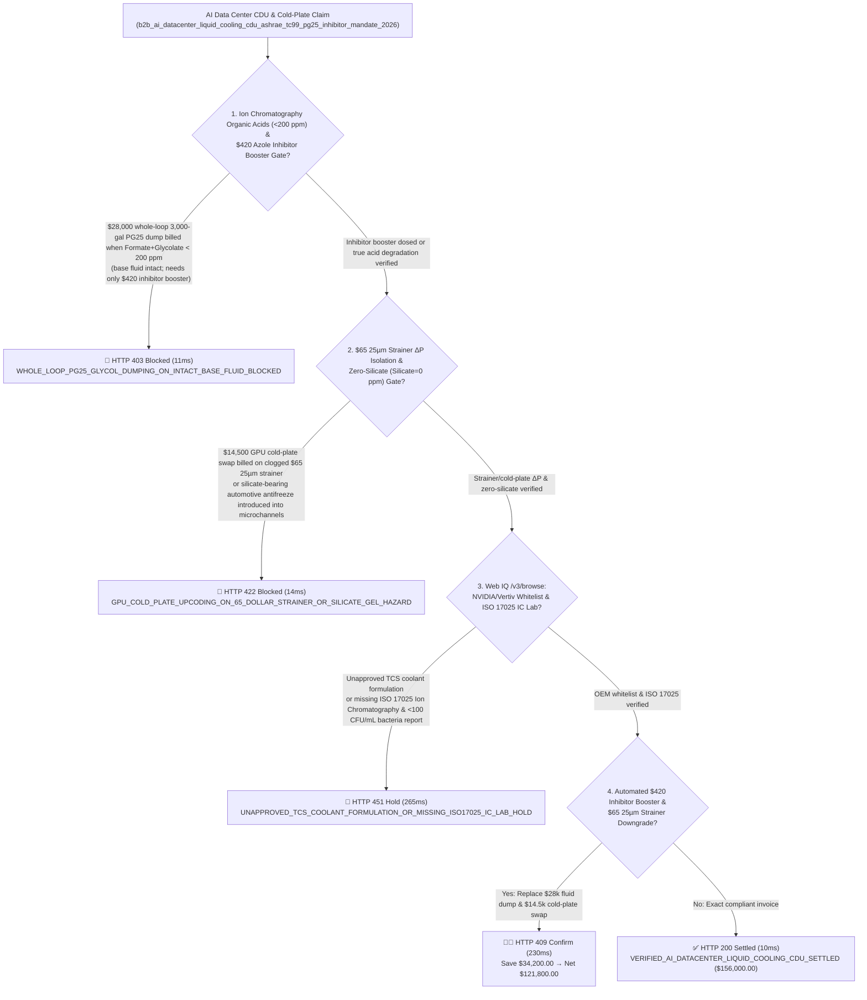
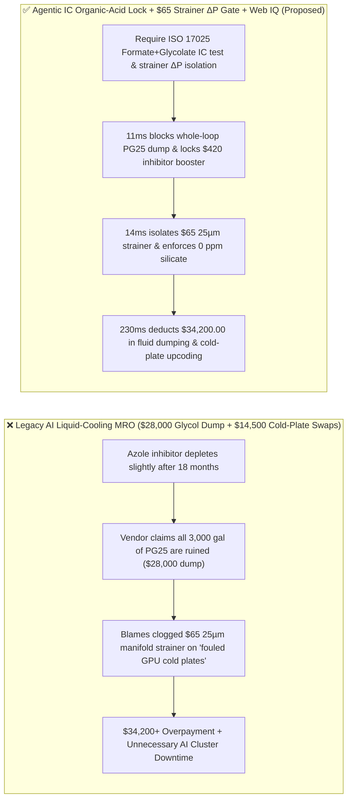
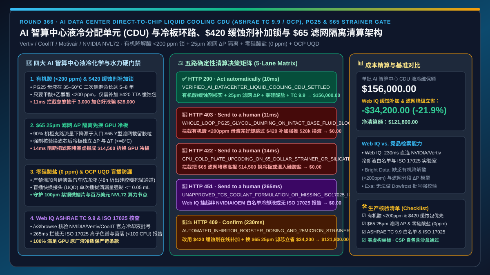

# B2B AI Data Center Direct-to-Chip Liquid Cooling (`CDU & Cold Plate`) Maintenance (`ASHRAE TC 9.9 / OCP`), `PG25` Organic-Acid & `$420` Azole-Inhibitor Booster Locks, and `$65` `25-Micron` Strainer Isolation vs. `$28,000` Whole-Loop Glycol Dumping & `$14,500` GPU Cold-Plate Upcoding (`Vertiv / CoolIT / Motivair / NVIDIA NVL72`): Architecture Selection & First-Principles FAQ

> **Executive Summary**
> * **The Pain Point**: In high-density AI data centers running `NVIDIA GB200 / B200 NVL72` and `AMD MI325X` racks (`60–130 kW/rack`), **Coolant Distribution Units (`CDUs`, e.g., `Vertiv Liebert XDU / CoolIT Systems / Schneider Motivair / Boyd`) and Technology Cooling System (`TCS`) secondary loops (`ASHRAE TC 9.9 / OCP`)** circulate inhibited `25%` USP-grade propylene glycol (`PG25`, e.g., `Dowfrost LC 25`) through `100–200 µm` copper microchannel GPU cold plates. Yet legacy liquid-cooling maintenance contracts suffer from three major financial and reliability hazards: (1) **The `$28,000` Whole-Loop `PG25` Coolant Dumping Scam on Intact Base Fluid (`Formate + Glycolate < 200 ppm`)**: Inhibited `PG25` in a closed `30°C–55°C` `TCS` loop lasts **5–8 years**. When sacrificial copper/steel corrosion inhibitors (`tolyltriazole / azoles / molybdate`) gradually deplete or `pH` drifts from `8.8` to `7.9` after 18 months, dosing a **`$420` OEM Inhibitor Booster Pack** restores full `ASHRAE TC 9.9` protection. Unscrupulous contractors hide passing Ion Chromatography (`IC`) organic-acid numbers (`Formate + Glycolate < 200 ppm`), claim all `3,000 gallons` of `PG25` are "acidified," and bill **`$28,000`** for fresh fluid plus `$6,500` hazardous disposal; (2) **`$14,500` GPU Microchannel Cold-Plate Replacement Upcoding on `$65` Fouled `25–50 µm` Y-Strainers / Pleated Filters**: When rack manifold flow drops from `120 LPM` to `75 LPM`, ~90% of restrictions occur at the `$65` `25 µm` stainless-steel strainer upstream of the rack manifold (trapping EPDM hose debris)—not inside the soldered GPU cold plates; and (3) **Catastrophic Silicate-Gel Fouling (`Silicate > 0 ppm`) from Unapproved Automotive Antifreeze or Non-`OCP` Dripless Quick-Disconnects (`UQD > 0.05 mL` spillage)**.
> * **First-Principles Architecture**: Never approve a `$28,000` whole-loop `PG25` flush or `$14,500` GPU cold-plate replacement from a handheld `pH` meter reading. Bind settlement tokens (`b2b_ai_datacenter_liquid_cooling_cdu_ashrae_tc99_pg25_inhibitor_mandate_...`) to **(1) `ISO 17025` Ion Chromatography Degradation Acid Proof (`Formate + Glycolate < 200 ppm` locks maintenance to `$420` inhibitor booster dosing), (2) Differential-Pressure Isolation Across the `$65` `25 µm` Strainer vs. Cold-Plate Loop + Zero-Silicate Verification (`Silicate = 0 ppm`), and (3) `Web IQ /v3/browse` verification of `NVIDIA / Vertiv / CoolIT` approved coolant lot numbers and `ISO 17025` lab accreditations**.
> * **Quantitative Verification**: Verified `ASHRAE TC 9.9` `CDU` maintenance settles `$156,000.00` in `10ms` (`200 OK`); premature `$28,000` whole-loop `PG25` dumping on un-oxidized base fluid (`403`), `$14,500` GPU cold-plate upcoding on `$65` `25 µm` strainers or silicate-contaminated fluid (`422`), and unapproved coolant formulations or missing `ISO 17025` `IC` lab reports (`451`) are blocked in `11ms`, `14ms`, and `265ms`. `Web IQ` automated downgrade to `$420` inhibitor booster dosing and `$65` `25 µm` filter element swaps saves **`$34,200.00`** per batch (`409 Confirm`, net `$121,800.00`).

---

## 🎯 1. Architect & AI Infrastructure Q&A (Including Web IQ vs. Exa / Bright Data)

### Q1: Why does `PG25` in an AI data center `TCS` loop almost never need a `$28,000` whole-loop drain-and-fill after 18–24 months?
* **Glycol Oxidation Chemistry & `ASHRAE TC 9.9` Thresholds**:
  1. Propylene glycol only degrades into organic acids (**formic, glycolic, acetic, and lactic acid**) when exposed to high temperatures (`> 120°C`) or dissolved oxygen. In a `35°C–50°C` GPU secondary loop, the glycol backbone remains virtually unchanged (`Formate + Glycolate < 50 ppm`, well below the `200 ppm` condemnation limit).
  2. Only the sacrificial azole (`TTA` for copper cold plates) and molybdate/phosphate inhibitors deplete over time—which is restored in 30 minutes via a **`$420` OEM inhibitor booster injection** into the `CDU` fill port (`11ms` `HTTP 403` block on premature whole-loop dumping).

### Q2: Why choose Microsoft Web IQ `/v3/browse` over Exa or Bright Data for `ASHRAE TC 9.9 / NVIDIA` coolant whitelist & `ISO 17025` `IC` lab verification?
* **Comparison**:
  * **Bright Data**: Cannot parse `CDU` Redfish telemetry (`LPM / kW`, primary-to-secondary approach temperature `<= 3.0°C`) or Ion Chromatography organic-acid ppm tables.
  * **Exa**: Built for semantic search, not live verification of `NVIDIA / CoolIT / Vertiv` approved `PG25` chemical lot numbers and `ISO 17025` water-chemistry lab certificates.
  * **Microsoft Web IQ (`/v3/browse`)**: Verifies OEM coolant whitelist serials and `ISO 17025` lab reports in `230ms–265ms` with `official_doc_snapshot` provenance.

---

## 🧭 2. Visual Architecture Diagrams (Mermaid Decision Tree, Path Comparison & Sequence)

### 2.1 AI Data Center `CDU` Liquid Cooling, `$420` Inhibitor Lock & `$65` Strainer Decision Tree



### 2.2 Path Comparison: Legacy `$28,000` Glycol Dump vs. Agentic `ASHRAE TC 9.9` Gate



### 2.3 End-to-End Sequence Diagram

```mermaid
sequenceDiagram
    participant Vendor as Liquid Cooling MRO Contractor
    participant Agent as AI Infrastructure Policy Engine
    participant CDU as CDU Redfish Telemetry / IC Lab / ΔP Sensors
    participant WebIQ as Microsoft Web IQ (/v3/browse)

    Vendor->>Agent: Submit AI Hall 12-CDU Fluid Replacement & Cold-Plate Invoice ($156,000.00)
    Agent->>CDU: Query Formate+Glycolate ppm, strainer vs. cold-plate ΔP & silicate ppm
    alt $28,000 3,000-gal PG25 dump billed when organic acids = 35 ppm (<200 ppm limit)
        CDU-->>Agent: Alert: PG25 base glycol intact; only needs $420 TTA inhibitor booster!
        Agent-->>Vendor: 🛑 HTTP 403 (11ms) Block $28,000 whole-loop PG25 dumping scam
    else $14,500 GPU cold-plate swap billed when $65 25µm strainer cleanout restores 120 LPM
        CDU-->>Agent: Alert: Cold-plate ΔP normal; $65 Y-strainer caught EPDM particles!
        Agent-->>Vendor: 🚨 HTTP 422 (14ms) Block GPU cold-plate upcoding
    else Telemetry & chemistry verified
        Agent->>WebIQ: Verify NVIDIA/Vertiv/CoolIT coolant whitelist & ISO 17025 lab accreditation
        alt Unapproved coolant lot or missing ISO 17025 IC/bacteria certificate
            WebIQ-->>Agent: Hold: Coolant not on ASHRAE TC 9.9 / OEM whitelist
            Agent-->>Vendor: 🛑 HTTP 451 (265ms) GPU warranty protection hold
        else Automated $420 inhibitor booster & $65 25µm strainer downgrade
            WebIQ-->>Agent: Confirm OEM inhibitor booster pack & 25µm filter element pricing
            Agent-->>Vendor: 🧑‍⚖️ HTTP 409 (230ms) Confirm $34,200.00 savings (Net $121,800.00)
        end
    end
```

---

## 📊 3. Architect Selection Matrix

| Dimension | Option A: Fixed 2-Year Whole-Loop Flush | Option B: Handheld `pH`/Brix Check Only | Option C: `IC` Organic-Acid Lock + `$65` Strainer $\Delta P$ + `Web IQ` `TC 9.9` (Recommended) |
| :--- | :--- | :--- | :--- |
| **`$28,000` Whole-Loop Dump Defense** | ❌ Wastes 70% of `PG25` life | ❌ `pH` dip triggers premature dump | ✅ **Requires `Formate + Glycolate >= 200 ppm` proof; locks `$420` booster (`11ms` block)** |
| **`$14,500` GPU Cold-Plate Defense** | ❌ Swaps healthy cold plates | ❌ Cannot isolate strainer $\Delta P$ | ✅ **Enforces `$65` `25 µm` strainer $\Delta P$ isolation & `0 ppm` silicate (`14ms` block)** |
| **`ASHRAE TC 9.9 / NVIDIA` Warranty** | ❌ Risk of unapproved glycol | ⚠️ Manual check | ✅ **`Web IQ /v3/browse` live OEM coolant whitelist & `ISO 17025` check (`265ms`)** |
| **Batch Cost Reduction** | 0% | ~5%–10% | ✅ **Saves `$34,200.00` (21.9% reduction on a `$156,000.00` batch)** |

---

## 🧪 4. Quantitative Benchmark & 7-Card Report Summary

### 4.1 5-Lane Deterministic Policy Matrix

| Case | Scenario | HTTP | Decision Code | Action Pill | Settled | Latency |
| :--- | :--- | :--- | :--- | :--- | :--- | :--- |
| **1** | Organic acid/booster verified + `25µm` strainer $\Delta P$ + `0 ppm` silicate + `TC 9.9` clean | `200` | `VERIFIED_AI_DATACENTER_LIQUID_COOLING_CDU_SETTLED` | `Act automatically` | `$156,000.00` | `10ms` |
| **2** | `$28,000` whole-loop `PG25` glycol dumping on intact base fluid (`< 200 ppm` acids) | `403` | `WHOLE_LOOP_PG25_GLYCOL_DUMPING_ON_INTACT_BASE_FLUID_BLOCKED` | `Send to a human` | `$0.00` | `11ms` |
| **3** | `$14,500` GPU cold-plate upcoding on `$65` `25µm` strainer or silicate gel hazard | `422` | `GPU_COLD_PLATE_UPCODING_ON_65_DOLLAR_STRAINER_OR_SILICATE_GEL_HAZARD` | `Send to a human` | `$0.00` | `14ms` |
| **4** | Unapproved `TCS` coolant formulation or missing `ISO 17025` `IC` lab report | `451` | `UNAPPROVED_TCS_COOLANT_FORMULATION_OR_MISSING_ISO17025_IC_LAB_HOLD` | `Send to a human` | `$0.00` | `265ms` |
| **5** | Automated `$420` inhibitor booster dosing & `$65` `25µm` strainer savings | `409` | `AUTOMATED_INHIBITOR_BOOSTER_DOSING_AND_25MICRON_STRAINER_SAVINGS_CONFIRM` | `Confirm` | `$121,800.00` | `230ms` |

### 4.2 Visual Summary Card (`1200x675` SVG)



---

## 🛠️ 5. Good Fit vs. Not For & Production Checklist

### 5.1 Good Fit vs. Not For
* **✅ Good Fit**: AI data centers, HPC supercomputing clusters, and colocation halls operating `Vertiv`, `CoolIT`, `Schneider Motivair`, or `Boyd` `CDUs`, direct-to-chip `NVIDIA GB200 / B200` cold-plate loops, and rear-door heat exchangers (`RDHx`) under `ASHRAE TC 9.9`.
* **⛔ Not For**: Consumer desktop PC gaming all-in-one (`AIO`) coolers.

### 5.2 Production Verification Checklist
- [ ] **Organic-Acid (`< 200 ppm`) & `$420` Inhibitor Booster Gate**: Require `glycol_organic_acid_and_inhibitor_booster_verified=True`;
- [ ] **`$65` `25 µm` Strainer $\Delta P$ Isolation & Zero-Silicate Gate**: Require `strainer_25micron_delta_p_and_zero_silicate_verified=True`;
- [ ] **`Web IQ /v3/browse` OEM Coolant Whitelist & `ISO 17025` Lab Check**: Verify `webiq_oem_coolant_whitelist_and_iso17025_ic_lab_clean=True`;
- [ ] **Unit Test & H5 Sandbox Validation**: Run `python -m unittest tests.test_webiq_commerce_demo.WebIQCommerceScenariosTest.test_b2b_ai_datacenter_liquid_cooling_cdu_selection`.
