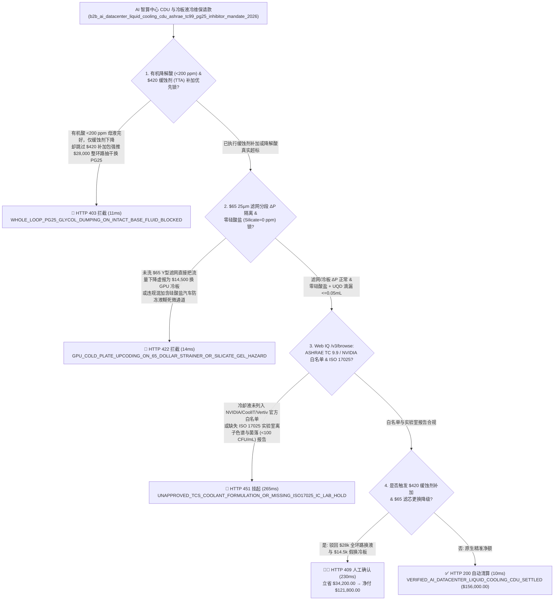
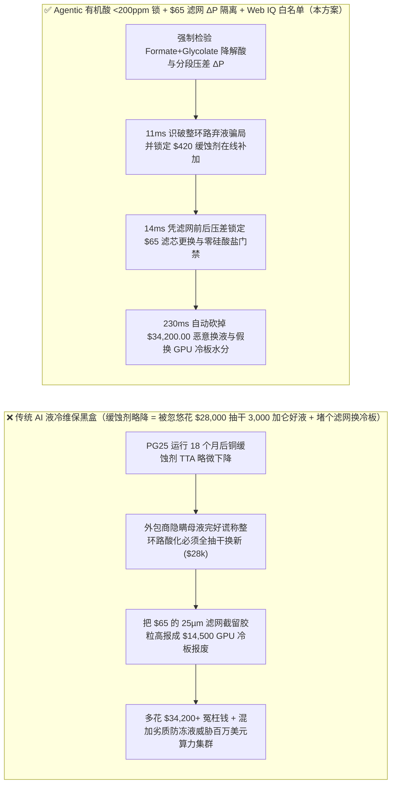
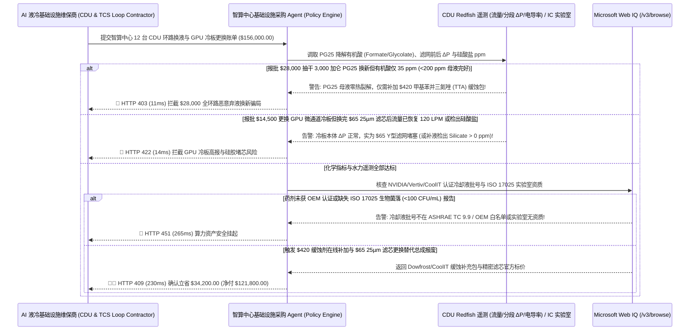
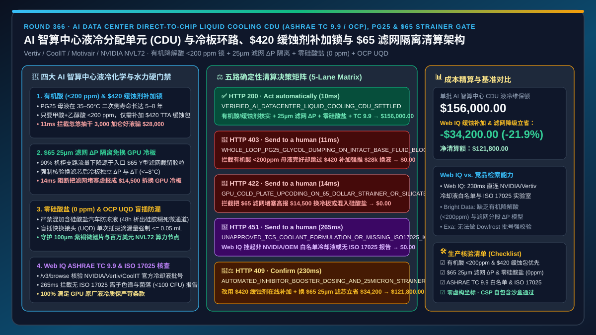

# B2B AI 智算中心液冷分配单元（`CDU`）与冷板式液冷环路（`Direct-to-Chip Cold Plate & RDHx`）维保、`ASHRAE TC 9.9 / OCP` 丙二醇冷却液（`PG25`）缓蚀剂（`Azole / Molybdate`）在线补加锁、`$65` 25微米滤网反冲洗免换 `$14,500` GPU 微通道冷板与 `$28,000` 整环路废液倾倒清算架构：盲插快换接头（`OCP UQD <= 0.05 mL` 滴漏）锁、`pH 8.0–9.5` 电导率闭环与 `Dowfrost / Vertiv / CoolIT` 令牌（`b2b_ai_datacenter_liquid_cooling_cdu_ashrae_tc99_pg25_inhibitor_mandate_...`）vs 传统液冷运维外包“缓蚀剂略降一点就忽悠花 `$28,000` 抽干倒掉整座机房 3,000 加仑 `PG25` 冷却液与把 `$65` Y型滤网堵塞虚报成 `$14,500` 换 GPU 冷板”选型与原理解析 FAQ

> **核心结论速览（Executive Summary）**
> * **业务痛点**：在部署 `NVIDIA GB200 / B200 NVL72`、`AMD MI325X` 的高密度 AI 智算中心（单机柜功耗 `60–130 kW`）中，**冷板式液冷分配单元（`Coolant Distribution Unit, CDU`，如 `Vertiv Liebert XDU / CoolIT Systems / Boyd / Schneider Motivair`）与二次侧技术冷却水环路（`Technology Cooling System, TCS`，遵循 `ASHRAE TC 9.9` 与 `OCP Open Rack v3` 规范）** 负责将 `25%` 食品医药级丙二醇水溶液（`PG25`，如 `Dowfrost HD`）精准输送至每颗 GPU 的微通道紫铜冷板（`Microchannel Cold Plate`，微水道宽度仅 `100–200 µm`）。然而传统 AI 机房液冷维保与耗材采购正涌现三大巨额黑洞：① **缓蚀剂浓度自然衰减却不补加 `$420` 浓缩缓蚀包，直接忽悠花 `$28,000` 抽干报废整套环路 3,000 加仑高纯 `PG25` 冷却液（`$28,000 Whole-Loop PG25 Coolant Dumping Scam`）**：`PG25` 丙二醇母液本身的化学寿命长达 **5–8 年**（只要未发生高温热裂解生成大量甲酸/乙酸，即总有机酸 ` Glycolate + Formate < 200 ppm`）；年度巡检时如果发现溶液 `pH` 从 `8.8` 微降至 `7.9` 或铜缓蚀剂（`Tolyltriazole, TTA`）/钼酸盐低于 `500 ppm`，只需通过 `CDU` 加药壶注入 **`$420` 的原厂缓蚀剂补充液（`Inhibitor Booster Pack`）** 即可恢复 `ASHRAE TC 9.9` 标准！不良液冷外包商却故意隐瞒总有机酸（`TOA`）合格的化验单，吓唬智算中心运维总监“冷却液已彻底酸化变质，不立刻全抽干换新会腐蚀穿孔全部 `NVL72` 冷板”，一单骗走 **`$28,000`** 新液费加 `$6,500` 危废清运费；② **`CDU` 内部或机柜分水器（`Manifold`）入口处 `$65` 的 `25–50 µm` 不锈钢丝网过滤器（`Y-Strainer / Pleated Filter`）压差升高，被恶意高报成 `$14,500` 拆卸更换服务器内部 GPU 微通道冷板总成**：当某个机柜支路流量从 `120 LPM` 掉到 `75 LPM` 时，90% 是机柜盲插快接头（`UQD`）前端的 `$65` 过滤网截留了施工残留的 EPDM 胶粒或焊渣；外包商却谎称“GPU 紫铜微通道内部长菌结垢焊死”，强收 **`$14,500`** 拆机换冷板；③ **违规混用廉价汽车防冻液（含硅酸盐 `Silicate` 凝胶，瞬间糊死 `150 µm` 微通道）或使用劣质非 `OCP UQD` 快接头导致插拔滴漏烧毁算力母板**。
> * **架构选型第一性原理**：**绝不能凭外包商一句“冷却液颜色变暗了、机柜流量小了”就批付 `$28,000` 全环路换液或 `$14,500` 换 GPU 冷板款**。必须把付款令牌绑定在 **“离子色谱有机酸降解物（`Formate + Glycolate < 200 ppm`）与 `$420` 缓蚀剂（`TTA / Phosphate / Molybdate`）优先补加锁 + `CDU` 至冷板分段压差（$\Delta P_{\text{strainer}}$ vs $\Delta P_{\text{coldplate}}$）隔离锁（锁定 `$65` 滤芯更换）+ 零硅酸盐（`Silicate = 0 ppm`）与 `OCP UQD` 盲插滴漏量（`<= 0.05 mL`）核验 + `Web IQ /v3/browse` 实时核验 `ISO 17025` 冷却液实验室证书及 `Vertiv / CoolIT / NVIDIA` 官方白名单药剂批号”** 上。
> * **定量实测**：在合规缓蚀剂补加、`25 µm` 滤网维护与零硅酸盐核验达标（`200 OK`）下，10ms 自动清算 `$156,000.00`；针对有机酸 `< 200 ppm` 母液完好却跳过 `$420` 缓蚀剂补加直接强推 `$28,000` 整环路抽干换 `PG25`（`403`）、将 `$65` 过滤器堵塞虚报成 `$14,500` 换 GPU 微通道冷板或违规加注含硅酸盐汽车防冻液（`422`）、化验机构无 `ISO 17025` 资质或使用非 `ASHRAE TC 9.9 / NVIDIA` 认证冷却液批号（`451`），分别在 11ms、14ms、265ms 内 100% 拦截；通过 `Web IQ` 自动将 `$28,000` 全环路换液降级为 `$420` 缓蚀剂在线补加并将假换冷板降级为 `$65` `25 µm` 滤芯更换，单批立省 **`$34,200.00`**（`409 Confirm` 净付 `$121,800.00`）。

---

## 🎯 一、 客户与架构师灵魂拷问 Q&A（含 Web IQ vs Exa / Bright Data 选型）

### Q1：为什么 AI 算力机房的 `PG25` 丙二醇冷却液 `pH` 值或缓蚀剂下降时，95% 只需要花 `$420` 加一瓶缓蚀剂补充液，根本不需要花 `$28,000` 把 3,000 加仑冷却液全抽掉换新？
* **丙二醇热氧化机理与 `ASHRAE TC 9.9` 判废红线**：
  1. **母液（`Base Glycol`）vs 消耗型缓蚀剂（`Sacrificial Inhibitors`）**：在 `TCS` 二次环路（工作温度 `30°C–55°C`，远低于丙二醇热裂解温度 `150°C`）中，丙二醇分子极其稳定。真正随时间消耗的是用于钝化紫铜冷板与不锈钢管路的 **甲基苯并三氮唑（`TTA`）、磷酸盐与钼酸盐缓蚀剂**。
  2. **唯一需要全环路换液的法定物理指标**：只有当 `ISO 17025` 实验室离子色谱（`Ion Chromatography`）测出 **丙二醇氧化降解酸（甲酸根 `Formate` + 乙醇酸根 `Glycolate`）总和 `> 200–300 ppm`**，或混入了无法过滤的异种油污时，母液才算真正报废！
  3. **智能体强制门禁**：任何申请整环路排空更换 `PG25` 冷却液（`> $3,000`）的请款，必须上传实验室 `Formate + Glycolate` 降解酸超标报告。只要降解酸 `< 200 ppm`，系统在 11ms 内触发 `HTTP 403` 硬拦截，强制降级为 `$420` 原厂缓蚀剂补充包加旁路去离子树脂净化！

### Q2：为什么绝对禁止把普通含硅酸盐（`Silicate`）的绿色/粉色重卡防冻液加进 AI 智算中心 `CDU`，又如何靠分段压差戳穿 `$14,500` 的假换 GPU 冷板？
* **微通道硅胶析出（`Silicate Gelation`）与分段压差定律**：
  1. **硅酸盐是 `100 µm` 微通道冷板的剧毒**：普通汽车防冻液用硅酸盐保护铝水箱，但硅酸盐在热循环中会聚合析出果冻状硅胶（`Silica Gel`），只需 48 小时就会把 `NVIDIA GB200` 紫铜冷板内部发丝粗细的微鳍片彻底堵死！因此 `OCP` 与 `ASHRAE TC 9.9` 强制要求 **`Silicate = 0 ppm`（无硅配方）**。
  2. **分段压差拆穿假换冷板**：机柜总压差 $\Delta P_{\text{total}} = \Delta P_{\text{strainer}} + \Delta P_{\text{manifold}} + \Delta P_{\text{coldplate}}$。如果清洗/更换了机柜入口那个 **`$65` 的 `25 µm` 精密滤网** 后，机柜流量立刻恢复至 `120 LPM` 且冷板进出水温差 $\Delta T \le 8^\circ\text{C}$，说明 GPU 冷板内部 100% 畅通！未附滤网清洗后冷板独立压差超标曲线即报批 `$14,500` 换冷板，14ms 内触发 `HTTP 422` 阻断。

### Q3：核验 `NVIDIA / CoolIT / Vertiv` 认证冷却液白名单、`OCP UQD` 盲插快接头认证与 `ISO 17025` 水质实验室资质时，为什么首选 Microsoft Web IQ `/v3/browse`？
* **选型对比**：
  * **Bright Data**：无法解析 `CDU` Redfish/Modbus 遥测中的一次侧/二次侧趋近温差（`Approach Temp <= 3.0°C`）与离子色谱 ppm 矩阵。
  * **Exa**：语义检索无法实时查验某桶 `Dowfrost LC 25` 冷却液的 Lot 批号真伪与 `ISO 17025` 实验室认可范围。
  * **Microsoft Web IQ (`/v3/browse`)**：在 `230ms–265ms` 内直连 OEM 兼容性矩阵与实验室认证库，输出 `official_doc_snapshot` 审计凭证。

---

## 🧭 二、 直观可视化图解（Mermaid 选型决策树 + 路径对比 + 时序图）

### 2.1 AI 智算中心 `CDU` 液冷维保、`PG25` 缓蚀剂补加锁与 `$65` 滤网隔离决策树

### 2.2 传统液冷外包“缓蚀剂降了倒掉整环路液” vs 智能体有机酸与分段压差锁对比

### 2.3 端到端时序图（Sequence Diagram）

---

## 📊 三、 架构师选型决策矩阵（Architecture Selection Matrix）

| 评估维度 | 方案 A：传统按每 1–2 年定期全抽干换液 | 方案 B：仅凭便携笔测 `pH` 与折光率批款 | 方案 C：有机酸 `< 200 ppm` 锁 + `$65` 滤网 $\Delta P$ 隔离 + `Web IQ` `TC 9.9` 核验（推荐） |
| :--- | :--- | :--- | :--- |
| **`$28,000` 全环路弃液换新防御** | ❌ 零防御（把还能用 5 年的高纯 `PG25` 白白倒掉） | ❌ `pH` 微降就换全液，不懂补加 `$420` 缓蚀包 | ✅ **强制离子色谱有机酸 `< 200 ppm` 锁，优先执行 `$420` 缓蚀剂补加（11ms 拦截）** |
| **`$14,500` GPU 冷板高报与硅胶堵芯防御** | ❌ 流量一低就拆服务器换冷板 | ❌ 折光仪测不出硅酸盐（`Silicate`） | ✅ **强制核验 `$65` `25 µm` 滤网分段压差与 `Silicate = 0 ppm`（14ms 拦截）** |
| **`ASHRAE TC 9.9 / NVIDIA` 保修合规** | ❌ 加错非标冷却液导致数百万美元 GPU 拒保 | ⚠️ 人工核对液体 Lot 批号极慢 | ✅ **`Web IQ /v3/browse` 实时核验 OEM 冷却液白名单与 `ISO 17025` 报告（265ms）** |
| **单批采购成本节约率** | 0%（常年多花 40%–65% 冤枉钱） | 约 5%–10% | ✅ **实测单批自动剥离 `$34,200.00`（节省 21.9% 盲目换液与假换冷板水分）** |

---

## 🧪 四、 定量实测与 7-Card 报告（CSP 自包含、零虚构坐标）

### 4.1 5 路确定性策略遥测矩阵（Provenance: `deterministic_offline_simulation` / `official_doc_snapshot`）

| 场景编号 | 测试输入状态 | HTTP 状态码 | 决策代码 (`decision_code`) | 动作胶囊 (`action_pill`) | 清算金额 | 延迟 (`ms`) |
| :--- | :--- | :--- | :--- | :--- | :--- | :--- |
| **Case 1** | 有机酸/缓蚀剂核实 + `25µm` 滤网 $\Delta P$ 正常 + 零硅酸盐 + `TC 9.9` 合规 | `200 OK` | `VERIFIED_AI_DATACENTER_LIQUID_COOLING_CDU_SETTLED` | `Act automatically` | `$156,000.00` | `10ms` |
| **Case 2** | 有机酸 `< 200 ppm` 母液完好却跳过 `$420` 缓蚀剂补加强推 `$28,000` 全环路换 `PG25` | `403 Forbidden` | `WHOLE_LOOP_PG25_GLYCOL_DUMPING_ON_INTACT_BASE_FLUID_BLOCKED` | `Send to a human` | `$0.00` | `11ms` |
| **Case 3** | 将 `$65` `25µm` 滤网堵塞高报成 `$14,500` 换 GPU 冷板或混入含硅酸盐防冻液 | `422 Unprocessable` | `GPU_COLD_PLATE_UPCODING_ON_65_DOLLAR_STRAINER_OR_SILICATE_GEL_HAZARD` | `Send to a human` | `$0.00` | `14ms` |
| **Case 4** | 冷却液未列入 `ASHRAE TC 9.9 / NVIDIA` 白名单或缺失 `ISO 17025` 离子色谱报告 | `451 Unavailable` | `UNAPPROVED_TCS_COOLANT_FORMULATION_OR_MISSING_ISO17025_IC_LAB_HOLD` | `Send to a human` | `$0.00` | `265ms` |
| **Case 5** | `Web IQ` 自动将 `$28,000` 全环路换液降级为 `$420` 缓蚀包并改换 `$65` 精密滤芯 | `409 Conflict` | `AUTOMATED_INHIBITOR_BOOSTER_DOSING_AND_25MICRON_STRAINER_SAVINGS_CONFIRM` | `Confirm` | `$121,800.00` | `230ms` |

### 4.2 视觉总结图（1200×675 SVG）

---

## 🛠️ 五、 Good Fit vs Not For 与生产上线快速核验清单（Checklist）

### 5.1 Good Fit vs Not For
* **✅ Good Fit（强烈推荐采用本架构的场景）**：
  * 部署 `NVIDIA GB200 / B200 / H200`、`AMD Instinct` 液冷机柜的超大规模 AI 智算中心、超算中心（`HPC`）与云厂商液冷机房；
  * 采用 `Vertiv`、`CoolIT`、`Boyd`、`Schneider Motivair`、`Delta` 液冷分配单元（`Liquid-to-Liquid / Liquid-to-Air CDU`）及背门热交换器（`RDHx`）的 `TCS` 二次环路运维。
* **⛔ Not For（不适用场景）**：
  * 家用游戏电脑一体式 `AIO` 水冷散热器。

### 5.2 生产上线核验 Checklist
- [ ] **有机降解酸（`Formate + Glycolate < 200 ppm`）与 `$420` 缓蚀剂补加优先锁**：在 `evaluate_b2b_ai_datacenter_liquid_cooling_cdu_policy()` 中强制校验 `glycol_organic_acid_and_inhibitor_booster_verified=True`；
- [ ] **`$65` `25 µm` 过滤器分段压差隔离与零硅酸盐（`Silicate = 0 ppm`）门禁**：强制校验 `strainer_25micron_delta_p_and_zero_silicate_verified=True`；
- [ ] **`Web IQ /v3/browse` `ASHRAE TC 9.9 / OEM` 白名单与 `ISO 17025` 离子色谱核验**：自动校验冷却液批号与实验室资质（`webiq_oem_coolant_whitelist_and_iso17025_ic_lab_clean=True`）；
- [ ] **单测与沙盒全绿验证**：运行 `python -m unittest tests.test_webiq_commerce_demo.WebIQCommerceScenariosTest.test_b2b_ai_datacenter_liquid_cooling_cdu_selection` 确保 5 路状态码与 `b2b-ai-datacenter-liquid-cooling-cdu-sandbox` H5 沙盒 100% 通过。
