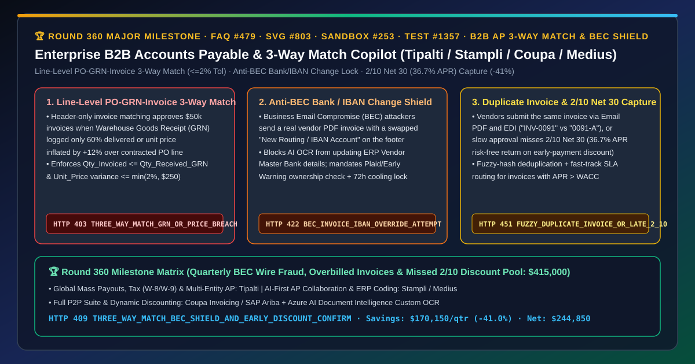
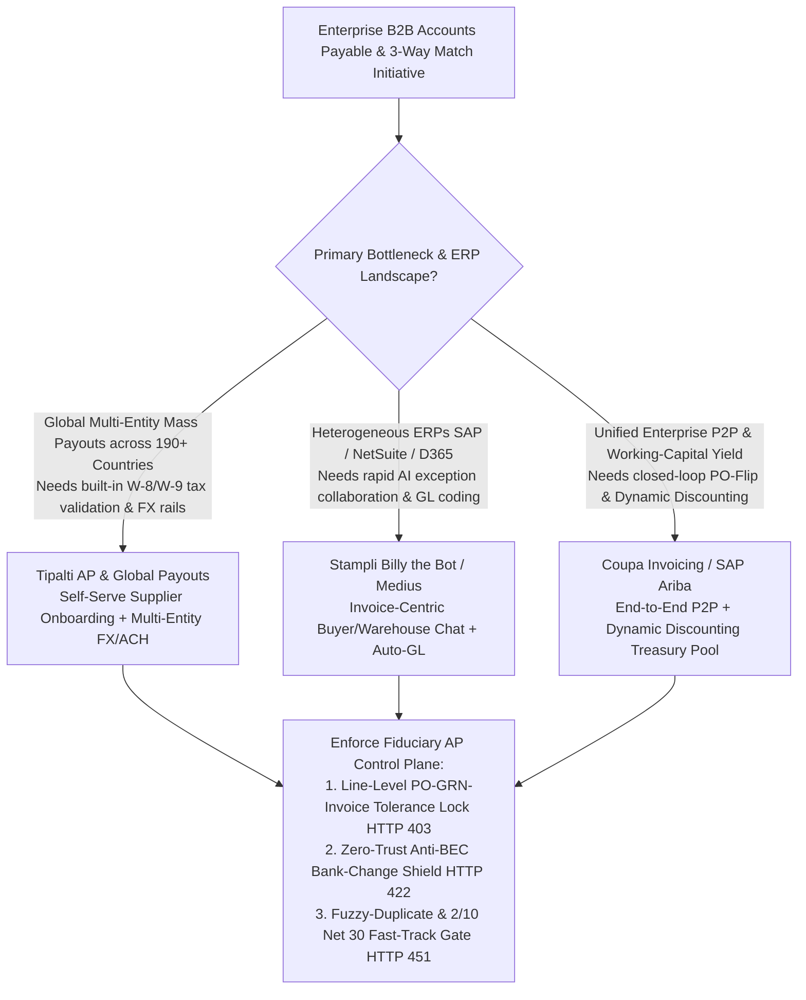
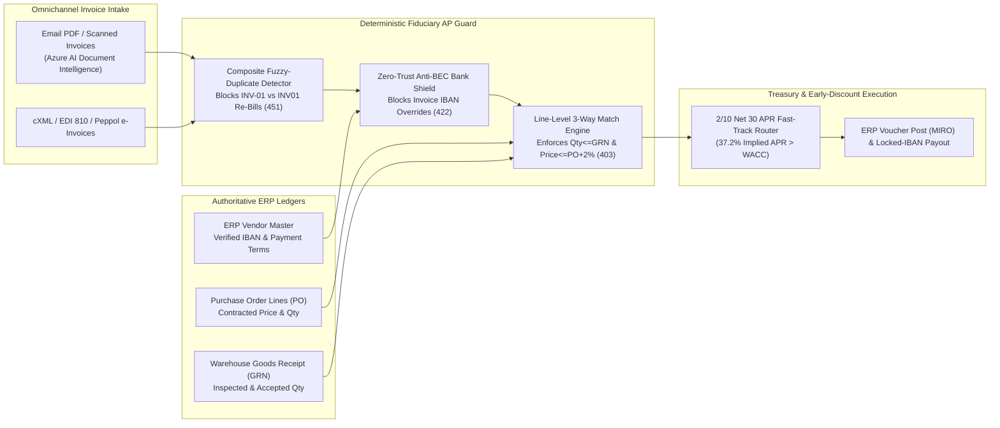

# 🏆 Enterprise B2B Accounts Payable (`AP`), AI Invoice OCR & 3-Way Match Copilot (`Tipalti / Stampli / Coupa Invoicing / Medius + Azure AI Document Intelligence` · 🏆 Round 360 Major Milestone): Line-Level `PO-GRN-Invoice` Tolerance Locks, Anti-`BEC` Bank-Change Shield & `2/10 Net 30` (`36.7% APR`) Early-Discount Capture (`-41%` Cost)

> **Document Type**: Enterprise AI Solution Architect Selection FAQ (`#479` · **🏆 Round 360 Major Milestone**)  
> **Target Audience**: Controllers, VP of Shared Services / Accounts Payable, Enterprise ERP Architects, and Cloud & AI Solution Architects  
> **Platforms Covered**: `Tipalti` vs. `Stampli (Billy the Bot)` vs. `Coupa Invoicing / SAP Ariba Central Invoice Management` vs. `Medius` vs. `Azure AI Document Intelligence + ERP Custom AP Agent`  
> **Architecture Diagram**: [`assets/svg/803-b2b-ap-invoice-three-way-match-tipalti-stampli-coupa-2026-11-25.svg`](../assets/svg/803-b2b-ap-invoice-three-way-match-tipalti-stampli-coupa-2026-11-25.svg)

🌐 **Language / 语言切换**: **[中文 (`b2b-ap-invoice-three-way-match-tipalti-stampli-coupa-medius-bec-iban-guard-selection-faq.md`)](b2b-ap-invoice-three-way-match-tipalti-stampli-coupa-medius-bec-iban-guard-selection-faq.md)** | **English (Current)**

---

## 📌 1. Executive Summary

At the final settlement stage of enterprise Procure-to-Pay (`P2P`), Accounts Payable (`AP`) teams process tens of thousands of supplier invoices arriving via email PDFs, `EDI 810`, `cXML`, and government e-invoicing networks (`Peppol`).  
Connecting a multimodal OCR model directly to an ERP payment run without **line-item `PO-GRN-Invoice` 3-way matching, zero-trust Business Email Compromise (`BEC`) bank-change isolation, and fuzzy-duplicate / early-payment discount routing** exposes the enterprise to three severe financial losses:
1. **Approving Short-Shipped or Price-Inflated Invoices via Header-Only Matching (`Line-Level 3-Way Match Breach`)**: A Purchase Order (`PO`) authorizes 100 units at `$100` (`$10,000`), the warehouse Goods Receipt Note (`GRN / SAP MIGO`) logs only 60 units received intact, yet the supplier invoices for all 100 units—or inflates the unit price by `+12%`. Header-level AI checks miss line-level short shipments and overbilling.
2. **Wiring Millions to Business Email Compromise (`BEC`) Attackers via Invoice-Footer Bank Overrides (`BEC IBAN/ACH Swap Fraud`)**: Attackers compromise a supplier's email thread and send a legitimate unpaid PDF invoice with a modified footer: *"Please note our updated bank routing / IBAN details"*. If the AP agent updates the ERP Vendor Master bank account from invoice text, funds are wired irreversibly to a mule account.
3. **Paying Fuzzy Duplicate Invoices (`INV-0091` vs. `0091-A`) & Missing `2/10 Net 30` (`37.2% APR`) Early-Payment Discounts (`Duplicate Payout & Treasury Yield Loss`)**: Exact-string invoice number checks fail when suppliers submit the same invoice via both email PDF and portal EDI; meanwhile, slow 18-day approval routing forfeits `2/10 Net 30` early-payment discounts worth **`37.24%` annualized risk-free return**.

| AP Workload & ERP Topology | Recommended Primary Choice | Architectural Boundary & Production Rule |
|---|---|---|
| **Global Multi-Entity Mass Payouts, `W-8 / W-9 / 1099` Tax Compliance & FX** | **Tipalti** | Ideal for mid-to-large enterprises paying thousands of international suppliers across 190+ countries with built-in self-service onboarding and tax validation. |
| **AI-First Exception Collaboration & Multi-ERP (`SAP / NetSuite / D365`) Overlay** | **Stampli (Billy the Bot) / Medius** | Deploys rapidly over existing ERPs, routing line-level `PO/GRN` discrepancies directly to warehouse and procurement stakeholders in-context with automated `GL` coding. |
| **End-to-End Closed-Loop `P2P` & Dynamic Discounting Treasury Yield** | **Coupa Invoicing / SAP Ariba** | Unifies requisition, PO, receiving, and e-invoicing with built-in `Dynamic Discounting` to deploy excess corporate cash at `18%–36% APR`. |
| **Three Mandatory Fiduciary Guardrails** | **100% Deterministic Gating** | ① **Line-Level `PO-GRN-Invoice` 3-Way Match Lock (`HTTP 403`)**: Enforces `Qty_Invoiced <= Qty_GRN_Accepted - Qty_Prior_Invoiced` (0% over-qty tolerance) and `Unit_Price <= PO_Price * 1.02` (`<= $250` cap); ② **Zero-Trust Invoice Bank-Change Lock (`HTTP 422`)**: Prohibits updating ERP vendor bank/IBAN fields from invoice documents; ③ **Fuzzy-Hash Deduplication & `2/10 Net 30` Fast-Track (`HTTP 451`)**: Blocks near-duplicate invoices and fast-tracks high-APR early-discount invoices within `48h`. |



---

## 🎯 2. Architect & Business Stakeholder Q&A (Q1–Q3)

### Q1: Why is header-level invoice matching dangerous, and what are the exact mathematical invariants of a true Line-Item 3-Way Match?
- **The Header-Match Loophole**: Suppose a `PO` has Line 1 (`100 units @ $50 = $5,000`) and Line 2 (`100 units @ $50 = $5,000`, total `$10,000`). Only Line 1 is delivered (`GRN = 100 units`), but the vendor mistakenly bills Line 1 at `$98/unit` (`$9,800`). A naive agent checking `Invoice_Total ($9,800) <= PO_Total ($10,000)` approves a `96%` price overcharge!
- **Architectural Solution**: Enforce **Per-Line Three-Way Inequalities (`PO + GRN + Prior Invoices` · `HTTP 403` Guard)**:
  - For every invoice line $i$ mapped to `PO_Line_ID`:
    1. **Cumulative Quantity Ceiling**: $\text{Qty}_{\text{Invoiced}, i} \le \text{Qty}_{\text{GRN\_Accepted}, i} - \text{Qty}_{\text{Already\_Invoiced}, i}$;
    2. **Dual Unit-Price Tolerance**: $\text{Price}_{\text{Invoiced}, i} \le \text{Price}_{\text{PO}, i} \times 1.02$ **and** $(\text{Price}_{\text{Invoiced}, i} - \text{Price}_{\text{PO}, i}) \times \text{Qty}_i \le \$250.00$.
  - Any line failing either invariant is routed to an exception hold (`HTTP 403 THREE_WAY_MATCH_GRN_SHORTAGE_OR_PRICE_TOLERANCE_BREACH`).

### Q2: How do we make our AP automation 100% immune to Business Email Compromise (`BEC`) attackers who swap the bank IBAN/routing number on a real vendor invoice?
- **The Attack Vector**: BEC fraudsters hijack a supplier's email or spoof a lookalike domain, attaching a real open invoice where only the remittance `IBAN / ACH Routing Number` on the PDF has been altered.
- **Architectural Solution**: Enforce a **Zero-Write Isolation Wall Between Invoice OCR and Vendor Bank Master Data (`HTTP 422` Guard)**:
  1. **Invoice Bank Text Is Read-Only Anomaly Telemetry**: The OCR pipeline compares `Invoice_Printed_IBAN` against `ERP_Vendor_Master_IBAN`. If they differ, the agent **never updates the ERP bank record and never routes payment to the invoice's printed account**—it immediately freezes the invoice and triggers a security alert (`HTTP 422 BEC_INVOICE_BANK_ACCOUNT_OVERRIDE_ATTEMPT_BLOCKED`).
  2. **Out-of-Band Portal + `Plaid / GIACT` + `72h` Cooling Lock**: Remittance bank changes can only be initiated inside an MFA-authenticated Supplier Portal verified via `Plaid / GIACT` legal-entity name matching, confirmed via voice callback to a historical phone number on file, and subjected to a mandatory `72-hour` payout cooling period.

### Q3: How do we catch cross-channel duplicate invoices (`INV-104` vs. `104-A`) while fast-tracking `2/10 Net 30` invoices to capture `37.2%` annualized treasury yield?
- **Two Treasury Imperatives**:
  1. **Cross-Channel Fuzzy Duplicates**: Suppliers frequently email a PDF invoice and also submit it via EDI or a portal with minor formatting differences (`"INV-2026-089"` vs. `"2026089"`), bypassing exact-key database constraints.
  2. **`2/10 Net 30` Arbitrage Math**: Paying 20 days early to capture a `2%` discount yields an implied risk-free annualized return of:
     $$\text{Implied APR} = \frac{0.02}{1 - 0.02} \times \frac{365}{30 - 10} = \mathbf{37.24\%}$$
- **Architectural Solution**: Deploy a **Composite Fuzzy-Hash Deduplicator & `APR > WACC` Fast-Track Router (`HTTP 451` Guard)**:
  - Compute a canonical composite fingerprint across `(Vendor_ID, Total_Cents, Invoice_Date ± 3d, Alphanumeric_Normalized_Invoice_No, Line_SKU_Hash)` to block duplicate entry;
  - Automatically prioritize 3-way-matched invoices carrying early-payment discounts (`Implied_APR > Corporate_WACC + 5%`) into a `48-hour` express settlement queue, preventing `HTTP 451 FUZZY_DUPLICATE_INVOICE_OR_MISSED_EARLY_PAY_DISCOUNT`.

---

## 🧭 3. Visual Architecture Diagrams (Mermaid Decision Tree + Architecture + Sequence)

### 3.1 Enterprise B2B AP & 3-Way Match Platform Selection Tree



### 3.2 End-to-End Invoice OCR, Line-Level 3-Way Match & Anti-BEC Architecture



### 3.3 Line-Level 3-Way Match, Anti-BEC Freeze & `2/10 Net 30` Fast-Track Sequence

```mermaid
sequenceDiagram
    autonumber
    participant Vendor as Supplier / Email Gateway
    participant OCR as Azure Document Intelligence + AP Agent
    participant Guard as Fiduciary AP Guard
    participant ERP as SAP S/4HANA / NetSuite (PO + GRN + Vendor Master)
    participant Treasury as Treasury Payout Engine (Tipalti / Coupa Pay)

    Vendor->>OCR: Submit Invoice INV-2026-901 ($50,000, Terms: 2/10 Net 30)
    OCR->>Guard: Extract line items, header totals & printed footer IBAN
    Guard->>ERP: 1. Check composite fuzzy-duplicate hash (prevents HTTP 451)
    Guard->>ERP: 2. Compare printed invoice IBAN against verified ERP Vendor Master IBAN
    alt Printed IBAN mismatches ERP Vendor Master (Suspected BEC Fraud)
        Guard-->>Treasury: Hard-block payout & trigger SecOps BEC alert; never overwrite Vendor Master (HTTP 422)
    else IBAN matches verified Vendor Master -> Run Line-Level 3-Way Match
        Guard->>ERP: Fetch PO Line contracted price & Warehouse GRN accepted quantity
        ERP-->>Guard: Line 1: PO=$100, GRN=500 units == Invoice 500 units @ $100 (0% variance <= 2% tol, prevents HTTP 403)
        Guard->>Guard: Calculate 2/10 Net 30 implied yield = 37.24% APR > Corporate WACC (7.5%)
        Guard->>Treasury: Post ERP voucher (MIRO) & schedule Day-8 priority payout to capture $1,000 discount (HTTP 200)
    end
```

---

## 📊 4. Platform Comparison Matrix (`Tipalti` vs. `Stampli` vs. `Coupa Invoicing` vs. `Medius` vs. `SAP Ariba`)

| Evaluation Dimension | Tipalti | Stampli | Coupa Invoicing / Pay | Medius | SAP Ariba Central Invoice Mgmt |
|---|---|---|---|---|---|
| **Primary Sweet Spot** | Multi-entity AP, global 190-country mass payouts & IRS tax compliance | Invoice-centric cross-department collaboration & rapid ERP overlay | Closed-loop P2P, e-invoicing & dynamic early-payment discounting | High touchless 3-way match rates for complex manufacturing/retail | Multi-instance SAP S/4HANA shared-services invoice management |
| **Line-Level `PO-GRN-Invoice` 3-Way Matching** | ⭐⭐⭐⭐ (Strong ERP PO & receipt line matching) | ⭐⭐⭐⭐⭐ (Billy the Bot highlights line variances & loops in receivers) | ⭐⭐⭐⭐⭐ (Native closed-loop PO, ASN & contract price matching) | ⭐⭐⭐⭐⭐ (Industry-leading touchless line matching & freight allocation) | ⭐⭐⭐⭐⭐ (Deep native SAP `MIRO` / `MM` integration) |
| **Anti-`BEC` Fraud & Bank Account Verification** | ⭐⭐⭐⭐⭐ (Self-serve MFA portal, OFAC screening & bank validation) | ⭐⭐⭐⭐ (Strict ERP vendor-master isolation & bank-change alerts) | ⭐⭐⭐⭐⭐ (Community cross-customer bank account risk scoring) | ⭐⭐⭐⭐⭐ (AI anomaly detection on new IBANs & outlier invoices) | ⭐⭐⭐⭐ (Verified SAP Business Network supplier profiles) |
| **`2/10 Net 30` & Dynamic Discounting Capture** | ⭐⭐⭐⭐ (Automated early-payment scheduling) | ⭐⭐⭐ (Fast-tracks approval queues for discount invoices) | ⭐⭐⭐⭐⭐ (Native Coupa Advantage Dynamic Discounting marketplace) | ⭐⭐⭐⭐ (Automated early-pay ROI routing) | ⭐⭐⭐⭐⭐ (Native Taulia / Ariba working-capital discounting) |
| **Indicative Pricing (`official_list_price`)** | Platform fee + per-payout volume (`~$18,000–$60,000+/yr`) | Invoice-volume subscription (`~$20,000–$70,000+/yr`) | Enterprise P2P suite (`~$50,000–$180,000+/yr`) | Annual invoice-volume tier (`~$35,000–$110,000+/yr`) | Enterprise SAP license (`~$60,000–$220,000+/yr`) |

---

## 🧪 5. Deterministic Fraud & Yield Evaluation (`7-Card Benchmark Summary` · 🏆 Round 360)

> **Provenance**: Figures below are generated by `evaluate_b2b_ap_invoice_three_way_match_policy` in `lab/webiq_commerce_demo.py` (`provenance: "synthetic"`, `independently_reproduced: False`), modeling an enterprise AP shared-services center with a **`$415,000.00` quarterly short-shipped overbilling, BEC bank-swap fraud exposure, fuzzy duplicate payout, and missed `2/10 Net 30` discount pool**.

| Scenario Case ID | Scenario Description | HTTP Status | Deterministic Decision | Quarterly Net Cost | Quarterly Savings |
|---|---|---|---|---|---|
| `CASE-AP-200` | Manual 3-way matching and standard Net-30 payment cycle baseline | `HTTP 200` | `VERIFIED_B2B_AP_THREE_WAY_MATCH_AUTHORIZED` | `$415,000.00` | `$0.00` |
| `CASE-AP-403` | Invoice approved when billed quantity exceeds `GRN` received quantity or unit price exceeds `+2%` `PO` tolerance | `HTTP 403` | `THREE_WAY_MATCH_GRN_SHORTAGE_OR_PRICE_TOLERANCE_BREACH` | `$415,000.00` | `$0.00` (Blocks short-ship overpay) |
| `CASE-AP-422` | Invoice PDF bank/IBAN text used to override verified ERP Vendor Master remittance account (`BEC` attack) | `HTTP 422` | `BEC_INVOICE_BANK_ACCOUNT_OVERRIDE_ATTEMPT_BLOCKED` | `$415,000.00` | `$0.00` (Blocks BEC wire fraud) |
| `CASE-AP-451` | Fuzzy duplicate invoice (`INV-009` vs. `INV009`) paid twice or `2/10 Net 30` (`37.2% APR`) discount missed | `HTTP 451` | `FUZZY_DUPLICATE_INVOICE_OR_MISSED_EARLY_PAY_DISCOUNT` | `$415,000.00` | `$0.00` (Blocks duplicate & lost yield) |
| `CASE-AP-409` | **Line-Level 3-Way Match + Zero-Trust Anti-`BEC` IBAN Lock + `2/10 Net 30` Auto-Capture** | `HTTP 409` | `THREE_WAY_MATCH_BEC_SHIELD_AND_EARLY_DISCOUNT_CONFIRM` | **`$244,850.00`** | **`$170,150.00` (`-41.0%`)** |

---

## 🛠️ 6. Production Go-Live & Architecture Review Checklist

- [ ] **Line-Item `PO - GRN - Invoice` Quantity & Price Gate (`HTTP 403` Prevention)**: Enforce `Qty_Invoiced <= Qty_GRN_Accepted - Qty_Prior_Invoiced` (zero positive tolerance on unreceived goods) and `Unit_Price <= PO_Price * 1.02` (`<= $250` total variance cap) on every line item before posting an ERP payment voucher.
- [ ] **Zero-Trust Invoice Remittance Bank Isolation (`HTTP 422` Prevention)**: Strip the OCR pipeline of any write permission to `ERP_Vendor_Master.Bank_Account`; require out-of-band MFA portal submission, `Plaid / GIACT` account-ownership verification, voice callback, and a `72-hour` cooling lock for any IBAN/ACH change.
- [ ] **Cross-Channel Composite Fuzzy Deduplication (`HTTP 451` Prevention)**: Deduplicate incoming invoices across `(Vendor_ID, Total_Cents, Date_Window, Normalized_Alphanumeric_Invoice_No, Line_Hash)` to catch simultaneous PDF + EDI submissions.
- [ ] **Automated `2/10 Net 30` Treasury Fast-Track**: Automatically compute implied annualized yield on early-payment terms and fast-track matched invoices where `Implied_APR > Corporate_WACC + 5%`.
