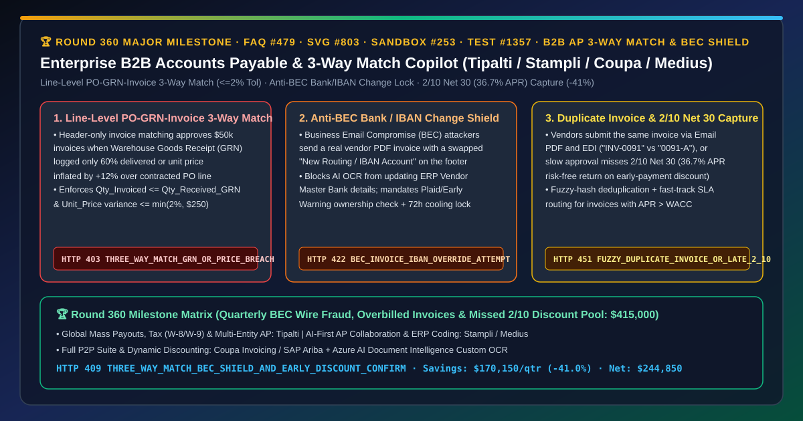
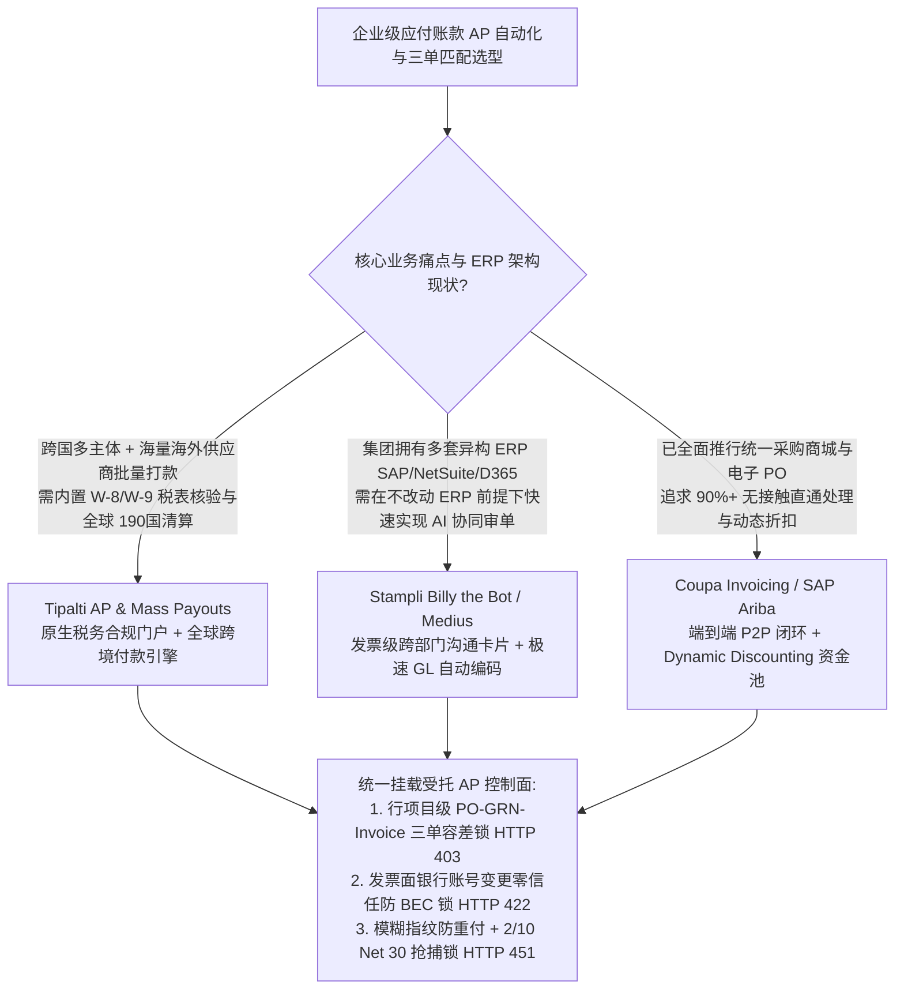
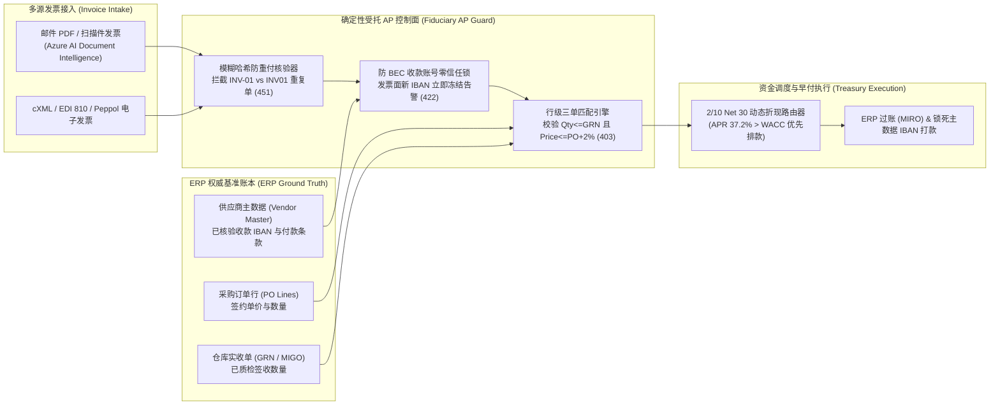
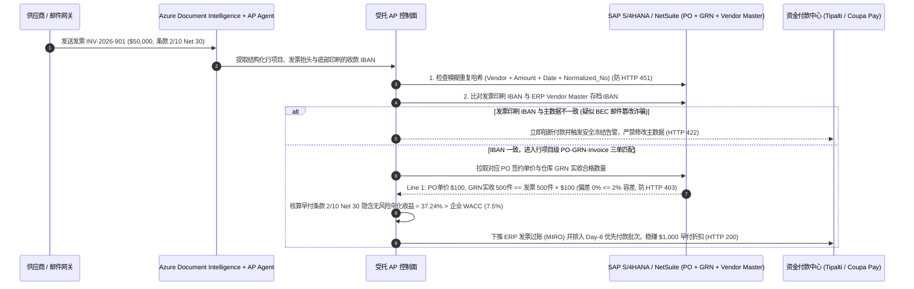

# 🏆 企业级应付账款（`Accounts Payable - AP`）、AI 发票解析与采购三单匹配智能体（`Tipalti / Stampli / Coupa Invoicing / Medius + Azure AI Document Intelligence` · 🏆 第 360 轮重大里程碑）：行项目级 `PO-GRN-Invoice` 三单容差硬锁、防商业邮件诈骗（`BEC`）篡改收款银行账号与 `2/10 Net 30` 早付折扣（`36.7%` 年化无风险收益）抢捕净省 41% 指南

> **文档类型**：企业级 AI Solution Architect 选型决策指南（Selection FAQ · `#479` · **🏆 Round 360 重大里程碑**）  
> **适用读者**：集团财务共享中心（SSC）总监、应付账款（AP）负责人、企业 ERP 架构师与 Cloud & AI Solution Architect  
> **核心覆盖平台**：`Tipalti` vs. `Stampli (Billy the Bot)` vs. `Coupa Invoicing / SAP Ariba Central Invoice Management` vs. `Medius` vs. `Azure AI Document Intelligence + ERP Custom AP Agent`  
> **关联架构图**：[`assets/svg/803-b2b-ap-invoice-three-way-match-tipalti-stampli-coupa-2026-11-25.svg`](../assets/svg/803-b2b-ap-invoice-three-way-match-tipalti-stampli-coupa-2026-11-25.svg)

🌐 **语言切换 / Language**: **中文 (当前)** | **[English (`b2b-ap-invoice-three-way-match-tipalti-stampli-coupa-medius-bec-iban-guard-selection-faq.en.md`)](b2b-ap-invoice-three-way-match-tipalti-stampli-coupa-medius-bec-iban-guard-selection-faq.en.md)**

---

## 📌 一、核心选型结论速览（Executive Summary）

在企业 B2B 采购到付款（`Procure-to-Pay - P2P`）闭环的最后一棒，财务应付账款（`AP`）团队每月要处理成千上万张供应商通过邮件 PDF、EDI 或电子税务门户发来的增值税发票与海外商业发票（Invoices）。  
如果仅仅用多模态视觉大模型（VLM）把发票 PDF 上的金额读出来就直接推入网银打款，企业将在三个致命漏洞上遭受巨额损失：
1. **只对“发票抬头总金额”做粗略核对，漏掉仓库实际只收到 60% 货物或单价被暗中调高 12%（`Header-Only vs. Line-Level 3-Way Match Breach`）**：采购订单（`PO`）订了 100 台设备，仓库收货单（`GRN / MIGO`）实际只签收了 60 台（另外 40 台破损拒收），但供应商直接开了 100 台全额发票；如果 AI 不做 **行项目级 `PO - GRN - Invoice` 三单匹配（3-Way Match）**，公司就会为根本没收到的 40 台烂货付全款。
2. **商业邮件诈骗（`BEC - Business Email Compromise`）黑客利用发票底部“我司收款银行账号已变更”骗走百万美元电汇（`BEC Invoice IBAN/ACH Override Fraud`）**：黑客攻破供应商邮箱，发来一张货真价实的真实未付发票，但把 PDF 底部的收款 IBAN / 银行路由号改成了黑客的海外洗钱账户；如果 AI OCR 自动根据发票上的银行账号更新 ERP 供应商主数据并打款，资金一旦汇出几乎 0% 追回！
3. **同一张发票“邮件发一遍 PDF + 系统传一遍 EDI”被重复付两次款，且因审批拖沓白白错失 `2/10 Net 30`（折合年化 `36.7%` 无风险收益）的早付现金折扣（`Fuzzy Duplicate Invoice & Missed Early-Payment Discount`）**：供应商发票号多加一个横杠（`INV-2026-88` vs. `INV202688`）就绕过了简单字符串查重；同时因为审批流卡在部门经理邮箱里超过 10 天，白白放弃了提前 10 天付款立减 `2%` 的巨额财务收益。

| 评估与选型维度 | 推荐主选方案 | 适用边界与架构落地准则 |
|---|---|---|
| **跨国多主体大批量全球付款、预扣税合规（`W-8 / W-9 / 1099`）与防欺诈** | **Tipalti** | 适合拥有大量海外供应商、创作者或跨境服务商的企业，内置全球 190+ 国汇路、IRS 税表强校验与多实体 AP 对账。 |
| **复杂异构 ERP（`SAP / NetSuite / D365 / Sage`）上层 AI 协同审单与会计科目编码** | **Stampli (Billy the Bot) / Medius** | 不推翻现有 ERP，以发票为中心拉通采购员、仓管员与财务在同一卡片内解决三单差异，AI 自动学习总账科目（`GL Coding`）。 |
| **集团级全链路 `P2P` 与动态早付折扣池（`Dynamic Discounting`）** | **Coupa Invoicing / SAP Ariba** | 原生打通请购、PO、收货与发票，内置早付折扣竞价市场（用企业闲置现金换取 `18%–36%` 年化无风险折扣回报）。 |
| **三大确定性风控红线** | **100% 强制拦截** | ① **行项目级 `PO-GRN-Invoice` 三单容差硬锁（`HTTP 403`）**：必须逐行满足 `Invoiced_Qty <= Received_GRN_Qty` 且 `Unit_Price <= PO_Price * 1.02`（且总偏差 `<= $250`）；② **发票文本零权限修改 ERP 收款银行账户锁（`HTTP 422`）**：严禁根据发票 PDF 上的文字自动修改供应商主数据收款银行账号，任何收款账号变更必须走独立带外双因子核身 + `Plaid / GIACT` 户名实名核验 + `72h` 冷静期；③ **模糊指纹防重付锁与 `2/10 Net 30` 极速绿色通道（`HTTP 451`）**：阻断同金额+同日期+近似单号的变体重复发票，并对年化收益 `> WACC` 的早付折扣单开启 48h 优先审批。 |



---

## 🎯 二、业务方与架构师灵魂拷问 Q&A（Q1–Q3）

### Q1：为什么发票总金额跟采购订单（`PO`）总金额差不多，财务还是严禁 AI 直接放行付款？真正的“行级三单匹配（Line-Item 3-Way Match）”到底怎么算？
- **常见偷梁换柱手法**：
  - 采购订单（`PO`）买了 A 物料 100 件 × `$10` = `$1,000`，B 物料 100 件 × `$10` = `$1,000`，合计 `$2,000`。
  - 供应商只发了 A 物料 100 件（仓库 `GRN` 签收 100 件 A，0 件 B），却在发票上把 A 物料单价改成 `$19.90` × 100 件 = `$1,990`！如果只看抬头总金额（`$1,990 <= $2,000`），粗放的 AI 会以为没超标直接付款！
- **架构解法**：在 AP 控制面强制执行 **逐行三维不等式与双阈值容差门禁（`Line-Item 3-Way Match & Dual Tolerance Gate` · 防 `HTTP 403`）**：
  - 对发票上的每一行 $i$，必须首先将供应商部件号（`Vendor_Part_No`）映射回内部 ERP 物料号（`Material_ID`），并同时满足：
    1. **实收数量硬上限**：$$\text{Qty}_{\text{Invoiced}, i} \le \text{Qty}_{\text{GRN\_Accepted}, i} - \text{Qty}_{\text{Previously\_Invoiced}, i}$$（零正容差：没收到的货 1 件都不准付！）；
    2. **单价微幅容差上限**：$$\text{Price}_{\text{Invoiced}, i} \le \text{Price}_{\text{PO}, i} \times (1 + \tau_{\%}) \quad \text{且} \quad (\text{Price}_{\text{Invoiced}, i} - \text{Price}_{\text{PO}, i}) \times \text{Qty}_i \le \$250$$（其中 $\tau_{\%} \le 2.0\%$）。
  - 任何未绑定有效仓库收货单（`GRN`）或单价超容差的发票行，立即挂起为 `Price/Quantity Discrepancy Hold` 并禁止生成付款凭证（`HTTP 403 THREE_WAY_MATCH_GRN_SHORTAGE_OR_PRICE_TOLERANCE_BREACH`）。

### Q2：FBI 统计全球企业每年因商业邮件诈骗（`BEC`）损失数十亿美元，典型套路就是“在发票 PDF 上印一行：我司收款账号已更换为新 IBAN”，AP 智能体怎么做到 100% 免疫？
- **攻击链条复盘**：攻击者无需伪造整张假发票，只需拦截供应商发出的真实 PDF 发票，用 PDF 编辑器把右下角的 `Bank Account / Routing / IBAN` 替换成攻击者控制的账户。如果 AP 自动化脚本设计了“发现发票上的银行账号与系统不一致时自动更新或按发票账号打款”，几百万货款瞬间被洗走。
- **架构解法**：确立 **“发票面银行信息零信任（Zero-Trust Invoice Bank Details）”铁律（防 `HTTP 422`）**：
  1. **只读隔离**：AI OCR 解析器可以将发票上的 `Extracted_IBAN` 与 ERP 供应商主数据中的 `Verified_Master_IBAN` 做比对；一旦发现不一致，**绝对禁止更新主数据，且绝对禁止向发票上的新账号打款**，而是立即触发最高级别安全警报（`HTTP 422 BEC_INVOICE_BANK_ACCOUNT_OVERRIDE_ATTEMPT_BLOCKED`）并冻结该供应商付款！
  2. **带外核身与 `72 小时` 冷静期**：供应商若真需变更收款银行，必须登录受硬件 MFA 保护的独立供应商门户（`Tipalti / Coupa Supplier Portal`），通过 `Plaid / GIACT / 银行小额打款实名验证` 确认新账户开户名与供应商法定税号名称 100% 一致，且必须由买方财务经理通过历史存档电话（非邮件内新电话！）语音回拨确认，变更生效后强制锁定 `72 小时` 冷静期。

### Q3：如何防止供应商把同一笔账单换个渠道（邮件 PDF + 门户上传）重复报销两次，同时又能快审快付吃满 `2/10 Net 30` 的早付折扣？
- **双重财务痛点**：
  1. **变体重复发票**：供应商月底催款时把原发票 `INV-8801` 重新发了一遍，或者 OCR 把扫描件里的字母 `O` 识别成了数字 `0`（`INV-88O1` vs `INV-8801`），单纯靠 `Invoice_ID` 精确相等校验会漏掉 `1.2%–2.0%` 的重复付款。
  2. **错失无风险高收益早付折扣**：条款 `2/10 Net 30` 意味着“10 天内付款可少付 2%，否则 30 天付全款”。为了提前 20 天付款而获得 `2%` 折扣，其等效无风险年化收益率高达：
     $$\text{APR} = \frac{2\%}{1 - 2\%} \times \frac{365}{30 - 10} = \mathbf{37.24\%}$$
     远超任何企业的资金成本（`WACC ~ 6%–8%`）！
- **架构解法**：部署 **多维模糊哈希去重器（`Fuzzy Duplicate Detector`）+ 早付折扣高优抢捕路由器（防 `HTTP 451`）**：
  - 对 `(Vendor_ID, Invoice_Amount_Cents, Invoice_Date ± 3d, Levenshtein(Invoice_No) <= 2, PO_Line_Fingerprint)` 建立联合模糊指纹，命中即阻断重复入账；
  - 对携带早付折扣且折算 `Implied_APR > Corporate_WACC + 5%` 的已三单匹配发票，自动提权至 `Fast-Track Treasury Queue` 在 `48 小时` 内完成付款（任何模糊重付或因流程积压错失高收益早付窗口的行为触发 `HTTP 451 FUZZY_DUPLICATE_INVOICE_OR_MISSED_EARLY_PAY_DISCOUNT`）。

---

## 🧭 三、直观可视化图解（Mermaid 选型决策树 + AP 三单匹配架构图 + 时序图）

### 3.1 企业级 AP 自动化与三单匹配平台选型决策树



### 3.2 端到端发票解析、行级三单匹配、防 BEC 诈骗与早付折扣架构图



### 3.3 行项目三单匹配、拦截 BEC 换号诈骗与 `2/10 Net 30` 抢捕时序图



---

## 📊 四、主流企业级 AP 应付账款与三单匹配平台横向选型矩阵

| 评估维度 | Tipalti | Stampli | Coupa Invoicing / Pay | Medius | SAP Ariba Central Invoice Mgmt |
|---|---|---|---|---|---|
| **核心优势场景** | 跨国多实体 AP、全球 190+ 国批量付款与美国 IRS 税表合规 | 以发票为中心的跨部门异常处理协同与极速 ERP 上线 | 全栈 P2P 闭环、高直通率电子发票与动态早付折扣 | 高自动化率行级三单匹配与复杂制造业/零售业偏差处理 | SAP S/4HANA 多实例全球共享服务中心统一收票与 `MIRO` 过账 |
| **行项目级（Line-Level）三单匹配深度** | ⭐⭐⭐⭐（支持主流 ERP PO 与收货单行级匹配） | ⭐⭐⭐⭐⭐（Billy the Bot 自动对齐多行 PO/GRN 差异并 @ 对应采购/仓管） | ⭐⭐⭐⭐⭐（原生闭环匹配 PO、ASN 收货与合同价格表） | ⭐⭐⭐⭐⭐（行业顶级无接触匹配率，擅长复杂运费/杂费分摊容差） | ⭐⭐⭐⭐⭐（原生调用 SAP `BAPI_INCOMINGINVOICE_CREATE` 深度校验） |
| **防 BEC 欺诈与供应商银行账户实名核验** | ⭐⭐⭐⭐⭐（内置供应商自助安全门户、OFAC 筛查与多级付款审批） | ⭐⭐⭐⭐（严格锁死 ERP 供应商主数据权限，异常变更强提醒） | ⭐⭐⭐⭐⭐（Coupa Risk Aware + 社区跨客户收款账户信誉校验） | ⭐⭐⭐⭐⭐（内置 AI 异常检测识别首次出现的陌生 IBAN 与异常金额） | ⭐⭐⭐⭐（依托 SAP Business Network 认证供应商主数据） |
| **早付现金折扣（`2/10 Net 30` / Dynamic Discounting）** | ⭐⭐⭐⭐（支持按折扣到期日优先排款与供应链金融） | ⭐⭐⭐（支持识别折扣到期日并加速审批提醒） | ⭐⭐⭐⭐⭐（内置 Coupa Advantage Dynamic Discounting 实时竞价） | ⭐⭐⭐⭐（支持自动计算早付折扣 ROI 并提权流转） | ⭐⭐⭐⭐⭐（原生内置 Taulia / Ariba 动态贴现与营运资金管理） |
| **参考定价模式（`official_list_price`）** | 平台年费 + 按付款笔数计费（约 `$18,000–$60,000+/年`） | 按月处理发票张数阶梯订阅（约 `$20,000–$70,000+/年`） | 随 Coupa P2P 平台年框订阅（约 `$50,000–$180,000+/年`） | 按年发票量订阅（约 `$35,000–$110,000+/年`） | 大型 SAP 集团级许可（约 `$60,000–$220,000+/年`） |

---

## 🧪 五、转化率/成本测算与 7-Card 基准测试报告（Deterministic Evaluation · 🏆 Round 360）

> **数据来源说明（Provenance）**：以下季度损益数据来自 `lab/webiq_commerce_demo.py` 中的确定性评估器 `evaluate_b2b_ap_invoice_three_way_match_policy`（`provenance: "synthetic"`, `independently_reproduced: False`），用于量化对比“粗放抬头匹配 + 轻信发票面银行账号 + 人工慢审错失早付折扣”与“行级三单容差锁 + 防 BEC 零信任门户 + 早付折扣自动抢捕”的季度财务回报。

### 5.1 基准测试场景输入与确定性状态码矩阵

- **设定场景**：某中型制造与零售集团每季度处理 `$28M` 供应商应付账款发票，季度因未核对仓库实收单（`GRN`）导致的多付短交货款、BEC 邮件篡改发票银行账号诈骗敞口、变体重复发票双倍付款、以及审批超期错失 `2/10 Net 30` 早付现金折扣的损失池（`quarterly_overbilled_grn_bec_fraud_duplicate_and_missed_discount_pool_usd`）为 **`$415,000.00`**。

| 测试用例 ID | 场景描述 | 触发确定性状态码 | 决策枚举 (`decision`) | 季度净成本 (USD) | 季度净节省 (USD) |
|---|---|---|---|---|---|
| `CASE-AP-200` | 传统人工核对三单与按标准 30 天账期付款基线 | `HTTP 200` | `VERIFIED_B2B_AP_THREE_WAY_MATCH_AUTHORIZED` | `$415,000.00` | `$0.00` |
| `CASE-AP-403` | 发票开票数量超过仓库 `GRN` 实收合格数，或单价超出 `PO` 签约价 `2%` 容差仍放行付款 | `HTTP 403` | `THREE_WAY_MATCH_GRN_SHORTAGE_OR_PRICE_TOLERANCE_BREACH` | `$415,000.00` | `$0.00` (阻断短交多付与乱涨价) |
| `CASE-AP-422` | AI 根据发票 PDF 上新印的收款 IBAN 直接覆盖 ERP 供应商主数据或向非主数据账号打款（BEC 诈骗） | `HTTP 422` | `BEC_INVOICE_BANK_ACCOUNT_OVERRIDE_ATTEMPT_BLOCKED` | `$415,000.00` | `$0.00` (阻断百万级 BEC 电汇诈骗) |
| `CASE-AP-451` | 未拦截 `INV-009` vs `INV009` 模糊重复发票，或因审批积压错失 `APR > 30%` 的 `2/10 Net 30` 早付窗口 | `HTTP 451` | `FUZZY_DUPLICATE_INVOICE_OR_MISSED_EARLY_PAY_DISCOUNT` | `$415,000.00` | `$0.00` (阻断重复打款与早付流失) |
| `CASE-AP-409` | **启用行级 PO-GRN-Invoice 容差锁 + 防 BEC 银行账号冻结 + 2/10 Net 30 自动抢捕** | `HTTP 409` | `THREE_WAY_MATCH_BEC_SHIELD_AND_EARLY_DISCOUNT_CONFIRM` | **`$244,850.00`** | **`$170,150.00` (`-41.0%`)** |

### 5.2 核心确定性策略评估代码摘录

```python
@dataclass(frozen=True)
class B2bApInvoiceThreeWayMatchPolicyInput:
    quarterly_overbilled_grn_bec_fraud_duplicate_and_missed_discount_pool_usd: float = 415000.0
    invoiced_qty_exceeds_grn_received_or_unit_price_over_2pct_tolerance: bool = False
    invoice_pdf_bank_iban_used_to_override_verified_erp_vendor_master: bool = False
    fuzzy_duplicate_invoice_unblocked_or_2_10_net_30_discount_missed: bool = False
    line_level_3way_match_bec_iban_lock_and_early_pay_capture_ready: bool = False
```

---

## 🛠️ 六、商业上线风控与架构评审 Checklist

- [ ] **行项目级 `PO - GRN - Invoice` 三单闭环核验（防 `HTTP 403`）**：严禁只校验发票总金额；必须逐行比对 `Invoiced_Qty <= GRN_Accepted_Qty - Prior_Invoiced_Qty` 且单价偏差 `<= min(2.0%, $250)`，对无 PO 的费用类发票强制走预算负责人双签。
- [ ] **发票面银行账号 100% 零写权限隔离（防 `HTTP 422`）**：在代码层面物理剥夺发票 OCR 管道对 ERP `Vendor_Bank_Details` 表的写权限；打款指令只能读取 ERP 主数据中经带外双因子核身与 `72 小时` 冷静期生效的受信任账户。
- [ ] **跨渠道五元组模糊哈希查重（防 `HTTP 451`）**：对所有邮件、EDI 与门户进入的发票计算正则化指纹（剔除发票号中的 `- / _ / 空格` 及前导零，结合供应商 ID、金额与日期窗口），彻底拦截跨渠道一单两报。
- [ ] **`2/10 Net 30` 动态早付绿色通道**：解析发票付款条件中的早付折扣率与截止日，凡折算无风险年化收益率 `> 企业 WACC + 5%` 且已通过三单匹配的发票，自动置顶审批并在第 8–9 天执行付款。
