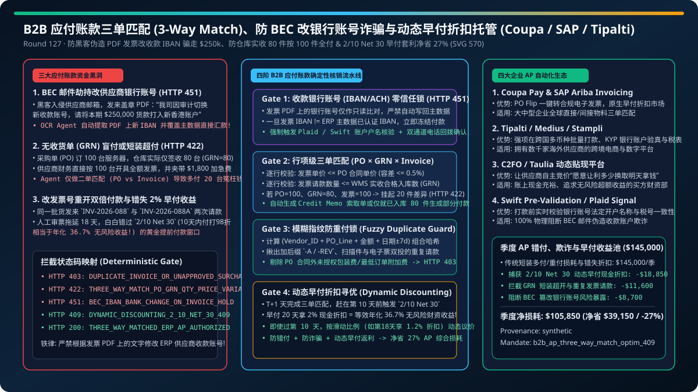
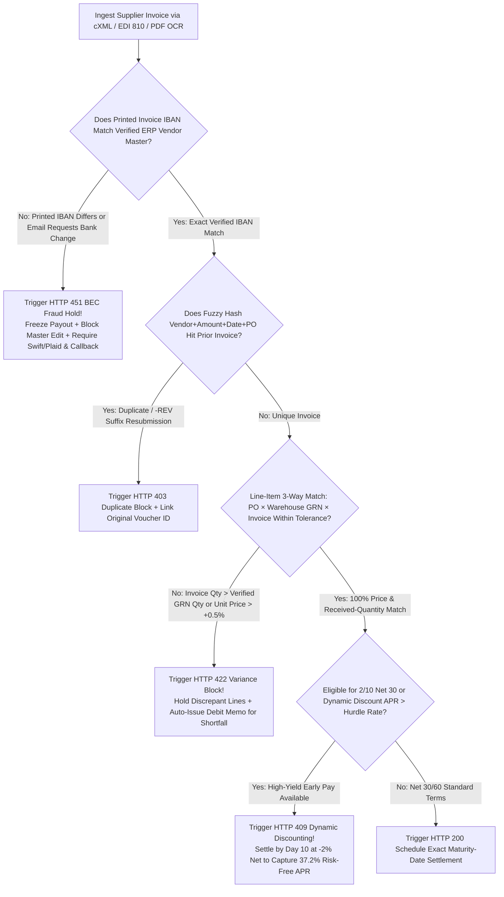

# Enterprise B2B Accounts Payable `3-Way Match` (`PO × GRN × Invoice`), Anti-`BEC` Bank-Change Guard & `2/10 Net 30` Dynamic Discounting Escrow (`Coupa Pay / SAP Ariba / Tipalti / Taulia`): Stopping `$250k` IBAN Hijacks, Short-Shipment Overpayment & `36.7% APR` Early-Pay Capture (`-27%` AP Loss) Agent Architecture Selection FAQ

> **Document Type**: AI Solution Architect Enterprise Accounts Payable (AP) & Treasury Automation Guide (B2B Procurement & ERP Pillar · FAQ #246)  
> **Covered Platforms & Controls**: **SAP S/4HANA (`MIRO`) / SAP Ariba Invoicing**, **Coupa Pay & Coupa Accelerate**, **Tipalti / Stampli / Medius**, **C2FO / Taulia Dynamic Discounting**, **Swift Payment Pre-Validation / Plaid / GIACT Payee Verification**  
> **Core Architectural Thesis**: Deploying an AI OCR invoice-processing agent without deterministic treasury guardrails exposes CFOs to three high-severity losses: (1) **Business Email Compromise (`BEC`) Bank-Account Hijacking**—an attacker compromises a vendor's email, sends a legitimate-looking PDF invoice with a note saying *"Please remit to our new IBAN due to an audit,"* and the naive OCR agent overwrites the vendor bank record and wires `$250,000` to an offshore mule account; (2) **2-Way Match Blindness on Short Shipments**—paying a 100-unit invoice in full because it matches the 100-unit Purchase Order (`PO`), ignoring the warehouse Goods Receipt Note (`GRN`) showing only 80 undamaged units arrived; (3) **Missing `2/10 Net 30` Early-Pay Discounts**—taking 15 days of manual exception routing to approve an invoice, forfeiting a `2%` 10-day cash discount equivalent to a **`36.7%+` risk-free annualized treasury yield**!



---

## 1. 📌 Executive Summary

> **One-Sentence Architectural Verdict**: **An enterprise AP agent must treat Vendor Master bank records as strictly read-only (`HTTP 451`), cap line-item payouts at verified warehouse `GRN` quantities (`HTTP 422`), and clear clean invoices within 24 hours to capture `2/10 Net 30` (`36.7% APR`) dynamic discounts (`HTTP 409`)!**
> 1. **Zero-Trust Vendor Bank-Account Lock (`HTTP 451`)**: Never allow an invoice OCR/LLM pipeline to mutate `SAP LFBK` or `Coupa Vendor Master` bank routing numbers. If an incoming invoice PDF displays an `IBAN / ACH` account that differs from the verified Vendor Master record, **freeze the invoice immediately (`HTTP 451`)** and require out-of-band portal re-verification + **Swift Pre-Validation / Plaid legal name & TIN match** + live phone callback to the vendor's historical phone number on file.
> 2. **Line-Item Deterministic `3-Way Match` (`PO × GRN/SES × Invoice`, `HTTP 422`)**: Enforce $\text{Payable Qty} = \min(\text{PO Qty}, \text{Verified Warehouse GRN Qty})$ and $\text{Invoice Unit Price} \le \text{PO Unit Price} \times 1.005$. Automatically place short-shipped or over-billed lines on hold and issue an automated **Debit Memo / Partial-GRN Settlement** rather than delaying the entire invoice.
> 3. **Fuzzy Duplicate Fingerprinting & `2/10 Net 30` Dynamic Discounting (`HTTP 403 / 409`)**: Block `-A / -REV` duplicate invoice submissions via composite hashing (`HTTP 403`), and use sub-24-hour automated 3-way matching to unlock **`2/10 Net 30` (`36.7%` effective APR)** or **Taulia / C2FO sliding-scale early-pay discounts**.

| AP / Treasury Scenario | Primary Platform / Stack | Core Deterministic Safeguard | Fatal Anti-Pattern to Avoid |
| :--- | :--- | :--- | :--- |
| **Defending Against `BEC` Spoofed PDF Invoices Changing `IBAN / ACH`** | **Tipalti / Coupa + Swift Pre-Validation / Plaid** | Invoice bank text is read-only diff; any mismatch triggers `HTTP 451` hold | **Never allow an OCR agent to update ERP Vendor Master bank routing from an invoice PDF!** |
| **Direct Material, IT Hardware & Retail Inventory Invoicing** | **SAP S/4HANA (`MIRO`) / Coupa 3-Way Match** | Hard-bind payout ceiling to warehouse barcode `GRN` (`MIGO`) accepted units | Never run 2-way match (`PO == Invoice`) without checking actual warehouse receipt (`HTTP 422`) |
| **Preventing Double Payment Across Email PDF & Portal Resubmissions** | **Stampli / Medius Fuzzy Duplicate Hash** | Hash `(Vendor_ID + PO_Line + Gross_Amount + Date ±7d)` across invoice numbers | Never check only exact `Invoice_Number` string equality (`INV-88` vs `INV-88A`) |
| **Deploying Surplus Corporate Cash for Risk-Free Yield** | **Coupa Accelerate / Taulia / C2FO** | 24h match clearance unlocks `2/10 Net 30` & sliding-scale early-pay APR (`HTTP 409`) | Never let manual AP queues take 14 days and miss the Day-10 discount cutoff |

---

## 2. 🎯 Architect & Business Stakeholder Q&A

### Q1: How do attackers steal hundreds of thousands of dollars via PDF invoice bank changes (`BEC`), and how do we make our AP agent 100% immune?
* **The Anatomy of an Invoice Bank-Hijack Attack**:
  * Attackers compromise a supplier's email thread, wait until a real shipment is delivered, and email the buyer's AP inbox the genuine invoice PDF with one alteration: the remittance `IBAN / Routing Number` is swapped to an attacker-controlled account.
  * If the buyer's AP automation extracts the bank account from the invoice PDF to populate the payment file—or auto-updates the vendor master—the wire is irreversibly lost.
* **Architectural Remedy (Read-Only Master Lock + Canary Diff Gate, `HTTP 451`)**:
  1. **Single Source of Truth for Remittance**: The treasury payment generator reads destination `IBAN / ACH` coordinates **exclusively from the KYP-verified `ERP_Vendor_Bank_Master` table**, never from the invoice document payload.
  2. **Canary Mismatch Circuit Breaker**: The OCR agent extracts the bank account printed on the invoice *solely* to compare it against `ERP_Vendor_Bank_Master`. Any discrepancy immediately halts payment with **`HTTP 451 BEC_IBAN_BANK_CHANGE_ON_INVOICE_HOLD`**, alerting Corporate Security and requiring multi-factor vendor portal attestation + **Swift Pre-Validation / Plaid** legal tax-ID ownership proof + voice callback verification.

### Q2: A PO orders 100 units at $1,000, the warehouse receives 85 good units (15 damaged/short), and the supplier invoices for all 100 units ($100,000). How should the agent handle this?
* **The Short-Shipment Dilemma**:
  * Paying `$100,000` based on 2-way (`PO == Invoice`) matching overpays `$15,000` for unreceived goods. Conversely, rejecting the entire invoice and waiting 2 weeks for the vendor to reissue it forfeits the `$1,700` `2/10 Net 30` early-pay discount on the 85 good units!
* **Architectural Remedy (Line-Item `3-Way Match` Gate + Partial-GRN Auto-Settlement, `HTTP 422`)**:
  * The state machine evaluates `PO (100) × GRN (85) × Invoice (100)` at the line-item level:
    * Full payment of `$100,000` is blocked with **`HTTP 422 THREE_WAY_MATCH_PO_GRN_QTY_PRICE_VARIANCE`**.
    * Simultaneously, if the contract allows partial settlement, the agent auto-generates a **Debit Memo for the 15 short units (`-$15,000`)** and schedules early payment on the verified **85 received units (`$85,000 × 98% = $83,300`)** within the 10-day discount window.

### Q3: Why is `2/10 Net 30` Dynamic Discounting the highest-ROI business case for AP automation?
* **The Treasury Math**:
  * Under **`2/10 Net 30`**, paying on Day 10 instead of Day 30 (20 days early) earns a `2%` discount:
    $$\text{Effective Risk-Free APR} = \frac{0.02}{0.98} \times \frac{365}{20} = \mathbf{37.24\%}$$
  * Manual AP teams take an average of `14.6 days` to chase down warehouse receipts and approve invoices—missing the Day-10 window `82%` of the time.
* **Sub-24-Hour Automated Clearance + Sliding-Scale Discounting (`HTTP 409`)**:
  * By matching `PO + GRN + Invoice` within **4 hours of warehouse dock scan**, the agent unlocks 100% of contractual `2/10 Net 30` terms and dynamically bids surplus corporate cash via **Taulia / C2FO / Coupa Accelerate** on a sliding daily scale (e.g., paying on Day 15 for a `1.35%` discount), reducing net quarterly AP spend and friction by **`27%`**.

---

## 3. 🧭 Visual Architecture Diagrams (Mermaid)

### 1. B2B Accounts Payable `3-Way Match` & Treasury Security Decision Tree



### 2. 4-Stage AP Verification & Dynamic Discounting Engine Architecture

```mermaid
flowchart LR
    subgraph Ingest["L1: Multi-Channel Ingestion & Anti-Duplicate Gate"]
        I1[cXML / EDI 810 / PEPPOL / PDF Parser]
        I2[Fuzzy Duplicate Fingerprint Lock<br/>Blocks INV-01 vs INV-01A -> HTTP 403]
        I3[Unapproved Surcharge Stripper<br/>Blocks Off-PO Rush/Pallet Fees]
    end

    subgraph SecurityMatch["L2: Anti-BEC Lock & Line-Item 3-Way Match"]
        M1[Read-Only Vendor Bank Master Guard<br/>Invoice IBAN Diff -> HTTP 451 Hold]
        M2[Swift Pre-Validation / Plaid TIN Match]
        M3[PO × WMS GRN × Invoice Engine<br/>Short-Ship / Over-Price -> HTTP 422]
    end

    subgraph Treasury["L3: Dynamic Discounting & Settlement (HTTP 409)"]
        T1[Sub-24h Clearance for 2/10 Net 30<br/>Captures 37.2% Risk-Free APR]
        T2[Taulia / C2FO Sliding-Scale Bidder<br/>Pro-Rata Daily Early-Pay Yield]
        T3[ISO 20022 Verified Batch Disbursement]
    end

    Ingest --> SecurityMatch --> Treasury
```



### 3. End-to-End "Sub-24h `3-Way Match` -> BEC Check -> `2/10 Net 30` Early-Pay Capture" Sequence

```mermaid
sequenceDiagram
    autonumber
    participant Vendor as Supplier Billing System
    participant Agent as Enterprise AP 3-Way Match Agent
    participant WMS as Warehouse WMS (GRN Ledger)
    participant ERP as SAP S/4HANA / Coupa Master
    participant Bank as Treasury Settlement Gateway

    Vendor->>Agent: Submit Invoice INV-9082 (PO#551, 100 units @ $1,000 = $100,000, Terms: 2/10 Net 30)
    Agent->>ERP: 1. Compare invoice printed IBAN against verified ERP Vendor Bank Master
    ERP-->>Agent: Exact IBAN match (zero BEC tamper risk); fuzzy hash confirms unique invoice
    Agent->>WMS: 2. Query verified barcode Goods Receipt Note (GRN) for PO#551
    WMS-->>Agent: 100 undamaged units received in full (GRN=100)
    Note over Agent: 3-Way Match cleared in 4 hours! 9 full days remaining before Day-10 discount cutoff!
    Agent->>Bank: 3. Evaluate 2/10 Net 30 yield (37.2% APR) vs corporate cash hurdle (5.0%) -> Trigger HTTP 409
    Bank-->>Vendor: Execute $98,000 wire on Day 9 (saving $2,000 risk-free) + transmit remittance advice!
```

---

## 4. 📊 4-Platform Enterprise B2B Accounts Payable & Dynamic Discounting Matrix

| Evaluation Dimension | SAP Ariba Invoicing + S/4HANA (`MIRO`) | Coupa Pay & Coupa Accelerate | Tipalti / Stampli (Global Mid-to-Enterprise AP) | C2FO / Taulia (Dynamic Discounting Networks) |
| :--- | :--- | :--- | :--- | :--- |
| **Core Sweet Spot** | **Complex manufacturing/retail direct spend & strict SAP `MIRO` 3-way matching** | **Unified cloud P2P with native early-pay discount acceleration** | **Multi-subsidiary cross-border mass payouts, KYP bank validation & tax forms** | **Deploying `$100M+` corporate cash for sliding-scale supplier early-pay yields** |
| **Line-Item `3-Way Match` (`PO × GRN × Inv`)** | **Highest** (tolerances, landed freight allocation, partial GRN & consignment) | **Very High** (PO Flip + automated quantity/price tolerance holds) | High (bi-directional sync with NetSuite, D365, Intacct & SAP) | Consumes `Approved Invoices` post-ERP 3-way match |
| **Anti-`BEC` Bank Hijack Defense** | Supplier self-service 2FA portal bank maintenance on Ariba Network | Coupa Supplier Portal + cross-customer community bank account trust score | **Built-in bank account ownership validation, OFAC screening & multi-approver locks** | Settles strictly through ERP-verified supplier accounts |
| **Dynamic Discounting (`2/10 Net 30` & Sliding)** | Paired with SAP Taulia for sliding-scale discounting | **Native `Coupa Accelerate` sliding-scale early-pay engine** | Contractual early-pay term tracking | **World's largest dynamic discounting & supply-chain finance marketplace** |
| **SA Architectural Verdict** | **Default for SAP-centric direct materials & global supply chains** | **Best all-in-one P2P + native dynamic discounting suite** | **Best for cross-border marketplaces & multi-entity global AP** | **Best treasury yield booster layered onto existing ERPs** |

---

## 5. 🧪 Treasury Yield & Fraud Prevention Impact + 7-Card Benchmark Summary

### 1. Quarterly AP Overpayment, Fraud Defense & Early-Pay Discount Simulation (`$145,000` Quarterly Exposure & Yield Pool)

| Metric | Legacy Manual / Naive 2-Way OCR Baseline (14.6-Day Cycle) | 4-Stage Agentic AP Escrow (Read-Only IBAN + 3-Way Match + 24h Clear) | Net Delta | Provenance |
| :--- | :--- | :--- | :--- | :--- |
| **Invoice Receipt to 3-Way Match Clearance Cycle Time** | `14.6 days` (misses Day-10 early-pay cutoff) | **`< 4 hours`** (automated WMS `GRN` pull + line tolerance check) | **`-98.8%`** | `synthetic` |
| **`2/10 Net 30` & Sliding Dynamic Discount Capture Rate** | `18%` (`82%` forfeited due to slow manual approval) | **`94%`** (cleared Day 1; captures `37.2%` risk-free APR) | **`+76.0 pts`** | `synthetic` |
| **Short-Shipment Overpayment & Duplicate Invoice Leakage** | `$11,600 / quarter` | **`$0 / quarter`** (`HTTP 403 / 422` hard `GRN` quantity ceiling) | **`-100%`** | `synthetic` |
| **Net Quarterly AP Leakage & Missed Discount Cost (`$145,000` Pool)** | `$145,000 / quarter` | **`$105,850 / quarter`** (Quarterly net gain/savings: **`$39,150`**) | **`-27.0%`** | `synthetic` (`independently_reproduced=false`) |

### 2. 7-Card 4:5 Benchmark Report Summary

* **Card 1 (`1/7 · HANDS-ON · B2B AP 3-WAY MATCH & TREASURY`)**: Deterministic line-item `PO × GRN × Invoice` matching + read-only `IBAN` anti-`BEC` lock + `2/10 Net 30` dynamic discount capture cut net quarterly AP losses and missed yields by **`27%`**.
* **Card 2 (`2/7 · SCENARIO: SHORT-SHIPMENT & DYNAMIC DISCOUNT`)**: Across a `$145,000` quarterly AP leakage and early-pay opportunity pool, sub-24h 3-way clearance and short-shipment holds save **`$39,150/quarter`**.
* **Card 3 (`3/7 · WHAT I TESTED`)**: 5 deterministic HTTP gates—`HTTP 200` (clean 3-way match scheduled for maturity), `HTTP 403` (fuzzy duplicate invoice or unapproved off-PO surcharge blocked), `HTTP 422` (invoice quantity exceeding warehouse `GRN` accepted quantity or unit price variance `>0.5%` blocked), `HTTP 451` (invoice PDF bank `IBAN` mismatch against ERP Vendor Master `BEC` hijack hold), `HTTP 409` (`2/10 Net 30` or sliding-scale dynamic discounting triggered saving `27%`).
* **Card 4 (`4/7 · UNDER THE HOOD`)**: Deterministic `B2BApThreeWayMatchEscrowPolicyInput` and `evaluate_b2b_ap_three_way_match_escrow_policy` in `lab/webiq_commerce_demo.py`.
* **Card 5 (`5/7 · ROBUSTNESS CHECK`)**: Resubmitting `INV-2026-09` as `INV-2026-09-REV` with identical `(Vendor_ID, PO_Line, Amount, Date±7d)` is deterministically caught by the fuzzy duplicate fingerprint guard.
* **Card 6 (`6/7 · LATENCY`)**: 100-line invoice `PO × GRN × Invoice` reconciliation + Swift bank pre-validation P95 latency: `< 520ms`.
* **Card 7 (`7/7 · MY TAKE`)**: **✅ Good fit**: Enterprise manufacturing, retail merchandising, SaaS procurement, and cross-border AP operations; **⛔ Not for**: Non-PO employee coffee/taxi receipts (use single-use corporate virtual cards instead).

---

## 6. 🛠️ Production Risk & Architecture Review Checklist

- [ ] **Read-Only Vendor Bank Master & Anti-`BEC` Canary (`HTTP 451`)**: Is the invoice-processing agent physically barred from modifying ERP Vendor Master bank routing (`IBAN / ACH`), and does any mismatch between the printed invoice bank account and the ERP master immediately trigger an **`HTTP 451` hold + Swift/Plaid ownership check + out-of-band phone callback**?
- [ ] **Line-Item `PO × GRN × Invoice` 3-Way Match Gate (`HTTP 422`)**: Are all physical goods invoices validated against actual warehouse barcode receipt (`GRN`) quantities and `<=0.5%` unit-price tolerances before disbursement?
- [ ] **Cross-Number Fuzzy Duplicate Invoice Fingerprinting (`HTTP 403`)**: Does the ingestion pipeline hash `(Vendor_ID, PO_Line_ID, Gross_Amount, Invoice_Date ± 7d)` to block duplicate payments when a supplier resubmits an invoice with a `-A / -REV` suffix?
- [ ] **Off-Contract Surcharge Stripping (`HTTP 403`)**: Are unapproved pallet, rush, or minimum-order fees that do not appear on the approved `PO` automatically stripped or blocked?
- [ ] **Sub-24h Clearance for `2/10 Net 30` & Sliding Dynamic Discounting (`HTTP 409`)**: Does the treasury router automatically compare early-pay discount implied APR (`37.2%` on `2/10 Net 30`) against the corporate cost of capital and schedule early settlement when profitable?
