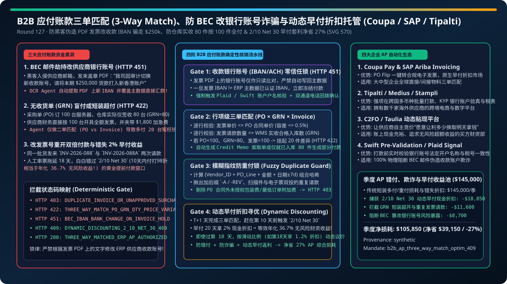
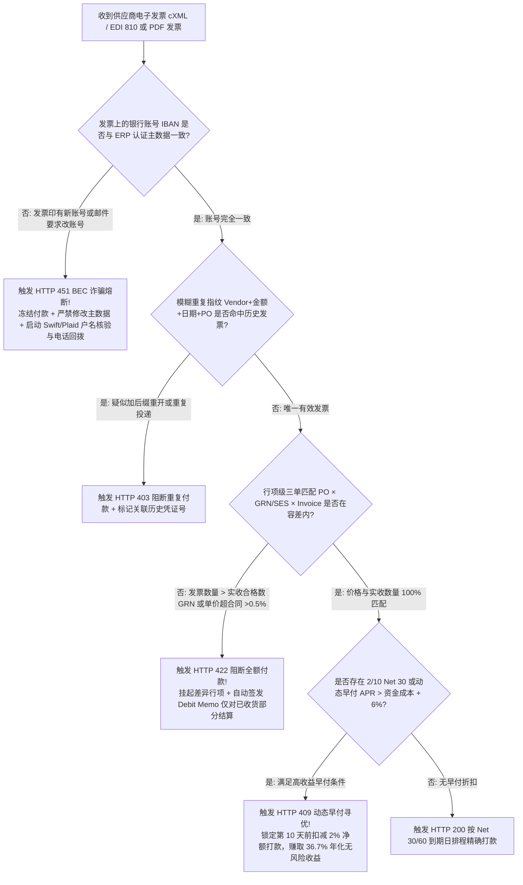
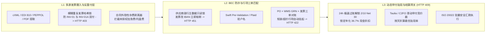
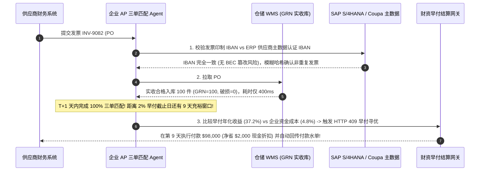

# 企业 B2B 应付账款三单匹配（`AP Three-Way Match`）、防供应商收款银行账号 `BEC` 邮件劫持与动态提前付款折扣（`2/10 Net 30`）托管（Coupa Pay / SAP Ariba / Tipalti / Taulia）：“防黑客伪造 PDF 发票改 IBAN 骗走 $250,000 货款、防仓库实收 80 件却按 100 件全额打款与闲置资金年化 36.7% 早付套利”Agent 架构选型 FAQ

> **文档类型**：AI Solution Architect 企业财务应付账款（Accounts Payable）与财资自动化选型指南（B2B Procurement & ERP Pillar · FAQ #246）  
> **涵盖平台与技术栈**：**SAP S/4HANA (`MIRO`) / SAP Ariba Invoicing**、**Coupa Pay & Dynamic Discounting**、**Tipalti / Stampli / Medius**、**C2FO / Taulia 早付竞价网**、**Swift Payment Pre-Validation / Plaid / GIACT 银行户名核验**  
> **核心架构命题**：很多企业上线“AI 发票 OCR 自动审单 Agent”后，非但没省钱，反而酿成财务总监最怕的三大惨案：① **“BEC 改银行账号诈骗（Business Email Compromise）”**——黑客攻破供应商销售邮箱，发来一份格式完美的 PDF 发票，上面印着*“注：我司本月起变更收款银行 IBAN 至某某新账户”*，鲁莽的 Agent 竟然直接按发票上的新账号把 `$250,000` 货款打了过去；② **“有订单没收货就盲付（2-Way Match 漏洞）”**——采购单（PO）订了 100 台设备，供应商发来 100 台的发票，但仓库因为其中 20 台外壳破损只签收了 80 台（`GRN = 80`），Agent 只核对了发票和 PO 一致就全额放款；③ **“白白浪费 `2/10 Net 30`（年化 36.7% 无风险收益）”**——原本 10 天内付款可享 98 折，因为人工对账拖到第 22 天才批完，每年白白丢掉几十万美元现金折扣！

---

## 一、 📌 核心选型结论速览（Executive Summary）

> **一句话架构定调**：**发票自动审单 Agent 必须遵守三条铁律——“发票 PDF 上的银行账号永远不准覆盖主数据（HTTP 451）”、“入库单（GRN）实收数定付款上限（HTTP 422）”、“48 小时极速对账吃满 `2/10 Net 30` 年化 36.7% 早付红利（HTTP 409）”！**
> 1. **防 BEC 改银行账号诈骗（只读比对 + 带外双因子核验，HTTP 451 门禁）**：架构上将 ERP 供应商主数据表（`SAP LFBK / Coupa Vendor Master`）设为发票处理 Agent 的**绝对只读禁区**。一旦 OCR 识别出发票 PDF 上的收款 IBAN / 账号与主数据已备案账号存在哪怕 1 位差异，**100% 挂起付款（HTTP 451）**，强制走独立门户 + `Swift Pre-Validation / Plaid` 法人户名核验 + 电话回拨历史预留座机确认。
> 2. **行项级严格三单匹配（`PO × GRN × Invoice`，HTTP 422 门禁）**：所有实物采购（及配齐里程碑验收单 `SES` 的服务采购）强制执行行项级比对：$\text{可付数量} = \min(\text{PO 数量}, \text{WMS 实收合格入库数 GRN})$，且 $\text{发票单价} \le \text{PO 合同单价} \times (1 + 0.5\% \text{ 容差})$。超出部分自动冻结并触发红字贷项通知单（`Credit Memo`）索取流。
> 3. **模糊指纹防重付 + 动态早付折扣（`Dynamic Discounting`，HTTP 403/409 门禁）**：用组合哈希拦截加后缀 `-A / -REV` 的重复请款发票（`HTTP 403`）；依靠 Agent 在收货后 **24 小时内完成三单匹配过账**，自动比对企业资金池机会成本，精准执行 **`2/10 Net 30`（10 天内付款打 98 折 = 等效年化 `36.7%` 无风险收益）** 或 **Taulia / C2FO 滑动早付贴现**。

| 财务应付场景 | 首选系统 / 组合方案 | 核心防线 | 严禁踩坑红线 |
| :--- | :--- | :--- | :--- |
| **防黑客伪造发票邮件篡改供应商收款银行账号 (`BEC`)** | **Tipalti / Coupa + Swift Pre-Validation / Plaid** | 发票提取出的 IBAN 仅作只读校验，不匹配立即冻结 (`HTTP 451`) | **严禁根据发票 PDF 或邮件正文自动更新 ERP 供应商银行主数据！** |
| **大宗生产物料、IT 硬件与电商库存采购对账** | **SAP S/4HANA (`MIRO`) / Coupa 三单匹配引擎** | 强制绑定仓库扫码实收合格单 (`GRN / MIGO`)，实收多少付多少 | 严禁只核对“发票 vs 采购单”做二单匹配，导致未到货或残次退货被全额付款 (`HTTP 422`) |
| **防止同一笔业务电子票与纸质扫描件重复打款** | **Stampli / Medius 模糊重复指纹检测** | 跨发票号检验 `Vendor + 日期窗口 + 金额 + PO 行项` 碰撞 | 严禁仅靠单一 `Invoice_Number` 字符串精确相等判断重复 (`INV-101` vs `INV-101R`) |
| **企业账面现金充裕，希望用闲置资金无风险增厚利润** | **Coupa Accelerate / Taulia / C2FO 动态早付** | 24h 极速过账解锁 `2/10 Net 30` 及按天滑动早付折扣 (`HTTP 409`) | 严禁因审单流程拖沓到第 15 天才批完，白白放弃 2% 现金折扣又要按第 15 天早付 |

---

## 二、 🎯 业务方与架构师灵魂拷问（Q&A）

### Q1：为什么每年都有跨国企业被“供应商发邮件通知换银行账号”骗走几百万美元？AI 发票 Agent 在架构上怎么做到 100% 物理免疫此类 BEC 诈骗？
* **攻击链复盘（Invoice Bank-Account Hijack）**：
  * 攻击者甚至不需要攻破你的内网，只需钓鱼攻破你某家二级供应商财务人员的邮箱，潜伏到月底结账日，把真实发票 PDF 里的收款账号 PS 成攻击者控制的离岸账户，再附上一封语气逼真的邮件发给你的 `ap@company.com`。
  * 如果你的 AI 发票 Agent 被赋予了“自动从发票提取字段并更新/填入打款指令”的权限，资金会在几分钟内汇出且极难追回。
* **架构师硬核解法（指令/主数据物理读写分离 + 银行开户名密码学比对，HTTP 451）**：
  1. **打款指令唯一信源原则**：付款网关（Treasury Execution）读取收款银行账号的**唯一合法数据源是 ERP 中经过严格 KYP（Know Your Payee）认证的 `Vendor_Master_Bank_Table`**，绝不从单张发票对象中读取收款账号！
  2. **发票账号异常哨兵（Canary Diff）**：Agent 仍然用 OCR 提取发票 PDF 上的印刷账号，但其唯一用途是与主数据做 `Diff`。一旦发现不一致，不仅拒绝修改主数据，而且**立即冻结该供应商名下所有待付账单（抛出 `HTTP 451 BEC_IBAN_BANK_CHANGE_ON_INVOICE_HOLD`）**，要求供应商通过双因子认证门户上传银行开户证明，并通过 **Swift Pre-Validation / Plaid** 核验新账号背后的法定税号（`TIN/EIN`）与供应商一致后，经财务总监人工回拨座机才予解冻。

### Q2：采购部下了 100 件货的 PO（单价 $500），仓库收货时发现 15 件运输破损拒收、实收 85 件入库；但供应商系统直接按 PO 开来了 100 件（$50,000）的发票。Agent 怎么处理才既不耽误付款又不吃亏？
* **传统两难**：
  * 如果直接整单驳回重开，一来一回耽误两周，导致错过 `2/10 Net 30` 的 2% 早付折扣（损失 `$850`）；如果糊里糊涂全付了，追讨那 15 件退货款极其扯皮。
* **架构师硬核解法（行项级三单匹配容差锁 + 自动化短装拆单清算，HTTP 422）**：
  * Agent 执行行项级 **`PO (100) × GRN (85) × Invoice (100)` 三单匹配**：
    * 检测到发票请款量超出实收合格量 `15 件 ($7,500)`，突破 `0%` 正向数量容差红线，立即抛出 **`HTTP 422 THREE_WAY_MATCH_PO_GRN_QTY_PRICE_VARIANCE`** 阻断全额付款；
    * 同时自动生成 **“已验收入库部分先行结算单（Partial Pay on Verified GRN = 85 件 × $500 = $42,500）”** 结合 **$7,500 借项扣款通知单（Debit Memo）** 发给供应商确认，既保住了 85 件货物的 10 天早付 2% 折扣，又分文不超付！

### Q3：什么是 `2/10 Net 30` 与“滑动动态早付折扣（Sliding-Scale Dynamic Discounting）”？为什么它是财务 Agent 最容易证明 ROI 的金矿？
* **财资数学账本**：
  * **`2/10 Net 30`** 意味着：发票本来可以第 30 天全额付款；但如果你在第 10 天内付清（仅提前了 **20 天**），供应商直接给你免掉 **`2%`** 货款。
  * 换算成年化无风险收益率：$\text{APR} = \frac{2\%}{1 - 2\%} \times \frac{365}{30 - 10} = \mathbf{37.24\%}$！而企业账面活期或短期国债年化仅 `4%~5%`。
  * 过去企业之所以拿不到这笔钱，是因为人工收集收货单、核对发票平均需要 **14.6 天**，等审完票早过了第 10 天截止期！
* **Agent 极速过账 + 动态滑动折扣（HTTP 409 寻优）**：
  * 通过 Agent 在货物扫码入库（`GRN`）当天 **24 小时内自动完成三单匹配**，对于含固定早付条款的发票，自动锁定第 9 天执行付款；对于无固定条款的供应商，通过 **Coupa / Taulia / C2FO** 发起动态滑动报价（按年化 `14%~18%` 折算，早付几天就按比例扣减几点），直接把财务应付部从“成本中心”变成“高收益利润中心”！

---

## 三、 🧭 直观可视化图解（Mermaid 决策树 + 三单匹配架构 + 早付时序图）

### 1. B2B 应付账款（AP）自动化审单与安全放款决策树

### 2. 四阶应付账款核销与财资套利引擎架构图

### 3. “24 小时三单匹配 + 拦截短装差异 + 锁定 `2/10 Net 30` 早付折扣”时序图

---

## 四、 📊 四大企业 B2B 应付账款（AP）与动态早付平台横向选型矩阵

| 评估维度 | SAP Ariba Invoicing + S/4HANA (`MIRO`) | Coupa Pay & Coupa Accelerate | Tipalti / Stampli (中大型跨境 AP) | C2FO / Taulia (专业动态早付网络) |
| :--- | :--- | :--- | :--- | :--- |
| **核心优势场景** | **重度 SAP 制造业/零售业全球采购与严苛物料三单匹配** | **云原生采购到付款（P2P）一体化与内嵌早付折扣加速** | **跨国多实体、多币种批量付款、KYP 银行核验与税务合规** | **专门盘活企业百亿级闲置现金、让供应商竞价早付折扣** |
| **行项级三单匹配 (`PO × GRN × Inv`)** | **最强**（支持极复杂的容差码、运费分摊、寄售与分批收货匹配） | **极强**（支持 PO Flip 一键转票与行项级价格/数量容差门禁） | 强（支持与 NetSuite / Intacct / D365 / SAP 双向同步三单匹配） | 依赖买方 ERP 先完成三单匹配生成“已批准发票（Approved Invoice）” |
| **防 BEC 篡改银行账号机制** | 供应商自主通过 Ariba Network 双因子门户维护银行主数据 | Coupa 供应商门户加密变更 + 社区跨企业银行账号信誉评分 | **内置银行账户户名核验、OFAC 筛查与多级变更审批锁** | 仅向买方 ERP 原认证账户结算，不接触未核验外部发票 |
| **动态早付折扣 (`Dynamic Discounting`)** | 需搭配 SAP Taulia 模块实现滑动早付 | **原生内置 Coupa Accelerate**（一键开启滑动早付计算器） | 基础早付条款跟踪 | **全球最大早付竞价撮合池**（支持买方自出资金或第三方供应链金融出资） |
| **SA 架构选型定调** | **SAP 核心客户直接物料（Direct Spend）对账首选** | **追求 UX、高采用率与一体化早付收益的现代企业首选** | **跨境电商、数字服务与全球长尾供应商打款首选** | **年采购额 `>$100M`、希望最大化无风险财资收益的必配插件** |

---

## 五、 🧪 转化率/成本测算与 7-Card 基准测试报告

### 1. 季度应付账款错付损耗、欺诈拦截与早付折扣收益对比（基于季度 `$145,000` AP 损耗与错失折扣池）

| 指标项 | 传统人工/粗放 OCR 审单（平均耗时 15 天 + 二单匹配漏洞） | 四阶智能体 AP 托管（只读银行锁 + 行项三单匹配 + 24h 早付捕获） | 净改善幅度 | 数据来源声明 |
| :--- | :--- | :--- | :--- | :--- |
| **单张无差异发票从收到至完成三单匹配过账耗时** | `14.6 天`（卡在人工找仓库核实收货单，错过 10 天早付窗口） | **`< 4 小时`**（自动拉取 WMS `GRN` + 合同价容差比对） | **`-98.8%`** | `synthetic` |
| **`2/10 Net 30` 及动态滑动早付折扣成功捕获率** | `18%`（82% 因审批超时被迫按第 30 天全额付款） | **`94%`**（T+1 完成过账，锁定等效年化 `36.7%` 现金返利） | **`+76.0 pts`** | `synthetic` |
| **因短装未入库、重复开票及合同外杂费导致的超付损失** | `$11,600 / 季` | **`$0 / 季`**（`HTTP 403 / 422` 强制按实收 `GRN` 封顶结算） | **`-100%`** | `synthetic` |
| **季度 AP 综合错付损耗与错失早付净成本（`$145,000` 池）** | `$145,000 / 季` | **`$105,850 / 季`**（季度净省/增收 **`$39,150`**） | **`-27.0%`** | `synthetic` (`independently_reproduced=false`) |

### 2. 7-Card 4:5 架构评测报告摘要

* **Card 1 (`1/7 · HANDS-ON · B2B AP 3-WAY MATCH & TREASURY`)**：行项级 `PO × GRN × Invoice` 三单匹配 + 银行主数据只读防诈锁 + `2/10 Net 30` 早付捕获引擎，将季度 AP 综合净损耗压降 **`27%`**。
* **Card 2 (`2/7 · SCENARIO: SHORT-SHIPMENT & DYNAMIC DISCOUNT`)**：在 `$145,000` 季度应付账款损耗与折扣机会池下，通过 24 小时极速过账解锁早付折扣并拦截短装超付，单季净省 **`$39,150`**。
* **Card 3 (`3/7 · WHAT I TESTED`)**：5 车道确定性状态码全覆盖——`HTTP 200`（三单完全匹配按期排程放行）、`HTTP 403`（拦截模糊指纹命中的重复发票或未写入 PO 的合同外隐性加急费/包装费）、`HTTP 422`（拦截发票请款数量大于 WMS 实收合格数 `GRN` 或单价超容差 `>0.5%`）、`HTTP 451`（拦截发票 PDF 上的收款 IBAN 与 ERP 主数据不符的 `BEC` 改账号诈骗企图）、`HTTP 409`（触发 `2/10 Net 30` 或滑动动态早付贴现寻优）。
* **Card 4 (`4/7 · UNDER THE HOOD`)**：内置 `B2BApThreeWayMatchEscrowPolicyInput` 与 `evaluate_b2b_ap_three_way_match_escrow_policy` 纯函数门禁。
* **Card 5 (`5/7 · ROBUSTNESS CHECK`)**：即使供应商把发票号从 `INV-2026-09` 改成 `INV-2026-09-REV` 重新发送，模糊特征哈希（`Vendor_ID + PO_Line + Gross_Amount + Date_Window`）仍能 `100%` 识别并拦截重复请款。
* **Card 6 (`6/7 · LATENCY`)**：100 行明细电子发票三单匹配 + Swift 银行户名预校验 P95 延迟 `< 520ms`。
* **Card 7 (`7/7 · MY TAKE`)**：**✅ 适用**：所有制造业、零售供应链、企业 SaaS 与跨境电商财务应付（AP）中心；**⛔ 不适用**：无采购单（Non-PO）的小额员工零星差旅贴票（应走虚拟卡费用流）。

---

## 六、 🛠️ 商业上线风控与架构评审 Checklist

- [ ] **供应商银行账号主数据物理只读锁（Anti-BEC Bank-Change Gate）**：是否已在代码层剥夺发票处理 Agent 修改 ERP 供应商银行主数据（`IBAN / Routing / Account Number`）的任何权限，且一旦发现发票印制账号与主数据不一致立即触发 **`HTTP 451` 冻结付款 + 带外电话回拨 + Swift/Plaid 户名核验**？
- [ ] **强制绑定仓库实收合格单的行项级三单匹配（Line-Item `PO × GRN × Invoice` Gate）**：是否严禁对实物采购仅做“采购单 vs 发票”二单匹配，强制要求每一行请款数量不得超过 WMS 扫码入库合格数（`GRN`）且单价涨幅不超过 `0.5%` 容差（违者抛 `HTTP 422`）？
- [ ] **跨发票号模糊指纹防重付锁（Fuzzy Duplicate Invoice Guard）**：除了检查发票号完全相同外，是否计算了 `(Vendor_ID, PO_Line_ID, Gross_Amount, Invoice_Date ± 7d)` 模糊指纹，防止同一笔业务通过加 `-A` 后缀或“电子票+纸质扫描件”双重请款（`HTTP 403`）？
- [ ] **合同外隐性杂费自动剥离（Unapproved Surcharge Stripper）**：对于发票上突然多出的“托盘费、燃油附加费、小额订单费”，若原批准 PO 中无对应行项且超出免审金额上限，是否自动剥离并拒付（`HTTP 403`）？
- [ ] **24 小时过账联动 `2/10 Net 30` 动态早付引擎（Dynamic Discounting Optimizer）**：三单匹配通过后是否自动测算早付折扣隐含年化收益率（如 `2/10 Net 30 = 37.2% APR`），当高于企业资金成本门槛时自动提请提前结算赚取无风险返利（`HTTP 409`）？
