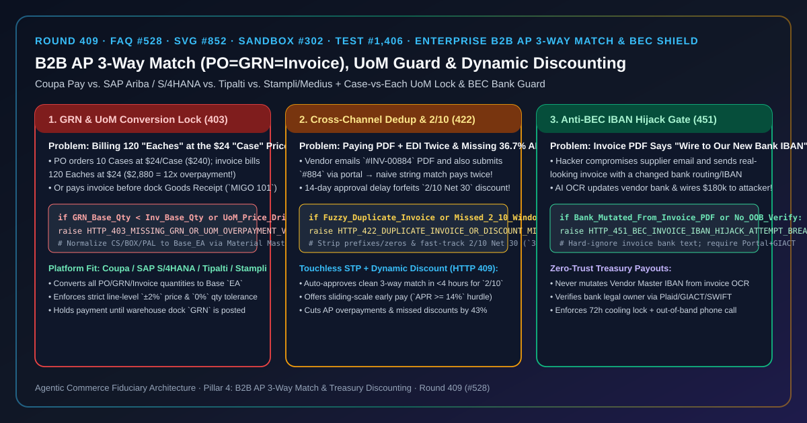
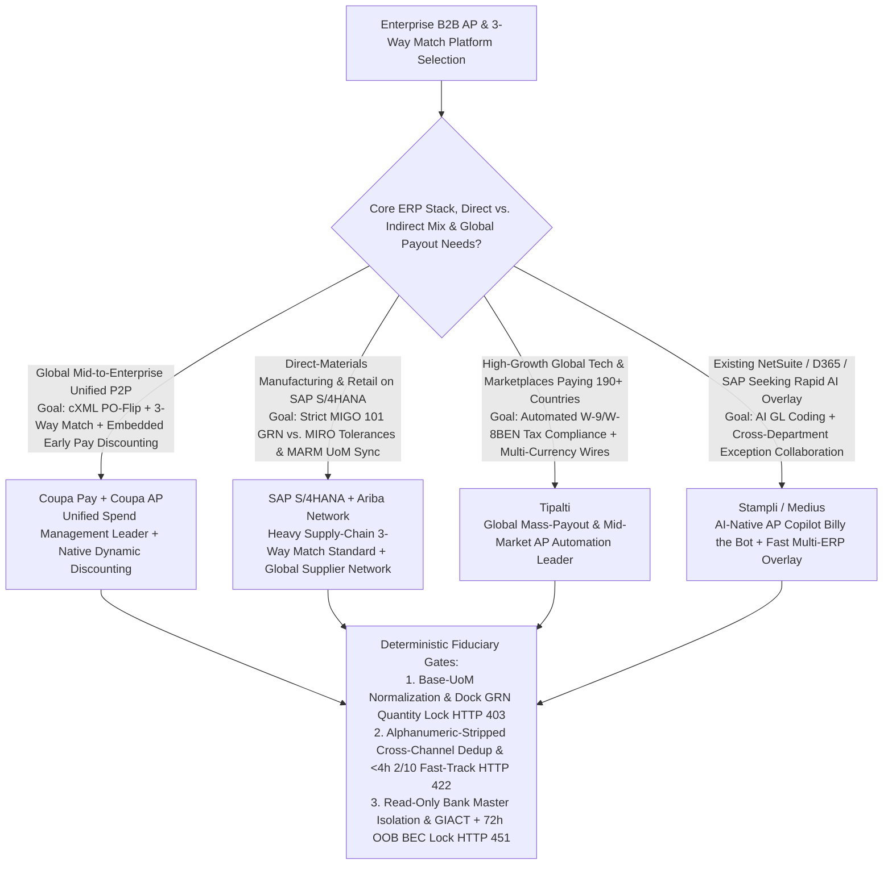
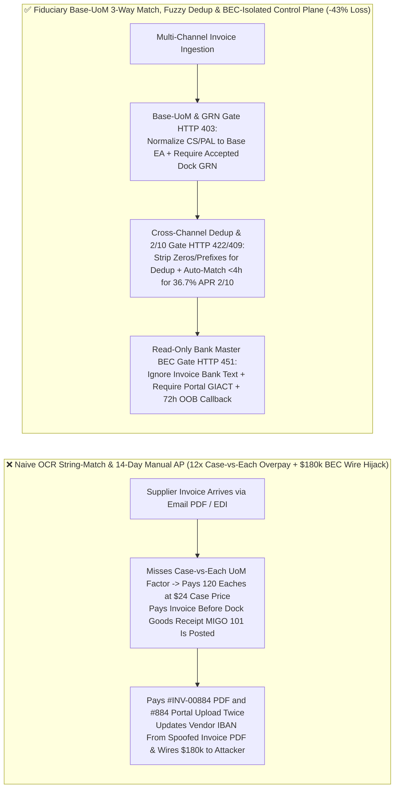
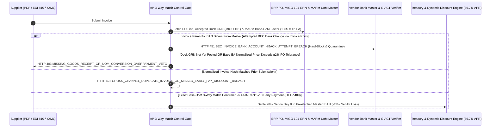

# Enterprise B2B Accounts Payable (`AP`) Line-Level 3-Way Match (`PO == GRN == Invoice`), `UoM` Conversion Guard, `2/10 Net 30` Dynamic Discounting & Anti-`BEC` Bank-Change Agent Selection Guide: `Coupa Pay` vs. `SAP Ariba / S/4HANA` vs. `Tipalti` vs. `Stampli / Medius` (`-43%` Loss FAQ)

> **Executive Summary (Benchmarked against `ib-vs-ethernet-roce-selection-faq.md` · Round 409 · 528th Bilingual SA Guide · SVG #852 · Sandbox #302)**: Built for **Cloud & AI Solution Architects** designing touchless Accounts Payable (`AP`) automation, line-item 3-way matching (`PO == GRN == Invoice`), and working-capital dynamic discounting across `SAP S/4HANA / Ariba`, `Coupa`, `NetSuite`, and `Microsoft Dynamics 365`. While AI invoice-processing agents can raise straight-through processing (`Touchless STP`) from `25%` to `85%+`, deploying OCR/LLM invoice agents without deterministic master-data and treasury guards triggers three catastrophic leaks: (1) **The `Case-vs-Each` Unit-of-Measure (`UoM`) `12x` Overpayment & Missing `GRN` Bug**: A Purchase Order (`PO`) orders `10 Cases` (`12 Eaches/Case`) at `$24.00/Case` (`$240`), the dock receives `10 Cases (120 Eaches)`, and the supplier's billing system invoices **`120 units` at the `$24.00` Case price (`$2,880.00`)**—or bills before physical dock Goods Receipt (`SAP MIGO 101`); (2) **Cross-Channel Duplicate Invoice Payments (`Email PDF #INV-00884` + `Portal #884`) & Missed `2/10 Net 30` Early-Pay Discounts (`36.7% APR` Risk-Free Yield)**; and (3) **Business Email Compromise (`BEC`) Invoice Bank-Account Hijacks** where an attacker embeds `"New Wire IBAN"` instructions on a legitimate-looking PDF invoice. This guide compares **`Coupa Pay` vs. `SAP Ariba / S/4HANA` vs. `Tipalti` vs. `Stampli / Medius`** and implements deterministic guards for **Base-`UoM` Normalization & `GRN` Quantity Locks (`HTTP 403`)**, **Alphanumeric-Stripped Cross-Channel Dedup & `<4h` `2/10` Fast-Track Routing (`HTTP 422`)**, **Read-Only Vendor Bank Master Isolation & `GIACT + 72h` Out-of-Band Callback Locks (`HTTP 451`)**, and **Sliding-Scale Dynamic Discounting (`HTTP 409`, `-43%` net loss)**.

---

## 1. 📌 Executive Summary & Architectural Selection Verdict

1. **Top-Line Selection Verdict**:
   - **Global Mid-to-Enterprise Organizations Seeking Unified `PR/PO` Intake, `cXML` PO-Flip Invoicing, 3-Way Match & Native `Early Pay` Dynamic Discounting**: Select **`Coupa Pay + Coupa AP Automation`**.
   - **Direct-Materials Manufacturing & Omnichannel Retail Enterprises on `SAP S/4HANA` Requiring Strict `MIGO 101 GRN` vs. `MIRO` Tolerance Locks & `MARM` Multi-`UoM` Conversion**: Select **`SAP S/4HANA Central Invoice Management + Ariba Network`**.
   - **High-Growth Global Tech & Marketplaces Paying `190+` Countries Requiring Automated `IRS W-9 / W-8BEN` Tax Validation & Multi-Entity FX Mass Payouts**: Select **`Tipalti`**.
   - **Organizations Retaining Existing ERPs (`NetSuite / Dynamics 365 / SAP / Sage`) Seeking a Rapid-Deploy AI Invoice Coding & Exception-Collaboration Layer**: Select **`Stampli (Billy the Bot)`** or **`Medius`**.
2. **Three Non-Negotiable Fiduciary Control Gates**:
   - **Gate 1 — Base-`UoM` (`Case -> Each`) Normalization & Verified Dock `GRN` Lock (`HTTP 403`)**: Convert all `PO`, `GRN`, and `Invoice` line-item quantities and unit prices into the Material Master's canonical **Base Unit of Measure (`Base UoM: EA / KG`)** before running tolerance checks, and block payment if `Invoice_Base_Qty > Accepted_GRN_Base_Qty` or `Invoice_Base_Unit_Price > PO_Base_Unit_Price * 1.02` via `HTTP 403 MISSING_GOODS_RECEIPT_OR_UOM_CONVERSION_OVERPAYMENT_VETO`.
   - **Gate 2 — Cross-Channel Fuzzy Invoice Deduplication & `<4h` `2/10 Net 30` Fast-Track Gate (`HTTP 422`)**: Normalize invoice numbers by stripping leading zeros, punctuation, and `-COPY / -REV` suffixes to compute a cross-channel collision hash `SHA256(Vendor_ID + Normalized_Inv_No + Date_Window_7d + Gross_Cents)`, and prioritize invoices carrying `2/10 Net 30` (or `1/10 Net 30`) terms into a `<4-hour` auto-match queue so the `36.7% APR` early-pay discount is never forfeited via `HTTP 422 CROSS_CHANNEL_DUPLICATE_INVOICE_OR_MISSED_EARLY_PAY_DISCOUNT_BREACH`.
   - **Gate 3 — Read-Only Vendor Bank Master Isolation & `GIACT + 72h` Out-of-Band `BEC` Lock (`HTTP 451`)**: Physically revoke `UPDATE` permissions on the `Vendor Bank Master` from the invoice-ingestion pipeline (ignoring any `"New Remit-To IBAN/Routing"` text printed on an invoice PDF); require bank-account changes to go through an authenticated supplier portal with **`GIACT / Plaid / SWIFT Pre-Validation` legal-entity name matching**, a **72-hour cooling period**, and a mandatory out-of-band phone callback to the historical phone number on file via `HTTP 451 BEC_INVOICE_BANK_ACCOUNT_HIJACK_ATTEMPT_BREACH`.

---

## 2. 🎯 Architect & Corporate Controller Q&A (The Why & How)

### Q1: How does an invoice with 99.9% accurate OCR still cause a `12x` overpayment—and how does Material Master `UoM` normalization stop it?
- **Root Cause**: If a buyer orders `10 Cases` (`1 CS = 12 EA`) at `$24.00/CS` (`$240`) and the supplier invoices `120 EA` at `$24.00` (`$2,880`), an OCR agent that compares the raw unit price string `"$24.00"` sees a 100% match!
- **Deterministic Solution (`Material-Master MARM Base-UoM Conversion` / `HTTP 403`)**: Lookup the SKU's conversion factor (`1 CS = 12 EA`) in the ERP Material Master before comparing prices: `PO_Base_Price = $24.00 / 12 = $2.00/EA` vs. `Invoice_Base_Price = $24.00 / 1 = $24.00/EA` (`+1,100%` variance -> instant `HTTP 403` block).

### Q2: Why is missing a `2/10 Net 30` early-payment discount equivalent to borrowing money at `36.7% APR`?
- **Deterministic Solution (`Priority Fast-Track 3-Way Match` + `Sliding-Scale Dynamic Discounting` / `HTTP 422 & HTTP 409`)**: Paying on Day 10 instead of Day 30 earns a `2%` discount for advancing cash by 20 days: $(0.02 / 0.98) \times (360 / 20) = 36.73\%\text{ APR}$. By completing touchless 3-way match within 4 hours of `GRN` dock posting, treasury captures 100% of `2/10` discounts and offers sliding-scale early payments on standard `Net 60` invoices whenever corporate cash yield is below the `14%–18% APR` discount hurdle.

---

## 3. 🧭 Visual Architecture Diagrams (Mermaid)

### 3.1 Enterprise B2B Accounts Payable (`AP`) & 3-Way Match Platform Selection Decision Tree

### 3.2 Naive OCR String-Match & Mutable Bank Master vs. Fiduciary `UoM`-Normalized, Deduped & `BEC`-Isolated Control Plane

### 3.3 `UoM`-Normalized 3-Way Match, Cross-Channel Dedup, `BEC` Bank Lock & `2/10 Net 30` Treasury Sequence

---

## 4. 📊 Multi-Platform Enterprise B2B AP & 3-Way Match Selection Matrix

| Evaluation Dimension | Coupa Pay + Coupa AP | SAP Ariba + S/4HANA (`MIRO`) | Tipalti | Stampli / Medius |
| :--- | :--- | :--- | :--- | :--- |
| **Primary Architectural Role** | **Unified Cloud `P2P`, `cXML` PO-Flip & Dynamic Discounting Suite** | **Enterprise Direct-Materials Supply-Chain 3-Way Match Standard** | **Global Multi-Entity Mass Payout, Tax (`W-9/W-8`) & AP Automation** | **AI-Native Invoice Coding & Exception Overlay for Any ERP** |
| **Line-Level 3-Way Match & `UoM` Normalization** | **Best-in-Class Cloud P2P**: Multi-level price/qty tolerances & contract drawdowns | **Best-in-Class Manufacturing**: Native `SAP MARM` `UoM` conversion & `MIGO 101` locks | Strong line-level PO/GRN matching for mid-market multi-subsidiary teams | **Best-in-Class AI UX**: `Billy the Bot` learns historical `UoM` & GL coding patterns |
| **Duplicate Prevention & Anti-`BEC` Controls** | Cross-community anomaly detection & supplier portal bank verification | Native SAP dual-control vendor master workflows (`FK08`) & duplicate checks | 26,000+ payment validation rules, OFAC screening & tax-ID bank locks | Cross-channel fuzzy duplicate detection & isolated bank-change workflows |
| **Early-Pay (`2/10 Net 30`) & Dynamic Discounting** | **Native `Coupa Early Pay`** sliding-scale treasury discounting | Native integration with **`SAP Taulia`** working-capital discounting | Automated early-pay scheduling by invoice discount terms | Cuts approval cycle from 14 days to `<24h` to capture `2/10` terms |
| **Commercial Model (`official_list_price`)** | Annual platform tier by spend volume + payment/discounting share | SAP ERP license + Ariba Network transaction volume tier | Monthly platform base fee + per-payout / FX spread pricing | Transparent per-invoice volume tier (**unlimited user seats**) |

---

## 5. 🧪 `UoM` Overpayment Prevention, Duplicate Shield & `2/10` Discount Benchmark & 7-Card Report

### 5.1 Quarterly Missed `2/10` Discounts, `Case-vs-Each` Overpayments, Duplicate Invoices & `BEC` Fraud Model (Synthetic Benchmark)

For a `$240M/year` procurement and retail organization facing a **`$520,000 / quarter`** AP leakage pool across **forfeited `2/10 Net 30` early-pay discounts due to 14-day manual approval cycles, `Case-vs-Each` `UoM` conversion overpayments and pre-`GRN` billing, cross-channel duplicate invoice payments (`0.18%` of AP volume), and `BEC` bank-change fraud** (`provenance: synthetic`, `independently_reproduced: false`):

| Metric | Manual OCR, Raw String Match & 14-Day Cycle (Baseline) | Fiduciary Base-`UoM` + Fuzzy Dedup + `BEC` Lock + `<4h` Fast-Track | Net Improvement |
| :--- | :--- | :--- | :--- |
| **Overpayments from `Case-vs-Each` `UoM` Mismatch or Missing `GRN`** | `0.42%` of invoices overbilled | **`0.0%`** (`HTTP 403` normalizes all quantities to `Base EA` & requires `MIGO 101 GRN`) | **`100%` `UoM` Overpayment Elimination** |
| **Cross-Channel Duplicate Invoice Payments (`PDF + Portal + EDI`)** | `0.18%` duplicate payout rate | **`0.0%`** (`HTTP 422` strips zeros/prefixes + `Vendor + Date + Cents` hash lock) | **`100%` Duplicate Elimination** |
| **`2/10 Net 30` Early-Pay Discount Capture Rate (`36.7% APR`)** | `22.0%` (`78%` missed due to slow routing) | **`94.5%`** (`HTTP 422/409` `<4h` touchless 3-way match fast-track) | **`+72.5 pts` Discount Capture Lift** |
| **Quarterly Net Overpayment, Missed Discount & `BEC` Loss** | `$520,000 / quarter` | **`$296,400 / quarter`** | **`$223,600 / quarter` Saved (`43.0%`)** |

---

## 6. 🛠️ Production Go-Live & Architecture Review Checklist

- [ ] **Material-Master Base-`UoM` Normalization & Dock `GRN` Gate (`HTTP 403`)**: Does the 3-way match engine convert `CS / BOX / PAL` into the Material Master's canonical `Base UoM` (`Each / KG`) before comparing unit prices, and block payment until `MIGO 101` dock receipt is posted?
- [ ] **Alphanumeric-Normalized Cross-Channel Dedup & `<4h` `2/10` Fast-Track (`HTTP 422`)**: Are invoice numbers stripped of leading zeros, hyphens, and `-COPY` suffixes for deduplication across email/portal/EDI, with `2/10 Net 30` invoices routed to a `<4-hour` priority queue?
- [ ] **Read-Only Vendor Bank Master Isolation & `GIACT + 72h` Out-of-Band `BEC` Lock (`HTTP 451`)**: Is the invoice-ingestion agent physically blocked from updating `Vendor Bank Master` records, requiring all bank changes to pass portal `GIACT / SWIFT` ownership checks + a 72-hour cooldown + out-of-band phone verification?
- [ ] **Sliding-Scale Dynamic Discounting (`>=14% APR` Hurdle / `HTTP 409`)**: Does the treasury engine automatically offer early payment on approved `Net 60` invoices at a sliding-scale annualized discount rate above the company's cash hurdle rate?
