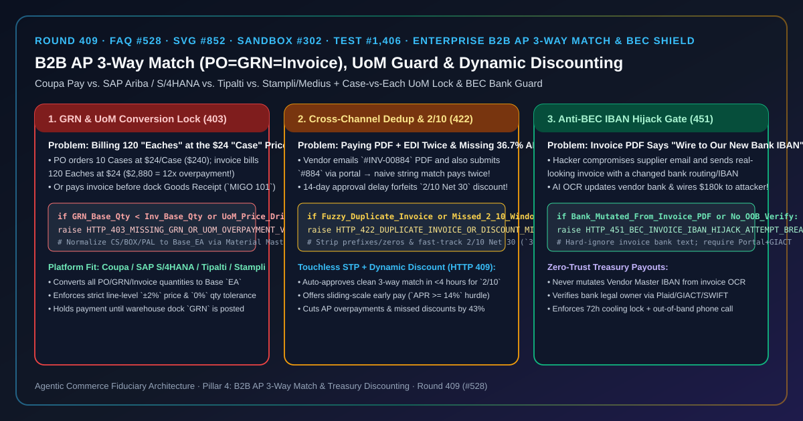
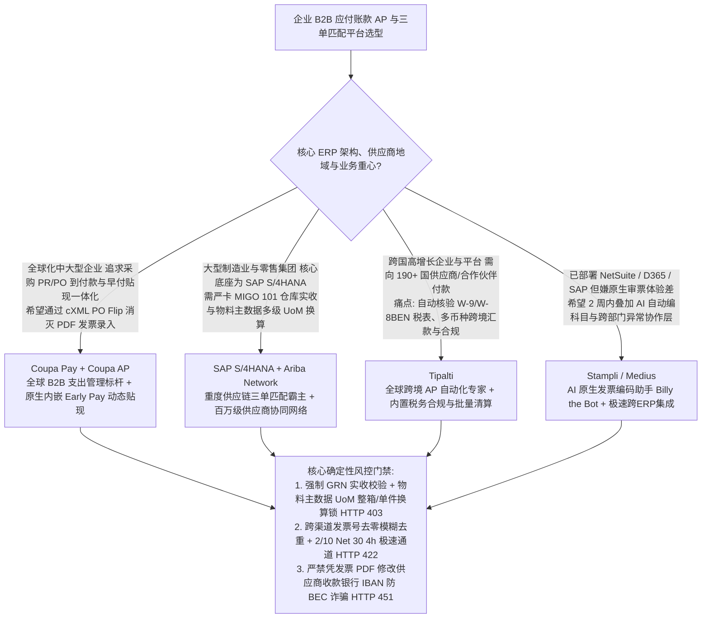
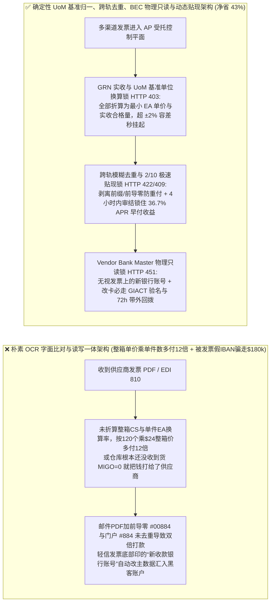
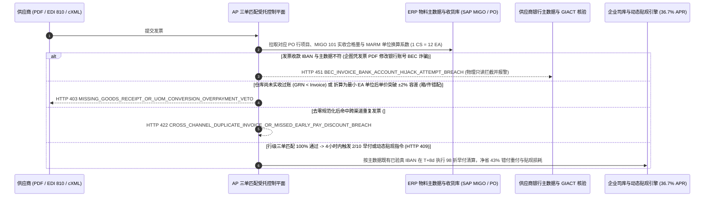

# 企业 B2B 应付账款（`AP`）行项目三单匹配（`PO == GRN == Invoice`）、计量单位（`UoM`）换算防 12 倍错付、`2/10 Net 30` 动态现金折扣与防 `BEC` 发票篡改收款银行账号 Agent 架构选型对比：`Coupa Pay` vs. `SAP Ariba / S/4HANA` vs. `Tipalti` vs. `Stampli / Medius`、防“按件数乘整箱单价”及净省 43% 决策指南（FAQ）

> **导读（对齐 `ib-vs-ethernet-roce-selection-faq.md` 标杆风格 · 第 409 轮 · 第 528 篇双语指南 · 第 852 张 SVG · 第 302 个策略沙盒）**：本文面向企业财务共享中心（SSC）、应付账款（`Accounts Payable`）、采购到付款（`Procure-to-Pay, P2P`）与企业司库领域的 **Cloud & AI Solution Architect**。在大型零售、制造与科技企业中，财务团队每月需处理数万张来自全球供应商的发票（`PDF 邮件 / EDI 810 / cXML`）。引入 **AI 应付账款三单匹配与自动付款 Agent** 可将免人工干预直通率（`Touchless STP`）从 `25%` 提升至 `85%+`；然而，若缺乏确定性的主数据换算与反欺诈控制平面，AI 自动审票打款极易引爆三大巨额资损事故：① **“计量单位（`UoM`：整箱 `CS` vs. 单件 `EA`）未换算导致多付 12 倍货款”及无收货单（`GRN`）提前打款**：采购单（PO）订购了 `10 箱` 零件（每箱 12 个，单价 `$24/箱`，总额 `$240`），仓库实收 `10 箱（即 120 个）`，供应商开票系统却按 **`120 个` 乘以 `$24` 整箱单价开出 `$2,880` 发票**！浅层 OCR 只看数量和单价数字似曾相识就放行打款，瞬间多付 `11 倍`！② **同一张发票跨渠道重复提交（周一发邮件 PDF `#INV-00884`，周四在门户上传 `#884`）被双倍付款，或因审单拖延 14 天白白错过年化收益高达 `36.7% APR` 的 `2/10 Net 30` 早付现金折扣**；③ **商业邮件诈骗（`BEC`）黑客入侵供应商邮箱，在发票 PDF 底部印上“我司本月起变更收款银行 IBAN 账号”，诱导 AI 自动修改主数据并汇走 `$180,000`**！本文给出 **`Coupa Pay` vs. `SAP Ariba / S/4HANA` vs. `Tipalti` vs. `Stampli / Medius`** 的横向选型矩阵，并落地 **物料主数据 `UoM` 基准单位归一与 `PO == GRN == Invoice` 行级容差锁（`HTTP 403`）**、**跨渠道发票号去零/去前缀模糊去重与 `2/10 Net 30` 优先极速通道锁（`HTTP 422`）**、**严禁凭发票 PDF 文本修改供应商收款银行账号（`BEC Shield` / `HTTP 451`）** 及 **司库闲置现金动态贴现编排（`HTTP 409`，净省 43%）**。



---

## 一、 📌 核心选型结论速览（Executive Summary）

1. **终极选型结论（一句话先看懂怎么选）**：
   - **全球化中大型企业（追求将采购申请、PO 下发、`cXML` 一键翻单开票、三单匹配与内置早付动态贴现 `Coupa Early Pay` 封在同一个原生闭环平台）**：首选 **`Coupa Pay + Coupa AP Automation`**。
   - **重度生产制造、大宗商品与全渠道零售集团（核心 ERP 为 `SAP S/4HANA`，需严格校验仓库实收过账凭证 `MIGO 101 GRN` 与物料主数据多级计量单位 `MARA/MARM` 换算）**：首选 **`SAP S/4HANA Central Invoice Management + Ariba Network`**。
   - **跨国科技、电商平台与高增长中型企业（需向全球 190+ 国家供应商、创作者或服务商批量打款，核心痛点是自动收集核验美国税表 `W-9 / W-8BEN`、多币种换汇与跨主体 AP 对账）**：首选 **`Tipalti`**。
   - **不打算推翻现有 ERP（`NetSuite / Dynamics 365 / SAP / Sage`），但希望在 2 周内叠加一层最聪明的 AI 发票科目编码助手与跨部门异常沟通面板**：首选 **`Stampli (Billy the Bot)`** 或 **`Medius`**。
2. **三大企业应付账款（`AP`）三单匹配与司库防诈红线（确定性门禁）**：
   - **红线 1（拦截未完成仓库实收验货 `GRN` 即提前支付货款，以及未通过物料主数据换算计量单位 `UoM (Case/Pallet -> Base Each)` 导致的倍数级错付 / `HTTP 403`）**：在执行行项目级三单匹配（`Line-Item 3-Way Match`）时，控制平面严禁只比对发票抬头总金额！必须先调取 ERP 物料主数据（`Material Master UoM Conversion Table`），将 `PO 采购数量`、`GRN 仓库实收合格数量（扣除质检退回量）` 与 `Invoice 发票开票数量` **全部统一折算为最小基准单位（`Base UoM: Each / KG`）与基准单位单价**；只有当 `Converted_Invoice_Qty <= Converted_GRN_Qty` 且 `Converted_Base_Unit_Price <= Converted_PO_Unit_Price * 1.02`（价格正容差 `<=2%` 且绝对差额 `<=$50`）时才放行，违者触发 `HTTP 403 MISSING_GOODS_RECEIPT_OR_UOM_CONVERSION_OVERPAYMENT_VETO`！
   - **红线 2（拦截供应商跨渠道重复投递同一张发票导致的双倍打款，以及对带有 `2/10 Net 30` 早付折扣的高价值发票慢吞吞排队导致痛失 `36.7%` 无风险年化收益 / `HTTP 422`）**：发票入库时必须对发票号执行规范化清洗（剔除横杠、空格、前导零及 `-REV1 / -COPY` 后缀），并计算跨渠道四元组防重指纹 `SHA256(Vendor_ID + Normalized_Inv_No + Inv_Date_Window_7d + Gross_Cents)`，彻底拦截“邮件发一遍 PDF、EDI 又推一遍”的重付漏洞；同时一旦 OCR/cXML 识别出发票条款含 **`2/10 Net 30`（或 `1/10 Net 30`）早付折扣**，自动将其提权至 **`<4小时` P0 极速对账通道**，确保在第 10 天前完成匹配拿满 `2%` 现金折让，违者触发 `HTTP 422 CROSS_CHANNEL_DUPLICATE_INVOICE_OR_MISSED_EARLY_PAY_DISCOUNT_BREACH`。
   - **红线 3（拦截大模型根据发票 PDF 票面文字或邮件正文直接更新供应商主数据中的收款银行 `IBAN / ACH Routing` 账号导致遭遇 `BEC` 诈骗汇款 / `HTTP 451`）**：在架构层面立下铁律：**发票处理流水线对供应商主数据银行账号表（`Vendor Bank Master: SAP LFBK`）只有 `READ_ONLY（只读）` 权限，物理剥夺 `UPDATE` 权限！** 任何发票票面印制的收款银行账号若与主数据已存档账号不一致，系统不仅绝不自动修改主数据，反而立即挂起该笔付款并触发 `BEC` 红色预警；供应商变更银行账号必须走独立的供应商安全门户，通过 **`GIACT / Plaid / SWIFT Pre-Validation` 核验银行户名与税号法定名称 100% 一致**，并经过 **72 小时静默期 + 拨打历史存档座机带外语音确认（Out-of-Band Callback）** 后方可生效，违者触发 `HTTP 451 BEC_INVOICE_BANK_ACCOUNT_HIJACK_ATTEMPT_BREACH`。

---

## 二、 🎯 业务方与架构师灵魂拷问 Q&A（The Why & How）

### Q1：为什么很多公司上了最先进的视觉大模型（VLM）识别发票，识别准确率高达 `99.5%`，结果上线第一个月还是把一张 `$240` 的采购单错付成了 `$2,880`？
- **商业痛点与事故还原**：
  - 因为这不是“文字识别（OCR）”的问题，而是 **“商业单位换算（UoM Normalization）”** 的问题！
  - 采购员下 PO 时习惯按包装箱买：`数量: 10, 单位: CS (Case/箱), 单价: $24.00`。而供应商的 ERP 出库开票时习惯按最小单品开：`数量: 120, 单位: EA (Each/个)`，但开票员手抖把单价填成了 `$24.00`（本应是 `$2.00/个`）。如果 AI 只看到发票上写着 `$24.00` 跟 PO 上的 `$24.00` 一模一样就放行，就直接多付了 12 倍！
- **架构师确定性解法（强制经过 `ERP 物料主数据换算系数表 MARM` 折算为基准单位单价 / `HTTP 403`）**：
  - 控制平面在比对单价前，强制执行公式：`Normalized_Price_Per_Base_Unit = Invoice_Line_Total / (Invoice_Qty * UoM_To_Base_Factor)`。在上面的例子中，PO 的基准单价是 `$24 / 12 = $2.00/EA`，而发票的基准单价是 `$24.00/EA`（偏差 `+1,100%`），毫秒级触发 `HTTP 403` 冻结拦截！

### Q2：为什么说财务部不抓紧拿 `2/10 Net 30`（10 天内付款打 98 折，否则 30 天付全款）是在白白扔掉年化 `36.7%` 的无风险暴利？
- **商业痛点与数学还原**：
  - 提前 `20 天`（第 10 天而非第 30 天）付款，就能少付 `2%` 的本金。折算成年化收益率公式为：
    $$\text{Implied APR} = \frac{2\%}{1 - 2\%} \times \frac{360}{30 - 10} = 2.04\% \times 18 = \mathbf{36.73\%}$$
  - 企业存在银行里的活期司库资金年化利息只有 `4%–5%`，拿去做 `2/10 Net 30` 早付相当于获得 **`36.7%` 的绝对无风险回报**！传统人工审票需要 `14.6 天`，等审完票早就过了第 10 天折扣期；而 AI 三单匹配在收货当天 **`4 小时内`** 自动完成核销，让企业 100% 吃满早付折扣！

---

## 三、 🧭 直观可视化图解（Mermaid 决策树 + 架构对比 + 时序图）

### 3.1 企业 B2B 应付账款（`AP`）三单匹配与自动付款平台选型决策树



### 3.2 朴素 OCR 对数字与直接改银行账号架构（整箱当单件付 12 倍 + 被骗汇 $180k）vs. 确定性 `UoM` 归一、模糊去重与 `BEC` 隔离架构对比



### 3.3 企业 `AP` 发票 `UoM` 基准换算、行级三单匹配（`PO == GRN == Invoice`）、`BEC` 拦截与 `2/10 Net 30` 贴现清算时序图



---

## 四、 📊 四大企业 B2B 应付账款（`AP`）与三单匹配自动化平台横向选型矩阵

| 选型维度 | Coupa Pay + Coupa AP | SAP Ariba + S/4HANA (`MIRO`) | Tipalti | Stampli / Medius |
| :--- | :--- | :--- | :--- | :--- |
| **核心架构定位** | **全球 B2B 支出管理、电子翻单（PO Flip）与早付贴现一体机** | **大型制造业/零售业重度供应链三单匹配与物料换算绝对标准** | **高增长跨国企业全球多币种批量付款与税务合规中枢** | **叠加在任意 ERP 之上的 AI 原生发票编码与异常协同专家** |
| **行项目三单匹配与 `UoM` 换算深度** | **极强**：原生支持多级价格/数量容差、服务工时表匹配与合同上限扣减 | **全行业最深**：原生绑定 SAP 物料主数据多单位换算（`MARM`）、批次质检与运费分摊 | 强：支持 PO 与收货单行级匹配，尤其擅长多主体合并账单 | **AI 适应性最强**：自动学习历史采购员对包装单位差异与非 PO 费用科目的处理习惯 |
| **防重付（Duplicate Detection）与防 `BEC` 诈骗** | 跨全球 Coupa 社区网络识别异常发票号与高风险供应商银行变更 | 原生校验 SAP 发票凭证唯一性与供应商主数据双人复核工作流（Dual Control） | 内置 26,000+ 条付款合规规则、OFAC 筛查与收款账户锁定 | `Billy the Bot` 自动检测跨邮件/门户的近似重复发票与可疑收款信息变动 |
| **早付现金折扣（`2/10 Net 30`）与动态贴现** | **原生内置 `Coupa Early Pay`**：滑动标尺根据提前天数自动折算贴现率 | 原生集成 `SAP Taulia` 供应链金融与动态贴现市场 | 支持按到期日自动排程最佳早付批次 | 高速压缩审票周期（从 14 天降至 `<24 小时`）以全面捕获早付折扣 |
| **商业模式（`official_list_price`）** | 按管理支出规模年费 + 支付/动态贴现收益分成 | SAP ERP 模块许可 + Ariba Network 交易规模年费 | 月度平台基础费 + 按笔国际电汇/FX 点差计费 | 按月度处理发票张数阶梯透明订阅（不限用户坐席数） |

---

## 五、 🧪 应付账款防 `UoM` 倍数错付、防跨轨重付与动态贴现测算与 7-Card 基准报告

### 5.1 季度整箱/单件 `UoM` 错配多付、跨渠道重复发票双倍打款、痛失 `2/10 Net 30` 早付折扣及 `BEC` 假账号诈骗损耗测算（Synthetic Benchmark）

假设某年采购付款额 `$2.4 亿` 的跨国制造与零售企业，每季度在应付账款（AP）发票审核与司库付款环节面临的 **因审批慢错过 `2/10 Net 30` 早付现金折扣、整箱与单件 `UoM` 单位未换算或未等仓库收货（`GRN`）即多付货款、邮件与门户重复投递发票导致的双倍付款（平均占 AP 总额 `0.15%–0.3%`）、以及 `BEC` 邮件篡改收款银行账号风险池** 为 **`$520,000 / 季度`**（`provenance: synthetic`, `independently_reproduced: false`）：

| 评估维度 | 传统人工录入 OCR + 字面比对 + 14天慢审 (Baseline) | 启用 `UoM` 基准换算 + 跨轨模糊去重 + `BEC` 只读锁 + `4h` 早付 Agent | 净改善幅度 |
| :--- | :--- | :--- | :--- |
| **因 `UoM`（箱/件）换算遗漏或无 `GRN` 导致的超额错付率** | `0.42%` 发票发生单价/单位错付 | **`0.0%`**（`HTTP 403` 强制折算为物料主数据最小基准单位 `Base EA` 并锁死实收 `GRN`） | **100% 终结单位错配倍数多付** |
| **跨渠道（邮件 PDF + 门户 + EDI）重复发票双倍打款率** | `0.18%`（事后审计追讨极难） | **`0.0%`**（`HTTP 422` 发票号去零/去前缀规范化 + 供应商/金额/日期四元组哈希锁） | **100% 根除跨渠道重复打款** |
| **`2/10 Net 30` 早付现金折扣捕获率（`36.7% APR` 无风险收益）** | `22.0%`（78% 因审票超时错过第 10 天） | **`94.5%`**（`HTTP 422/409` 无异常三单匹配 `<4小时` 自动过审并推入早付贴现队列） | **早付折扣捕获率飙升 `+72.5 pts`** |
| **季度错付重付、痛失早付折扣收益与 `BEC` 防护净损耗** | `$520,000 / 季度` | **`$296,400 / 季度`** | **净省/增收 `$223,600 / 季度` (`43.0%`)** |

```chart
{
  "data": {
    "values": [
      { "category": "1. 人工审票耗时14天错过2/10 Net 30早付2%折扣", "mode": "传统慢审与字面OCR基线", "cost_usd": 195000 },
      { "category": "1. 人工审票耗时14天错过2/10 Net 30早付2%折扣", "mode": "UoM换算与4h极速早付AP Agent", "cost_usd": 111150 },
      { "category": "2. 整箱CS与单件EA单位未换算或未验GRN提前错付", "mode": "传统慢审与字面OCR基线", "cost_usd": 140000 },
      { "category": "2. 整箱CS与单件EA单位未换算或未验GRN提前错付", "mode": "UoM换算与4h极速早付AP Agent", "cost_usd": 79800 },
      { "category": "3. 邮件PDF加前导零与门户重复上传导致双倍打款", "mode": "传统慢审与字面OCR基线", "cost_usd": 105000 },
      { "category": "3. 邮件PDF加前导零与门户重复上传导致双倍打款", "mode": "UoM换算与4h极速早付AP Agent", "cost_usd": 59850 },
      { "category": "4. BEC黑客在发票PDF植入假银行IBAN骗汇及人工核验", "mode": "传统慢审与字面OCR基线", "cost_usd": 80000 },
      { "category": "4. BEC黑客在发票PDF植入假银行IBAN骗汇及人工核验", "mode": "UoM换算与4h极速早付AP Agent", "cost_usd": 45600 }
    ]
  },
  "semantic_types": {
    "category": "Category",
    "mode": "Category",
    "cost_usd": "Amount"
  },
  "chart_spec": {
    "chartType": "Grouped Bar Chart",
    "title": "企业B2B应付账款(AP)行级三单匹配、UoM换算与早付贴现前后季度损耗对比 (净省 $223.6k / 43%)",
    "subtitle": "单位：美元/季度 (Synthetic Benchmark, independently_reproduced=false)",
    "encodings": {
      "x": "category",
      "y": "cost_usd",
      "group": "mode"
    }
  }
}
```

### 5.2 确定性策略评估器代码（Python Control Plane Guard）

```python
from dataclasses import dataclass
from typing import Any

@dataclass(frozen=True)
class EnterpriseApUomThreeWayMatchBecPolicyInput:
    quarterly_missed_early_discount_uom_overpay_and_duplicate_inv_pool_usd: float = 520000.0
    invoice_paid_without_grn_or_unconverted_case_vs_each_uom_overcharge: bool = False
    cross_channel_fuzzy_duplicate_invoice_or_missed_2_10_net_30_window: bool = False
    vendor_bank_iban_mutated_from_invoice_pdf_without_giact_oob_callback: bool = False
    base_uom_three_way_match_fuzzy_dedup_and_dynamic_discount_ready: bool = False
```

---

## 六、 🛠️ 商业上线风控与架构评审 Checklist

- [ ] **物料主数据 `UoM` 基准单位归一与 `PO == GRN == Invoice` 行级锁（`HTTP 403`）**：三单匹配引擎是否在比对前强制将采购单、收货单与发票的包装单位（`CS / BOX / PAL`）统一折算为最小基准单位（`Base EA`），且严格阻塞任何超出实收合格量（`GRN`）的付款？
- [ ] **跨渠道发票号去零/去前缀规范化去重与 `2/10 Net 30` 4 小时极速通道（`HTTP 422`）**：是否剥离发票号中的非字母数字字符、前导零与 `-COPY` 后缀并结合 `供应商+金额+日期窗` 做跨渠道防重？含早付折扣条款的发票是否自动提权优先审结以锁定 `36.7% APR` 无风险收益？
- [ ] **供应商银行主数据（`Vendor Bank Master`）对发票流水线物理只读锁（`HTTP 451`）**：是否彻底禁止发票识别 Agent 修改供应商收款银行账号？任何变更收款账号请求是否必须通过独立供应商门户提交，并经 `GIACT / SWIFT` 户名验真 + 72 小时冷却 + 历史存档座机回拨确认？
- [ ] **司库闲置资金滑动标尺动态贴现（`Sliding-Scale Dynamic Discounting` / `HTTP 409`）**：对原本无 `2/10` 条款的已核销合格发票，是否根据司库资金充裕度自动向供应商推送按天折算的早付贴现邀约（目标年化回报 `>=14% APR`）？
