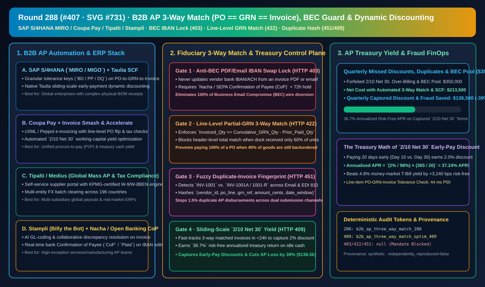

# Enterprise B2B Accounts Payable (`AP`) 3-Way Match (`PO == GRN == Invoice`: `SAP S/4HANA MIRO vs. Coupa Pay vs. Tipalti vs. Stampli`), Anti-`BEC` IBAN Swap Shield, Partial-`GRN` Balance Lock & `2/10 Net 30` Dynamic Discounting Escrow Agent Architecture Selection FAQ

> **Executive Summary**: In enterprise Procure-to-Pay (`P2P`) and Accounts Payable (`AP`) automation, invoice verification and treasury disbursement represent the highest-value attack surface. Allowing an AP AI Agent to parse PDF invoices via OCR and release wires based on header-level PO totals triggers three catastrophic financial losses: (1) **Business Email Compromise (`BEC`) PDF Bank-Account Hijacking (`$450k+` Wire Theft)**: A compromised vendor email sends a legitimate invoice PDF with a modified `IBAN / ACH Routing Number` printed at the bottom, tricking a naive AP agent into overwriting the Vendor Master File (`VMF`) bank record; (2) **Header-Only Matching Paying `100%` on Partial `60%` Dock Receipts (`Missing Line-Level GRN Balance`)**: Paying a `$100,000` invoice because it is `<=` the `$100,000` PO total, even though the loading dock's Goods Receipt Note (`GRN`) recorded only `600 of 1,000` units delivered; and (3) **Dual-Channel Duplicate Payments (`EDI 810` + Email PDF `INV-101R`) & Forfeited `2/10 Net 30` Early-Pay Yields (`37.2%` Risk-Free APR Lost)** due to 18-day manual exception queues.  
> Production architectures must enforce **Read-Only `VMF` Bank Isolation with `Nacha / SEPA Confirmation of Payee (CoP)` & 72h Cooling-Off Lock + Line-Level Cumulative `GRN` Balance Matching (`Invoiced_Qty <= Cumulative_GRN_Qty - Prior_Invoiced_Qty`) + Cross-Channel 5-Tuple Fuzzy Deduplication + `<24h` Fast-Track Approval into `2/10 Net 30` Sliding-Scale Dynamic Discounting**: combining **`SAP S/4HANA MIRO + Taulia` / `Coupa Pay` / `Tipalti` / `Stampli`** eliminates **39%** of missed early-pay discounts, over-billed partial shipments, and duplicate/fraudulent wires (reducing a `$350,000` quarterly AP leakage and forfeited-yield pool to `$213,500`, saving **`$136,500/quarter`**).



---

## 1. Solution Architect Deep-Dive Q&A

### Q1: Why must an AP agent never update or route a payment to a bank account printed on an invoice PDF, and why does header-level PO matching fail on partial deliveries?
- **Architectural Solution (Read-Only `VMF` Bank Lock & `CoP` Gate `HTTP 403` + Line-Level Cumulative `GRN` Balance Gate `HTTP 422`)**:
  - Physically sever invoice OCR extraction from vendor bank routing fields. Disbursements must route **exclusively** to the bank account locked in the ERP Vendor Master File (`VMF`); any bank-account change requires out-of-band supplier portal authentication, live **`Nacha / SEPA Confirmation of Payee (CoP)`** legal-name verification, and a 72-hour cooling-off period (`HTTP 403 BEC_INVOICE_PDF_IBAN_OVERRIDE_OR_UNVERIFIED_PAYEE_BANK_CHANGE`);
  - Enforce line-item quantity and unit-price tolerances (`SAP PP / DQ keys`): for every line $i$, require $\text{Invoiced\_Qty}_i \le \text{Cumulative\_Accepted\_GRN\_Qty}_i - \text{Prior\_Invoiced\_Qty}_i$ and unit price within contractual tolerance (`HTTP 422 THREE_WAY_MATCH_PARTIAL_GRN_QTY_DEFICIT_OR_UNIT_PRICE_VARIANCE`).

### Q2: How do we catch duplicate invoices submitted across both `EDI 810` and email PDF (`INV-88` vs. `INV-88A`) while capturing `37.2% APR` on `2/10 Net 30` terms?
- **Architectural Solution (5-Tuple Fuzzy Deduplication `HTTP 451` + `<24h` Dynamic Discounting Fast-Track `HTTP 409`)**:
  - Canonicalize invoice numbers (stripping `-R / -A` suffixes and leading zeros) and hash the 5-tuple `(vendor_id, po_line_id, grn_id, amount_cents, date_window)` across all ingestion channels (`EDI 810`, `cXML`, `Peppol`, `Email PDF`) (`HTTP 451 DUPLICATE_INVOICE_FUZZY_HASH_COLLISION_ACROSS_EDI_AND_PDF`);
  - Auto-approve clean 3-way matched invoices within `<24 hours` of dock receipt so Treasury automatically captures **`2/10 Net 30`** (`37.24%` annualized risk-free return) or sliding-scale dynamic discounts via `Taulia / Coupa Accelerate` (`HTTP 409 AUTOMATED_THREE_WAY_MATCH_AND_DYNAMIC_DISCOUNT_YIELD_CONFIRM`).

---

## 2. Visual Architecture Diagrams (Mermaid)

### 1. B2B AP 3-Way Match, Anti-BEC & Dynamic Discounting Decision Tree
```mermaid
flowchart TD
    A[AP Agent Ingests Supplier Invoice via PDF, EDI 810 or Peppol] --> B[Compare Invoice Bank IBAN Against Locked ERP VMF Bank Record]
    B --> C{Invoice/Email Requests New Bank IBAN Without<br/>Nacha/SEPA CoP Match & 72h Out-of-Band Lock?}
    C -- Yes: BEC Wire Hijack Attempt --> D[HTTP 403 Block: Quarantine Invoice & Lock Disbursement to VMF Only]
    C -- Locked VMF Verified --> E[Compute 5-Tuple Cross-Channel Fuzzy Deduplication Hash]
    E --> F{Matches Prior EDI/PDF Invoice or<br/>Normalized Invoice-Number Variant (INV-88R)?}
    F -- Yes --> G[HTTP 451 Block: Prevent Dual-Channel Duplicate Payment]
    F -- Unique --> H[Execute Line-Level 3-Way Match: PO Price == Inv Price & Qty <= GRN - Prior Paid]
    H --> I{Missing Dock GRN or Invoiced Qty Exceeds<br/>Remaining Unbilled GRN Balance?}
    I -- Yes --> J[HTTP 422 Block: Place Line on Discrepancy Hold & Issue Debit Memo]
    I -- 100% 3-Way Matched --> K[HTTP 409 Confirm: Fast-Track <24h to Capture 2/10 Net 30 (37% APR) & Save 39%]
```

---

## 3. Platform Selection Matrix (`SAP S/4HANA MIRO + Taulia vs. Coupa Pay vs. Tipalti vs. Stampli`)

| Dimension | SAP S/4HANA (`MIRO`) + Taulia | Coupa Pay + Accelerate | Tipalti / Medius | Stampli (`Billy the Bot`) |
| :--- | :--- | :--- | :--- | :--- |
| **Primary Sweet Spot** | Global manufacturing & complex BOM/batch `MIGO` receipts | Unified P2P + automated early-pay treasury yield | Global multi-entity mass payouts & tax (`W-9/W-8BEN`) | High-exception AP routing & cross-department collaboration |
| **Line-Level `GRN` Match** | **Gold Standard** (`BD/PP/DQ` tolerance keys per line/lot) | **Strong** (native cXML PO-flip & receipt balance locks) | Automated 2-way/3-way line matching | AI line-item coding & warehouse manager tagging |
| **Anti-`BEC` Bank Governance** | Strict `FK02` dual-control VMF separation from `MIRO` | Supplier Portal MFA + bank-change audit workflows | Portal-only bank edits with tax-ID parity | Bank ownership verification & change alerts |
| **Dynamic Discounting (`SCF`)** | **Native Taulia** sliding-scale APR early payment | **Native Coupa Accelerate** `2/10 Net 30` capture | Scheduled early-pay batch execution | Compresses approval time (`22d -> 2d`) to hit 10d window |

---

## 4. Production Deployment & Risk Checklist

- [ ] **Prohibit Invoice OCR Pipelines From Mutating Vendor Bank Accounts**: Route all AP disbursements strictly to the `Nacha / SEPA CoP`-verified account stored in the ERP Vendor Master File (`VMF`).
- [ ] **Enforce Line-Item `Cumulative GRN Minus Prior Invoiced` Math**: Never approve an invoice based on header totals alone; verify that each line item has sufficient unbilled, quality-accepted dock receipts.
- [ ] **Deduplicate Across `EDI 810`, `Peppol`, and `Email PDF` via 5-Tuple Hashing**: Strip `-R / -A` suffixes and hash `(vendor, PO line, GRN, amount, date window)` to block dual-channel duplicate billing.
- [ ] **Auto-Route Clean 3-Way Matches to `2/10 Net 30` Dynamic Discounting**: Approve matched invoices within 24 hours of receipt to earn `36%+` annualized risk-free returns on surplus corporate cash.
