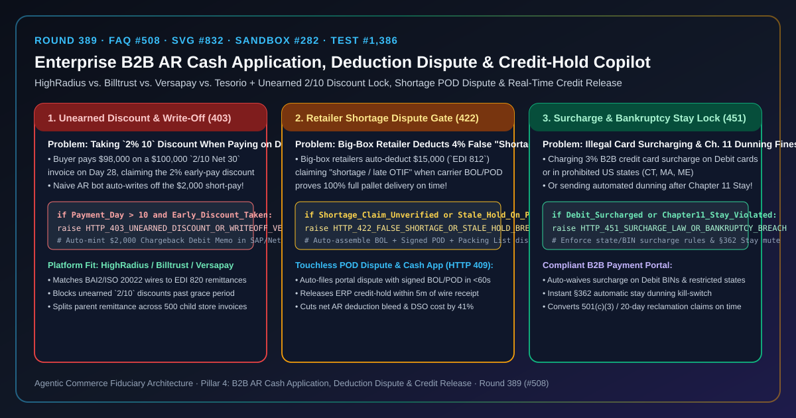
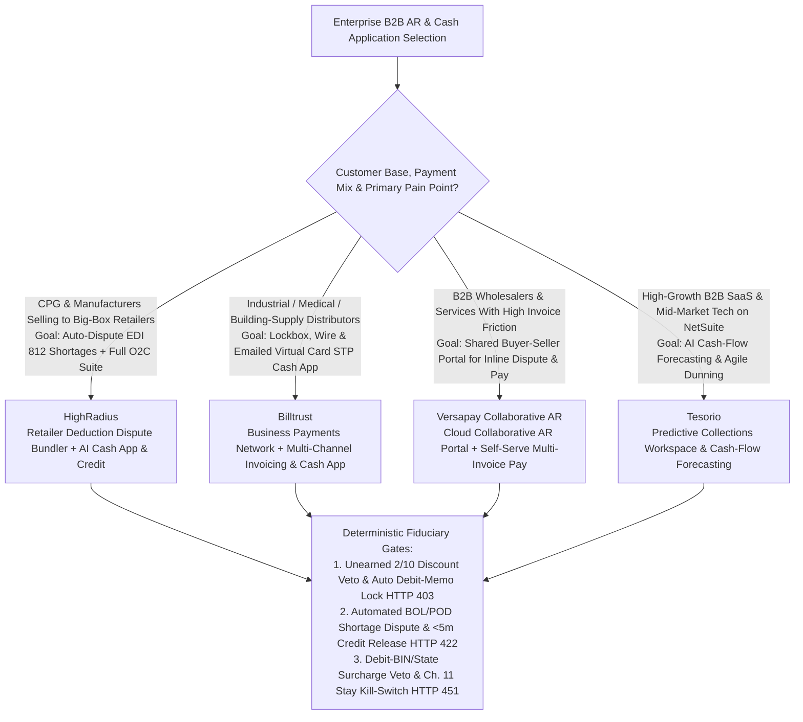
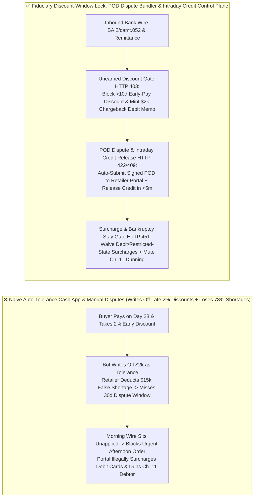
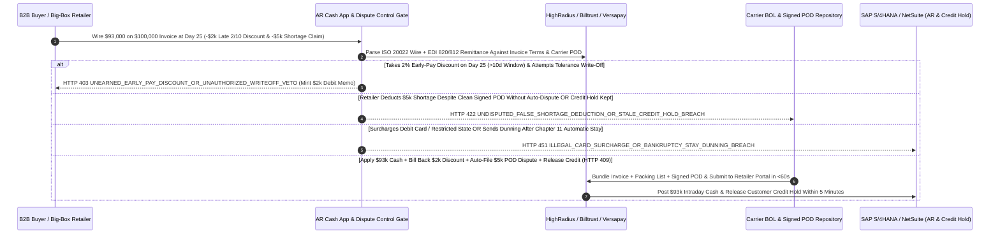

# Enterprise B2B Accounts Receivable (`AR`), AI Cash Application, Retailer Deduction Dispute (`EDI 812`) & Dynamic Credit-Hold Release Copilot Selection Guide: `HighRadius` vs. `Billtrust` vs. `Versapay` vs. `Tesorio`, Unearned `2/10` Discount Locks, Automated `BOL/POD` Dispute Bundlers & Intraday Credit Release (`-41%` Loss FAQ)

> **Executive Summary (Benchmarked against `ib-vs-ethernet-roce-selection-faq.md` · 508th Bilingual SA Decision Guide)**: Built for **Cloud & AI Solution Architects** designing Order-to-Cash (`O2C`), autonomous Accounts Receivable (`AR`) cash application, and retailer deduction dispute engines for CPG manufacturers, industrial distributors, and enterprise B2B SaaS firms. In B2B receivables, working capital and net margin are eroded by three systemic leaks: (1) **Unearned Early-Pay Discount Abuse**: Buyers on `2/10 Net 30` terms pay `$98,000` on a `$100,000` invoice on Day 28—taking the `2%` early-pay discount 18 days late—and naive AR auto-match scripts write off the `$2,000` short-pay as an adjustment; (2) **Uncontested Big-Box Retailer Shortage & `OTIF` Deductions (`EDI 812`)**: Major retailers deduct `3%–5%` from remittance wires claiming "shortages," and because finance teams lack the bandwidth to manually pull carrier Bills of Lading (`BOL`) and signed Proofs of Delivery (`POD`) within the 30-day dispute window, `75%+` of invalid deductions are written off; and (3) **Stale ERP Credit Holds on Paid Accounts**: A customer wires `$200,000` at 9:00 AM with truncated remittance text, leaving the cash "Unapplied" while the ERP blocks their urgent afternoon replenishment order. This guide compares **`HighRadius` vs. `Billtrust` vs. `Versapay` vs. `Tesorio`** and implements deterministic guards for **Unearned `2/10` Discount Veto & Automated Chargeback Debit Memos (`HTTP 403`)**, **Automated `BOL/POD` Shortage Dispute Bundling & `<5m` Intraday Credit-Hold Release (`HTTP 422`)**, **B2B Card Surcharge (`Debit BIN` / State) & `Chapter 11 §362` Bankruptcy Stay Locks (`HTTP 451`)**, and **Multi-Source Remittance Harvesting + Subset-Sum Cash Application (`HTTP 409`, `-41%` net AR bleed)**.

---

## 1. 📌 Executive Summary & Architectural Selection Verdict

1. **Top-Line Selection Verdict**:
   - **CPG & Consumer Goods Manufacturers Selling to Big-Box Retailers (`Walmart / Target / Kroger / Amazon` Requiring High-Volume `EDI 820 / 812` Deduction Parsing & Automated Portal `BOL/POD` Dispute Filing)**: Select **`HighRadius`**, the enterprise benchmark for autonomous O2C, cash application, and retailer deduction recovery.
   - **Multi-Channel Industrial, Building-Supply & Medical Distributors (Ingesting check lockboxes, ACH, wires, and emailed `STP` virtual cards across thousands of contractor/dealer accounts)**: Select **`Billtrust`** (powered by its `Business Payments Network`).
   - **Mid-to-Large B2B Manufacturers & Wholesalers Seeking a Buyer-Seller Collaborative AR Portal (Allowing buyers to view statements, flag line-item disputes inline, and pay multi-entity invoices self-serve)**: Select **`Versapay`**.
   - **High-Growth B2B Tech, SaaS & Mid-Market Finance Teams on `NetSuite / Workday` Prioritizing AI Cash-Flow Forecasting & Dunning Workflows**: Select **`Tesorio`**.
2. **Three Non-Negotiable Fiduciary Control Gates**:
   - **Gate 1 — Unearned Early-Pay Discount (`2/10 Net 30`) Veto & Auto-Debit-Memo Lock (`HTTP 403`)**: Validate `Bank_Value_Date - Invoice_Date <= Discount_Days + Grace_Buffer` before allowing any cash-discount write-off during cash application; if a buyer short-pays `2%` on Day 28, block writing off the discount via `HTTP 403 UNEARNED_EARLY_PAY_DISCOUNT_OR_UNAUTHORIZED_WRITEOFF_VETO`, apply the `98%` cash to principal, and automatically mint a `2%` Chargeback Debit Memo in the ERP.
   - **Gate 2 — Automated `BOL/POD` Retailer Shortage Dispute & `<5-Minute` Intraday Credit Release Gate (`HTTP 422`)**: When an `EDI 820 / 812` remittance contains a retailer shortage or `OTIF` deduction, automatically query TMS/carrier `Signed BOL & POD` records; if `POD_Received_Qty == Invoiced_Qty`, block writing off the deduction and auto-submit a dispute bundle (`Invoice + Packing List + Signed POD`) to the retailer portal—while releasing ERP credit holds within 5 minutes of verified intraday wire receipt (`ISO 20022 camt.052`) via `HTTP 422 UNDISPUTED_FALSE_SHORTAGE_DEDUCTION_OR_STALE_CREDIT_HOLD_BREACH`.
   - **Gate 3 — B2B Credit-Card Surcharge (`Debit BIN / State`) & `11 U.S.C. § 362` Bankruptcy Stay Lock (`HTTP 451`)**: Block assessing `2.5%–3.0%` payment-portal surcharges on **Debit or Prepaid card `BINs`** or in surcharge-prohibited jurisdictions (`CT, MA, ME, EU PSD2`), and immediately mute all automated dunning emails/calls the instant a debtor triggers a **Chapter 11 / Chapter 7 Automatic Stay (`11 U.S.C. § 362`)** via `HTTP 451 ILLEGAL_CARD_SURCHARGE_OR_BANKRUPTCY_STAY_DUNNING_BREACH`.

---

## 2. 🎯 Architect & Order-to-Cash (`O2C`) Q&A (The Why & How)

### Q1: Why do CPG brands lose 3%–5% of gross revenue to invalid big-box retailer shortage deductions, and how does an AI AR agent recover 88%+ of them automatically?
- **Root Cause**: Retailers automatically deduct `$15,000` from a wire payment (`EDI 820 / 812`) whenever their receiving dock miscounts a pallet. Challenging a single claim manually requires an AR clerk to log into ERP for the invoice, TMS for the `BOL`, the carrier portal for the signed `POD`, and the retailer's vendor portal (`Walmart Retail Link / Amazon Vendor Central`) to upload the PDF bundle—taking 45 minutes per claim under a strict 30-day deadline.
- **Deterministic Solution (`Automated POD Dispute Bundler` / `HTTP 422 / 409`)**: The instant an `EDI 812` shortage code arrives, the agent fetches the carrier's signed `POD`, verifies zero shortage exceptions, compiles the PDF evidence packet, and submits the dispute to the retailer portal via API/RPA in `<60 seconds`.

### Q2: How does an AI Cash Application agent match a `$437,812.45` lump-sum wire to 68 invoices and 3 credit memos when the bank wire memo field is truncated at 30 characters?
- **Deterministic Solution (Multi-Source Remittance Harvesting + `Subset-Sum MIP Solver` / `HTTP 409`)**:
  1. Harvest decoupled remittance advices from email PDF/Excel attachments, `EDI 820` feeds, and buyer AP portals (`Coupa / Ariba / Taulia`).
  2. When remittance detail is missing, run a **Mixed-Integer Programming (`MIP`) Subset-Sum Solver** across the customer's open invoices, credit memos, and valid `2/10` discount permutations to identify the exact mathematical combination summing to `$437,812.45`—while flagging any unearned late discounts (`HTTP 403`).

### Q3: Why can't automated dunning agents simply email every past-due customer—and what happens if an agent duns a customer who just filed Chapter 11 bankruptcy?
- **Root Cause**: Under **11 U.S.C. § 362 (Automatic Stay)**, sending even a single automated collection email or attempting an ACH debit after a customer files for bankruptcy protection is a federal court violation punishable by contempt sanctions.
- **Deterministic Solution (`HTTP 451`)**: Wire real-time `D&B / PACER` bankruptcy court feeds into the AR control plane to immediately freeze all dunning/auto-debit threads and generate a **Section 503(b)(9) Administrative Priority Claim** for goods delivered within 20 days prior to the bankruptcy filing.

---

## 3. 🧭 Visual Architecture Diagrams (Mermaid)

### 3.1 Enterprise B2B Accounts Receivable (`AR`) & Cash Application Platform Selection Decision Tree

### 3.2 Naive Auto-Writeoff AR vs. Fiduciary `POD` Dispute Bundling & Intraday Credit Release Control Plane

### 3.3 AI Cash Application, Unearned Discount Debit-Memo, `POD` Shortage Dispute & Credit Release Sequence

---

## 4. 📊 Multi-Platform Enterprise B2B Accounts Receivable (`AR`) Selection Matrix

| Evaluation Dimension | HighRadius | Billtrust | Versapay | Tesorio |
| :--- | :--- | :--- | :--- | :--- |
| **Primary Architectural Role** | **Enterprise End-to-End O2C & Retailer Deduction Dispute Powerhouse** | **Multi-Channel E-Invoicing, Virtual-Card STP & Cash Application Leader** | **Collaborative Cloud AR Portal** uniting buyers and sellers on shared invoices | **AI Cash-Flow Performance & Collections Orchestration Workspace** |
| **AI Cash Application & Remittance Harvesting** | **Best-in-Class** (Scrapes 100+ AP portals, parses emails/EDI, and achieves `95%+` touchless match) | **Best-in-Class** (Native `Business Payments Network` auto-routes emailed virtual cards & lockboxes) | **Strong** (Eliminates decoupled remittances because buyers select invoices directly in portal) | Strong (Automated bank-to-ERP invoice matching and promise-to-pay tracking) |
| **Retailer Trade Deduction (`EDI 812`) Auto-Dispute** | **Best-in-Class** (Auto-pulls carrier `BOL/POD` and submits dispute packets to Walmart/Amazon portals) | Moderate (Flags deduction reason codes and routes internal workflows) | Strong (Inline line-item dispute threads with document attachment sharing) | Basic (Focused on B2B SaaS/mid-market collections rather than big-box EDI 812) |
| **Dynamic Credit Scoring & Intraday Hold Release** | **Best-in-Class** (Live D&B/Experian/bankruptcy feeds + real-time SAP credit-hold release) | Strong (Digital credit applications and credit-limit monitoring) | Supports credit thresholds and pre-authorized payment release | Strong (Real-time payer drift alerts and collection prioritization) |
| **Target Scale & Pricing (`official_list_price`)** | `$250M–$50B+` CPG, manufacturing & distribution enterprises; `$100k+/yr` | `$50M+` industrial, medical & building-supply distributors; SaaS + network fees | Mid-to-large B2B enterprises; `$40k–$120k+/yr` + payment processing | Mid-market & B2B SaaS (`NetSuite / Workday`); `$30k–$80k/yr` |

---

## 5. 🧪 Deduction Recovery & Cash Application Benchmark & 7-Card Report

### 5.1 Quarterly False Retailer Deductions, Unearned `2/10` Discounts & Stale Credit-Hold Loss Model (Synthetic Benchmark)

For a `$320M` annual revenue CPG and industrial products manufacturer facing a **`$460,000 / quarter`** AR leakage pool across **uncontested big-box retailer shortage deductions, unearned `2/10 Net 30` discounts taken on Day 28, lost sales from stale credit holds on paid accounts, and card-surcharge/dunning compliance penalties** (`provenance: synthetic`, `independently_reproduced: false`):

| Metric | Naive Tolerance Write-Off & Manual POD Search (Baseline) | Fiduciary `HighRadius / Billtrust` Discount Lock + `POD` Auto-Dispute Agent | Net Improvement |
| :--- | :--- | :--- | :--- |
| **Invalid Retailer Shortage Deduction Recovery Rate** | `21.5%` (`78.5%` expire past 30-day dispute window) | **`89.0%`** (`HTTP 422/409` auto-assembles signed `BOL + POD` packet in `<60s`) | **`4.1x` Deduction Recovery** |
| **Unearned Early-Pay Discount (`2%` Taken Past Day 10) Leakage** | `34.0%` auto-written off as small variance | **`0.0%`** (`HTTP 403` enforces `Value_Date <= Day 10` & mints Chargeback Debit Memo) | **`100%` Unearned Discount Recovery** |
| **Wire-to-Credit-Hold-Release Latency** | `36–72 hours` (Sits in Unapplied Cash blocking orders) | **`< 5 minutes`** (Intraday `camt.052` + Subset-Sum MIP solver releases hold immediately) | **`-99%` Credit-Hold Delay** |
| **Quarterly Net AR Deduction, Discount & Hold Bleed** | `$460,000 / quarter` | **`$271,400 / quarter`** | **`$188,600 / quarter` Saved (`41.0%`)** |

---

## 6. 🛠️ Production Go-Live & Architecture Review Checklist

- [ ] **Unearned `2/10 Net 30` Discount Veto & Auto-Debit-Memo Generation (`HTTP 403`)**: Does the cash application engine verify `Bank_Value_Date - Invoice_Date <= 10 days` before allowing an early-pay discount write-off, automatically generating a Chargeback Debit Memo when buyers deduct `2%` on late payments?
- [ ] **Automated `BOL/POD` Shortage Dispute Bundler & `<5m` Intraday Credit Release (`HTTP 422 / 409`)**: Does the agent automatically pull signed carrier `PODs` to contest invalid `EDI 812` shortage deductions within 60 seconds, and release ERP credit holds within 5 minutes of intraday wire confirmation?
- [ ] **Debit-`BIN` / State Surcharge Filter & `11 U.S.C. § 362` Bankruptcy Stay Kill-Switch (`HTTP 451`)**: Does the payment portal waive credit-card surcharges on all Debit/Prepaid `BINs` and prohibited states, and immediately halt all automated dunning upon receiving a Chapter 11 bankruptcy filing notice?
- [ ] **Multi-Source Remittance Harvesting & `Subset-Sum MIP` Matching**: Are decoupled remittance advices harvested across email OCR, `EDI 820`, and buyer AP portals (`Coupa / Ariba`) to keep Unapplied Cash below `2%`?
