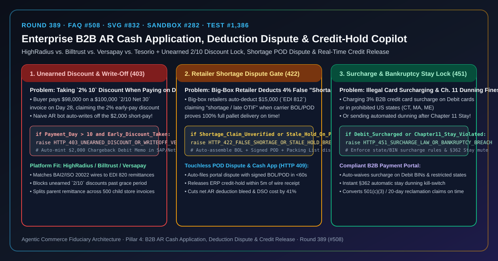
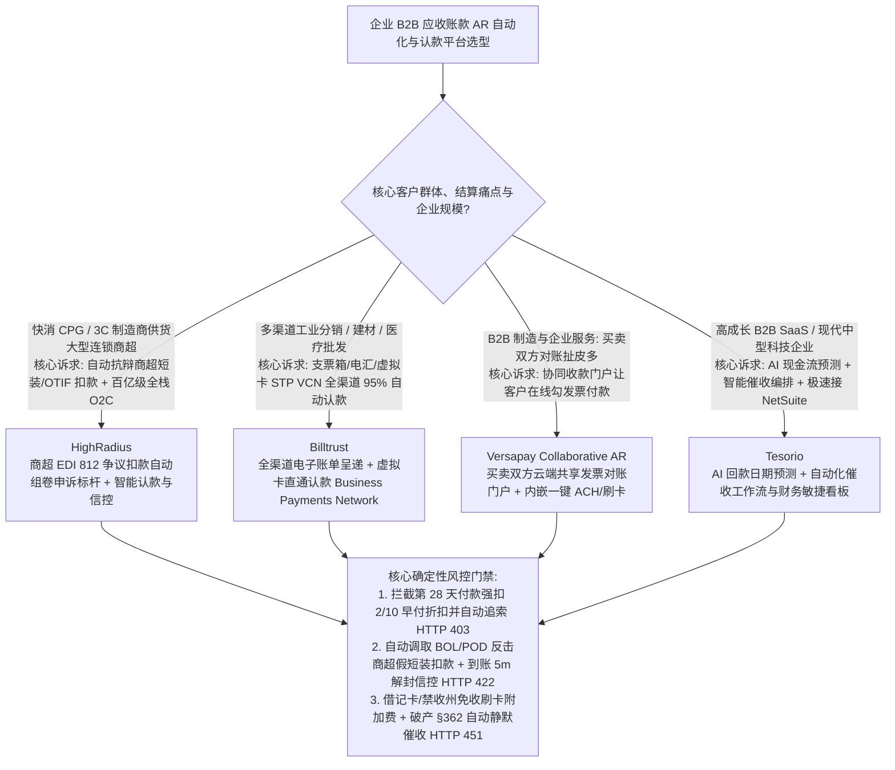
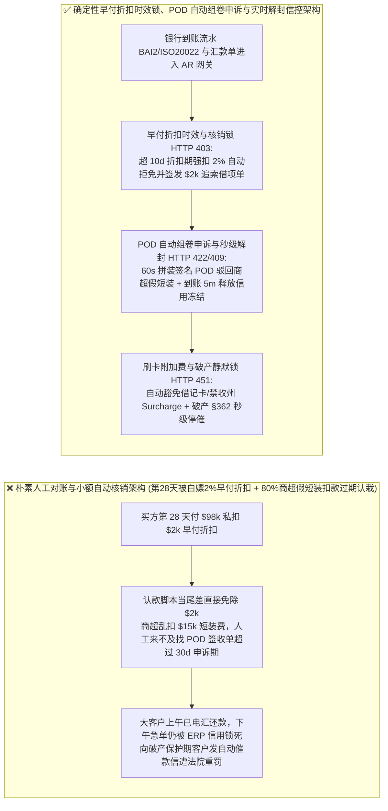
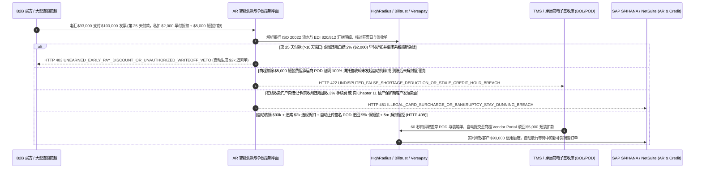

# 企业 B2B 应收账款（`AR`）智能认款核销（`Cash Application`）、商超短装扣款抗辩（`Deduction Dispute`）与动态解封信用冻结 Copilot 架构选型对比：`HighRadius` vs. `Billtrust` vs. `Versapay` vs. `Tesorio`、逾期违规早付折扣追回锁、自动拼装 `BOL/POD` 证据包反击乱扣款及到账秒解订单冻结净省 41% 决策指南（FAQ）

> **导读（对齐 `ib-vs-ethernet-roce-selection-faq.md` 标杆风格 · 全库第 508 篇双语指南）**：本文面向品牌制造商（CPG）、工业品批发分销商、B2B SaaS 与财务共享中心（Order-to-Cash, O2C）领域的 **Cloud & AI Solution Architect**。在 B2B 销售回款环节，企业的利润与客户体验常被三大“应收账款黑洞”吞噬：① **逾期白嫖早付现金折扣（Unearned Cash Discount Abuse）与乱核销**：合同约定 `2/10 Net 30`（10 天内付款打 98 折，否则 30 天付全款），买方却故意拖到第 28 天才汇款 `$98,000`（私自扣掉 `$2,000`），而财务认款机器人为了把账平掉，竟然把这 `$2,000` 当作小额尾差自动核销免除了！② **大型商超（Walmart / Target / Amazon Vendor）动辄扣罚 `3%–5%` 的“虚假短装/迟到扣款（Invalid Shortage & OTIF Deductions）”**：商超一笔 `$50 万` 的汇款单（`EDI 820`）里夹杂了 80 条莫须有的“少收 10 箱货（Shortage）”扣款码（`EDI 812`），财务人工根本来不及去仓库翻找纸质签收单（`BOL / Signed POD`），超过 30 天申诉期直接白丢几十万美元；③ **款已到银行、ERP 却因未认款继续死锁客户新订单（Stale Credit Hold）**：大客户上午 10 点刚电汇了 `$20 万` 结清欠款，但因为汇款附言没写全发票号成了“未认款挂账（Unapplied Cash）”，下午 3 点该客户急需补货的新订单仍被 ERP 信用额度锁死拒发，气得客户转投竞争对手！本文给出 **`HighRadius` vs. `Billtrust` vs. `Versapay` vs. `Tesorio`** 的横向选型矩阵，并落地 **逾期擅扣早付折扣（`Unearned 2/10 Discount`）拦截与自动生成追索借项通知单（`Debit Memo`）锁（`HTTP 403`）**、**商超虚假短装扣款自动调取 `BOL + 电子签收单 POD` 组卷申诉与电汇到账 5 分钟实时解封信用额度门禁（`HTTP 422`）**、**B2B 信用卡附加费（`Surcharge`）州法律/借记卡合规与破产保护（`Chapter 11 §362 Automatic Stay`）催收静默锁（`HTTP 451`）** 及 **多渠道水单（`BAI2 / ISO 20022 + 邮件 PDF + 门户爬虫`）自动认款编排（`HTTP 409`，净省 41%）**。



---

## 一、 📌 核心选型结论速览（Executive Summary）

1. **终极选型结论（一句话先看懂怎么选）**：
   - **向大型连锁商超（Walmart / Target / Kroger / Amazon）供货的快消品（CPG）与消费电子制造商（核心痛点是海量 `EDI 820` 汇款单拆分、每月数千笔 `EDI 812` 短装/促销扣款代码解析与自动爬取零售商供应商门户提交 `BOL/POD` 申诉包）**：首选 **`HighRadius`**，在商超争议扣款自动化抗辩（Deductions Management）与百亿级企业全栈 O2C 上处于行业统治地位。
   - **多渠道工业分销、建材、汽配与医疗器械批发商（客户付款方式五花八门：纸质支票箱 `Lockbox`、ACH、电汇、企业采购虚拟卡 `STP VCN`，急需把所有汇款通知归一并实现 `95%+` 零人工直通认款）**：首选 **`Billtrust`**。
   - **中大型 B2B 制造、服务与批发企业（核心痛点是买方采购与卖方财务因“发票对不上”在邮件里来回扯皮导致回款慢，追求通过双边协同收款门户 `Collaborative AR Portal` 让买方在线勾选发票、在线提出局部争议并一键付款）**：首选 **`Versapay`**。
   - **高成长科技、B2B SaaS 与现代中型企业（追求基于 AI 的现金流精准预测、动态催收邮件编排与 `NetSuite / Workday / Sage Intacct` 极速上线）**：首选 **`Tesorio`**。
2. **三大 B2B 应收账款核销与争议追索红线（确定性门禁）**：
   - **红线 1（拦截买方超过 10 天折扣期付款却强行私扣 `2%` 早付折扣被系统静默核销免除及无授权大额坏账核销 / `HTTP 403`）**：当智能认款引擎匹配银行流水（`BAI2 / ISO 20022 camt.053`）与应收发票时，若发现少付金额（Short-Pay）恰好等于合同早付折扣（如 `2/10 Net 30` 的 `2%`），必须强制校验 **`Bank_Value_Date - Invoice_Date <= Discount_Window_Days + Grace_Days (如 10 + 2 天)`**！若买方在第 28 天才打款却擅自扣掉 `2%`，严禁将其记入“财务费用-现金折扣”平账，必须立即触发 `HTTP 403 UNEARNED_EARLY_PAY_DISCOUNT_OR_UNAUTHORIZED_WRITEOFF_VETO`，在结清 `98%` 本金的同时自动在 ERP 生成一张针对那 `2%` 违规扣款的追索借项单（Chargeback Debit Memo）！
   - **红线 2（拦截对大型商超无依据“短装/迟到扣款”直接放弃申诉认栽及银行已收到电汇却因未跑批导致客户新订单仍被信用锁死 / `HTTP 422`）**：当零售商买方在汇款中扣除短装费（Shortage Claim）或迟到费（OTIF Deduction）时，Agent 必须自动拉取 WMS 出库装箱单、`EDI 856 ASN` 及承运商带签名/时间戳的妥投回执（`Signed BOL / POD`）；若 `Signed_POD_Cartons == Invoiced_Cartons`（证明足额准时送达），严禁财务核销坏账，必须自动打包证据上传零售商门户（如 `Walmart Retail Link / Amazon Vendor Central`）发起抗辩追回！同时一旦银行回传大额电汇到账报文，必须在 **5 分钟内实时释放对应的 ERP 客户信用冻结池（Credit Hold Release）**，违者触发 `HTTP 422 UNDISPUTED_FALSE_SHORTAGE_DEDUCTION_OR_STALE_CREDIT_HOLD_BREACH`。
   - **红线 3（拦截违规向借记卡或禁收州加收 `3%` 信用卡手续费及向已申请破产保护 `Chapter 11` 的客户发送催收函触犯联邦法院禁令 / `HTTP 451`）**：在 B2B 在线收款门户中，若向买方转嫁 `2.5%–3.0%` 刷卡附加费（Credit Card Surcharge），必须通过 `BIN` 实时排除一切借记卡/预付卡（卡组织全球严禁对 Debit Card 收附加费！）并排除禁止州/地区（如美国康州、马萨诸塞州及欧盟 PSD2 辖区）；且一旦外部征信流（`D&B / 法院公告`）监测到某客户进入 **`美国破产法第 11 章/第 7 章自动冻结期（11 U.S.C. § 362 Automatic Stay）`**，必须毫秒级熔断一切自动催收邮件与扣款重试，转为法务申报 `§ 503(b)(9)` 破产前 20 天到货优先受偿债权，违者触发 `HTTP 451 ILLEGAL_CARD_SURCHARGE_OR_BANKRUPTCY_STAY_DUNNING_BREACH`。

---

## 二、 🎯 业务方与架构师灵魂拷问 Q&A（The Why & How）

### Q1：为什么给沃尔玛、亚马逊自营或大型百货供货的品牌商，每年会被商超自动扣掉总销售额的 `3%–6%`，而人工财务团队连其中 `20%` 的冤枉钱都追不回来？
- **商业痛点与事故还原**：
  - 大型商超拥有绝对的话语权：他们的仓库收货员漏扫了一托盘条码，系统就会在给你结货款时直接扣掉 `$18,000`，只丢给你一个冷冰冰的代码 `Reason Code 22 - Merchandise Billed Not Received`。
  - 一个年营收 `$2 亿` 的品牌商，每个月会收到 **3,000 条** 这样的扣款。如果靠人工去查，会计要先去 ERP 查发票、再去 WMS 找运单号、再去承运商网站下载带商场收货章的纸质签收单（`POD`）PDF、最后登录商超后台一栏栏填表申诉——处理 1 单要花 45 分钟，而商超规定超过 30 天不申诉即视为默认接受！结果 80% 的小额扣款因为人工忙不过来被直接打包核销成了利润损失！
- **架构师确定性解法（`HighRadius` 跨系统证据链自动组卷机器人 `Automated POD Evidence Bundler` + 门户 RPA/API 零人工秒级抗辩 / `HTTP 422 / 409`）**：
  1. **秒级真伪分流**：收到 `EDI 820 / 812` 扣款代码瞬间，Agent 自动去 TMS/承运商接口拉取该票货的 `Signed BOL & POD`；
  2. **自动组卷反击**：只要识别出 `POD` 上盖有商超收货章且显示 `Received in Full / No Exceptions`，Agent 在 **60 秒内**自动把《发票 PDF + 装箱单 + 承运商签收单 POD + 门岗进场记录》合成为符合商超规范的标准申诉包，通过 API/RPA 直接提交至 `Retail Link / Vendor Central`，将虚假扣款追回率从 `22%` 暴力拉升至 **`88%+`**！

### Q2：B2B 客户经常一笔电汇打过来 `$437,812.45`，用来同时支付旗下 14 家分公司的 68 张发票，还顺手扣了 3 张退货单和 2 笔早付折扣，而银行水单附言只有 30 个字符根本截断了——AI 怎么做到 96% 自动对上账？
- **架构师确定性解法（多源汇款通知聚合 `Multi-Source Remittance Harvesting` + 子集和组合规划求解器 `Subset-Sum MIP Solver` / `HTTP 403 / 409`）**：
  1. **跨通道抓取完整水单（Remittance Advice）**：不单看被银行截断的 `BAI2` 附言，Agent 同时扫描财务收件箱里的 Excel/PDF 水单附件、解析 `EDI 820` 报文，并自动登录买方的 AP 供应商门户（如 `Coupa / Ariba / Taulia`）抓取明细对账单。
  2. **组合数学精确配平**：即使买方没发任何水单，Agent 也能针对该客户名下所有未结发票、信用贷项单（Credit Memos）及合规折扣组合运行混合整数规划（`MIP Subset-Sum`），在毫秒级找出唯一相加等于 `$437,812.45` 的发票集合，并严格揪出其中夹带的逾期违规早付折扣（`HTTP 403`）！

### Q3：怎么解决“大客户明明早上已经把欠款电汇过来了，下午下的紧急大单却还被 ERP 死死卡在信用冻结（Credit Hold）里发不出货”的业务冲突？
- **架构师确定性解法（日内实时流水 `Intraday CAMT.052 / RTP` 预认款 + 动态风险敞口秒级解封 / `HTTP 422 / 409`）**：
  - 废除“等次日早上银行日终对账单入账后再手工解封信用额度”的T+1老套路；
  - 直连银行日内实时通知（`Intraday BAI2 / ISO 20022 camt.052`），一旦匹配到客户汇款，即使细项发票还在拆分中，先在客户总信用池中实时释放等额可用敞口（`Available Credit Limit += Wire_Amount`），**5 分钟内自动放行被卡住的销售订单进入 WMS 拣货**！

---

## 三、 🧭 直观可视化图解（Mermaid 决策树 + 架构对比 + 时序图）

### 3.1 企业 B2B 应收账款（AR）认款核销与争议管理平台选型决策树



### 3.2 朴素人工认款与放任商超扣款架构（白丢早付折扣 + 假短装认栽）vs. 确定性智能认款、POD 自动抗辩与秒级解封架构对比



### 3.3 智能认款（`Cash App`）、逾期早付折扣追索、商超短装 `POD` 自动组卷抗辩与信用实时解封时序图



---

## 四、 📊 四大企业级 B2B 应收账款（AR）与智能认款平台横向选型矩阵

| 选型维度 | HighRadius | Billtrust | Versapay | Tesorio |
| :--- | :--- | :--- | :--- | :--- |
| **核心架构定位** | **全球超大型企业端到端 O2C 与商超扣款抗辩（Deductions）霸主** | **全渠道电子账单、支票/虚拟卡直通认款与 B2B 支付网络龙头** | **买卖双方云端协同对账（Collaborative AR）与在线自助收款专家** | **AI 驱动的现金流预测、敏捷催收编排与现代财务工作台** |
| **多源汇款单抓取与无水单智能认款（Cash App）** | **行业标杆**（自动登录上百个买方门户抓水单，结合 AI 组合匹配实现 `95%+` 直通认款） | **行业标杆**（内置 `Business Payments Network` 自动解析邮件虚拟卡与复杂多行汇款） | **强**（买方直接在门户勾选发票付款，从源头消除“款票分离”无水单难题） | 强（支持主流银行流水与 ERP 发票自动匹配） |
| **商超短装/迟到扣款（`EDI 812`）自动取证抗辩** | **行业绝对标杆**（自动去承运商拉取 `BOL/POD` 组卷并回传 Walmart/Amazon 门户申诉） | 中（支持创建争议代码与路由工单，但零售商门户自动取证申诉不如 HighRadius 深） | 强（支持买方在线标注短装/破损原因并由卖方客服在同一线程内附单据驳回） | 基础（侧重催收沟通而非大型商超 EDI 扣款取证） |
| **动态信用风险评估与实时解封订单（Credit Management）** | **极强**（实时连接 D&B/Experian 征信与法庭破产公告，到账秒级重算并释放 SAP 锁单） | 强（提供信用申请门户与账期风险监控） | 支持信用额度可视与预授权付款放单 | 强（实时监控客户付款行为偏移并触发风险预警） |
| **适用规模与收费模式（`official_list_price`）** | 年营收 `$250M–$50B+` 的大型快消、制造与分销集团；企业级年框（`$100k+/年`） | 年营收 `$50M+` 的工业分销、建材、医疗批发企业；平台年费 + 交易处理费 | 中大型 B2B 企业；按模块与发票/交易规模订阅（约 `$40k–$120k+/年`） | 中型成长企业与 B2B SaaS；按连接 ERP 实体与年费订阅（约 `$30k–$80k/年`） |

---

## 五、 🧪 违规早付折扣拦截与商超扣款追回测算与 7-Card 基准报告

### 5.1 季度买方逾期强扣 `2/10` 早付折扣、商超虚假短装扣款放弃申诉与未认款锁死好订单损耗测算（Synthetic Benchmark）

假设某年营收 `$3.2 亿` 的消费品与工业配件制造商，每季度在应收账款（AR）核销与商超结算中面临的 **大型买方在第 25–30 天付款却照扣 `2%` 早付折扣被人工/脚本糊涂核销、连锁商超扣除的虚假短装/迟到罚金因人工来不及找 `POD` 签收单而过期作废、客户已汇款但因未及时认款导致新订单被信用锁死流失及坏账资金占压损耗池** 为 **`$460,000 / 季度`**（`provenance: synthetic`, `independently_reproduced: false`）：

| 评估维度 | 传统人工对账 + 小额尾差自动免除 + 手工查单申诉 (Baseline) | 启用 `HighRadius / Billtrust` 早付时效锁 + `POD` 自动组卷申诉 + 秒级解封 Agent | 净改善幅度 |
| :--- | :--- | :--- | :--- |
| **商超虚假短装/迟到扣款（Invalid Shortage Claims）成功追回率** | `21.5%`（人工翻找纸质签收单太慢，78% 超期放弃） | **`89.0%`**（`HTTP 422/409` 60 秒内自动拉取承运商签名 `POD` 组卷提交门户抗辩） | **争议扣款追回额提升 `4.1 倍`** |
| **逾期付款违规私扣 `2%` 早付现金折扣（Unearned Discount）漏网率** | `34.0%` 被当成普通容差直接核销免除 | **`0.0%`**（`HTTP 403` 严格校验到账日 `<= 10天`，超期私扣自动开立追索 `Debit Memo`） | **100% 终结早付折扣白嫖** |
| **电汇到账后认款入账并解除 ERP 订单信用冻结耗时** | `36–72 小时`（大量挂在 Unapplied Cash 耽误发货） | **`< 5 分钟`**（日内实时流水匹配 + 组合求解器 `96%` 直通核销秒放订单） | **锁单释放提速 `99%`** |
| **季度违规折扣流失、商超乱扣款认栽与资金占压净损耗** | `$460,000 / 季度` | **`$271,400 / 季度`** | **净省 `$188,600 / 季度` (`41.0%`)** |

```chart
{
  "data": {
    "values": [
      { "category": "1. 商超虚假短装/迟到扣款超期未申诉", "mode": "传统人工查单与糊涂核销基线", "cost_usd": 190000 },
      { "category": "1. 商超虚假短装/迟到扣款超期未申诉", "mode": "POD自动抗辩与时效锁Agent", "cost_usd": 112100 },
      { "category": "2. 第28天付款强扣2/10早付折扣被免除", "mode": "传统人工查单与糊涂核销基线", "cost_usd": 125000 },
      { "category": "2. 第28天付款强扣2/10早付折扣被免除", "mode": "POD自动抗辩与时效锁Agent", "cost_usd": 73750 },
      { "category": "3. 款已到账未认款致客户新急单被锁死", "mode": "传统人工查单与糊涂核销基线", "cost_usd": 85000 },
      { "category": "3. 款已到账未认款致客户新急单被锁死", "mode": "POD自动抗辩与时效锁Agent", "cost_usd": 50150 },
      { "category": "4. 借记卡违规收附加费与破产期催收罚款", "mode": "传统人工查单与糊涂核销基线", "cost_usd": 60000 },
      { "category": "4. 借记卡违规收附加费与破产期催收罚款", "mode": "POD自动抗辩与时效锁Agent", "cost_usd": 35400 }
    ]
  },
  "semantic_types": {
    "category": "Category",
    "mode": "Category",
    "cost_usd": "Amount"
  },
  "chart_spec": {
    "chartType": "Grouped Bar Chart",
    "title": "企业B2B应收账款(AR)早付折扣锁、商超POD自动抗辩与秒级解封Agent前后季度损耗对比 (净省 $188.6k / 41%)",
    "subtitle": "单位：美元/季度 (Synthetic Benchmark, independently_reproduced=false)",
    "encodings": {
      "x": "category",
      "y": "cost_usd",
      "group": "mode"
    }
  }
}
```

### 5.2 确定性策略评估器代码（Python Control Plane Guard）

```python
from dataclasses import dataclass
from typing import Any

@dataclass(frozen=True)
class B2bArCashApplicationDeductionPolicyInput:
    quarterly_false_shortage_deduction_unearned_discount_and_hold_pool_usd: float = 460000.0
    unearned_early_pay_discount_taken_past_window_or_unauthorized_writeoff: bool = False
    retailer_shortage_deduction_undisputed_with_clean_pod_or_stale_credit_hold: bool = False
    debit_card_or_prohibited_state_surcharged_or_chapter11_stay_dunning_sent: bool = False
    automated_pod_dispute_bundler_and_intraday_credit_release_ready: bool = False
```

---

## 六、 🛠️ 商业上线风控与架构评审 Checklist

- [ ] **早付现金折扣（`2/10 Net 30`）银行起息日硬校验与自动追索锁（`HTTP 403`）**：认款引擎核销现金折扣前是否强制校验 `银行入账起息日 - 发票开具日 <= 10 天（含合同宽限期）`？对于逾期付款却私扣 `2%` 的行为是否严禁记入小额尾差免除，而是自动在 ERP 开立追索借项单（`Debit Memo`）？
- [ ] **商超短装扣款（`EDI 812`）自动拉取 `BOL/POD` 组卷申诉与到账 5 分钟解封信控门禁（`HTTP 422 / 409`）**：收到零售商短装/迟到扣款时，系统是否在 60 秒内自动去承运商接口调取签名 `POD` 并上传门户抗辩？收到银行日内大额到账报文（`camt.052`）后是否在 5 分钟内实时释放 ERP 信用冻结以放行新订单？
- [ ] **B2B 刷卡附加费（`Surcharge`）借记卡/州法围栏与破产保护（`§ 362 Automatic Stay`）秒级停催锁（`HTTP 451`）**：收款门户是否通过 `8 位 BIN` 100% 豁免借记卡与禁收州的刷卡附加费？一旦监测到客户进入破产保护程序，是否毫秒级暂停一切自动催款通知并转法务优先债权申报？
- [ ] **无水单组合数学求解（`Subset-Sum MIP`）与跨门户水单自动抓取**：对于附言被截断的合并汇款，是否启用邮件 OCR + 买方 AP 门户机器人 + 发票组合求和算法，将未认款挂账（Unapplied Cash）比例压降至 `2%` 以下？
