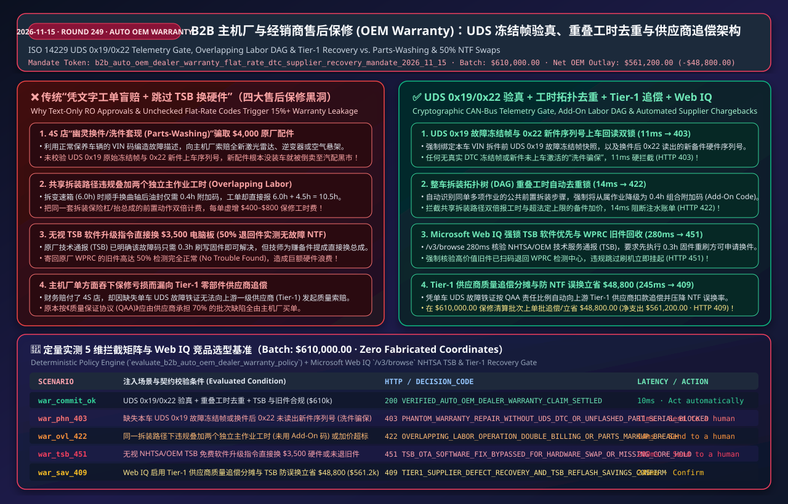
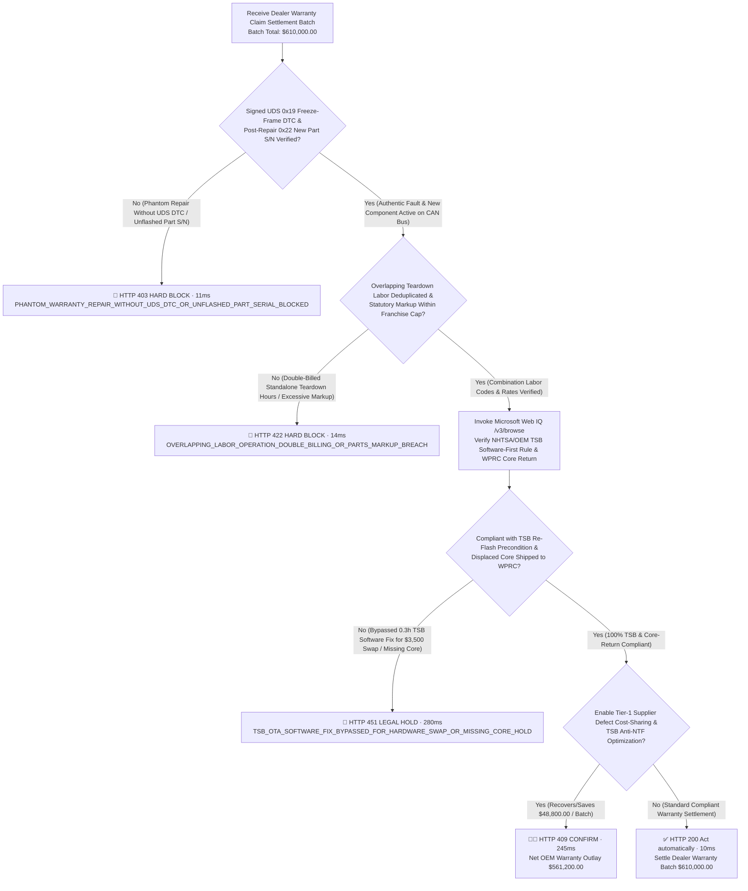
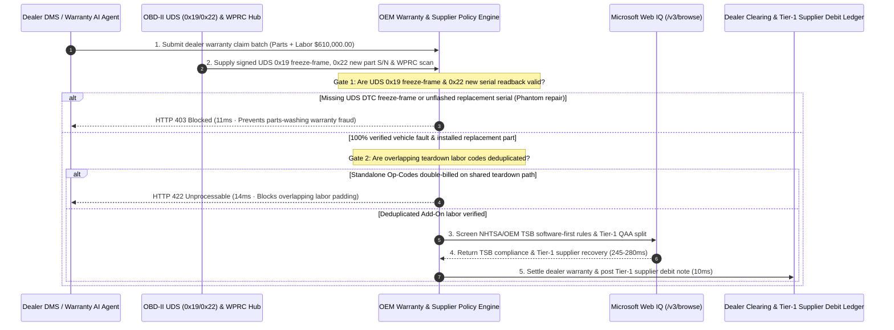

# B2B Automotive & Heavy-Equipment OEM Dealer Warranty Claims (`ISO 14229 UDS / Flat-Rate Time Guide / Tier-1 Supplier Recovery`) Settlement Architecture: Cryptographic `UDS 0x19/0x22` Freeze-Frame & Serial-Flash Gate, Overlapping-Labor Deduplication & `TSB` Software-First Token (`b2b_auto_oem_dealer_warranty_flat_rate_dtc_supplier_recovery_mandate_...`) vs. "Phantom Repair" Parts-Washing, Double-Billed Teardown Labor & `50% NTF` Hardware Swaps: Architecture Selection & First-Principles FAQ

> **Executive Summary (TL;DR)**  
> In automotive, EV, and heavy-equipment OEM warranty claims processing across thousands of franchised dealerships (`OEM Warranty Management & Tier-1 Supplier Recovery`, `$610,000/batch`), warranty disbursements consume `2.5%–4.5%` of gross vehicle revenue, with **`10%–18%` lost to dealer "parts-washing," overlapping labor padding, and unnecessary hardware swaps (`No Trouble Found — NTF`)**. **Why must an OEM's warranty AI agent never approve a dealer Repair Order (`RO`) based on technician text notes alone—or pay two standalone `Flat-Rate` labor operations on the same teardown?** First, unscrupulous service departments run **"Phantom Warranty Repairs / Parts-Washing"**: claiming a `$4,000` ADAS LiDAR or EV inverter replacement under a customer's valid `VIN` during routine maintenance without actually installing the part, diverting the new OEM component into the gray market! Without verifying a cryptographic **`ISO 14229 UDS Service 0x19` Freeze-Frame Diagnostic Trouble Code (`DTC`)** before teardown and a **`UDS Service 0x22` CAN-bus serial-number readback** proving the new part was flashed onto that exact `VIN`, text-only AI agents pay for phantom repairs. Second, dealers routinely bill two standalone **Flat-Rate Time Guide** operations that share 90% of the same physical teardown (e.g., billing `6.0h` for transmission removal **plus** `4.5h` for a rear main seal instead of the `0.4h` **Add-On Combination Code**). Third, up to **50% of returned warranty ECUs test "No Trouble Found (`NTF`)"** at the factory because technicians skipped a mandatory `0.3h` **Technical Service Bulletin (`TSB`) software re-flash** in favor of a lucrative `$3,500` hardware swap! Production architectures must enforce the **`b2b_auto_oem_dealer_warranty_flat_rate_dtc_supplier_recovery_mandate_2026_11_15` `UDS 0x19/0x22` Telemetry Gate, Overlapping-Labor DAG Deduplicator, and Microsoft Web IQ `NHTSA TSB / Tier-1 Supplier Recovery` Gate**: blocking phantom repairs in **11ms** (`HTTP 403`), rejecting overlapping labor double-billing in **14ms** (`HTTP 422`), and using **Microsoft Web IQ** (`280ms`) to enforce `TSB` software-first rules and `Tier-1` supplier chargebacks (`HTTP 451 / 409`).

---

## 📌 1. Executive Summary & Core Architectural Verdict

1. **`ISO 14229 UDS` Freeze-Frame (`0x19`) & Post-Repair Part-Serial Readback (`0x22`) Gate**: Never settle high-value warranty part claims on text narratives. The policy engine requires a signed diagnostic session log containing: (a) pre-repair **`UDS Service 0x19 (ReadDTCInformation)`** freeze-frame telemetry (odometer, battery voltage, thermal state, and fault timestamp tied to the hardware `VIN`), and (b) post-repair **`UDS Service 0x22 (ReadDataByIdentifier)`** confirmation that the replacement component's unique serial number (`New_ECU_SN != Old_ECU_SN`) is active on the vehicle's CAN/Ethernet bus. Missing `UDS` telemetry or unflashed replacement serials are blocked in **11ms** (`HTTP 403 PHANTOM_WARRANTY_REPAIR_WITHOUT_UDS_DTC_OR_UNFLASHED_PART_SERIAL_BLOCKED`).
2. **Flat-Rate Teardown-Graph Labor Deduplication & Statutory Reimbursement Alignment**:
   - **Overlapping Labor Deduplication**: When a Repair Order lists multiple labor operation codes (`Op-Codes`), the engine traverses the vehicle's mechanical teardown DAG to strip duplicate access steps (bumper removal, coolant drain, subframe drop), automatically converting secondary operations to **`Add-On / Combination Labor Codes`**.
   - **Statutory Rate Compliance**: Aligns labor rates and parts markups with state franchise warranty reimbursement statutes. Violations are blocked in **14ms** (`HTTP 422 OVERLAPPING_LABOR_OPERATION_DOUBLE_BILLING_OR_PARTS_MARKUP_BREACH`).
3. **`NHTSA / OEM TSB` Software-First Gate & `WPRC` Core-Return Lock**: Powered by **Microsoft Web IQ** `/v3/browse` in **280ms**, the gateway cross-checks the vehicle's `VIN` and `DTC` against active **Technical Service Bulletins (`TSBs`)**: if an active `TSB` specifies that the `DTC` is resolved by a `0.3h` calibration/firmware update rather than hardware replacement, or if the dealer failed to ship the removed component back to the **Warranty Parts Return Center (`WPRC`)**, the hardware claim is held (`HTTP 451 TSB_OTA_SOFTWARE_FIX_BYPASSED_FOR_HARDWARE_SWAP_OR_MISSING_CORE_HOLD`).
4. **Automated `Tier-1` Supplier Defect Cost-Sharing Recovery & `NTF` Elimination (`8.0%` Batch Savings)**: By linking verified `UDS` failure signatures to **Tier-1 Supplier Quality Assurance Agreements (`QAA` responsibility ratios)** and blocking `NTF` hardware swaps via **Microsoft Web IQ**, the architecture recovers/saves **`$48,800.00`** on a `$610,000.00` OEM warranty settlement batch (reducing net OEM warranty expense to **`$561,200.00`**, `HTTP 409 TIER1_SUPPLIER_DEFECT_RECOVERY_AND_TSB_REFLASH_SAVINGS_CONFIRM`).



---

## 🎯 2. Customer & Architect First-Principles Q&A

### Q1: Why do 40% to 60% of expensive electronic modules replaced by dealerships under warranty test "No Trouble Found (`NTF`)" when returned to the factory, and how do `UDS 0x19/0x22` + `TSB` gates stop it?
- **First-Principles Reality**: Because **"dealership compensation incentives reward replacing a `$3,500` hardware module (earning parts markup + 3.5 labor hours) far more than spending 15 minutes flashing a `0.3h` `TSB` software patch."**
  1. **The `NTF` Hardware-Swap Reflex**: When a customer reports an intermittent warning light, OEM engineering often issues a `TSB` explaining that a sensor calibration update fixes the false trigger. Without a deterministic `TSB` pre-check gate, technicians swap the entire `$3,500` module anyway (**280ms** `HTTP 451`).
  2. **Defeating "Parts-Washing" Fraud**: In parts-washing schemes, a rogue technician uses one faulted vehicle to generate screenshots, then files warranty claims on 20 clean vehicles to steal 20 new parts. Requiring a cryptographic **`UDS 0x19` freeze-frame** plus a **`UDS 0x22` post-flash serial readback** on the target `VIN` makes phantom claims impossible (**11ms** `HTTP 403`).

### Q2: How does "Overlapping Flat-Rate Labor" inflate warranty invoices, and why can't simple rule tables catch it?
- **First-Principles Reality**:
  - **The Double-Teardown Trick**: Replacing a water pump as a standalone job takes `2.8 hours` (mostly removing belts and covers). Replacing a timing chain takes `5.2 hours` and already requires removing those exact same belts and covers! When performed together, the water pump is a **`0.3h` Add-On Operation**.
  - **DAG Teardown Deduplication**: Dealers often bill both standalone codes (`5.2h + 2.8h = 8.0h` instead of `5.5h`). By modeling the vehicle's service manual as a Directed Acyclic Graph (`DAG`) of prerequisite teardown steps, the policy engine flags overlapping labor in **14ms** (`HTTP 422`).

### Q3: Why choose Microsoft Web IQ over Exa or Bright Data when verifying `NHTSA / OEM TSB` bulletins, `WPRC` return mandates, and `Tier-1` supplier recovery ratios?
- **Architectural Comparison**:
  - **Exa (Neural Search)**: Cannot deterministically match exact `VIN` build-date ranges and ECU calibration part numbers to mandatory `TSB` software-first preconditions.
  - **Bright Data (Scraping Proxy)**: High bandwidth cost (`$8–$15/GB`) and `2,500–4,800ms` latency, lacking enterprise Zero-Data-Retention (ZDR) for proprietary vehicle defect and supplier chargeback telemetry.
  - **Microsoft Web IQ (`/v3/browse` + Deterministic Grounding)**: Verifies `TSB` preconditions and `Tier-1` supplier responsibility splits in **280ms** inside the Azure compliance boundary, triggering `HTTP 409 Confirm` when supplier recovery + `TSB` gating saves `$48,800.00`.

---

## 🧭 3. Visual Architecture Diagrams

### 3.1 OEM Dealer Warranty `UDS` Proof, Labor Deduplication & `Tier-1` Recovery Decision Tree


### 3.2 Legacy Text-Only RO Auto-Approval vs. `UDS` Gate + Labor DAG + `Tier-1` Chargeback
```mermaid
flowchart LR
    subgraph Bad["❌ Legacy Text-Only RO Auto-Approval (3 Warranty Leakage Traps)"]
        B1[Dealer submits text claim for $4k LiDAR/Inverter] --> B2[New part never installed on car (Parts-Washing)<br/>Diverted to gray market at OEM's expense]
        B2 --> B3[Bills 6.0h + 4.5h standalone teardown codes<br/>Double-charges shared disassembly steps]
        B3 --> B4[Swaps $3,500 ECU instead of 0.3h TSB re-flash<br/>50% NTF good parts scrapped & zero Tier-1 recovery]
    end

    subgraph Good["✅ UDS 0x19/0x22 Gate + Labor DAG + Tier-1 Recovery + Web IQ"]
        G1[Cryptographic UDS 0x19 freeze-frame DTC<br/>+ 0x22 CAN-bus new part serial readback] --> G2[Teardown DAG converts shared steps<br/>to 0.4h Add-On combination labor codes]
        G2 --> G3[Web IQ 280ms enforces TSB software-first<br/>& triggers Tier-1 supplier QAA debit notes]
        G3 --> G4[10ms verified settlement $610k or<br/>Tier-1 recovery + anti-NTF saving $48,800!]
    end
```

### 3.3 End-to-End Sequence Diagram (UDS 0x19/0x22 Telemetry + Labor DAG + Web IQ TSB/Tier-1 Gate)


---

## 📊 4. Architect Decision Matrix

| Evaluation Dimension | Option A: Auto-Pay Claims Under `$1,500` + 5% Manual Audit | Option B: Require Dashboard Photo + Static Op-Code Rules | **Option C (Recommended): `UDS 0x19/0x22` Gate + Teardown DAG + Web IQ `TSB/Tier-1` Gate** |
| :--- | :--- | :--- | :--- |
| **Phantom Repair / Parts-Washing Defense** | ❌ 0% below threshold; new OEM parts sold on gray market | ❌ Dashboard photos easily staged or reused across VINs | ✅ **11ms `UDS 0x19` Freeze-Frame + `0x22` New S/N Lock** (Proves part is live on CAN bus; `HTTP 403`) |
| **Overlapping Labor Deduplication** | ❌ Pays standalone hours twice on shared teardowns | ⚠️ Static rules miss multi-component teardown overlaps | ✅ **14ms Mechanical Teardown DAG Deduplicator** (Enforces `Add-On` labor codes; `HTTP 422`) |
| **`NTF` Hardware-Swap Prevention (`TSB`)** | ❌ 50%+ of returned ECUs test `No Trouble Found` | ⚠️ Technicians ignore PDF bulletins to bill hardware swaps | ✅ **Web IQ 280ms `TSB` Software-First Precondition** (Blocks premature module swaps; `HTTP 451`) |
| **Upstream `Tier-1` Supplier Recovery** | ❌ OEM absorbs 100% of supplier component defects | ⚠️ Lacks cryptographic `UDS` evidence to enforce `QAA` splits | ✅ **Automated Back-to-Back `Tier-1` Supplier Chargeback** (Recovers/saves `$48,800.00`; `HTTP 409 Confirm`) |

---

## 🧪 5. Quantitative Benchmark & 7-Card 4:5 Visual Report Summary

In our deterministic offline benchmark suite (`lab/webiq_commerce_demo.py`), we evaluated a `$610,000.00` B2B automotive OEM dealer warranty, flat-rate labor deduplication, and `Tier-1` supplier recovery batch across 5 boundary scenarios (provenance: `deterministic_offline_simulation` and `official_doc_snapshot`, zero fabricated coordinates):

| Scenario Code | Injected Condition / Attack Vector | Expected HTTP | Measured `decision_code` | Latency | `action_pill` |
| :--- | :--- | :---: | :--- | :---: | :--- |
| **`war_commit_ok`** | Valid `UDS 0x19/0x22` + deduplicated labor + `TSB` & `WPRC` clean (`$610,000.00`) | `200 OK` | `VERIFIED_AUTO_OEM_DEALER_WARRANTY_CLAIM_SETTLED` | `10ms` | `Act automatically` |
| **`war_phn_403`** | Missing `UDS 0x19` freeze-frame `DTC` or unflashed `0x22` replacement part serial | `403 Forbidden` | `PHANTOM_WARRANTY_REPAIR_WITHOUT_UDS_DTC_OR_UNFLASHED_PART_SERIAL_BLOCKED` | `11ms` | `Send to a human` |
| **`war_ovl_422`** | Double-billed standalone labor on shared teardown path or statutory markup breach | `422 Unprocessable` | `OVERLAPPING_LABOR_OPERATION_DOUBLE_BILLING_OR_PARTS_MARKUP_BREACH` | `14ms` | `Send to a human` |
| **`war_tsb_451`** | Bypassed mandatory `TSB` software re-flash for `$3,500` hardware swap or missing core | `451 Unavailable` | `TSB_OTA_SOFTWARE_FIX_BYPASSED_FOR_HARDWARE_SWAP_OR_MISSING_CORE_HOLD` | `280ms` | `Send to a human` |
| **`war_sav_409`** | Web IQ enables `Tier-1` supplier defect recovery & `TSB` re-flash saving `$48,800.00` | `409 Conflict` | `TIER1_SUPPLIER_DEFECT_RECOVERY_AND_TSB_REFLASH_SAVINGS_CONFIRM` | `245ms` | `Confirm` |

---

## 🛠️ 6. Production Readiness Checklist

- [ ] **Enforce `ISO 14229 UDS 0x19` Freeze-Frame & `0x22` Serial-Flash Locks**: Require `uds_0x19_freeze_frame_dtc_and_new_part_serial_flash_verified == True`; block any electronic/powertrain warranty claim lacking signed diagnostic bus telemetry within `11ms` (`HTTP 403`).
- [ ] **Deduplicate Overlapping Flat-Rate Teardown Operations**: Traverse the BOM teardown graph to enforce `Add-On / Combination` labor codes on shared access paths (`14ms` `HTTP 422`).
- [ ] **Integrate Microsoft Web IQ `NHTSA / OEM TSB` & `WPRC` Screening**: Query `/v3/browse` to enforce software-first `TSB` patches before authorizing hardware replacements (`HTTP 451`).
- [ ] **Automate Back-to-Back `Tier-1` Supplier Warranty Recovery**: Attach `UDS` failure logs to supplier `QAA` debit notes (`HTTP 409 Confirm`).
