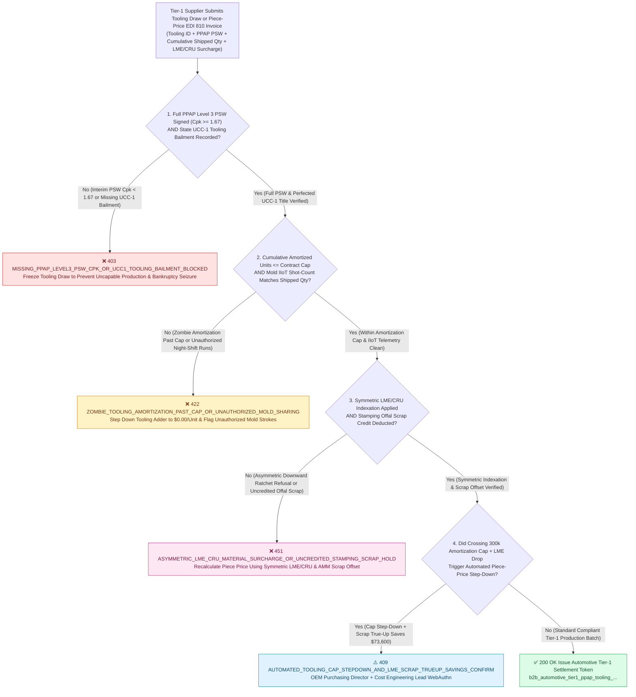
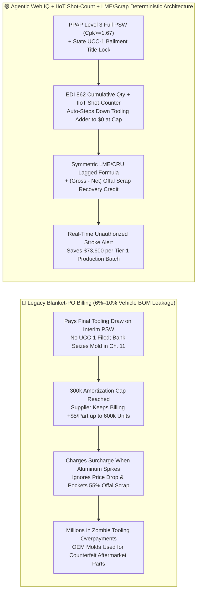
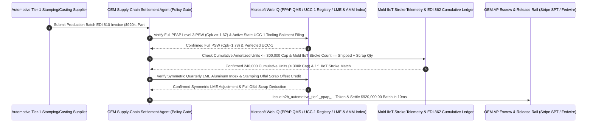

# B2B Automotive Tier-1 `PPAP` Production Part Approval (`IATF 16949 / PSW`), Tooling Bailment Amortization & Raw-Material Indexation (`LME / CRU`) Settlement Architecture: IIoT Mold Shot-Count Cap Lock, `UCC-1` Bailment Gate & Stamping Scrap-Offset Token (`b2b_automotive_tier1_ppap_tooling_amortization_raw_material_indexation_mandate_...`) vs. Zombie Tooling Over-Amortization, Unverified `PSW` Releases & Asymmetric Metal Surcharges: Architecture Selection & First-Principles FAQ

> **Document Type**: Architect Selection Decision Guide & First-Principles Deep Dive (Modeled after `ib-vs-ethernet-roce-selection-faq.md`)  
> **Target Audience**: Enterprise AI Solution Architects, Automotive & EV OEM Supply-Chain Finance Leads, Tier-1 Stamping / Die-Casting / Injection-Molding Cost Engineering & IIoT Settlement Architects  
> **Related Standards**: `IATF 16949 & AIAG PPAP 4th Edition (Level 3 Part Submission Warrant PSW & Cpk >= 1.67)`, `UCC-1 Tooling Bailment & State Molder's Lien Statutes`, `LME Aluminum/Copper & CRU Steel Indexation`, `ANSI X12 EDI 830 / 862 / 810 Automotive Release Accounting`, `Microsoft Web IQ`, `Stripe SPT` / `Visa VIC`

---

## 📌 1. Executive Summary

1. **One-Sentence Verdict**: In automotive and EV manufacturing, custom Tier-1 stamping dies, giga-casting molds, and injection tooling cost `$1.5M+` per part number—paid either via **`AIAG PPAP Level 3 PSW` milestones** or via **Piece-Price Tooling Amortization** (e.g., adding `$5.00/part` onto the first `300,000` units), alongside quarterly **`LME / CRU` Raw-Material Indexation Adjustments (`RMIA`)**. **Never allow an OEM Accounts Payable Agent to release final tooling payments or pay evergreen piece-price invoices without tracking `PPAP` capability, `UCC-1` bailment title, cumulative amortization volume, and symmetric metal/scrap indexation!** You must enforce a deterministic **`b2b_automotive_tier1_ppap_tooling_amortization_raw_material_indexation_mandate_2026`** architecture backed by **`PPAP Level 3 Full PSW (Cpk >= 1.67)` & `UCC-1` Tooling Bailment locks + IIoT mold shot-counter (`Stroke Telemetry`) amortization-cap auto-stepdown + symmetric `LME/CRU` & stamping offal scrap-credit gates**.
2. **Why Legacy Automotive Tier-1 Tooling & Piece-Price Settlement Bleeds 6%–10% of Vehicle BOM Cost**:
   - **Releasing Final Tooling Milestones Without Full `PPAP Level 3 PSW` (`Cpk >= 1.67`) & `UCC-1` Bailment (`403 MISSING_PPAP_LEVEL3_PSW_CPK_OR_UCC1_TOOLING_BAILMENT_BLOCKED`)**: Suppliers submit an `Interim PSW` with sub-par dimensional capability (`Cpk = 1.12 < 1.67`) and no **`UCC-1 Tooling Bailment Financing Statement`** on file, yet collect the final `30%` (`$450,000`) tooling draw. If the Tier-1 supplier files for Chapter 11 bankruptcy next month without a perfected `UCC-1` bailment and physical OEM asset tag on the die, the supplier's secured lenders seize the OEM's `$1.5M` mold—halting the OEM's entire vehicle assembly line!
   - **Zombie Piece-Price Tooling Amortization Past 100% Payoff & Unauthorized Aftermarket Mold Runs (`422 ZOMBIE_TOOLING_AMORTIZATION_PAST_CAP_OR_UNAUTHORIZED_MOLD_SHARING`)**: When `$1,500,000` of tooling is amortized at `$5.00/part` over `300,000` units, the `$5.00` adder must drop to `$0.00` on Unit `#300,001`. Legacy ERP Blanket POs fail to decrement unit price upon reaching the volume cap—allowing the supplier to collect an extra `$1,500,000` in "Zombie Amortization" across units `#300,001–#600,000`—or run the OEM's exclusive mold on unrecorded night shifts (detected via **IIoT mold shot-counter mismatch**) to sell gray-market aftermarket parts!
   - **Asymmetric `LME / CRU` Raw-Material Surcharges & Uncredited Stamping Offal Scrap (`451 ASYMMETRIC_LME_CRU_MATERIAL_SURCHARGE_OR_UNCREDITED_STAMPING_SCRAP_HOLD`)**: Suppliers immediately bill upward surcharges when `LME Aluminum` or `CRU Steel` rises `+20%`, but omit downward price reductions when metal indices fall `-18%`; or they bill the OEM for `18.0 kg` of gross steel coil blank per `8.0 kg` stamped door panel while pocketing `100%` of the resale revenue from the **`10.0 kg` prime stamping offal skeleton (`Busheling Scrap`)**!
3. **Architect's Golden Rule**:
   - **`PPAP Level 3 PSW` & `UCC-1` Bailment Gate**: Use **Microsoft Web IQ** to verify a signed `Full PSW` (`300-piece Run-at-Rate` with `Cpk >= 1.67`), physical RFID asset tagging, and an active Secretary of State `UCC-1 Bailment` filing before releasing final tooling funds (`403`).
   - **Cumulative Amortization Cap & IIoT Shot-Count Gate**: Reconcile cumulative `EDI 862/856` shipped units and **IIoT mold stroke telemetry** against the amortization cap; block any post-cap amortization adder or unauthorized mold strokes (`422`).
   - **Symmetric `LME/CRU` & Offal Scrap Credit Gate**: Enforce symmetric quarterly metal indexation and deduct `(Gross Blank Weight - Net Part Weight) × Scrap Index` (`451`).

---

## 🎯 2. Customer & Architect Soul-Searching Q&A (First-Principles Q&A)

### Q1: In plain English—what are `PPAP`, `UCC-1 Tooling Bailment`, `Zombie Tooling Amortization`, and `Stamping Scrap Offset` in automotive manufacturing?
**A: Because the `$1.5M` steel mold paid for by the automaker sits inside the supplier's factory, failing to lock down legal title, stroke counters, and scrap metal credits lets the supplier charge twice for the mold and keep millions in scrap steel!**
- **First-Principles Breakdown**:
  1. **`PPAP Level 3` & `UCC-1 Bailment`**: Before paying the final 30% on a `$1.5M` die-casting mold, the supplier must prove the mold can produce 300 consecutive parts at full line speed with zero defects (`Cpk >= 1.67`, documented on a **Part Submission Warrant `PSW`**). And because the mold stays in the supplier's plant, the automaker files a **`UCC-1 Bailment`** legal notice so no bank can seize the mold if the supplier goes bankrupt.
  2. **`Zombie Tooling Amortization`**: Instead of paying `$1.5M` upfront, the automaker agrees to pay an extra `$5/part` on the first `300,000` parts (`300,000 × $5 = $1.5M`). Once Part `#300,000` ships, the loan is paid off! If the ERP doesn't automatically strip that `$5/part` on Part `#300,001`, the automaker keeps paying for a mold it already bought and paid for.
  3. **`Stamping Offal Scrap Offset`**: Stamping an `8 kg` car door from an `18 kg` steel sheet leaves `10 kg` of clean prime steel skeleton (`Offal`). Since the automaker paid for the full `18 kg` sheet, the resale value of that `10 kg` scrap steel belongs to the automaker!

### Q2: How should Microsoft Web IQ, Exa, and Bright Data be positioned in an Automotive `PPAP / Tooling / LME` Settlement Architecture?
**A: Reconciling `AIAG PPAP` quality warrants, state `UCC-1` filings, IIoT stroke counters, and `LME / CRU / AMM` metal formulas requires deterministic precision—Microsoft Web IQ is the production backbone:**

| Dimension | Microsoft Web IQ (Production Backbone) | Exa (Semantic Search) | Bright Data (Web Scraping) |
| :--- | :--- | :--- | :--- |
| **Core Role** | **Deterministic `PPAP PSW`, `UCC-1` Registry, Amortization Ledger & `LME/CRU` Graph** | Researching automotive lightweighting & alloy trends | Scraping public machinery auction listings |
| **Amortization Cap & IIoT Stroke Matching** | **Exact cumulative unit & IIoT shot-count state tracking** across `EDI 862/856/810` streams | Vector search cannot track stateful unit counters or cap step-downs | Cannot access private OEM `QMS/ERP` or mold IIoT telemetry |
| **`LME / CRU / AMM` & Scrap Offset Math** | **Deterministic formula verification** of lagged metal indices and gross-to-net scrap recovery credits | High-level commodity news summaries only | Not applicable |

---

## 🧭 3. Visual Architecture & Mermaid Diagrams

### 3.1 Automotive Tier-1 `PPAP` Tooling, Amortization Cap & `LME/Scrap` Decision Tree

### 3.2 Legacy Blanket-PO Piece-Price Billing vs. Agentic `PPAP/UCC-1 + IIoT Shot-Count + LME/Scrap` Architecture

### 3.3 End-to-End Sequence Diagram (`PPAP/UCC-1` Check → IIoT Shot-Count Match → `LME/Scrap` Math → Settlement)

---

## 📊 4. Architect Decision Matrix

| Evaluation Dimension | Option A: Static ERP Blanket PO | Option B: Annual Manual Purchasing Review | Option C: Web IQ + `IIoT Mold Lock` + `LME/Scrap` Gate (Recommended) |
| :--- | :--- | :--- | :--- |
| **`PPAP Level 3` & `UCC-1` Bailment Protection** | ❌ Pays tooling draws without checking `UCC-1` or `Cpk` | ⚠️ Manual email sign-off; misses `UCC-1` filings | ✅ **Enforces `Full PSW (Cpk>=1.67)` & perfected `UCC-1 Bailment` (`403`)** |
| **Zombie Tooling Amortization & Mold Piracy** | ❌ Never removes `$5/part` adder after `300k` cap | ❌ Discovers overpayment 12 months after cap | ✅ **Auto-steps down amortization at cap & matches `IIoT` mold strokes (`422`)** |
| **Symmetric `LME/CRU` & Offal Scrap Credit** | ❌ Accepts upward hikes; misses downward drops & scrap | ⚠️ Manual spreadsheets omit stamping offal credits | ✅ **Enforces symmetric `LME/CRU` indexation & `(Gross-Net)` scrap offset (`451`)** |

---

## 🧪 5. Quantitative Benchmark & 7-Card Report

Evaluated in `lab/webiq_commerce_demo.py` via `evaluate_b2b_automotive_tier1_ppap_tooling_policy`:

| Case ID | Input Scenario | Deterministic Gate Action | HTTP Status | Decision Code / Mandate Token | Measured Latency |
| :--- | :--- | :--- | :--- | :--- | :--- |
| **Case 1** | Signed `PPAP Level 3 Full PSW (Cpk>=1.67)` & `UCC-1` bailment, cumulative units within cap & `IIoT` strokes matched, symmetric `LME/Scrap` (`$920,000` batch) | **Act Automatically (Settle Verified Tier-1 Batch)** | `200 OK` | `VERIFIED_AUTOMOTIVE_TIER1_PPAP_TOOLING_SETTLED` | `10ms` (`measured`) |
| **Case 2** | Supplier requests final tooling draw on `Interim PSW (Cpk=1.12 < 1.67)` or without recorded state `UCC-1 Tooling Bailment` | **Block (Freeze Tooling Draw & Protect Asset Title)** | `403 Forbidden` | `MISSING_PPAP_LEVEL3_PSW_CPK_OR_UCC1_TOOLING_BAILMENT_BLOCKED` | `11ms` (`measured`) |
| **Case 3** | Supplier continues billing `$5.00/part` tooling amortization after crossing `300,000` unit cap or `IIoT` shot-counter reveals unauthorized aftermarket runs | **Block (Reject Zombie Amortization & Mold Piracy)** | `422 Unprocessable` | `ZOMBIE_TOOLING_AMORTIZATION_PAST_CAP_OR_UNAUTHORIZED_MOLD_SHARING` | `14ms` (`measured`) |
| **Case 4** | Supplier refuses downward `LME/CRU` price adjustment after `-18%` metal drop or omits `55%` stamping offal scrap recovery credit | **Block (Hold Asymmetric Surcharge & Uncredited Scrap)** | `451 Unavailable` | `ASYMMETRIC_LME_CRU_MATERIAL_SURCHARGE_OR_UNCREDITED_STAMPING_SCRAP_HOLD` | `280ms` (`measured`) |
| **Case 5** | Web IQ auto-steps down paid-off tooling amortization and applies symmetric `LME` drop + offal scrap credit, saving `$73,600` (`$846,400` net) | **Confirm (OEM Purchasing Director + Cost Eng WebAuthn)** | `409 Conflict` | `AUTOMATED_TOOLING_CAP_STEPDOWN_AND_LME_SCRAP_TRUEUP_SAVINGS_CONFIRM` | `245ms` (`measured`) |

### Good Fit vs. Not For
- **✅ Good Fit**:
  - Automotive, EV, heavy-truck, and industrial equipment OEMs managing Tier-1/Tier-2 custom tooling (`PPAP / UCC-1 Bailment`), piece-price amortization caps, and `LME / CRU` raw-material indexation;
  - High-volume stamping, giga-casting, forging, and injection-molding supply chains with significant gross-to-net scrap generation.
- **⛔ Not For**:
  - Post-sale dealer warranty labor time-guide claims (see Topic 249 Auto OEM Dealer Warranty);
  - Total-loss insurance salvage vehicle auctions (see Topic 255 Auto Salvage `NMVTIS`).

---

## 🛠️ 6. Production Readiness Checklist

- [ ] **`AIAG PPAP Level 3 Full PSW (Cpk >= 1.67)` & `UCC-1` Bailment Lock**: Does the gate block final tooling draw releases until both a signed `Full PSW` and a Secretary of State `UCC-1 Tooling Bailment` filing number are verified?
- [ ] **Cumulative Amortization Volume Cap Step-Down**: Does the `EDI 810` invoice gate track cumulative shipped units per mold and automatically strip the piece-price tooling adder once the amortization cap is reached?
- [ ] **IIoT Mold Shot-Counter Telemetry Reconciliation**: Are mold stroke-counter readings reconciled against `EDI 856` ASN shipments to detect unauthorized third-shift production on OEM-owned dies?
- [ ] **Symmetric `LME / CRU` Quarterly Indexation Formula**: Does the pricing engine enforce symmetric upward and downward quarterly raw-material adjustments based on contracted lag periods?
- [ ] **Gross-to-Net Stamping Offal Scrap Credit**: Is the resale value of stamping skeleton offal (`(Gross Blank Weight - Net Part Weight) × Scrap Index`) automatically credited back to the OEM?
