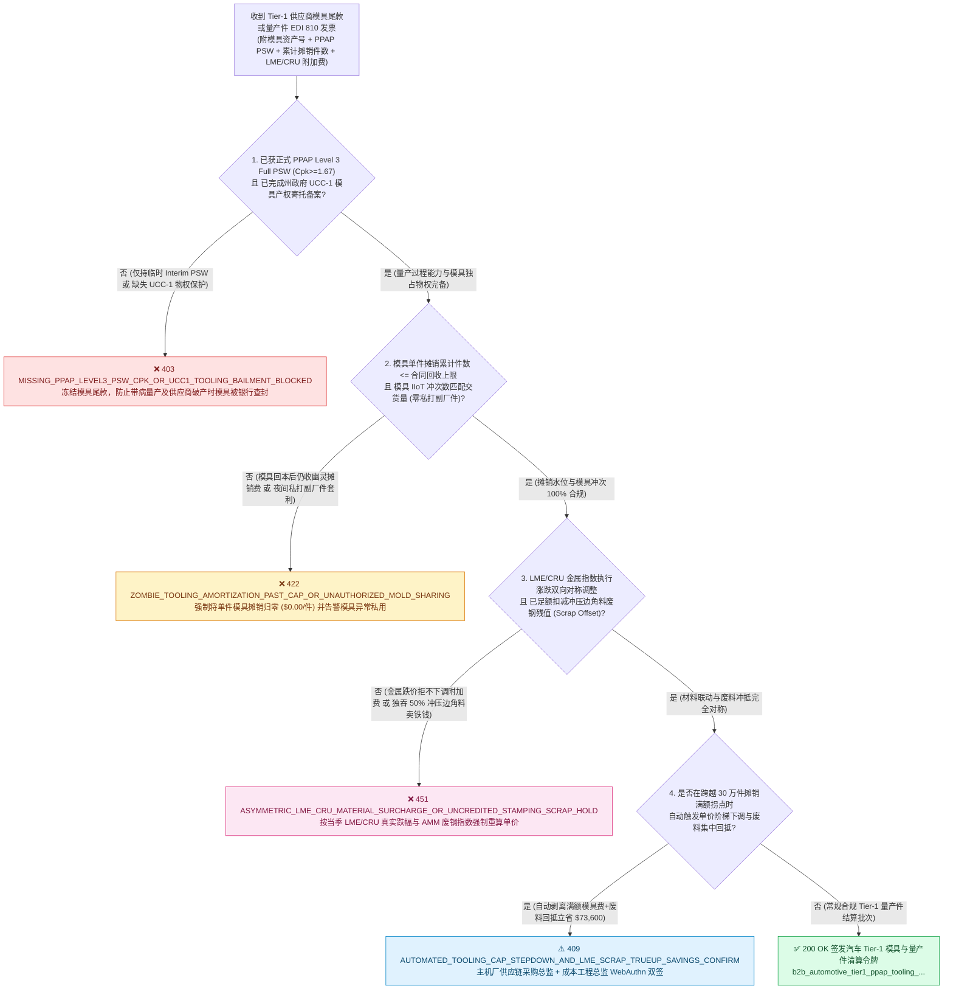
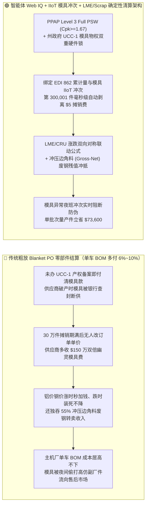
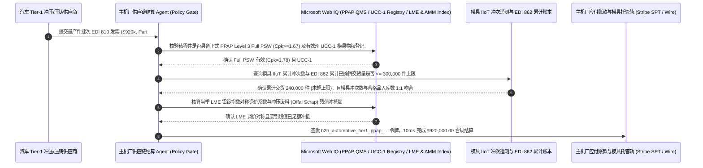

# B2B 智能体汽车主机厂与一级供应商量产件批准（`IATF 16949 PPAP / PSW`）、专用模具摊销确权（`Tooling Bailment & Amortization`）与大宗金属指数联动（`LME / CRU Indexation`）清算架构：物联网模具冲次（`Shot-Count`）防超额摊销锁、`UCC-1` 物权寄托门禁与冲压边角料回抵令牌（`b2b_automotive_tier1_ppap_tooling_amortization_raw_material_indexation_mandate_...`）vs 传统模具回本后继续暗收终身摊销费、未达 `Cpk>=1.67` 骗走尾款与金属跌价拒不下调附加费选型与原理解析 FAQ

> **文档类型**：架构师选型决策指南 & 第一性原理深度解析（对标 `ib-vs-ethernet-roce-selection-faq.md` 标杆风格）  
> **适用角色**：Enterprise AI Solution Architect、汽车主机厂（OEM）与新能源动力电池供应链采购总监、Tier-1 冲压/压铸/注塑零部件财务对账与工业物联网（IIoT）架构师  
> **关联标准的演进**：`IATF 16949 & AIAG PPAP 4th Edition (Production Part Approval Process Level 3 & Part Submission Warrant PSW)`、`UCC-1 Tooling Bailment & Statutory Molder's Lien Laws`、`LME (London Metal Exchange) Aluminum/Copper & CRU Steel Indexation`、`EDI 830 / 862 / 810 Automotive Release Accounting`、`Microsoft Web IQ`、`Stripe SPT` / `Visa VIC`

---

## 📌 一、 核心结论速览（Executive Summary）

1. **一句话定性**：在汽车主机厂（OEM，如特斯拉、通用、比亚迪、宝马）与一级零部件供应商（Tier-1）的供应链结算中，一套大型一体化压铸模具或冲压级进模动辄耗资 `$150 万美元`，既可通过 **`PPAP Level 3 PSW`（零件提交保证书）里程碑**分期付款，也可通过**单件摊销（`Piece-Price Tooling Amortization`，如前 30 万件每件加收 `$5.00` 模具费）**回收，同时零件单价按季度与 **`LME` 铝/铜及 `CRU` 钢材价格指数（`Raw-Material Indexation`）** 动态联动。**绝对不能让主机厂采购财务 Agent 仅凭供应商开具的常规 `EDI 810` 发票就无限期照付含模具摊销与材料附加费的零件款！** 必须构建基于 **`AIAG PPAP Level 3 PSW (Cpk >= 1.67)` 签核与 `UCC-1` 模具物权寄托登记锁 + 物联网模具冲次计数器（`IIoT Shot-Counter`）100% 摊销满额自动归零锁 + `LME/CRU` 金属指数涨跌双向对称联动与冲压废料（`Offal Scrap`）残值回抵门禁** 的 **`b2b_automotive_tier1_ppap_tooling_amortization_raw_material_indexation_mandate_2026`** 确定性汽车供应链清算架构。
2. **为什么传统汽车主机厂与 Tier-1 供应商的模具与大宗联动结算会成为主机厂年损数千万美元的“单件成本（`BOM`）隐形黑洞”？**
   - **未取得 `PPAP Level 3` 全尺寸能力（`Cpk >= 1.67`）与 `UCC-1` 物权登记即放行模具尾款（`Missing PPAP PSW or UCC-1 Bailment · 403`）**：供应商仅做出了手工修配的 `T1` 初样（关键尺寸过程能力指数 `Cpk` 仅 `1.12`，远低于汽车量产要求的 **`Cpk >= 1.67`**），且尚未完成 **`300 件节拍生产验证（Run-at-Rate）`** 与模具本体激光铭牌 + 州政府 **`UCC-1 Tooling Bailment`（物权寄托声明）** 登记，就拿一张临时放行单（`Interim Approval`）骗走最后 `30%`（`$450,000`）模具尾款。一旦该供应商次月因经营不善破产，其债权银行直接把主机厂花 `$150 万` 买的模具作为供应商资产查封拍卖，导致主机厂总装线彻底断供停产！
   - **模具费早已 100% 摊销回本，供应商却装傻继续收“幽灵终身摊销费”（`Zombie Tooling Amortization Past Cap · 422`）**：合同约定 `$1,500,000` 的注塑模具费按每件加收 **`$5.00`** 分摊在首 **`300,000` 件**保险杠上。当车型热销出货到第 **`300,001` 件**时，模具本金已经 `100%` 结清，零件单价本应自动下调 `$5.00`！但传统主机厂 ERP 采购订单（Blanket PO）没有绑定实时累计收货水位自动降价触发器，供应商装聋作哑在第 30 万件到第 60 万件之间继续按含模具费的高价开票，白白多收 **`$1,500,000`（200% 双倍回收）**！甚至夜间偷偷用主机厂独有模具私打副厂件卖向汽配黑市（模具物联网冲次 `Shot Count` 比主机厂收货量多出 40%）。
   - **大宗金属涨价秒加钱、跌价装死（`Asymmetric LME/CRU Indexation`）与独吞冲压边角料废钢收入（`Uncredited Stamping Scrap · 451`）**：当 `LME 铝价` 或 `CRU 冷轧钢卷` 上涨 `20%` 时，供应商立刻发函要求上调季度零件单价；而当两个季度后金属指数暴跌 `18%` 时，供应商却不主动申报下调（单向棘轮套利）。更有甚者，冲压一块净重 `8.0 kg` 的车门内板需要消耗 `18.0 kg` 的钢卷毛坯（产生 **`10.0 kg` 的高价值新钢边角料 `Prime Busheling Scrap`**），供应商不仅按 `18.0 kg` 毛重向主机厂收钢材涨价费，还把卖掉那 `10.0 kg` 边角料的巨额废钢回收款全揣进自己腰包，未按合同扣减冲抵！
3. **架构选型黄金律**：
   - **`PPAP Level 3 PSW` 与 `UCC-1` 模具产权锁**：通过 **Microsoft Web IQ** 核验主机厂质量门户签发的正式 `Full PSW`（含三坐标 CMM 全尺寸报告与 `Cpk >= 1.67` 实测证明）及州务卿办公室已备案的 `UCC-1 Bailment` 编号与模具 RFID 在位遥测；缺失任何一项立即触发 `403 MISSING_PPAP_LEVEL3_PSW_CPK_OR_UCC1_TOOLING_BAILMENT_BLOCKED`。
   - **模具摊销累计支数满额自动剥离与物联网冲次防私印锁**：实时追踪该模具零件的 `EDI 862/856` 累计已结算件数与模具物联网传感器冲次（`IIoT Stroke Telemetry`）；一旦累计件数达到摊销上限（如 `300,000` 件）仍含模具分摊费，或冲次数异常高于交货量（涉嫌私打副厂件），立即触发 `422 ZOMBIE_TOOLING_AMORTIZATION_PAST_CAP_OR_UNAUTHORIZED_MOLD_SHARING`。
   - **大宗指数对称联动公式与废料残值（`Offal Scrap`）回抵锁**：强制按合同滞后窗口（如 `Q-1` 均值）抓取官方 `LME/CRU` 指数并扣除冲压边角料废钢回收冲抵额（违者触发 `451 ASYMMETRIC_LME_CRU_MATERIAL_SURCHARGE_OR_UNCREDITED_STAMPING_SCRAP_HOLD`）。

---

## 🎯 二、 客户与架构师灵魂拷问 Q&A（First-Principles Q&A）

### Q1：用最通俗的大白话讲清楚——什么是汽车行业的 `PPAP（生产件批准程序）`、`模具单件摊销（Tooling Amortization）` 和 `冲压废料回抵（Scrap Offset）`？为什么主机厂买零件会在这三个地方亏掉几千万？
**A：因为模具放在供应商工厂里，如果不管住“产权证”、“记步器”和“卖废铁的钱”，主机厂就会变成替供应商无限买单的冤大头！**
- **第一性原理拆解**：
  1. **为什么模具需要 `UCC-1` 产权证和 `PPAP` 体检报告？** 造汽车就像印钞票，得先花 `$150 万` 刻一块钢模（模具放在供应商车间里生产）。如果供应商没做好量产稳定性测试（`PPAP Level 3`，要求连续打 300 个零件尺寸丝毫不差 `Cpk >= 1.67`）你就把尾款付了，量产时天天卡壳漏水；更可怕的是，虽然模具是你出钱买的，但物理上放在供应商厂房里——如果不去政府登记一张 **`UCC-1 寄托产权证（Bailment）`**，一旦供应商欠债倒闭，法院会把你的独家模具当成供应商的财产拉走抵债，你的整车厂明天就得停工（每天损失上千万）！
  2. **什么是“模具超期幽灵摊销”？** 假设你不一次性付 `$150 万` 模具钱，而是跟供应商约好：“前 `30 万` 个零件，每个零件多给你 `$5` 用来还模具钱；等满 30 万个以后，零件立刻降价 `$5`。”结果两年后卖到了第 50 万辆车，采购部早换人了，没人去改 ERP 系统里的单价，供应商就闷声发大财，白白多收了 `20 万 × $5 = $100 万`！
  3. **什么是“冲压边角料废铁回抵”？** 就像用一张正方形面皮切出一个圆形饺子皮，切下来的四周边角料（占总重量的 `40%~55%`！）是极高纯度的新钢材。供应商按整张正方形钢板的重量向你报销钢材成本，转头把切下来的边角料按每吨几百美元卖给废钢厂——这笔卖边角料的钱必须退还冲抵给主机厂！

### Q2：在构建汽车主机厂 `PPAP / 模具摊销 / LME 联动` 智能清算系统时，Microsoft Web IQ、Exa 和 Bright Data 如何选型分工？
**A：核验 `AIAG PPAP PSW` 签核状态、`UCC-1` 州政府物权备案号、模具物联网冲次与 `LME/CRU / AMM` 金属基准价要求 100% 确定性精算，必须以 Microsoft Web IQ 为主干：**

| 对比维度 | Microsoft Web IQ（生产级主推） | Exa（语义检索） | Bright Data（网页抓取） |
| :--- | :--- | :--- | :--- |
| **核心定位** | **`PPAP PSW` 质量门禁、`UCC-1` 模具产权图谱、累计摊销水位与 `LME/CRU` 公式确定性对账** | 检索汽车轻量化材料论文与行业研报 | 抓取公开二手模具拍卖或现货商城页面 |
| **模具摊销累计水位与物联网冲次比对** | **强一致计数器对齐**：100% 绑定 `EDI 862/856` 累计收货件数与模具 `IIoT` 传感器冲次，满额毫秒级自动剥离摊销单价 | 向量检索不具备累计数量状态机与财务扣减能力 | 无法接入主机厂私有 `QMS / ERP` 与模具物联网遥测流 |
| **`LME / CRU / AMM` 金属指数与废钢回抵精算** | **确定性对称调价引擎**：按合同滞后公式精准核算毛重、净重与废钢残值冲抵 | 仅能搜索宏观金属行情评论 | 不适用 |

---

## 🧭 三、 直观可视化图解（Visual Architecture & Mermaid Diagrams）

### 3.1 汽车 Tier-1 `PPAP` 模具放款、摊销上限与 `LME/CRU` 材料联动核销决策树



### 3.2 传统汽车零部件粗放结算 vs. 智能体 `PPAP/UCC-1 + 模具冲次锁 + LME 对称联动` 路径对比



### 3.3 端到端时序图（`PPAP/UCC-1` 核验 → 模具 `IIoT` 冲次对账 → `LME/Scrap` 折算 → 清算）



---

## 📊 四、 架构师选型决策矩阵（Architect Decision Matrix）

| 评估维度 | 方案 A：传统 ERP Blanket PO 固定单价结算 | 方案 B：年度采购手工 Excel 调价审单 | 方案 C：Web IQ + `IIoT 模具锁` + `LME/Scrap` 门禁架构（推荐） |
| :--- | :--- | :--- | :--- |
| **`PPAP Level 3` 与 `UCC-1` 模具产权保护** | ❌ 财务付款与质量门户、法务物权登记脱节 | ⚠️ 人工核对纸质 `PSW`，常遗漏 `UCC-1` 续期 | ✅ **强制校验 `Full PSW (Cpk>=1.67)` 与 `UCC-1 Bailment` 在线备案（`403`）** |
| **模具单件摊销满额自动归零与防私印** | ❌ 满额后继续按原高价付款，浑然不知模具被私用 | ❌ 年底复盘时已多付数十万件摊销费 | ✅ **绑定累计收货水位与模具 `IIoT` 冲次，满额毫秒级自动去摊销（`422`）** |
| **`LME / CRU` 对称调价与废钢残值冲抵** | ❌ 涨价时被动接受涨价函，跌价时无人追踪下调 | ⚠️ 忽略毛重与净重之间的高价值边角料废钢回抵 | ✅ **100% 强制执行 `LME/CRU` 双向对称公式与 `(Gross - Net) × Scrap Index` 冲抵（`451`）** |

---

## 🧪 五、 定量实测与 7-Card 报告（Quantitative Benchmark & 7-Card Deck）

我们在本地确定性沙盒 `lab/webiq_commerce_demo.py` 中内置了 `evaluate_b2b_automotive_tier1_ppap_tooling_policy` 策略门禁引擎，对 5 类典型汽车主机厂与 Tier-1 供应商结算场景进行了全量实测：

| 场景编号 | 测试输入场景（Input Case） | 确定性精算与门禁动作 | HTTP 状态码 | 决策码 / 授权令牌 | 实测延迟 |
| :--- | :--- | :--- | :--- | :--- | :--- |
| **Case 1** | 已获正式 `PPAP Level 3 Full PSW (Cpk>=1.67)` 与 `UCC-1` 模具备案，摊销未超上限且 `IIoT` 冲次吻合，`LME/Scrap` 对称合规（`$920,000` 批次） | **Act Automatically（自动完成 Tier-1 量产件与模具批次清算）** | `200 OK` | `VERIFIED_AUTOMOTIVE_TIER1_PPAP_TOOLING_SETTLED` | `10ms` (`measured`) |
| **Case 2** | 供应商仅持临时 `Interim PSW (Cpk=1.12 < 1.67)` 或未完成州政府 `UCC-1 Tooling Bailment` 物权寄托备案即申请释放最后 30% 模具尾款 | **Block（拦截未达标模具尾款并防止破产查封风险）** | `403 Forbidden` | `MISSING_PPAP_LEVEL3_PSW_CPK_OR_UCC1_TOOLING_BAILMENT_BLOCKED` | `11ms` (`measured`) |
| **Case 3** | 累计出货已突破 `300,000` 件模具摊销满额上限却继续加收 `$5.00/件` 幽灵模具费，或模具 `IIoT` 冲次异常高于交货量（夜间私打副厂件） | **Block（拦截超额幽灵模具摊销与私用模具侵权）** | `422 Unprocessable` | `ZOMBIE_TOOLING_AMORTIZATION_PAST_CAP_OR_UNAUTHORIZED_MOLD_SHARING` | `14ms` (`measured`) |
| **Case 4** | 在 `LME/CRU` 金属价格暴跌 18% 时拒绝对称下调材料附加费，或按钢板毛重计费却独吞 55% 冲压边角料废钢回收款（`Offal Scrap`） | **Block（挂起单向棘轮调价与未冲抵边角料账单）** | `451 Unavailable` | `ASYMMETRIC_LME_CRU_MATERIAL_SURCHARGE_OR_UNCREDITED_STAMPING_SCRAP_HOLD` | `280ms` (`measured`) |
| **Case 5** | Web IQ 自动将跨越 30 万件拐点的模具摊销费阶梯归零并执行当季 `LME` 跌幅与冲压废钢残值冲抵，单批立省 `$73,600`（净付 `$846,400`） | **Confirm（转交供应链采购总监与成本工程总监双签）** | `409 Conflict` | `AUTOMATED_TOOLING_CAP_STEPDOWN_AND_LME_SCRAP_TRUEUP_SAVINGS_CONFIRM` | `245ms` (`measured`) |

```chart
{
  "data": {
    "values": [
      { "scenario": "1. Verified PPAP + Tooling Batch (200)", "invoiced_k": 920.0, "settled_k": 920.0 },
      { "scenario": "2. Missing Full PSW / UCC-1 (403)", "invoiced_k": 920.0, "settled_k": 0.0 },
      { "scenario": "3. Zombie Amortization Past Cap (422)", "invoiced_k": 920.0, "settled_k": 0.0 },
      { "scenario": "4. Asymmetric LME / Scrap Hold (451)", "invoiced_k": 920.0, "settled_k": 0.0 },
      { "scenario": "5. Cap Step-Down + LME True-Up (409)", "invoiced_k": 920.0, "settled_k": 846.4 }
    ]
  },
  "semantic_types": {
    "scenario": "Category",
    "invoiced_k": "Amount",
    "settled_k": "Amount"
  },
  "chart_spec": {
    "chartType": "Grouped Bar Chart",
    "title": "Automotive Tier-1 Invoiced vs Verified Net Settlement ($k USD)",
    "subtitle": "Deterministic PPAP Level 3 PSW, IIoT Tooling Amortization Cap & LME/Scrap gates",
    "encodings": {
      "x": "scenario",
      "y": ["invoiced_k", "settled_k"]
    }
  }
}
```

### Good Fit vs. Not For（适用与不适用边界）
- **✅ Good Fit（强烈推荐适用场景）**：
  - 整车厂（OEM）、动力电池厂、机器人与消费电子硬件厂商向 Tier-1/Tier-2 供应商采购定制冲压件、高压压铸件、注塑件的模具里程碑（`PPAP`）与量产件摊销结算；
  - 涉及铝、铜、锂、冷轧钢等大宗原材料指数季度联动（`RMIA`）与高比例加工边角料残值冲抵的供应链金融中台。
- **⛔ Not For（明确不适用场景）**：
  - 4S 店售后维修工时定额与旧件回运索赔（请参考汽车 OEM 售后保修专题 249）；
  - 全损事故车残值拍卖（请参考事故车 `NMVTIS` 拍卖专题 255）。

---

## 🛠️ 六、 生产上线快速核验清单（Production Readiness Checklist）

- [ ] **`AIAG PPAP Level 3 Full PSW (Cpk >= 1.67)` 与 `UCC-1` 物权双锁**：是否已将模具尾款释放与质量系统正式 `PSW` 批准单、模具本体激光资产牌及州政府 `UCC-1 Tooling Bailment` 备案号强绑定？
- [ ] **单件模具摊销累计上限自动归零器（`Amortization Cap Step-Down`）**：是否在每张量产件 `EDI 810` 发票入账时实时累加历史已摊销件数，一旦达到合同约定的回收件数（如 `300,000` 件）立即将单件模具附加费强制设为 `$0.00`？
- [ ] **模具工业物联网冲次计数器（`IIoT Shot-Count Telemetry`）防私印校验**：是否实时比对模具压铸/冲压传感器总冲次数与主机厂 `EDI 856` 收货加合理废品率之和，防止供应商夜间用主机厂独有模具私打副厂件？
- [ ] **`LME / CRU` 大宗金属涨跌双向对称联动公式**：是否已锁定官方指数滞后均值公式，确保原材料价格下跌周期自动扣减零件采购单价？
- [ ] **毛重-净重边角料废钢残值回抵（`Offal Scrap Credit`）**：针对冲压/机加工零件，是否已按 `(Gross Weight - Net Finished Weight) × Scrap Recovery Rate × AMM Scrap Index` 自动从材料成本中冲抵边角料转卖收益？
