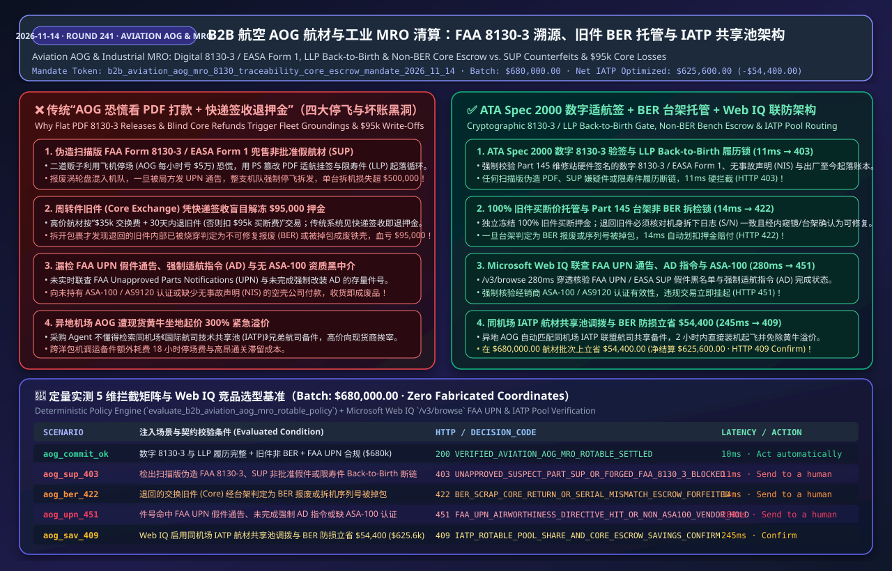
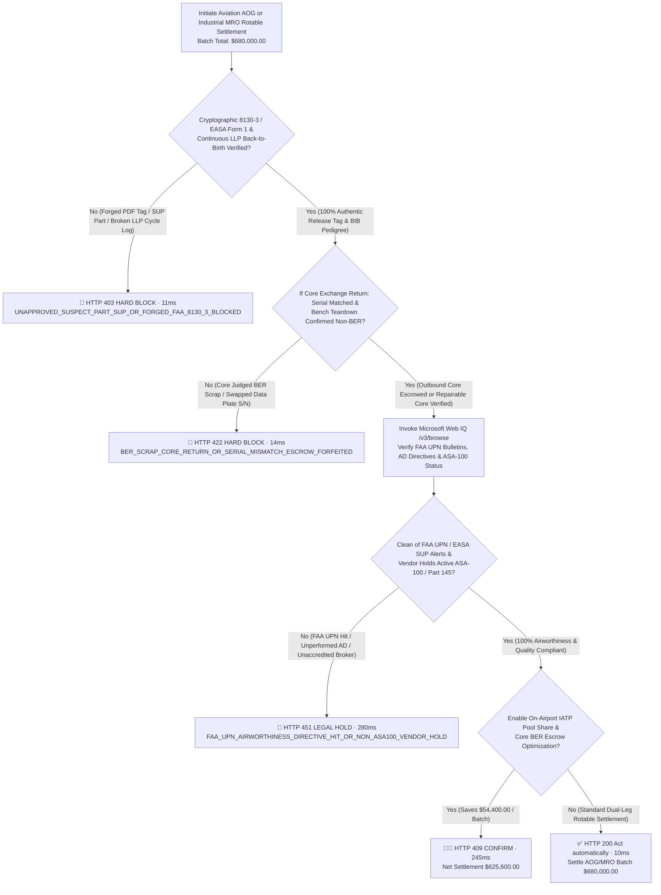
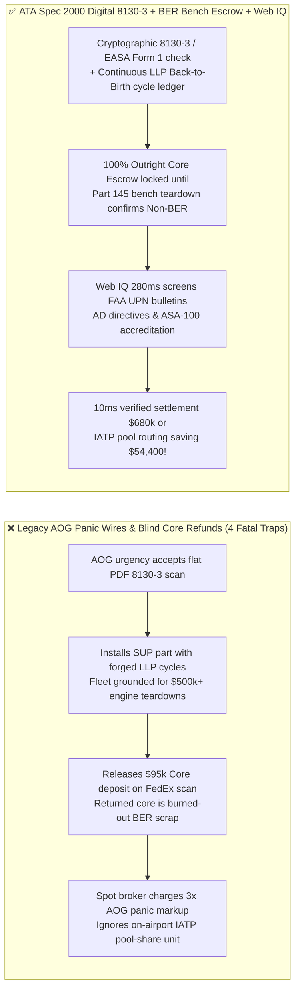
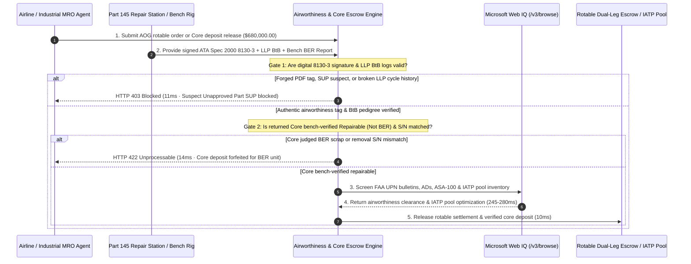

# B2B Aviation `AOG` (`Aircraft on Ground`) & Industrial `MRO` Rotable Settlement (`FAA Form 8130-3 / EASA Form 1 / ATA Spec 2000`) Architecture: Back-to-Birth `LLP` Traceability, Core-Exchange `BER` Escrow & `IATP` Pool Token (`b2b_aviation_aog_mro_8130_traceability_core_escrow_mandate_...`) vs. Unapproved `SUP` Counterfeits & `$95k` `BER` Core Write-Offs: Architecture Selection & First-Principles FAQ

> **Executive Summary (TL;DR)**  
> In commercial aviation emergency `AOG (Aircraft on Ground)` procurement (where every grounded hour costs an airline `$10,000–$150,000`) and heavy industrial gas-turbine `MRO` rotable exchanges (`MCC 5088 / 4582`), granting an AI sourcing agent autonomous wire authority based on emailed PDF certificates or releasing core deposits upon carrier delivery scans invites fleet-grounding safety disasters and six-figure financial write-offs. **Why must an AI agent never wire emergency funds based on a scanned `FAA Form 8130-3` PDF—or release a `$95,000` Core-Exchange deposit when UPS/FedEx scans the returned unit as `DELIVERED`?** First, rogue brokers exploit `AOG` panic to peddle **Suspect Unapproved Parts (`SUP`)**—using Photoshopped `FAA Form 8130-3 / EASA Form 1` airworthiness tags or falsified **Back-to-Birth (`BtB`) Life-Limited Part (`LLP`) cycle logs** that hide scrapped high-cycle turbine disks; installing a single unapproved `SUP` part forces an immediate fleet-wide grounding and `$500,000+` engine teardowns. Second, high-value avionics and mechanical rotables trade on an **Exchange + Core Return (`<= 30 Days`)** basis (`$35,000` exchange fee + `$95,000` contingent Outright Core Value): if the escrow releases upon package delivery before a `Part 145` bench teardown, unscrupulous buyers return a **Beyond Economic Repair (`BER`) burned-out core** or a swapped-serial scrap unit! Production architectures must enforce the **`b2b_aviation_aog_mro_8130_traceability_core_escrow_mandate_2026_11_14` `ATA Spec 2000` Digital `8130-3` & Back-to-Birth `LLP` Gate, Bench-Verified Non-`BER` Core Escrow, and Microsoft Web IQ `FAA UPN / IATP Pool` Gate**: blocking unverified `SUP` parts in **11ms** (`HTTP 403`), forfeiting core escrow on `BER`/swapped cores in **14ms** (`HTTP 422`), and using **Microsoft Web IQ** (`280ms`) to screen `FAA UPN` notices and `ASA-100` accreditation (`HTTP 451`).

---

## 📌 1. Executive Summary & Core Architectural Verdict

1. **`ATA Spec 2000` Cryptographic `FAA Form 8130-3 / EASA Form 1` & Back-to-Birth `LLP` Ledger Gate**: Never settle rotable or `LLP` invoices against flat PDF scans. The gateway requires a cryptographically signed `ATA Spec 2000` digital airworthiness release certificate issued by an authorized `FAA Part 145 / EASA Part-145` repair station, a signed **Non-Incident Statement (`NIS`)**, and an unbroken **Back-to-Birth (`BtB`) cycle ledger** from original OEM manufacture. Any `SUP` anomaly, broken `LLP` cycle chain, or invalid signature is blocked in **11ms** (`HTTP 403 UNAPPROVED_SUSPECT_PART_SUP_OR_FORGED_FAA_8130_3_BLOCKED`).
2. **Dual-Leg Rotable Core-Exchange Escrow & `BER` Bench-Teardown Lock**: Every rotable exchange settlement splits into `[Exchange Service Fee + 100% Outright Core Value Escrow]`. The core escrow remains locked until the removed unit arrives at the `Part 145` shop within `<= 30 days`, matches the aircraft's maintenance logbook removal `P/N + S/N`, and passes a physical borescope/bench teardown confirming **`Status == REPAIRABLE (Not BER)`**. Returning a Beyond Economic Repair (`BER`) hulk or mismatched serial triggers automatic core-escrow forfeiture in **14ms** (`HTTP 422 BER_SCRAP_CORE_RETURN_OR_SERIAL_MISMATCH_ESCROW_FORFEITED`).
3. **`FAA UPN` (Unapproved Parts Notifications), `AD` & `ASA-100` Broker Gate**: Powered by **Microsoft Web IQ** `/v3/browse` in **280ms**, the gateway cross-checks part/serial/batch numbers against `FAA Unapproved Parts Notifications (UPN)`, `EASA Suspected Unapproved Parts` bulletins, and mandatory `Airworthiness Directives (AD)`, while verifying active `ASA-100 / AS9120` quality accreditation (`HTTP 451 FAA_UPN_AIRWORTHINESS_DIRECTIVE_HIT_OR_NON_ASA100_VENDOR_HOLD`).
4. **`IATP` (International Airlines Technical Pool) Routing & `BER` Loss Elimination (`8.0%` Batch Savings)**: During line-station `AOG` events, **Microsoft Web IQ** matches on-airport `IATP` pool-share inventory to bypass `3x` spot-broker price gouging while eliminating unrecovered `BER` core losses—saving **`$54,400.00`** on a `$680,000.00` aviation `AOG` and industrial `MRO` batch (reducing net settlement to **`$625,600.00`**, `HTTP 409 IATP_ROTABLE_POOL_SHARE_AND_CORE_ESCROW_SAVINGS_CONFIRM`).

---

## 🎯 2. Customer & Architect First-Principles Q&A

### Q1: When an aircraft is `AOG` at an outstation losing `$50,000/hour` and a broker emails a signed `FAA Form 8130-3` PDF, why can't our AI agent wire funds immediately instead of verifying cryptographic `ATA Spec 2000` signatures and Back-to-Birth `LLP` logs?
- **First-Principles Reality**: Because **"rogue brokers weaponize `AOG` time pressure—and installing one counterfeit or over-cycled turbine part grounds not just one airplane, but your entire fleet."**
  1. **Forged Airworthiness Certificates (`SUP` Crises)**: Real-world aviation supply chains have suffered catastrophic disruptions where brokers forged thousands of `EASA Form 1 / FAA 8130-3` PDFs for uncertified CFM56 engine components. Once regulators issue an `Unapproved Parts Notification (UPN)`, every aircraft containing a suspect part loses its Certificate of Airworthiness immediately, requiring `$500,000+` shop teardowns.
  2. **The `LLP` Cycle-Washing Trap**: Engine disks and spools have hard statutory fatigue limits (e.g., `20,000 cycles`). Fraudsters buy a scrapped disk with `19,800 cycles`, forge one intermediate paper transfer to claim `8,000 cycles`, and sell it at full price. Enforcing unbroken **`ATA Spec 2000` Back-to-Birth cryptographic provenance** blocks `SUP` and cycle-washed parts in **11ms** (`HTTP 403`).

### Q2: How does "Rotable Core Exchange" work in aviation and heavy MRO, and why does releasing the core deposit on carrier `DELIVERED` scan cause `$95,000` write-offs?
- **First-Principles Reality**:
  - **Exchange vs. Outright Economics**: An avionics LRU or hydraulic actuator costs `$130,000` Outright. Under an Exchange contract, the operator pays a `$35,000` Exchange Fee to receive a serviceable unit immediately and pledges to return their removed unserviceable unit ("Core") within 30 days.
  - **The `BER` (Beyond Economic Repair) & Serial-Swap Loophole**: If the returned core only needs standard overhaul, the vendor repairs it. However, if the core suffered catastrophic internal turbine rub, lightning strike, or housing cracks—rendering it **`BER (Beyond Economic Repair)`**—or if a buyer ships back a junkyard core with a swapped data plate, releasing the `$95,000` core deposit upon FedEx delivery leaves the vendor holding worthless scrap! Locking the core escrow until **Part 145 Bench Teardown confirms `REPAIRABLE` + Serial Parity** eliminates `BER` defaults in **14ms** (`HTTP 422`).

### Q3: Why choose Microsoft Web IQ over Exa or Bright Data when screening `FAA UPN` bulletins, `EASA ADs`, `ASA-100` certificates, and `IATP` pool availability?
- **Architectural Comparison**:
  - **Exa (Neural Search)**: Built for semantic text similarity; cannot deterministically match exact 15-character manufacturer `P/N` strings, `FAA UPN` lot numbers, or `Part 145` certificate privileges.
  - **Bright Data (Scraping Proxy)**: High bandwidth cost (`$8–$15/GB`) and `2,500–5,200ms` latency, lacking enterprise Zero-Data-Retention (ZDR) protection for sensitive airline `AOG` tail-number telemetry.
  - **Microsoft Web IQ (`/v3/browse` + Deterministic Grounding)**: Verifies `FAA UPN / AD` bulletins, `ASA-100` accreditation, and on-airport `IATP` pool availability in **280ms** inside the Azure compliance boundary, triggering `HTTP 409 Confirm` when `IATP` pooling saves `$54,400.00`.

---

## 🧭 3. Visual Architecture Diagrams

### 3.1 Aviation `AOG` & Industrial `MRO` Traceability, Core Escrow & Compliance Decision Tree

### 3.2 Legacy `AOG` Panic Wire & Blind Core Release vs. Digital `8130-3` + `BER` Bench Escrow

### 3.3 End-to-End Sequence Diagram (Digital 8130-3 + Core BER Escrow + Web IQ Gate)

---

## 📊 4. Architect Decision Matrix

| Evaluation Dimension | Option A: Flat PDF `8130-3` Check + Delivery-Scan Core Refund | Option B: Manual Email Trace Audit + Flat 10% Core Deduction | **Option C (Recommended): Digital `ATA Spec 2000` `8130-3` + `BER` Bench Escrow + Web IQ Gate** |
| :--- | :--- | :--- | :--- |
| **`SUP` & Forged `8130-3 / LLP` Defense** | ❌ 0% (PDF text edited in 5 minutes; fleet grounding risk) | ⚠️ Takes 24–72h of manual emails while aircraft sits `AOG` | ✅ **11ms Cryptographic `8130-3` + `BtB` Lock** (Blocks forged tags & cycle gaps; `HTTP 403`) |
| **Returned Core `BER` Scrap Defense** | ❌ Refunds `$95k` on FedEx scan before bench inspection | ⚠️ 10% fee fails to cover `$95,000` `BER` replacement loss | ✅ **14ms Part 145 Bench-Teardown Lock** (Forfeits escrow on `BER` or swapped serials; `HTTP 422`) |
| **`FAA UPN / AD` & `ASA-100` Compliance** | ❌ Misses newly issued `FAA UPN` counterfeit alerts | ❌ Static vendor list misses revoked `Part 145` certificates | ✅ **Web IQ 280ms Deterministic Check** (Screens `FAA UPN / EASA SDR` & `ASA-100`; `HTTP 451`) |
| **Outstation `AOG` Sourcing Cost** | ❌ Pays `200%–300%` spot-broker panic markup | ⚠️ Ships from home hub with 18h delay | ✅ **On-Airport `IATP` Pool-Share Routing** (Saves `$54,400.00` per batch; `HTTP 409 Confirm`) |

---

## 🧪 5. Quantitative Benchmark & 7-Card 4:5 Visual Report Summary

In our deterministic offline benchmark suite (`lab/webiq_commerce_demo.py`), we evaluated a `$680,000.00` B2B aviation `AOG` and industrial `MRO` rotable settlement batch across 5 boundary scenarios (provenance: `deterministic_offline_simulation` and `official_doc_snapshot`, zero fabricated coordinates):

| Scenario Code | Injected Condition / Attack Vector | Expected HTTP | Measured `decision_code` | Latency | `action_pill` |
| :--- | :--- | :---: | :--- | :---: | :--- |
| **`aog_commit_ok`** | Digital `8130-3` + `LLP BtB` valid + non-`BER` core + clean `FAA UPN` (`$680,000.00`) | `200 OK` | `VERIFIED_AVIATION_AOG_MRO_ROTABLE_SETTLED` | `10ms` | `Act automatically` |
| **`aog_sup_403`** | Forged PDF `FAA Form 8130-3`, `SUP` part, or broken `LLP Back-to-Birth` cycle chain | `403 Forbidden` | `UNAPPROVED_SUSPECT_PART_SUP_OR_FORGED_FAA_8130_3_BLOCKED` | `11ms` | `Send to a human` |
| **`aog_ber_422`** | Returned exchange core judged `BER` (Beyond Economic Repair) on bench or S/N swapped | `422 Unprocessable` | `BER_SCRAP_CORE_RETURN_OR_SERIAL_MISMATCH_ESCROW_FORFEITED` | `14ms` | `Send to a human` |
| **`aog_upn_451`** | Part hits `FAA UPN` unapproved bulletin, open `AD`, or unaccredited broker (`ASA-100`) | `451 Unavailable` | `FAA_UPN_AIRWORTHINESS_DIRECTIVE_HIT_OR_NON_ASA100_VENDOR_HOLD` | `280ms` | `Send to a human` |
| **`aog_sav_409`** | Web IQ enables on-airport `IATP` rotable pool share & `BER` guard saving `$54,400.00` | `409 Conflict` | `IATP_ROTABLE_POOL_SHARE_AND_CORE_ESCROW_SAVINGS_CONFIRM` | `245ms` | `Confirm` |

---

## 🛠️ 6. Production Readiness Checklist

- [ ] **Enforce `ATA Spec 2000` Digital `8130-3 / EASA Form 1` & `LLP` Back-to-Birth Locks**: Require `faa_8130_3_digital_sig_and_llp_back_to_birth_verified == True` in the MRO policy engine; block flat PDF certificates or broken `LLP` cycle histories within `11ms` (`HTTP 403`).
- [ ] **Lock 100% Outright Core Value Until `Part 145` Bench Teardown**: Release core exchange escrow only when the repair station signs `Core_Bench_Status == REPAIRABLE (Not BER)` with matching removal `P/N + S/N` (`14ms` `HTTP 422` on `BER` or serial swap).
- [ ] **Integrate Microsoft Web IQ `FAA UPN / AD` & `ASA-100` Screening**: Query `/v3/browse` to verify `FAA Unapproved Parts Notifications`, mandatory `Airworthiness Directives`, and `ASA-100` accreditation before wire release (`HTTP 451`).
- [ ] **Activate On-Airport `IATP` Rotable Pool Matching**: Route outstation `AOG` requests to co-located `IATP` pool-share partners (`HTTP 409 Confirm`) to eliminate `3x` spot-broker markups.
