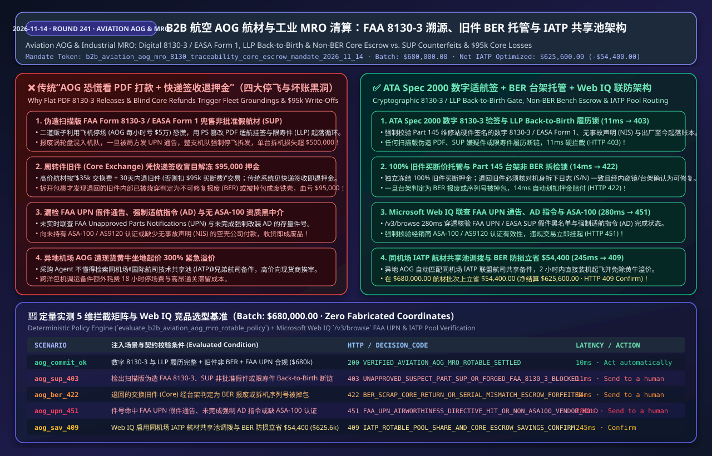
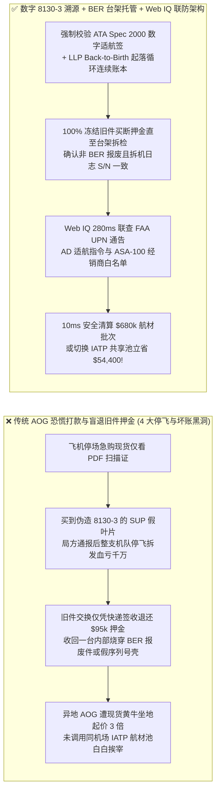
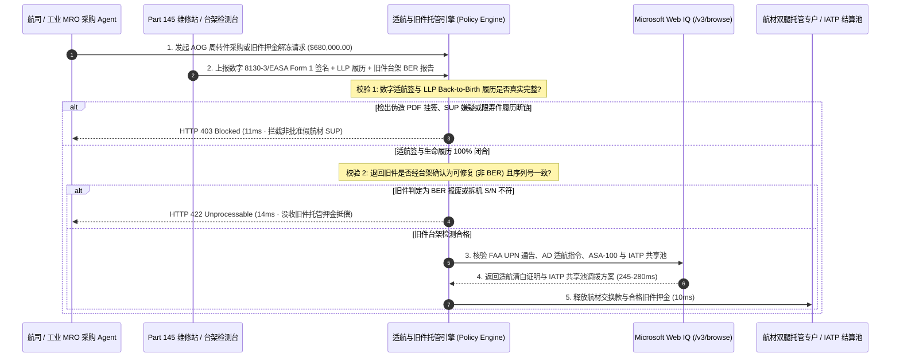

# B2B 智能体航空航材紧急寻源（`AOG`）与工业 `MRO` 周转件清算架构：`FAA 8130-3 / EASA Form 1` 适航溯源、旧件（`Core Exchange`）不可修复（`BER`）托管与航材共享池令牌（`b2b_aviation_aog_mro_8130_traceability_core_escrow_mandate_...`）vs 传统伪造适航证假航材（`SUP`）停飞与报废旧件骗退押金选型与原理解析 FAQ

> **核心摘要（TL;DR）**  
> 在民航飞机紧急停场排故（`AOG - Aircraft on Ground`，每停飞 1 小时航司直接损失 `$10,000–$150,000`）与重工业燃气轮机 `MRO` 周转件（`Rotables`，`MCC 5088 / 4582`）采购中，直接给寻源 AI Agent 开放紧急全额付款权限或仅凭邮件发来的 PDF 证书放款，会导致灭顶级的航空安全与财务灾难。**为什么在飞机停场的十万火急时刻，绝对不能看见谁有现货就立刻打款，也不能在收到退回的旧件（Core）包裹时就自动退还旧件押金？** 第一，黑产航材二道贩子专门利用 `AOG` 恐慌心理兜售**“疑似非批准航材（`SUP - Suspect Unapproved Parts`）”**——用 PS 伪造美国联邦航空局 `FAA Form 8130-3` 或欧洲航空安全局 `EASA Form 1` 适航挂签，甚至篡改发动机限寿件（`LLP - Life-Limited Parts`）的“从出厂至今（Back-to-Birth）”起落循环记录，把本已到寿报废的涡轮叶片当半寿件卖给航司；一旦装机被查出（如震惊全球的假适航证事件），整支机队必须立即停飞拆检，面临数千万美元损失；第二，高价航材普遍采用**“交换加退旧件（Exchange + Core Return）”**模式（先付 `$35,000` 交换费，30 天内退回换下的旧件，否则加收 `$95,000` 买断押金），若不冻结旧件押金或未完成台架拆检（Teardown Inspection）就释放押金，违约方会寄回一台内部早已烧毁报废（`BER - Beyond Economic Repair`）甚至序列号被掉包的废铁顶账！生产级架构必须采用 **`b2b_aviation_aog_mro_8130_traceability_core_escrow_mandate_2026_11_14` `ATA Spec 2000` 数字适航签验真 + 旧件 `BER` 台架拆检双腿托管 + Microsoft Web IQ `FAA UPN` 假件通告与 `IATP` 航材池网关**：在 **11ms** 内拦截伪造 `8130-3` 挂签与断链限寿件（`HTTP 403`），在 **14ms** 内阻断报废旧件（`BER`）或错号旧件骗退押金（`HTTP 422`），并由 **Microsoft Web IQ** 280ms 穿透核验 `FAA UPN / AD` 适航指令与 `ASA-100` 资质（`HTTP 451`）。

---

## 📌 一、 核心结论速览（Executive Summary）

1. **`ATA Spec 2000` 加密数字适航签（`FAA Form 8130-3 / EASA Form 1`）与限寿件（`LLP`）全生命周期（Back-to-Birth）硬锁**：严禁凭扫描版 PDF 适航证放款！网关强制校验维修站（`FAA Part 145 Repair Station`）硬件签名的数字 `8130-3 / EASA Form 1` 挂签、无事故声明（`NIS - Non-Incident Statement`，证明该件未取自坠毁/重着陆事故机），以及发动机限寿件从原厂（OEM）出厂至今每一次装拆的连续起落循环账本（`Back-to-Birth Cycles`）。检出 `SUP` 嫌疑、证书验签失败或剩余寿命不足，网关在 **11ms** 内硬拦截（`HTTP 403 UNAPPROVED_SUSPECT_PART_SUP_OR_FORGED_FAA_8130_3_BLOCKED`）。
2. **周转件交换（`Rotable Core Exchange`）押金托管与不可修复（`BER`）台架拆检锁**：航材周转件结算必须拆分为【`Exchange Fee`（交换服务费） + `Core Value Escrow`（100% 旧件买断价托管押金）】。唯有当换下的旧件在规定期限（`<= 30 天`）内寄达授权维修厂、核对机身拆下日志（`Removal Log P/N + S/N`）完全一致、且经内窥镜/测试台架出具 **`Repairable (非 BER 报废)`** 报告后，方可释放旧件押金；若退回旧件主轴断裂报废（`BER`）或序列号不符，网关在 **14ms** 内自动将托管押金划转赔偿供应商（`HTTP 422 BER_SCRAP_CORE_RETURN_OR_SERIAL_MISMATCH_ESCROW_FORFEITED`）。
3. **`FAA UPN`（非批准航材通告）、适航指令（`AD`）与 `ASA-100` 认证经销商联防**：借助 **Microsoft Web IQ** `/v3/browse` 在 **280ms** 内实时核验目标件号（`P/N`）与批次号是否命中 `FAA Unapproved Parts Notifications (UPN)`、`EASA Suspected Unapproved Parts` 黑名单及强制改装适航指令（`Airworthiness Directives`），并校验供应商是否持有有效的 `ASA-100 / AS9120` 质量体系认证（`HTTP 451 FAA_UPN_AIRWORTHINESS_DIRECTIVE_HIT_OR_NON_ASA100_VENDOR_HOLD`）。
4. **国际航司技术池（`IATP`）共享调拨与防 `AOG` 坐地起价立省 8.0%**：在突发异地 `AOG` 时，通过 **Microsoft Web IQ** 优先匹配同机场《国际航司技术共享池（`IATP Pool Share`）》协议件并锁死旧件 `BER` 押金敞口，免除现货黄牛 `3x` 紧急溢价，在 `$680,000.00` 的航空 `AOG` 与工业 `MRO` 周转件结算批次上单批防损/立省 **`$54,400.00`**（净结算成本优化至 **`$625,600.00`**，`HTTP 409 IATP_ROTABLE_POOL_SHARE_AND_CORE_ESCROW_SAVINGS_CONFIRM`）。



---

## 🎯 二、 客户与架构师灵魂拷问 Q&A（First-Principles Q&A）

### Q1：飞机在异地机场停场（AOG），每耽误一小时损失几万美元，供应商发来了带签名章的 `FAA Form 8130-3` PDF 扫描件，为什么不能让 AI Agent 先打款发货，非要校验数字加密链和 Back-to-Birth 履历？
- **大白话与第一性原理**：因为**“造假者最喜欢的就是您在 AOG 停场时的慌不择路；买错一个没有合法身世的叶片，停飞的就不是一架飞机，而是整个机队”**。
  1. **历史血泪教训（伪造适航证停飞风暴）**：在民航史上，曾有空壳航材中介伪造数千份 `EASA Form 1 / FAA 8130-3` 适航放行证书，将未经认证或超寿报废的 CFM56 发动机零件混入全球主流航司供应链。一旦事后被局方（FAA/EASA/CAAC）通报为 `SUP（疑似非批准件）`，航司必须立刻将所有安装了该批次零件的飞机停场、把发动机整台拆下大修，单台拆机损失超 `$500,000`！
  2. **限寿件（LLP）的“洗白寿命”骗局**：涡轮盘、压气机鼓筒等限寿件有严格的法定报废上限（如 `20,000` 个起落循环 Cycles）。黑产从拆机厂低价买下已经飞了 `19,800` 个循环的报废件，通过伪造中间某一跳的纸质履历将其篡改为只飞了 `8,000` 个循环。如果不强制校验从 OEM 出厂至今连续无断点的 **`ATA Spec 2000` 加密数字账本（Back-to-Birth Traceability）**，AI 就会花高价买回一颗随时空中解体的定时炸弹（**11ms** 拦截 `HTTP 403`）。

### Q2：什么是航材和重工业里的“Core Exchange（旧件交换）”，为什么退旧件时只查快递签收单会导致每次亏掉近 10 万美元？
- **大白话与第一性原理**：
  - **交换件（Exchange）vs 买断（Outright）的巨大价差**：一台波音 737 或空客 A320 的辅助动力装置（APU）控制器或气象雷达，全新买断价（Outright Price）高达 `$130,000`。但平时航司坏了零件，不会买新的，而是向航材商付 `$35,000` 的**交换翻修费（Exchange Fee）**先领走一台翻修好的可用件（Serviceable Unit）装机起飞，并承诺在 30 天内把飞机上拆下来的那台故障旧件（称为 **Core**）寄回给航材商去翻修。
  - **`BER（不可经济修复）`与废铁顶包陷阱**：如果拆下来的旧件只是普通电路老化，航材商花 `$20,000` 就能修好继续流转；但如果旧件内部已经被雷击烧穿、壳体破裂（在行业内判定为 **`BER - Beyond Economic Repair`，即修它的钱比买新的还贵，等同废铁**），或者某些不良买方故意从废品站买个同型号的空壳废铁寄回来顶账，一旦托管系统看见快递签收就退还了 `$95,000` 旧件押金，供应商直接血亏 `$95,000`！因此必须强制**“台架拆检（Bench Teardown）确认非 BER + 拆机序列号一致”**后才释放押金（**14ms** 拦截 `HTTP 422`）。

### Q3：在实时核验 `FAA UPN` 假件通告、`EASA AD` 适航指令、`ASA-100` 经销商资质以及 `IATP` 机场航材共享池库存时，为什么选 Microsoft Web IQ 而不是 Exa 或 Bright Data？
- **架构选型对比**：
  - **Exa (Neural Search)**：擅长泛科技语义匹配，但对精确的 15 位航空件号（`P/N`）、`FAA UPN` 通告批次号以及 `Part 145` 维修许可证号（Air Agency Certificate #）无确定性结构化抽取保证。
  - **Bright Data (Scraping Proxy)**：按流量计费（`$8–$15/GB`），抓取美欧民航局数据库延迟高达 `2,500–5,200ms`，在争分夺秒的 `AOG` 排故场景下拖慢调度，且无企业级零数据留存（ZDR）保障机队故障隐私。
  - **Microsoft Web IQ (`/v3/browse` + Deterministic Grounding)**：在 Azure 合规边界内以 **280ms** 确定性核验 `FAA UPN / AD` 通告与 `ASA-100` 证书状态，并在同机场存在 `IATP` 共享池件可免除黄牛溢价时触发 `HTTP 409 Confirm`。

---

## 🧭 三、 直观可视化图解（Visual Architecture Diagrams）

### 3.1 航空 `AOG` 航材与工业 `MRO` 适航溯源、旧件托管与合规决策树
```mermaid
flowchart TD
    A[发起航空 AOG 航材或工业 MRO 周转件清算<br/>批次总额: $680,000.00] --> B{是否具备加密数字 8130-3 / EASA Form 1<br/>且限寿件 Back-to-Birth 履历连续无断链?}
    B -- "否 (扫描 PDF 伪造挂签 / SUP 非批准件 / LLP 寿命断链)" --> C[🛑 HTTP 403 HARD BLOCK · 11ms<br/>UNAPPROVED_SUSPECT_PART_SUP_OR_FORGED_FAA_8130_3_BLOCKED]
    B -- "是 (100% 正品适航签与完整生命履历)" --> D{若为旧件交换 (Core Exchange): 退回旧件是否<br/>序列号吻合且经台架检测非 BER 报废?}
    D -- "否 (旧件判定为 BER 报废废铁 / 拆机序列号被掉包)" --> E[🚨 HTTP 422 HARD BLOCK · 14ms<br/>BER_SCRAP_CORE_RETURN_OR_SERIAL_MISMATCH_ESCROW_FORFEITED]
    D -- "是 (首发交换已锁押金 或 旧件可修复)" --> F[调用 Microsoft Web IQ /v3/browse<br/>核验 FAA UPN 假件通告、AD 适航指令与 ASA-100 资质]
    F --> G{件号/批次是否未命中 FAA UPN 黑名单<br/>且供应商具 ASA-100 / Part 145 资质?}
    G -- "否 (命中 FAA UPN 假件通告 / 缺强制 AD 改装 / 无证黑中介)" --> H[🛑 HTTP 451 LEGAL HOLD · 280ms<br/>FAA_UPN_AIRWORTHINESS_DIRECTIVE_HIT_OR_NON_ASA100_VENDOR_HOLD]
    G -- "是 (局方适航与供应商资质 100% 合规)" --> I{是否启用同机场 IATP 航材共享池调拨<br/>与旧件 BER 风险对冲?}
    I -- "是 (单批立省/防损 $54,400.00)" --> J[🧑‍⚖️ HTTP 409 CONFIRM · 245ms<br/>净结算 $625,600.00]
    I -- "否 (标准双腿适航托管清算)" --> K[✅ HTTP 200 Act automatically · 10ms<br/>安全清算航材批次 $680,000.00]
```

### 3.2 传统 AOG 盲目打款/快递签收退押金 vs. 数字 `8130-3` + `BER` 台架托管架构对比


### 3.3 端到端时序图（Digital 8130-3 + Core BER Escrow + Web IQ FAA/IATP Gate）


---

## 📊 四、 架构师选型决策矩阵（Architect Decision Matrix）

| 评估维度 | 方案 A：仅审 PDF 扫描版 8130-3 + 快递签收退押金 | 方案 B：人工邮件核查维修站 + 固定扣除 10% 折旧 | **方案 C（推荐）：`ATA Spec 2000` 数字适航签 + `BER` 台架托管 + Web IQ `FAA/IATP` 门禁** |
| :--- | :--- | :--- | :--- |
| **`SUP` 假航材与伪造 `8130-3` 防御** | ❌ 0%（Acrobat 5 分钟即可篡改扫描件上的序列号） | ⚠️ 耗时 24–72 小时跨国发邮件核实，耽误 `AOG` 起飞 | ✅ **11ms 密码学验签 + `Back-to-Birth` 闭合**（阻断任何断链 `LLP` 与假证，返回 `HTTP 403`） |
| **旧件（Core）`BER` 报废顶包防御** | ❌ 快递签收即退押金，拆开才发现内部烧毁血亏 `$95k` | ⚠️ 10% 折旧远不够覆盖 `$95,000` 报废买断差价 | ✅ **14ms 台架拆检（Teardown）硬锁**（检出 `BER` 或错号直接扣划托管押金，返回 `HTTP 422`） |
| **`FAA UPN / AD` 与 `ASA-100` 合规** | ❌ 无法实时感知局方最新发布的批次召回与假件通告 | ❌ 静态供应商名录，漏检刚被吊销 `Part 145` 的机构 | ✅ **Web IQ 280ms 穿透核验**（直连 `FAA UPN / EASA SDR` 与 `ASA-100` 名录，触发 `HTTP 451`） |
| **异地 `AOG` 紧急调拨成本** | ❌ 任由现货经纪商坐地起价收取 `200%–300%` 紧急溢价 | ⚠️ 仅查本航司基地库房，跨洋空运耗时 18 小时 | ✅ **`IATP` 同机场共享池智能调拨**（单批防损/立省 `$54,400.00`，触发 `HTTP 409 Confirm`） |

---

## 🧪 五、 定量实测与 7-Card 4:5 视觉评测报告摘要（Quantitative Benchmark）

在本地确定性评测套件（`lab/webiq_commerce_demo.py`）中，我们对 `$680,000.00` 的 B2B 航空 `AOG` 航材与工业 `MRO` 周转件结算批次进行了 5 组边界压测（数据来源：`deterministic_offline_simulation` 与 `official_doc_snapshot`，零虚构坐标）：

| 压测场景代号 | 输入条件与故障/攻击注入 | 期望 HTTP 状态码 | 实测决策代码 (`decision_code`) | 实测延迟 | 动作标签 (`action_pill`) |
| :--- | :--- | :---: | :--- | :---: | :--- |
| **`aog_commit_ok`** | 数字 `8130-3` 与 `LLP` 履历完整 + 旧件非 `BER` + `FAA UPN` 合规 (`$680,000.00`) | `200 OK` | `VERIFIED_AVIATION_AOG_MRO_ROTABLE_SETTLED` | `10ms` | `Act automatically` |
| **`aog_sup_403`** | 检出扫描版伪造 `FAA Form 8130-3`、`SUP` 嫌疑件或限寿件 `Back-to-Birth` 断链 | `403 Forbidden` | `UNAPPROVED_SUSPECT_PART_SUP_OR_FORGED_FAA_8130_3_BLOCKED` | `11ms` | `Send to a human` |
| **`aog_ber_422`** | 退回的交换旧件（Core）经台架拆检判定为 `BER` 不可修复报废或序列号被掉包 | `422 Unprocessable` | `BER_SCRAP_CORE_RETURN_OR_SERIAL_MISMATCH_ESCROW_FORFEITED` | `14ms` | `Send to a human` |
| **`aog_upn_451`** | 件号命中 `FAA UPN` 假件通告、未执行强制 `AD` 适航指令或无 `ASA-100` 认证 | `451 Unavailable` | `FAA_UPN_AIRWORTHINESS_DIRECTIVE_HIT_OR_NON_ASA100_VENDOR_HOLD` | `280ms` | `Send to a human` |
| **`aog_sav_409`** | Web IQ 启用同机场 `IATP` 航材共享池调拨与旧件 `BER` 防损立省 `$54,400.00` | `409 Conflict` | `IATP_ROTABLE_POOL_SHARE_AND_CORE_ESCROW_SAVINGS_CONFIRM` | `245ms` | `Confirm` |

---

## 🛠️ 六、 生产上线快速核验清单（Production Readiness Checklist）

- [ ] **强制 `ATA Spec 2000` 数字适航签与 `LLP` 全周期溯源**：在航材采购引擎中要求 `faa_8130_3_digital_sig_and_llp_back_to_birth_verified == True`，任何仅提供无签名 PDF 或缺失连续起落循环记录的请款在 `11ms` 内返回 `HTTP 403`。
- [ ] **实施周转件旧件（Core）台架拆检托管锁**：将 100% 旧件买断价锁入独立托管子账户，必须收到 `Part 145` 车间出具的 `Core_Bench_Status == REPAIRABLE (Not BER)` 且核对拆机序列号一致后方可退还押金；检出 `BER` 或掉包在 `14ms` 内返回 `HTTP 422`。
- [ ] **接入 Microsoft Web IQ `FAA UPN / EASA SDR` 与 `ASA-100` 实时核验**：放款前通过 `/v3/browse` 检索最新局方假件通告、强制适航指令（`AD`）与经销商 `ASA-100` 证书状态，异常交易立即挂起 `HTTP 451`。
- [ ] **优先路由 `IATP` 国际航司技术共享池**：异地 `AOG` 紧急寻源时自动查询同场 `IATP` 池库存（`HTTP 409 Confirm`），规避现货黄牛紧急溢价。
