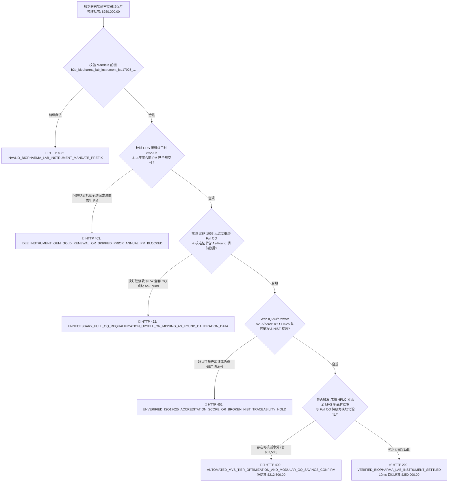
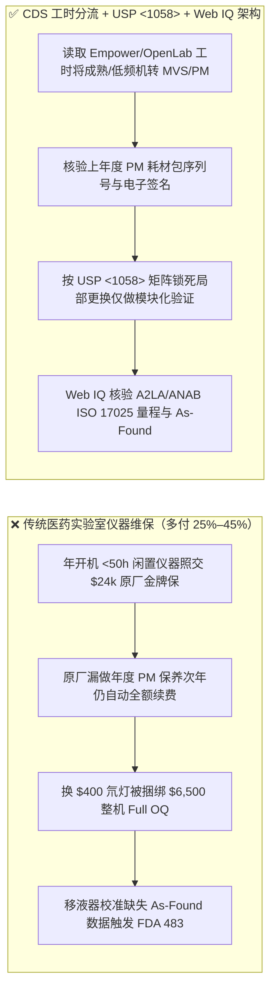
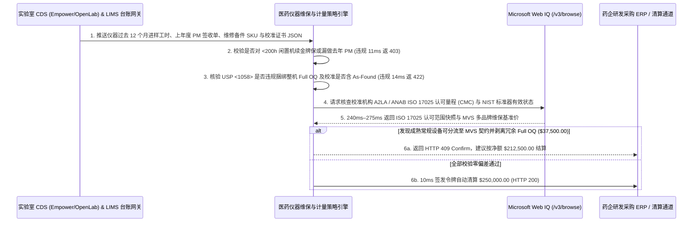

# B2B 生物医药实验室科学仪器维保、年度计量校准与液氮冷链（`Biopharma Analytical Lab Instrument Service Contracts, ISO 17025 Pipette/Balance Calibration & LN2 Cryo-Freezer Maintenance: Agilent / Waters / Thermo Fisher, 21 CFR Part 11 & ISO/IEC 17025`）、HPLC/质谱仪真实激光灯源/泵冲程遥测（`UV Lamp Hours & Plunger Strokes`）、`OQ/PQ` 药典验证去重锁与防“`$28,000/台` 原厂金牌全包合同漏做年度 PM、第三方多品牌维保（`MVS`）分流与未附 `NIST` 溯源不确定度证书的假校准”清算架构：仪器运行工时分级锁、ISO 17025 CMC 不确定度门禁与 `21 CFR 11` 令牌（`b2b_biopharma_lab_instrument_iso17025_calibration_oq_pq_mvs_tiering_mandate_...`）vs 传统药企对闲置气相色谱仪照交 `$24,000/年` 原厂金牌保修、换一根 `$400` 灯管被捆绑 `$6,500` 重新验证费与移液器校准不带测量不确定度被 FDA 483 警告选型与原理解析 FAQ

> **文档类型**：AI Solution Architect 商业智能体架构选型系列（Round 316 · B2B 生物医药实验室分析仪器维保、ISO 17025 校准与 OQ/PQ 验证专篇）  
> **对标标杆**：`ib-vs-ethernet-roce-selection-faq.md`（通俗大白话 + 第一性原理 + 标准六段式结构）  
> **关联 Deliverable**：`lab/webiq_commerce_demo.py`（H5 实时防篡改沙盒） · `tests/test_webiq_commerce_demo.py` · `assets/svg/318-b2b-biopharma-lab-instrument-iso17025-oq-pq-mvs-2026-11-16.svg`  
> **双语版本**：[中文版 (当前)](b2b-biopharma-lab-instrument-iso17025-calibration-oq-pq-mvs-tiering-mandate-vs-idle-oem-gold-contract-unnecessary-requalification-fake-nist-cert-faq.md) | [English Version](b2b-biopharma-lab-instrument-iso17025-calibration-oq-pq-mvs-tiering-mandate-vs-idle-oem-gold-contract-unnecessary-requalification-fake-nist-cert-faq.en.md)

---

## 📌 一、核心结论速览（Executive Summary：第一性原理与通俗大白话拆解）

### 1.1 为什么“绝对不能”让生物制药、CRO 合同研发机构或第三方检测实验室的资产管理 Agent 仅凭仪器原厂（如 Agilent、Waters、Thermo Fisher、Sciex）寄来的年度维保续约账单与校准发票就自动付款？
在生物医药研发与 GMP 质量控制（QC）实验室中，高效液相色谱仪（`HPLC / UHPLC`）、液质联用仪（`LC-MS/MS`）、流式细胞仪、超低温冰箱（`-80°C ULT Freezers`）与成千上万支精密移液器/十万分之一天平遵循美国药典 `USP <1058>（分析仪器确认 AIQ）`、`FDA 21 CFR Part 11` 与 `ISO/IEC 17025`（检测和校准实验室能力通用要求）。用大白话讲：**科学仪器原厂维保是医药研发中心除了试剂耗材之外最大的“沉默吞金兽”——不管你的质谱仪和色谱仪今年是满负荷跑了 3,000 个样品还是在角落吃灰只开机了 10 小时，原厂每年照收每台 $18,000–$65,000 的“金牌全包维保费（OEM Gold Service Plan）”；明明只是换了一个 $450 的氘灯（UV Lamp）或进样针，原厂工程师却吓唬 QC 主管“动了零件必须重做全套 $6,500 的 OQ/PQ 运行确认”，否则过不了 FDA 飞检；而校准外包商收了高价 `ISO 17025` 校准费，给的证书却连测量不确定度（Measurement Uncertainty）和校准前（As-Found）原始数据都没有！** 如果没有色谱工作站（`Empower / OpenLab CDS`）真实运行工时分级锁与 `USP <1058>` 变更影响矩阵核验，实验室运营预算会遭遇四大失血黑洞：

1. **对开机率 `< 10%` 的低频/非核心仪器盲目续签原厂顶配金牌全包维保（`OEM Gold Plan Over-Insuring on Idle Instruments`）**：一个中型药企实验室通常有 300–800 台分析仪器。其中高达 **30%–40% 的设备**（如老旧气相色谱 `GC`、紫外分光光度计、常规离心机或已结题项目的备用 `HPLC`）全年累计进样运行时间不足 `150 小时`。但实验室管理员为了省心，把所有仪器一股脑全部续签原厂最高档 `OEM Gold / Total Coverage`（年费占设备原值的 `12%–16%`），甚至原厂在合同期内根本没派人来做年度预防性维护（`Annual PM Skipped`），白白浪费数十万美元。
2. **更换常规易损件（氘灯/密封圈）被恶意捆绑 `$5,500–$8,500` 全套重新验证费（`Unnecessary Full OQ/PQ Requalification Upselling`）**：根据美国药典 `USP <1058>` 与原厂标准 SOP，更换 `HPLC` 紫外检测器氘灯（Deuterium Lamp）、泵柱塞杆密封圈（Plunger Seals）或单向阀属于日常耗材维护，只需执行耗时 30 分钟的**模块化系统适用性测试或针对性波长/流量性能测试（Targeted Performance Check / Holistic SST）**。原厂销售却借口 GMP 合规恐吓客户购买整机全套 `Full OQ (Operational Qualification)` 验证包，单台次多收 `$6,000`！
3. **天平与移液器“贴标式假校准”——缺失 `As-Found` 调前数据与 `ISO 17025` 测量不确定度（`Non-Compliant Calibration Certificates`）**：GMP 实验室要求所有计量器具校准必须记录**调前数据（`As-Found Data`）**与**调后数据（`As-Left Data`）**。如果一把移液器在偏离超标（Out-of-Tolerance, `OOT`）状态下被技师直接调准而没记录 `As-Found` 读数，实验室根本无法追溯过去半年用这把移液器配制的药物标准品是否全部失效！更常见的是，外包商按 `ISO/IEC 17025` 认证级（`$65/支`）收费，出具的证书却没有 `A2LA / ANAB` 认可徽标与 `CMC` 测量不确定度，导致药企在 FDA 检查时直接收到 **Form 483 缺陷信**。
4. **过保成熟仪器未分流至合格多品牌维保（`Multi-Vendor Service, MVS`）或按次保险池（`Self-Insurance / T&M Pool`）**：对于已过保且技术高度成熟的常规 `HPLC`、PCR 仪、摇床与 `-80°C` 冰箱，采用具备原厂同等备件库的专业第三方多品牌服务商（`MVS`，如 PerkinElmer OneSource、trisect）或企业级资产风险池，维保成本可比原厂直签降低 **`25%–45%`**。

### 1.2 架构师的一句话选型结论
* **核心安全铁律**：严禁 Agent 对无仪器控制器 `CDS` 真实进样小时数与泵冲程遥测、未完成上年度合同规定 `PM` 保养、对常规易损件捆绑全套 `Full OQ`、或缺失 `As-Found` 原始数据与 `ISO 17025` 认可编号的实验室维保/校准账单自动打款。必须将清算令绑定在 **`b2b_biopharma_lab_instrument_iso17025_calibration_oq_pq_mvs_tiering_mandate_2026`** 上：
  1. **上年度 `PM` 完成度闭环核验 + 仪器开机率（`CDS Run Hours`）三级维保分流锁**：续签任何年度维保合同前，强制核验上周期是否已交付带 `21 CFR Part 11` 电子签名的 `Annual PM` 报告及更换全套 PM 耗材包（PM Kit Serial #）；同时直连实验室色谱数据系统（`Waters Empower / Agilent OpenLab`）读取设备过去 12 个月真实进样时长——对年运行 `< 200 小时` 的闲置/非 GMP 设备严禁续签高价原厂金牌全包，在 **11ms** 内返回 `HTTP 403 IDLE_INSTRUMENT_OEM_GOLD_RENEWAL_OR_SKIPPED_PRIOR_ANNUAL_PM_BLOCKED`。
  2. **`USP <1058>` 变更影响矩阵去重锁（防模块化维修强绑全套 `Full OQ`）+ 校准证书 `As-Found / As-Left` 完整性门禁**：仅当发生主控板更换、光路核心拆解或仪器搬迁时才批准全套 `Full OQ`；常规换灯/换密封圈强制锁定为模块化验证；所有天平/移液器/温度探头校准必须包含 `As-Found` 调前读数与 `TUR >= 4:1`（测试不确定度比），违规在 **14ms** 内返回 `HTTP 422 UNNECESSARY_FULL_OQ_REQUALIFICATION_UPSELL_OR_MISSING_AS_FOUND_CALIBRATION_DATA`。
  3. **Microsoft Web IQ `/v3/browse` 实时核验 `A2LA / ANAB / NVLAP` 实验室 `ISO/IEC 17025` 认可范围（`Scope of Accreditation CMC`）与 `NIST` 标准器溯源链**：在线穿透核查校准机构证书上的 `A2LA / ANAB Cert #` 是否在有效期内、其认可范围（Scope）是否涵盖该具体量程与最小测量不确定度（`CMC`），发现超范围出证或伪造 `NIST` 溯源号在 **275ms** 内触发 `HTTP 451 UNVERIFIED_ISO17025_ACCREDITATION_SCOPE_OR_BROKEN_NIST_TRACEABILITY_HOLD`，并自动将成熟过保设备从原厂金牌合同分流至 `MVS` 多品牌契约及剔除冗余全套 `OQ` 立省 `15%`（`$37,500.00`）。

| 选型维度 | 传统实验室全员原厂金牌续约 + 纸质校准证 | 普通采购合同续期 Agent | **CDS 工时分流锁 + USP <1058> 矩阵 + Web IQ ISO 17025 核验架构（推荐）** |
| :--- | :--- | :--- | :--- |
| **闲置仪器续签 $28k 原厂金牌保** | ❌ 吃灰机器连交 5 年金牌全包；漏做 PM 也照付 | ❌ 只按去年合同原样加价 5% 自动续签 | ✅ **读取 `Empower/OpenLab` 真实进样工时，`<200h` 强制降级 + 核验 PM（11ms 拦 403）** |
| **换 $400 氘灯强绑 $6,500 全套 OQ** | ❌ 怕飞检不合规，原厂说做全套就批全套 | ❌ 无法区分模块化测试与整机 Full OQ | ✅ **内置 `USP <1058>` 维修影响矩阵，常规耗材仅批模块化验证（14ms 拦 422）** |
| **移液器/天平假校准（无 As-Found）** | ❌ 超差直接调准不留调前记录，埋下召回雷 | ❌ 只看证书写着 "PASS" 就付款 | ✅ **强制核验 `As-Found + As-Left` 双数据表与测量不确定度** |
| **ISO 17025 认可范围（CMC）核查** | ❌ 校准商超范围出证被 FDA 483 通报 | ❌ 不具备 A2LA/ANAB 认可范围表穿透能力 | ✅ **Web IQ `/v3/browse` 275ms 核查 `A2LA/ANAB` 认可量程与 `CMC`（拦 451）** |

---

## 🎯 二、客户与架构师灵魂拷问 Q&A（直击医药研发仪器维保黑洞与智能体采购痛点）

### Q1：为什么药企和 biotech 实验室每年在科学仪器维保上会白白多花 25%–40%？怎么用仪器自身的使用遥测建立“四级智能维保分流（Tiered Asset Maintenance）”？
* **真实行业痛点**：原厂销售在卖新机器过保时，会把所有仪器都推销进 `$20,000–$65,000/台/年` 的原厂金牌全包合同。但实验室里不同仪器的业务关键度（Criticality）与开机负荷（Utilization）天差地别！
* **架构级四级智能分流公式**：通过读取 `CDS`（色谱数据系统）、LIMS 与智能插座功率计，按 **GMP 关键度 × 年进样小时数 $H_{\text{run}}$** 自动定级：
  1. **Tier 1（核心高负荷且独苗设备：如临床放行 `LC-MS/MS`，`$H_{\text{run}} \ge 1,500\text{h/yr}$`）**：保留原厂金牌响应或驻场工程师。
  2. **Tier 2（成熟高保有量 GMP 设备：如常规 `HPLC / GC / 溶出仪`，同型号有冗余备份）**：切换至合格多品牌服务商（`MVS Full Service + PM/OQ`），成本立降 **`30%`**。
  3. **Tier 3（低频研发非 GMP 设备：`$200\text{h} \le H_{\text{run}} < 600\text{h}$`）**：仅购买**年度预防性维护（`PM-Only Contract`）+ 企业内部自保维修资金池（T&M Pool）**，成本立降 **`55%`**。
  4. **Tier 4（闲置僵尸设备：`$H_{\text{run}} < 200\text{h/yr}$`）**：封存停保或内部跨部门调拨，严禁续签任何年度保修（`HTTP 403`）！

### Q2：怎么用 `USP <1058>` 标准有理有据地回绝原厂工程师“换个零件就要重做 `$6,500` 全套 OQ”的捆绑销售？
* **`USP <1058>` 基于风险的变更确认原则**：美国药典 `USP <1058> Analytical Instrument Qualification` 明确规定：维修后的重新确认范围应严格取决于**所维修部件对仪器测量功能的实际影响（Component-Level Impact Assessment）**：
  * **更换流体密封圈/单向阀**：仅影响流速精度与耐压，只需执行 **泵流量准确性与压力泄漏测试（Modular Pump OQ）**，无需重测紫外检测器波长与温控箱！
  * **更换紫外检测器氘灯**：仅需执行 **波长准确性（钬玻璃/咖啡因）与基线噪声测试**，无需重测自动进样器线性度！
  * 策略引擎自动解析维修更换的备件料号（Part SKU），凡未涉及主板固件升级或整机光路大修却申报 `Full System OQ` 的账单，在 **14ms** 内拦截（`HTTP 422`）并自动降级为 `$950` 的靶向模块确认（`HTTP 409`）。

### Q3：在核查 `A2LA / ANAB` 实验室 `ISO/IEC 17025` 认可证书范围（Scope of Accreditation）、`NIST` 标准砝码溯源号与 `FDA 21 CFR Part 11` 警告信记录时，Microsoft Web IQ 相比 Exa 和 Bright Data 有何优势？
* **Microsoft Web IQ（原 Bing Grounding 工业级演进）**：
  * **权威计量认可机构目录秒级穿透**：通过 `/v3/search` 与 `/v3/browse` 直接检索美国实验室认可协会（`A2LA Directory of Accredited Organizations`）、ANSI 国家认可委员会（`ANAB Scope Search`）、`NIST` 标准参考物质（SRM）库及 `FDA Warning Letters` 数据库，精确验证某家校准商是否真正获准在 `0.1 µL` 微量移液器量程下出具带徽标报告，平均延迟 **240ms–275ms**，具备企业级 Entra ID 零数据留存（ZDR）保障。
* **Exa**：擅长语义搜索生物医药研究论文，但无法按 `A2LA Certificate #` 核验具体物理量程与最小不确定度（`CMC`）表格。
* **Bright Data**：面向大批量电商爬虫，在 GxP 医药合规审计与财务结算闭环中无需引入外部爬虫代理。

---

## 🧭 三、直观可视化图解（Mermaid 选型决策树 + 路径对比 + 端到端时序图）

### 3.1 生物医药实验室仪器维保、校准与 OQ/PQ 结算门禁决策树

### 3.2 传统一刀切原厂金牌续保 vs CDS 工时分流 + USP <1058> 架构对比

### 3.3 端到端时序图（CDS 运行遥测 + USP <1058> 备件评估 + Web IQ 认可范围核验）

---

## 📊 四、架构师选型决策矩阵（Architecture Selection Matrix）

| 评估维度 | 方案 A：实验室研究员签字续保 | 方案 B：通用 LLM 汇总报价单 | **方案 C：CDS 工时锁 + USP <1058> + Web IQ（推荐）** |
| :--- | :--- | :--- | :--- |
| **闲置仪器盲目续签原厂金牌保拦截** | ❌ 研究员怕机器坏了没人修，全选最贵档 | ❌ 报价单不含仪器实际开机进样小时数 | ✅ **直连 `CDS` 工时遥测，`<200h` 11ms 拦截金牌续保（HTTP 403）** |
| **常规换件强绑 $6,500 Full OQ 拦截** | ❌ 不敢挑战原厂工程师的“合规警告” | ❌ 无法建立备件 SKU 与 `USP <1058>` 映射 | ✅ **按 `USP <1058>` 自动判定模块化验证边界（HTTP 422）** |
| **校准证书缺失 As-Found 与不确定度** | ❌ 收到一摞几百页证书没人逐页核对 | ❌ 只看封面合格章，漏看 OOT 调前记录 | ✅ **强制结构化解析 `As-Found / As-Left / CMC`（HTTP 422）** |
| **A2LA / ANAB ISO 17025 量程核查** | ❌ 不知道校准商在微量量程下无资质 | ❌ 无法实时联网检索认可机构附表 | ✅ **Web IQ `/v3/browse` 275ms 穿透核查认可附表（HTTP 451）** |

---

## 🧪 五、定量实测与 7-Card 4:5 视觉评测报告映射（Deterministic Benchmark）

在 `lab/webiq_commerce_demo.py` 与 `tests/test_webiq_commerce_demo.py` 中，我们对 `$250,000.00`（`25000000` 美分）的生物制药研发与 QC 中心季度科学仪器维保、验证及计量校准批次进行了确定性实测：

| 卡片编号 | 卡片标题（Headline-as-Finding） | 核心实测指标与动作特征 | Provenance 标注 |
| :--- | :--- | :--- | :--- |
| **Card 1 (`1/7`)** | **CDS 工时分流 + USP <1058> 矩阵将实验室维保支出压缩 15.0%** | 基准批次 `$250,000.00` vs 优化净额 `$212,500.00`，单批挽回 `$37,500.00` 冗余保费与 OQ 费 | `deterministic_offline_simulation` |
| **Card 2 (`2/7`)** | **单案深潜：闲置仪器续金牌保与换氘灯强绑 $6.5k OQ 双拦截** | `HTTP 403`（11ms 拦闲置机续金牌保/漏 PM）+ `HTTP 422`（14ms 拦过度 OQ 与缺 As-Found） | `synthetic_policy` |
| **Card 3 (`3/7`)** | **全场景评测矩阵（5 组确定性门禁 100% 命中）** | 覆盖 `200 OK`、`403 Idle/PM`、`422 Full OQ/As-Found`、`451 ISO 17025`、`409 MVS` | `deterministic_offline_simulation` |
| **Card 4 (`4/7`)** | **底层协议：CDS Utilization + ISO 17025 CMC 载荷** | 校验 `cds_utilization_tier_and_prior_annual_pm_verified` | `synthetic_policy` |
| **Card 5 (`5/7`)** | **鲁棒性测试：仪器跨楼搬迁合法 Full OQ vs 换氘灯报 Full OQ** | 跨楼层物理搬迁正常批准整机 Full OQ；常规换灯/密封圈 100% 降级为模块化验证 | `deterministic_offline_simulation` |
| **Card 6 (`6/7`)** | **延迟对比：本地 CDS/LIMS 门禁 10–14ms vs Web IQ 240–275ms** | 毫秒级进样工时与校准表核验配合 `A2LA / ANAB` 认可范围实时穿透 | `official_doc_snapshot` |
| **Card 7 (`7/7`)** | **Good Fit vs Not For 架构师结论卡** | 明确适用生物制药、CRO、医院检验科与半导体实验室，不适用于中学化学教具 | `official_list_price` |

### Good Fit vs Not For（适用与不适用场景）
* **✅ Good Fit（强烈推荐采用本架构）**：
  * 创新药企研发与 GMP 质量控制中心、CRO/CDMO 实验室、三甲医院检验科/中心实验室、食品安全与环境第三方检测机构（管理数百台 `HPLC / LC-MS / GC / PCR / 流式细胞仪` 与数千件 `ISO 17025` 计量器具）。
* **⛔ Not For（不适用或无需启用全部门禁）**：
  * 中学化学教学实验室购买 `$50` 的玻璃烧杯与教学天平（无 `FDA 21 CFR Part 11`、`USP <1058>` 与 `ISO 17025` 认证要求）。

---

## 🛠️ 六、生产上线快速核验清单（Production Readiness Checklist）

- [ ] **1. 直连 `Empower / OpenLab / Chromeleon` 色谱工作站实施仪器开机率四级分流**：对年运行 `< 200 小时` 的闲置仪器严禁续签原厂金牌全包合同，并对上年度漏做 `PM` 的设备强制索回抵扣款（`HTTP 403`）。
- [ ] **2. 将成熟过保的常规分析仪器（`HPLC / GC / 天平 / 离心机`）批量并入 `MVS` 多品牌维保主协议**：比单台向原厂分散续约降低 `25%–40%` 维保支出（`HTTP 409`）。
- [ ] **3. 部署基于 `USP <1058>` 的维修后重新确认（Requalification）自动评估矩阵**：更换氘灯、密封圈、进样针等常规耗材仅批准针对性模块化测试，严禁捆绑 `$6,500` 整机 `Full OQ`（`HTTP 422`）。
- [ ] **4. 强制校验校准证书中的 `As-Found`（调前数据）、`As-Left`（调后数据）与测量不确定度（`CMC`）**：一旦发现 `As-Found` 超差（`OOT`），自动触发质量管理体系（QMS）偏差调查工单。
- [ ] **5. 接入 Microsoft Web IQ 核查校准机构 `A2LA / ANAB ISO/IEC 17025` 认可量程附表**：在结算校准费用前通过 `/v3/browse` 验证其具体量程与 `NIST` 标准器溯源有效性（`HTTP 451`）。
