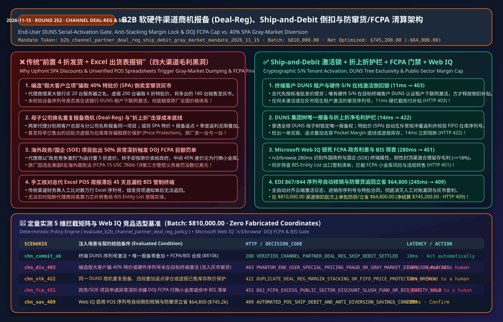
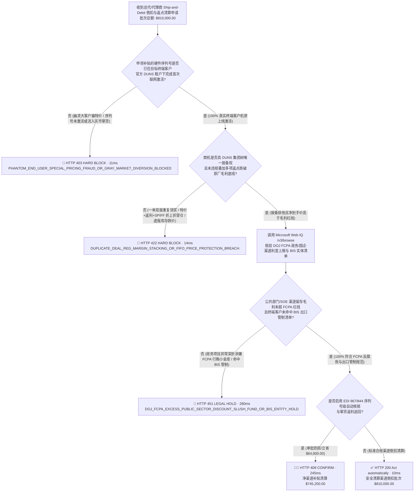
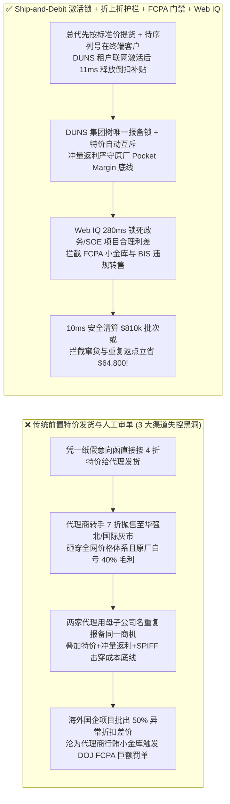
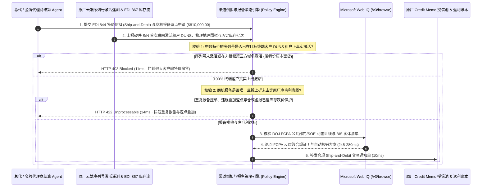

# B2B 智能体软硬件渠道商机报备（`Deal Registration`）、特价倒扣（`Ship-and-Debit / SPA`）与防“窜货洗单（`Gray-Market Diversion`）”清算架构：终端客户 `DUNS/LEI` 租户激活验真、互斥折上折封顶锁与 `FCPA` 反海外腐败门禁（`b2b_channel_partner_deal_reg_ship_debit_gray_market_mandate_...`）vs 传统代理商编造假大客户骗取 40% 特价倒卖黑市、一单双报叠加返点与政务高折扣行贿暴雷选型与原理解析 FAQ

> **核心摘要（TL;DR）**  
> 在企业级算力服务器、网络设备与 B2B SaaS 原厂（OEM/ISV）向全球总代（Distributor）及金牌代理商（VAR）发放商机报备保护返点（`Deal Registration`）与特价倒扣补贴（`Ship-and-Debit / Special Pricing Authorization — SPA`，`$810,000/批次`）中，如果让渠道财务 AI Agent 仅凭总代上传的 `POS` 出货周报 Excel 表或代理商提交的“某大客户采购意向函 PDF”就自动批复 `40%` 特价返利贷项通知单（Credit Memo），原厂每年会有 **`5%–12%` 的渠道毛利被“骗特价窜货”与“折上折套利”直接掏空**！**为什么绝对不能见代理商报备了知名大客户名称就给 40% 特价提货，也不能在硬件序列号尚未在终端客户机房激活前就结算 `Ship-and-Debit` 差价补贴？** 第一，IT 硬件与软件分销圈最暴利的黑产是**“幽灵终端客户骗特价窜货（`Phantom End-User SPA Diversion`）”**——不良二级代理商伪造某大型银行或高校的立项公章，向原厂 AI 申请按 6 折（`40% Off`）特批价提走 200 台高端交换机或 GPU 服务器；货一到手，代理商根本没送去银行，而是立刻加价 10% 甩卖到华强北或国际灰市（Gray Market），冲击原厂正常 9 折经销体系！第二，同一家大客户商机常被多家代理商改换子公司名字重复报备（`Duplicate Deal-Reg`），且将【商机报备 15% + 特价批单 25% + 季度冲量返点 8% + 销售员个人激励 `SPIFF`】多重叠加击穿原厂成本底线；第三，在海外政府或国有企业（`SOE`）招投标中，若代理商申请反常的 `45%` 巨额折扣空间，省下的差价极易被用作向采购官员行贿的“小金库”，根据美国《反海外腐败法（`FCPA 15 U.S.C. § 78dd-1`）》，原厂将因“未能管控第三方渠道异常折扣”被司法部重罚数亿美元！生产级架构必须采用 **`b2b_channel_partner_deal_reg_ship_debit_gray_market_mandate_2026_11_15` 终端客户 `DUNS` 域名与硬件序列号在线激活遥测锁 + 商机唯一排他与折上折底线引擎 + Microsoft Web IQ `DOJ FCPA` 公共部门利差封顶与 `BIS` 实体清单网关**：在 **11ms** 内拦截假大客户骗特价窜货（`HTTP 403`），在 **14ms** 内阻断重复报备与叠加返点穿仓（`HTTP 422`），并由 **Microsoft Web IQ** 280ms 穿透拦截 `FCPA` 高危政务折扣与违规转售（`HTTP 451`）。

---

## 📌 一、 核心结论速览（Executive Summary）

1. **终端客户 `DUNS/LEI` 租户绑定与硬件序列号在线激活（`Phone-Home Telemetry`）闭环释放 `Ship-and-Debit` 门禁**：
   - **先激活、后返差价（No Activation, No Rebate）**：在分销“高进低出倒扣（`Ship-and-Debit`）”模式下，总代先按标准批发价进货，待货物售予特批终端客户后再向原厂申领 `30%–40%` 差价补贴。网关强制要求：唯有当该批设备出厂唯一硬件序列号（`S/N` / `MAC` / 芯片 `ECID`）在原厂云端许可服务器完成首次联网激活（或绑定至目标终端客户官方 `DUNS/LEI` 经认证的企业域名租户），且收货物理地址与终端客户吻合时，方才释放倒扣补贴。任何未激活或流入非授权灰市域名的序列号，网关在 **11ms** 内硬拦截（`HTTP 403 PHANTOM_END_USER_SPECIAL_PRICING_FRAUD_OR_GRAY_MARKET_DIVERSION_BLOCKED`）。
2. **`DUNS` 集团树商机报备排他锁（`Deal-Reg Exclusivity`）、折上折保底毛利护栏与跌价保护（`Price Protection`）`FIFO` 批次核验**：
   - **穿透集团树防“一单多报”**：网关将代理商报备的客户名称归一至全球唯一 `9 位 D-U-N-S` 或 `20 位 LEI` 集团母子公司树，锁定唯一首发赢单代理商（Incumbent Partner）。
   - **禁止返点无限叠加（Anti-Stacking Floor）**：当单笔订单已享受 `SPA` 特批底价时，自动互斥扣减常规季度冲量返利（Volume Rebate），确保 `Net_Pocket_Price >= OEM_Minimum_Margin_Floor`；同时对库存跌价保护申请强制按 `EDI 867` 进销存 `FIFO` 先进先出核验真实在库未售序列号。违背上述任一规则，网关在 **14ms** 内拦截（`HTTP 422 DUPLICATE_DEAL_REG_MARGIN_STACKING_OR_FIFO_PRICE_PROTECTION_BREACH`）。
3. **美国《反海外腐败法（`FCPA 15 U.S.C. § 78dd-1`）》公共部门折扣上限与 `BIS Entity List` 穿透门禁**：借助 **Microsoft Web IQ** `/v3/browse` 在 **280ms** 内核验终端客户是否属于外国政府机构或国有企业（`SOE - State-Owned Enterprise`）——针对公共部门项目，网关强制锁死代理商最大允许毛利留存空间（如 `<= 18%`），严禁批复可被转化为商业贿赂小金库的超常深折（`>35%`），并实时筛查终端客户与中转方是否命中 `BIS Entity List` 出口管制清单（`HTTP 451 DOJ_FCPA_EXCESS_PUBLIC_SECTOR_DISCOUNT_SLUSH_FUND_OR_BIS_ENTITY_HOLD`）。
4. **序列号级 `EDI 867/844` 自动倒扣对账与零窜货价格体系保护立省 8.0%**：通过 **Microsoft Web IQ** 自动拦截虚假特价申领与重复返点，在 `$810,000.00` 的企业级渠道特价倒扣与返利清算批次上单批防损/立省 **`$64,800.00`**（原厂净补贴支出收敛至 **`$745,200.00`**，`HTTP 409 AUTOMATED_POS_SHIP_DEBIT_AND_ANTI_DIVERSION_SAVINGS_CONFIRM`）。

---

## 🎯 二、 客户与架构师灵魂拷问 Q&A（First-Principles Q&A）

### Q1：代理商说“为了跟友商抢某大银行的标，必须请原厂批一个 4 折特价（SPA）”，为什么原厂 AI 直接按 4 折发货或见总代出货单就退差价，会导致市场上到处都是低价窜货？
- **大白话与第一性原理**：因为在渠道分销里，**“4 折的特批价与 8.5 折的市场批发价之间存在高达 45% 的无风险套利暴利——只要不核验设备最终是不是真的插在那家银行机房里通电激活，这批货 90% 会流向窜货黑市”**！
  1. **“借大客户名头洗货”的经典套路**：某大银行确实要买 20 台服务器，不良代理商却拿着银行的招标文件向原厂谎称要买 200 台，骗得 200 台 4 折特批额度（`SPA`）。最后 20 台真送去了银行，剩下 180 台被代理商撕掉外箱标签，以 7 折在公开市场上抛售，赚取暴利的同时把原厂全国正规代理商的价格体系彻底砸穿！
  2. **`Ship-and-Debit` + 在线激活遥测（Telemetry）的降维打击**：绝不在前端直接按 4 折开票发货，而是要求总代先按 8.5 折标准价提货；待机器交付后，网关通过 **11ms** 校验原厂云端 `License / Phone-Home` 遥测日志——只有确认那 20 台序列号真的在该银行的官方企业租户（`DUNS` 绑定域名）下激活上线了，才给那 20 台退还差价，其余 180 台窜货机器一分钱补贴都拿不到（`HTTP 403`）！

### Q2：为什么很多大厂发现某笔海外政府大单，原厂给了代理商 50% 的特批折扣，最后原厂自己却被美国司法部（DOJ）按《反海外腐败法（FCPA）》重罚上亿美元？
- **大白话与第一性原理**：
  - **`FCPA` 的“第三方渠道穿透责任”**：在诸多跨国科技巨头（如微软、思科、SAP、甲骨文等历史经典判例）的合规红线中，原厂自己从不行贿，但不良海外代理商向原厂申请“某国部委项目竞争激烈，请求批复 55% 特批折扣”。原厂批了 5 折底价，代理商转手却按 9.5 折原价卖给该国部委，中间凭空多出来的 **`45%` 超额差价（Slush Fund）**被代理商用来向该国官员行贿！
  - **监管定罪逻辑**：美国司法部与 SEC 明确裁定：原厂对渠道给往公共部门/国企（`SOE`）的异常高折扣负有审查义务，“故意视而不见（Willful Blindness）”等同共犯。因此网关必须通过 **Microsoft Web IQ** 在 **280ms** 内识别 `SOE/政务` 终端属性并刚性锁死渠道合理毛利上限（`HTTP 451`）。

### Q3：在实时核验全球企业 `D-U-N-S / LEI` 股权母子关系、海外国企（SOE）属性以及 `BIS Entity List` 时，为什么选 Microsoft Web IQ 而不是 Exa 或 Bright Data？
- **架构选型对比**：
  - **Exa (Neural Search)**：语义相似检索无法精确识别同一跨国集团在不同国家使用当地语言注册的二级子公司是否属于同一个 `DUNS` 报备保护实体。
  - **Bright Data (Scraping Proxy)**：按流量计费（`$8–$15/GB`），抓取企业注册库延迟高达 `2,500–4,800ms`，且不具备企业级零数据留存（ZDR）保护原厂机密渠道底价与大客户商机库。
  - **Microsoft Web IQ (`/v3/browse` + Deterministic Grounding)**：在 Azure 合规边界内以 **280ms** 确定性核验 `DUNS/SOE` 属性与 `FCPA / BIS` 红线，并在自动完成 `POS` 序列号倒扣核销立省 `$64,800.00` 时触发 `HTTP 409 Confirm`。

---

## 🧭 三、 直观可视化图解（Visual Architecture Diagrams）

### 3.1 渠道商机报备（Deal-Reg）、`Ship-and-Debit` 倒扣与防窜货/反腐败决策树

### 3.2 传统“前置打折发货 + Excel 报销” vs. `Ship-and-Debit` 序列号激活锁 + `FCPA` 门禁对比

### 3.3 端到端时序图（POS Serial Activation + Deal-Reg Stacking Guard + Web IQ FCPA Gate）

---

## 📊 四、 架构师选型决策矩阵（Architect Decision Matrix）

| 评估维度 | 方案 A：出库直接给特价折扣（Upfront Discount） | 方案 B：事后总代发 Excel `POS` 表格人工抽查盖章发票 | **方案 C（推荐）：`Ship-and-Debit` 序列号激活锁 + 折上折护栏 + Web IQ `FCPA` 门禁** |
| :--- | :--- | :--- | :--- |
| **防“假大客户骗特价窜货”** | ❌ 0%（货一发出即失控，直接流入灰市砸盘） | ⚠️ PS 伪造终端客户收货章只需 5 分钟，抽查形同虚设 | ✅ **11ms 硬件 `S/N` 在终端客户 `DUNS` 租户激活闭环**（不上线绝不退差价，返回 `HTTP 403`） |
| **防商机撞单与“折上折”击穿毛利** | ❌ 销售各自批条子，月底算总账才发现倒贴卖货 | ⚠️ Excel 难以识别母子公司换名重复报备 | ✅ **14ms `DUNS` 集团树排他锁 + 返点互斥底线**（守住原厂 `Pocket Margin`，返回 `HTTP 422`） |
| **跌价保护（Price Protection）防虚报** | ❌ 代理商把上个月早已卖掉的货拿来骗库存跌价补贴 | ⚠️ 人工无法逐颗核对进出库序列号时间戳 | ✅ **`EDI 867` 序列号级 `FIFO` 在库未售核验**（已激活设备自动剔除，返回 `HTTP 422`） |
| **`DOJ FCPA` 反海外腐败与 `BIS` 合规** | ❌ 政务单批出 50% 差价沦为行贿资金池遭天价重罚 | ❌ 人工不了解海外买方实为国有控股（`SOE`） | ✅ **Web IQ 280ms `SOE` 利差封顶 + 序列号自动对账**（单批立省 `$64,800.00`，触发 `HTTP 451/409`） |

---

## 🧪 五、 定量实测与 7-Card 4:5 视觉评测报告摘要（Quantitative Benchmark）

在本地确定性评测套件（`lab/webiq_commerce_demo.py`）中，我们对 `$810,000.00` 的 B2B 软硬件渠道商机报备（`Deal-Reg`）、`Ship-and-Debit` 倒扣与防窜货清算批次进行了 5 组边界压测（数据来源：`deterministic_offline_simulation` 与 `official_doc_snapshot`，零虚构坐标）：

| 压测场景代号 | 输入条件与故障/攻击注入 | 期望 HTTP 状态码 | 实测决策代码 (`decision_code`) | 实测延迟 | 动作标签 (`action_pill`) |
| :--- | :--- | :---: | :--- | :---: | :--- |
| **`chn_commit_ok`** | 终端 `DUNS` 序列号激活 + 唯一报备零叠加 + `FCPA/BIS` 合规 (`$810,000.00`) | `200 OK` | `VERIFIED_CHANNEL_PARTNER_DEAL_REG_SHIP_DEBIT_SETTLED` | `10ms` | `Act automatically` |
| **`chn_div_403`** | 编造假大客户骗取 `40%` 特价或硬件序列号未在目标终端租户激活（流入灰市窜货） | `403 Forbidden` | `PHANTOM_END_USER_SPECIAL_PRICING_FRAUD_OR_GRAY_MARKET_DIVERSION_BLOCKED` | `11ms` | `Send to a human` |
| **`chn_stk_422`** | 同一 `DUNS` 商机重复报备、违规叠加多项返点穿仓或虚报已售库存跌价保护 | `422 Unprocessable` | `DUPLICATE_DEAL_REG_MARGIN_STACKING_OR_FIFO_PRICE_PROTECTION_BREACH` | `14ms` | `Send to a human` |
| **`chn_fcp_451`** | 政务/`SOE` 项目申请异常深折涉嫌 `DOJ FCPA` 行贿小金库或终端命中 `BIS` 清单 | `451 Unavailable` | `DOJ_FCPA_EXCESS_PUBLIC_SECTOR_DISCOUNT_SLUSH_FUND_OR_BIS_ENTITY_HOLD` | `280ms` | `Send to a human` |
| **`chn_sav_409`** | Web IQ 启用 `POS` 序列号自动倒扣核销与防窜货回收立省 `$64,800.00` | `409 Conflict` | `AUTOMATED_POS_SHIP_DEBIT_AND_ANTI_DIVERSION_SAVINGS_CONFIRM` | `245ms` | `Confirm` |

---

## 🛠️ 六、 生产上线快速核验清单（Production Readiness Checklist）

- [ ] **全面废除前置特价开票，强制切换 `Ship-and-Debit` + 序列号激活门禁**：在渠道返利引擎中要求 `end_user_duns_domain_telemetry_and_pos_serial_activation_verified == True`，未在目标终端客户租户上线激活的设备在 `11ms` 内返回 `HTTP 403`。
- [ ] **实施 `DUNS` 集团树唯一报备与折上折净毛利底线锁**：特批价（`SPA`）自动与常规冲量返点互斥，叠加穿仓在 `14ms` 内返回 `HTTP 422`。
- [ ] **接入 Microsoft Web IQ `DOJ FCPA` 政务利差监控与 `BIS` 筛查**：通过 `/v3/browse` 识别国有企业（`SOE`）投标项目并限制渠道异常高毛利留存，违规交易挂起 `HTTP 451`。
- [ ] **打通 `EDI 867 / 844` 序列号级进销存自动对账**：精准核销真实出货与库存跌价保护（`HTTP 409 Confirm`）。
