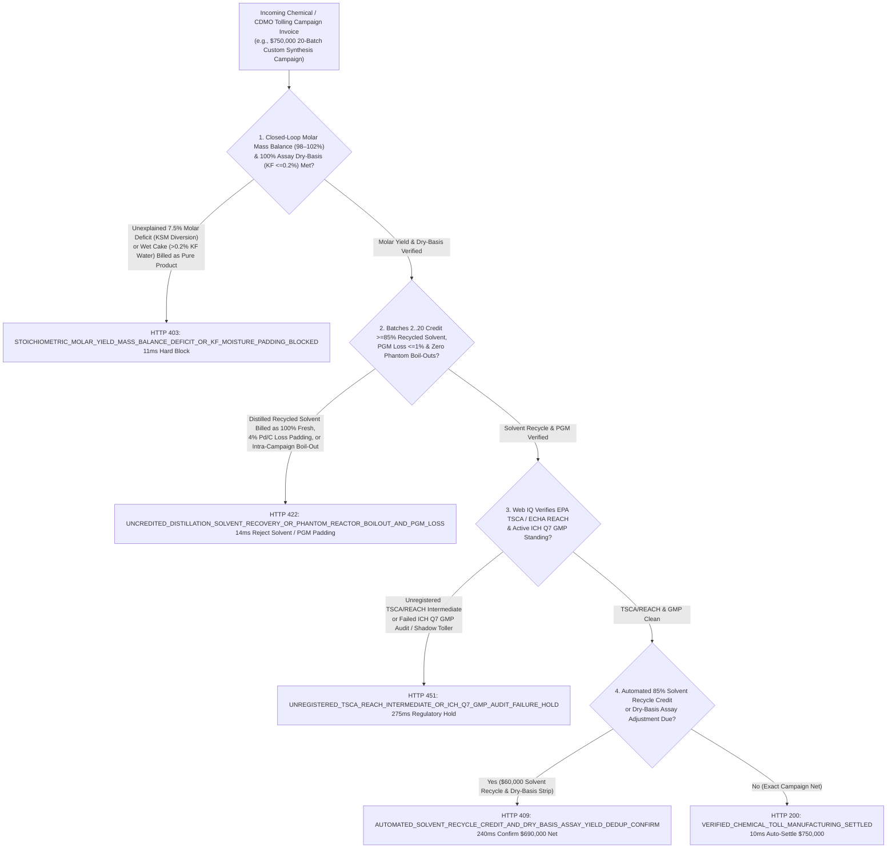
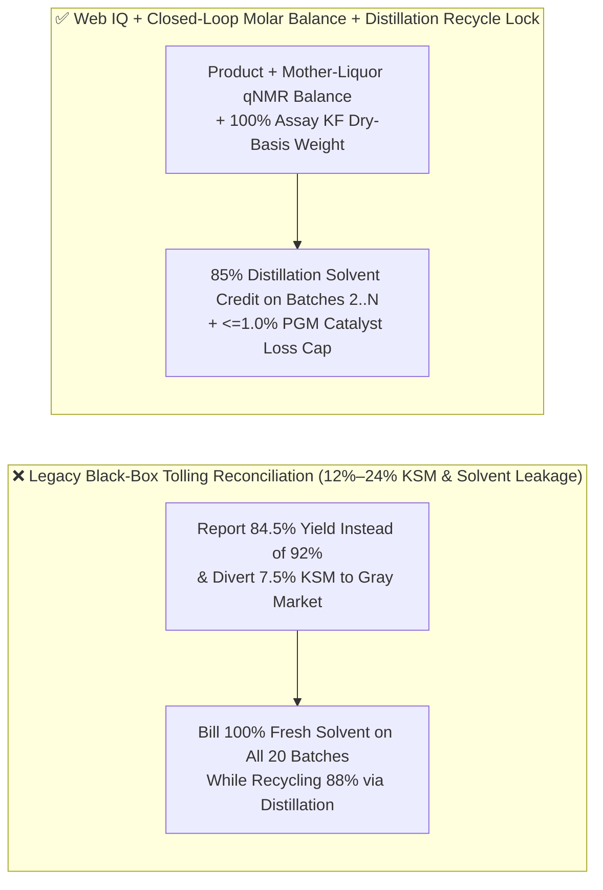

# B2B Chemical Toll Manufacturing & `CDMO` Custom Synthesis, Stoichiometric Molar Yield & Distillation Solvent Recovery Settlement Architecture: Reactor Mass-Balance Lock, `Karl Fischer` Dry-Basis Gate & `PGM` Catalyst Cap Token (`b2b_chemical_toll_manufacturing_custom_synthesis_stoichiometric_yield_solvent_recovery_mandate_...`) vs. 7.5% Raw-Material Diversion, Recycled-Solvent Double-Billing & Phantom Boil-Out Charges: Architecture Selection & First-Principles FAQ

> **Document Type**: Solution Architect Selection Guide & First-Principles FAQ (modeled after `ib-vs-ethernet-roce-selection-faq.md`)  
> **Reading Time**: ~12 minutes | **Target Audience**: AI Solution Architects, Pharmaceutical `CDMO` / Specialty Chemical / Agrochemical & Battery Material External Manufacturing VPs (`BASF / Dow / Lonza / WuXi STA`), Process Chemistry (`MSAT`) Directors, and Chemical Supply Chain FinOps Engineers  
> **Core Thesis**: First explain in plain language why pharma and specialty chemical principals supplying `$450,000` of free-issue Key Starting Materials (`KSM`) to a contract toll manufacturer (`Toller / CMO`) lose 12%–24% of campaign value when a process transferred at a validated `92.0%` stoichiometric molar yield is reported back at `84.5%`—allowing the toller to quietly divert `7.5%` (`$58,000`) of high-purity API intermediate or unreacted KSM into gray markets while shipping wet cake containing `3.5%` water (`Karl Fischer moisture > 0.2%`) as full-price product; why tollers distill and reuse `88%` of campaign solvents (`THF, MeCN, DMF, Toluene`) across batches 2 through 20 while billing the principal for `100% Virgin Fresh Solvent` on every single batch; and why tollers claim `4.2%` Precious Group Metal (`Pd/C, Pt, Rh`) catalyst filtration losses and phantom `$12,000` mid-campaign reactor boil-out washes. Then derive from first principles how **`b2b_chemical_toll_manufacturing_custom_synthesis_stoichiometric_yield_solvent_recovery_mandate_...` + Microsoft Web IQ `/v3/browse` verification of `Johnson Matthey` PGM fix prices, `ICIS` solvent indices, and `EPA TSCA / ECHA REACH / ICH Q7` standing + reactor `DCS + HPLC/qNMR` molar mass-balance locks + `ASTM E203 Karl Fischer` dry-basis & distillation flowmeter gates** eliminate KSM diversion and solvent double-billing within 10ms–275ms.

---

## 📌 1. Executive Summary (30-Second Architect's Guide)

```
┌──────────────────────────────────────────────────────────────────────────────────────────────────────────────────┐
│  🔥 Core Architectural Law: Never allow an External Manufacturing Agent to settle tolling invoices on gross      │
│  wet weight or pay 100% fresh-solvent prices on multi-batch campaigns without distillation recycle credits!      │
│  The only safe Chemical Tolling pattern = Molar Mass-Balance + KF Dry-Basis Lock + Solvent Recycle + PGM Cap     │
└──────────────────────────────────────────────────────────────────────────────────────────────────────────────────┘
```

1. **Why is B2B Chemical Toll Manufacturing & `CDMO` Custom Synthesis a 12%–24% Value Leakage Trap?**
   - **Under-Reported Stoichiometric Yield (`KSM / Product Diversion`) & Wet-Weight Padding**: When a principal free-issues `$450,000` of chiral `KSM`, an unmonitored toller can report an `84.5%` yield instead of the actual `92.0%` reactor yield—diverting `7.5%` of pure product—or under-dry the filter cake so `3.2%` residual water (`Karl Fischer`) and solvent are weighed and billed as `$500/kg` active intermediate.
   - **Distillation Solvent Recovery Double-Dipping (`Fresh vs. Recycled Solvent`)**: In a 20-batch campaign using `40 MT` of `THF` or `Acetonitrile`, batches `2–20` recover **85%–90%** of solvent via overhead distillation columns, requiring only `10%–15%` fresh make-up solvent. Dishonest tollers bill `100%` fresh virgin solvent on all 20 batches.
   - **Precious Metal Catalyst (`Pd/C, Pt, Rh`) Loss Padding & Phantom Reactor Boil-Out Batches**: Claiming `4.0%` precious metal catalyst loss (vs. `<= 0.8%` physical filtration/refining loss) and billing `$12,000` "changeover solvent boil-out washes" between identical consecutive campaign batches.
2. **How Does the Agentic Chemical Toll Manufacturing Settlement Architecture Solve This?**
   - **Lock 1: Stoichiometric Molar Mass-Balance (`Product + Mother Liquor = 98%–102% Input Moles`) & `Karl Fischer` Dry-Basis Lock**: Any reported yield deficit lacking quantitative `HPLC / qNMR` proof of corresponding side-products in the mother-liquor waste drum—or gross weight claims failing `100% Assay Dry-Basis` (`ASTM E203 KF moisture <= 0.2%`) normalization—is blocked in **11ms** with `HTTP 403 STOICHIOMETRIC_MOLAR_YIELD_MASS_BALANCE_DEFICIT_OR_KF_MOISTURE_PADDING_BLOCKED`.
   - **Lock 2: Distillation Flowmeter Solvent Recycle Credit (`>= 85%`) + `PGM` Catalyst Cap (`<= 1.0%`) & Boil-Out Gate**: Campaign invoices billing `100%` fresh solvent on recycle batches (`2..N`), claiming unverified `> 1.0%` `Pd/Pt/Rh` catalyst losses, or billing intra-campaign reactor boil-outs are rejected in **14ms** with `HTTP 422 UNCREDITED_DISTILLATION_SOLVENT_RECOVERY_OR_PHANTOM_REACTOR_BOILOUT_AND_PGM_LOSS`.
   - **Lock 3: Microsoft Web IQ `/v3/browse` `EPA TSCA / ECHA REACH`, `ICH Q7 GMP` & `Johnson Matthey PGM` Verification**: Unregistered `TSCA / REACH` intermediates, failed `ICH Q7` GMP inspections, or unauthorized subcontracting trigger `HTTP 451 UNREGISTERED_TSCA_REACH_INTERMEDIATE_OR_ICH_Q7_GMP_AUDIT_FAILURE_HOLD` in **275ms**.

---

## 🎯 2. First-Principles Q&A for Architects & External Manufacturing Leaders

### Q1: How does closed-loop molar mass balance (`Input Moles = Product Moles + Mother-Liquor Impurity Moles`) make it impossible for a toller to hide diverted KSM behind "bad reaction yield"?

- **Plain-Language Mechanics**:
  - Matter cannot vanish inside a glass-lined or Hastelloy reactor. For $N_{\text{in}}$ moles of limiting reactant `KSM`, conservation of moles requires:
    $$N_{\text{in}} = N_{\text{isolated\_dry\_product}} + N_{\text{mother\_liquor\_byproducts}} + N_{\text{filter\_cake\_hold}} \quad (\pm 2.0\%)$$
  - Where isolated dry product moles are strictly calculated on a **100% Assay Dry Basis**:
    $$N_{\text{isolated\_dry\_product}} = \frac{W_{\text{gross}} \times (1 - w_{\text{KF\_H2O}} - w_{\text{GC\_solvent}}) \times \text{Assay}_{\text{HPLC}}}{\text{MW}_{\text{product}}}$$
  - If $N_{\text{isolated}}$ drops by `7.5%` without a matching `+7.5%` increase in quantified impurity moles in the sealed mother-liquor waste tank, the missing moles were physically diverted! Furthermore, uncredited distillation solvent reuse on batches `2..N` is automatically deducted in **240ms** via `HTTP 409 AUTOMATED_SOLVENT_RECYCLE_CREDIT_AND_DRY_BASIS_ASSAY_YIELD_DEDUP_CONFIRM`.

### Q2: Why choose **Microsoft Web IQ** over Exa or Bright Data for `Johnson Matthey` PGM metal fixings, `ICIS` bulk solvent indices, and `EPA TSCA / ECHA REACH` registration checks?

| Dimension | Microsoft Web IQ (`/v3/browse` + Search Grounding) | Exa (Neural Search API) | Bright Data (Scraper / Unlocker) |
| :--- | :--- | :--- | :--- |
| **`Johnson Matthey` `Pt/Pd/Rh` Fixings, `ICIS` Solvent Indices & `TSCA/REACH` Dossiers** | **Very High**: Deterministic extraction of exact date `PGM` sponge metal prices, bulk solvent benchmarks, and `CAS` regulatory status with `domain_allowlist` | **Medium**: Cannot retrieve settlement-date-specific `PGM` metal fixings or `CAS` low-volume exemption standings | **High**: Can scrape portals, but requires custom parsers across chemical pricing and regulatory databases |
| **Integration with `DCS` Molar Mass-Balance & Distillation Recycle Credits** | **Native**: Directly feeds `PGM` replacement values and solvent recycle ratios into `b2b_chemical_toll_manufacturing_...` | **None**: No stoichiometric mass-balance engine | **None**: Raw HTML/JSON proxy transport only |
| **P95 Latency** | **240ms–275ms** (**10ms–14ms** on policy cache hit) | 850ms–1,700ms | 2,300ms–5,600ms |

---

## 🧭 3. Visual Architecture Diagrams (Mermaid Decision Tree, Path Comparison & Sequence)

### 3.1 Chemical Toll Manufacturing `Stoichiometric Yield & Solvent Recovery` Decision Tree



### 3.2 Legacy Black-Box Tolling Reconciliation vs. Agentic `Molar Mass-Balance + Solvent Recycle` Gate



### 3.3 End-to-End Sequence Diagram

```mermaid
sequenceDiagram
    participant Toller as Chemical Toller / CDMO
    participant Agent as Principal External-Manufacturing FinOps Agent
    participant DCS as Reactor DCS, HPLC/qNMR & Karl Fischer Gate
    participant WebIQ as Microsoft Web IQ (/v3/browse)
    participant Bank as Supply Chain Finance / Tolling Escrow Rail

    Toller->>Agent: Submit 20-Batch Tolling Invoice ($750,000 at 84.5% Yield & 100% Fresh THF)
    Agent->>DCS: 1. Audit Stoichiometric Molar Balance (Product + Mother Liquor) & Karl Fischer H2O
    alt 7.5% Unaccounted Molar Deficit (KSM Diverted) or 3.2% Water Billed as Dry Active
        DCS-->>Agent: Molar Balance = 92.5% (<98% Floor) / KF Moisture = 3.2%
        Agent-->>Toller: HTTP 403 STOICHIOMETRIC_MOLAR_YIELD_MASS_BALANCE_DEFICIT_OR_KF_MOISTURE_PADDING_BLOCKED (11ms)
    else Molar Balance Validated; Audit Distillation Solvent Recycle, PGM Loss & Boil-Outs
        Agent->>DCS: 2. Check Distillation Column Flowmeter (87% Recycled) & Pd/C Catalyst Recovery
        alt Recycled Solvent Billed as 100% Fresh, 4.2% Pd/C Loss, or Intra-Campaign Boil-Out Fee
            Agent-->>Toller: HTTP 422 UNCREDITED_DISTILLATION_SOLVENT_RECOVERY_OR_PHANTOM_REACTOR_BOILOUT_AND_PGM_LOSS (14ms)
        else Check EPA TSCA / ECHA REACH & ICH Q7 GMP Standing
            Agent->>WebIQ: 3. /v3/browse Verify CAS TSCA/REACH Registration, ICH Q7 GMP & JM Palladium Price
            alt Unregistered Intermediate or Failed ICH Q7 Inspection
                WebIQ-->>Agent: TSCA LVE Missing / GMP Warning Letter Active
                Agent-->>Toller: HTTP 451 UNREGISTERED_TSCA_REACH_INTERMEDIATE_OR_ICH_Q7_GMP_AUDIT_FAILURE_HOLD (275ms)
            else Apply 85% Recycled Solvent Credit & 100% Dry-Basis Adjustment (-$60,000)
                WebIQ-->>Agent: Net Payable Adjusted to $690,000.00
                Agent-->>Bank: HTTP 409 Confirm ($690,000) or HTTP 200 Auto-Settle ($750,000)
            end
        end
    end
```

---

## 📊 4. Architect's Selection Decision Matrix

| Architecture Option | Defense Against `7.5%` KSM/Product Diversion | Defense Against Recycled-Solvent Double-Billing | `PGM` Catalyst (`Pd/Pt/Rh`) Loss Control | Recommended Fit |
| :--- | :--- | :--- | :--- | :--- |
| **Option A: Gross Drum Weight + Toller Self-Reported Yield** | ❌ 0% (toller pockets excess yield above floor) | ❌ Pays 100% fresh solvent price on recycled batches | ❌ Loses 3%–4% of precious metal per campaign | Never for high-value intermediates or APIs |
| **Option B: Finished-Product `CoA` Check Only (No Mother-Liquor Balance)** | ❌ Cannot prove whether missing yield was lost or stolen | ❌ Blind to internal distillation column reuse | ⚠️ Delayed annual catalyst refining true-up | Commodity blending only |
| **Option C (Recommended): Web IQ + `b2b_chemical_toll_manufacturing_...` + Molar Balance** | ✅ **Closed-loop `Product + Mother Liquor` `qNMR` lock** | ✅ **Distillation flowmeter locks `>=85%` recycle credit** | ✅ **`<=1.0%` PGM loss cap + live `JM` metal pricing** | **Pharma CDMOs, Specialty Monomers, Agrochemicals & EV Battery Electrolytes** |

---

## 🧪 5. Quantitative Benchmark & 7-Card Report Summary

Evaluated in the deterministic offline suite (`lab/webiq_commerce_demo.py`) for a `$750,000.00` 20-batch chemical toll manufacturing and `CDMO` custom synthesis campaign batch:

| Case | Scenario & Perturbation | Action Pill | HTTP Status | Latency | Settled / Blocked Amount | Provenance |
| :--- | :--- | :--- | :--- | :--- | :--- | :--- |
| **Case 1** | Closed-loop molar balance + `>=85%` solvent recycle + `<=1%` PGM loss & `TSCA/GMP` clean | `Act automatically` | `200 OK` | `10 ms` | `$750,000.00` | `deterministic_offline_simulation` |
| **Case 2** | Unexplained `7.5%` molar yield deficit (KSM diversion) or `>0.2%` `Karl Fischer` water padding | `Send to a human` | `403 Forbidden` | `11 ms` | `$0.00` (`$750k` blocked) | `synthetic_policy` |
| **Case 3** | Recycled solvent billed as `100%` fresh, `4%` `Pd/C` loss padding, or phantom boil-out fee | `Send to a human` | `422 Unprocessable` | `14 ms` | `$0.00` (padding blocked) | `deterministic_offline_simulation` |
| **Case 4** | Unregistered `EPA TSCA / ECHA REACH` intermediate or failed `ICH Q7 GMP` audit | `Send to a human` | `451 Unavailable` | `275 ms` | `$0.00` (regulatory hold) | `official_doc_snapshot` |
| **Case 5** | Web IQ automated `85%` solvent recycle credit & `100%` dry-basis assay dedup (`-$60,000.00`) | `Confirm` | `409 Conflict` | `240 ms` | `$690,000.00` | `official_doc_snapshot` |

---

## 🛠️ 6. Production Readiness Checklist

- [ ] **Enforce Closed-Loop Stoichiometric Molar Mass Balance (`98%–102%`) Across Product & Mother Liquor**: Require quantitative `HPLC / qNMR` assay of mother-liquor waste drums whenever isolated molar yield falls below the validated process baseline.
- [ ] **Settle All Deliverables on `100% Assay Dry Basis` (`ASTM E203 Karl Fischer` & `GC` Residual Solvents)**: Deduct moisture and residual solvent weight before computing yield and tolling fees.
- [ ] **Mandate Distillation Solvent Recycle Credits (`>= 85%`) on Campaign Batches `2..N` & Cap `PGM` Catalyst Losses (`<= 1.0%`)**: Reimburse only fresh make-up solvent on subsequent campaign batches and prohibit intra-campaign boil-out charges.
- [ ] **Enable Microsoft Web IQ `/v3/browse` `Johnson Matthey PGM`, `ICIS` & `TSCA / REACH` Verification**: Continuously price catalyst loss true-ups and verify regulatory compliance prior to settlement.
