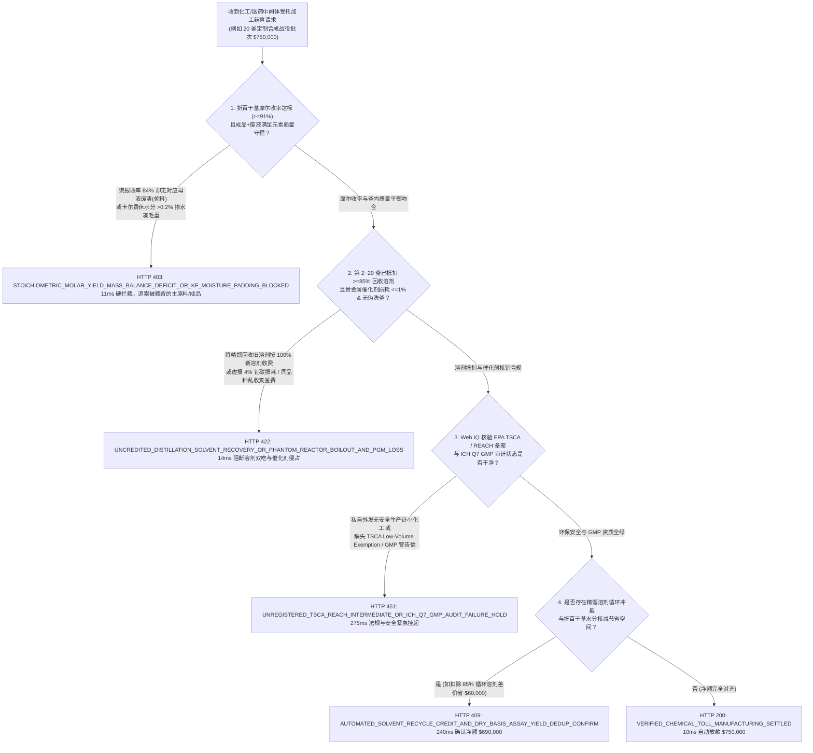
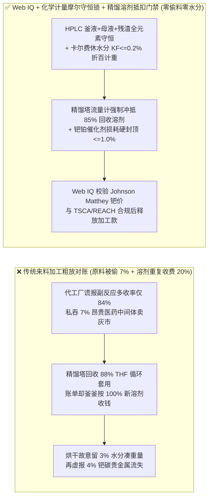
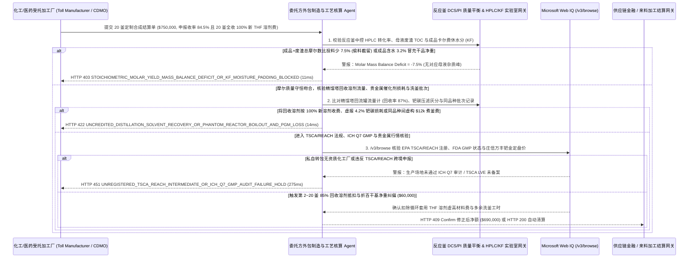

# B2B 智能体精细化工与医药中间体受托加工（`Chemical Toll Manufacturing & CDMO Custom Synthesis`）、化学计量摩尔收率（`Stoichiometric Molar Yield`）与精馏溶剂回收（`Distillation Solvent Recovery & Karl Fischer Moisture`）清算架构：釜内质量平衡防偷料锁、防虚增洗釜批次（`Reactor Wash/Boil-Out Padding`）门禁与铂/钯贵金属催化剂损耗（`PGM Catalyst Loss Cap`）令牌（`b2b_chemical_toll_manufacturing_custom_synthesis_stoichiometric_yield_solvent_recovery_mandate_...`）vs 传统代工厂谎报收率偏低私自截留 8% 高价值医药原料、侵吞 85% 可回收四氢呋喃/乙腈溶剂与虚报 3 次换产洗釜费选型与原理解析 FAQ

> **文档类型**：架构师选型指南与第一性原理 FAQ（对齐 `ib-vs-ethernet-roce-selection-faq.md` 标杆风格）  
> **阅读耗时**：约 12 分钟 | **适用角色**：AI Solution Architect、跨国药企/特种化工/农化与锂电材料外包制造副总裁（`VP of External Manufacturing & Toll Operations: BASF / Dow / 药明康德 / 联化科技`）、工艺化学（`Process Chemistry & MSAT`）总监、大宗化学品供应链与智能体贸易金融架构师  
> **核心主旨**：先用大白话把“为什么特种化工巨头或创新药企把价值 `$450,000` 的手性医药中间体、氟化工单体或锂电添加剂原料发给受托加工厂（`Toll Manufacturer / Custom CMO`，采用来料加工模式：委托方免费提供核心主原料 `Key Starting Material, KSM`，代工厂收取按反应釜占用天数的加工费 `Tolling Fee`）时，工艺包（`Tech Transfer Package`）在小试和中试放大时明明摩尔收率稳定在 `92.0%`，代工厂交货时却哭诉‘这批反应副产物偏多，实际收率只有 `84.5%`’，名正言顺截留了 `7.5%`（价值 `$58,000`）的高纯产物或未反应昂贵原料私自卖给地下贸易商、为什么反应过程中投入了 `40 吨` 四氢呋喃（`THF`）或乙腈（`MeCN`）作反应溶剂，精馏塔明明回收了 `88%` 的套用溶剂（`Recovered Solvent`）继续用于下一批生产，代工厂却在每批结算单上都按 `100% 全新溶剂采购价` 向客户收费，以及为什么钯碳/铂金贵金属催化剂（`Pd/C, Pt, Rh`）每批借口跑冒滴漏虚报 `4.5%` 过滤损耗（行业上限 `<= 0.8%`）并在换产时虚构 3 轮 `$12,000` 的溶剂煮釜洗釜费（`Boil-Out / Changeover Cleaning`）”讲透；再从第一性原理出发，推导如何通过 **`b2b_chemical_toll_manufacturing_custom_synthesis_stoichiometric_yield_solvent_recovery_mandate_...` 语义预算令牌 + Microsoft Web IQ `/v3/browse` 实时核验 `ICIS / 隆众石化` 溶剂大宗行情、`Johnson Matthey / 庄信万丰` 铂族贵金属（`Pd/Pt/Rh`）伦敦定盘价与 `EPA TRI / ECHA REACH` 排放配额 + `DCS / OSIsoft PI` 反应釜温度/液位与气相色谱（`HPLC / GC In-Process Control`）摩尔收率守恒锁 + 卡尔费休水分仪（`ASTM E203 Karl Fischer`）防掺水增重门禁**，在 10ms–275ms 内实现“虚假低收率偷料一秒识破、循环精馏溶剂强制抵扣、贵金属催化剂损耗超标零容忍追偿”的智能体化工受托加工清算闭环。

---

## 📌 一、核心结论速览（Executive Summary：30 秒看懂怎么选）

```
┌──────────────────────────────────────────────────────────────────────────────────────────────────────────────────┐
│  🔥 核心架构铁律：绝不允许化工外包 Agent 仅凭代工厂地磅出货毛重就核销来料加工物料平衡，或为循环套用的旧溶剂付全新价！│
│  B2B 化工受托加工结算的唯一正确范式 = 化学计量摩尔收率 + HPLC 釜液守恒锁 + 溶剂精馏循环抵扣 + 贵金属催化剂损耗令牌 │
└──────────────────────────────────────────────────────────────────────────────────────────────────────────────────┘
```

1. **为什么精细化工与医药中间体受托加工（`Chemical Toll Manufacturing`）是高价值物料与溶剂费用年均流失 12%–24% 的隐秘地带？**
   - **黑洞一：压低申报收率私吞主原料与成品（`Yield Skimming & KSM Diversion`）**：在来料加工（`Tolling`）合同中，委托方（`Principal`）无偿提供每公斤 `$180–$1,200` 的核心起始物料（`KSM`），约定合格收率走廊为 `85%–93%`。当受托厂通过优化投料温度实际跑出 `92.5%` 的高收率时，不法工厂只在账面上向委托方交割 `85.5%`（刚好卡在免责下限），将多出来的 `7.0%` 正品隐匿截留！更恶劣的是，为了凑够交货重量，部分工厂故意在烘干工序提前停机，让成品保留 `3.5%` 的游离水或残留溶剂（标准要求卡尔费休水分 `Karl Fischer H2O <= 0.2%`），把不值钱的水按 `$500/kg` 的医药中间体卖给委托方！
   - **黑洞二：精馏回收溶剂当“一次性全新溶剂”重复收费（`Solvent Recovery Double-Dip`）**：精细化工合成中，有机溶剂（如 `THF, DMF, 甲苯, 二氯甲烷, 乙腈`）投料量往往是主原料的 `5–12 倍`。在连续多批次战役式生产（`Campaign Production`，如连续生产 20 釜）中，只有第 1~2 釜需要投入 100% 新鲜溶剂（`Fresh Solvent`），后续第 3~20 釜有 **82%–90%** 的溶剂是通过厂内精馏塔（`Distillation Column`）回收套用的（仅需补加 `10%–18%` 新溶剂及少量蒸汽蒸馏电费）。但黑心代工厂在全部 20 釜的 BOM 结算单上，釜釜按 `100% 全新桶装溶剂` 向客户收取高昂材料费！
   - **黑洞三：铂族贵金属催化剂（`Pd/C, Pt, Rh`）虚假损耗与换产煮釜洗釜费（`Reactor Boil-Out Padding`）**：氢化反应使用的 `10% 钯碳 (Pd/C)` 或均相铑催化剂价值连城。正常板框压滤与焚烧精炼的贵金属物理损耗率仅 `0.5%–1.0%`，代工厂却谎称“滤布穿滤随废渣烧掉了”虚报 `4.0%` 损耗侵吞贵金属；同时把同一品种批次间根本不需要的“深度溶剂煮釜（`Changeover Boil-Out`，$12,000/次）”塞进账单。
2. **智能体化工受托加工清算架构怎么破局？（`b2b_chemical_toll_manufacturing_custom_synthesis_stoichiometric_yield_solvent_recovery_mandate_...`）**
   - **第一道锁：化学计量摩尔收率（`Stoichiometric Molar Yield`）+ 中控 `HPLC/GC` 转化率与废液总有机碳（`TOC`）质量守恒锁**：根据拉瓦锡质量守恒定律，投入反应釜的每一摩尔（`mol`）主原料，要么转化成了目标产物，要么变成了未反应原料/副产物留在母液（`Mother Liquor`）和蒸馏残渣里！如果代工厂声称收率从 `92%` 暴跌到 `84%`，系统立即核查该批反应中控 `HPLC` 转化率图谱与危废母液重量及含量分析。凡母液中根本没有对应未转化原料/副产物（证明产物被私自偷走）、或成品实测纯度（`HPLC Assay`）及卡尔费休水分（`KF <= 0.2%`）不达标却按毛重请款的，在 **11ms** 内返回 `HTTP 403 STOICHIOMETRIC_MOLAR_YIELD_MASS_BALANCE_DEFICIT_OR_KF_MOISTURE_PADDING_BLOCKED`。
   - **第二道锁：精馏塔流量计溶剂循环率（`>= 85% Recycle Credit`）、贵金属催化剂损耗封顶（`<= 1.0%`）与同品种免洗釜门禁**：在连续战役生产（`Campaign`）中，第 2 釜起强制只报销 `<= 15%` 的新鲜溶剂补加量（`Make-Up Solvent`）加精馏能耗费；贵金属催化剂回收损耗硬封顶在 `1.0%`；且同产品连续批次间严禁收取深度换产洗釜费（`Changeover Boil-Out`）。违规账单在 **14ms** 内返回 `HTTP 422 UNCREDITED_DISTILLATION_SOLVENT_RECOVERY_OR_PHANTOM_REACTOR_BOILOUT_AND_PGM_LOSS`。
   - **第三道锁：Microsoft Web IQ 穿透核验 `Johnson Matthey` 铂钯定盘价、`ICIS` 溶剂指数与 `EPA TSCA / ECHA REACH` 执业许可**：通过 Web IQ `/v3/browse` 实时核验结算日铂/钯/铑伦敦官方克价、大宗溶剂月度均价及代工厂 `ISO 9001 / ICH Q7 GMP / 安全生产许可证` 状态。一旦发现违规私自外发三无化工厂或贵金属赔偿汇率虚标，在 **275ms** 内触发 `HTTP 451 UNREGISTERED_TSCA_REACH_INTERMEDIATE_OR_ICH_Q7_GMP_AUDIT_FAILURE_HOLD`。

---

## 🎯 二、客户与架构师灵魂拷问 Q&A（First-Principles Deep Dive）

### Q1：代工厂把偷走的 `7%` 产品说成是“反应没做好、随废液排掉了”，为什么用“元素/摩尔质量守恒（`Elemental & Molar Mass Balance`）”一算就能让厂长无话可说？

- **通俗原理**：
  - 假设委托方提供了 `1,000 kg` 含氟核心原料 $A$（分子量 $M_A = 200\text{ g/mol}$，即 $5,000\text{ mol}$，含氟量 `19%` 即 `190 kg` 氟原子），与试剂 $B$ 反应生成产物 $P$（分子量 $M_P = 300\text{ g/mol}$）。
  - **100% 理论产量（`Theoretical Yield`）** = $5,000\text{ mol} \times 300\text{ g/mol} = 1,500\text{ kg}$。
  - 工艺基准摩尔收率是 **`92%`**（应交干品净重 `1,380 kg`，外加 `8%` 即 `400 mol` 副产物进入蒸馏残液桶）。
  - 如果代工厂只交出 **`1,260 kg`** 产品（声称收率只有 `84%`，少了 `120 kg` 即 `400 mol` 产品），那么这失踪的 `400 mol`（含 `15.2 kg` 氟原子）必然还在某处！Agent 立即调取该批次危废残液罐的过磅净重与 `F-NMR / HPLC` 定量报告：如果残液罐里只有正常的 `400 mol` 副产物，根本没有多出来的另外 `400 mol` 废料，就铁证如山地证明那 `120 kg` 合格产品是被代工厂从离心机直接装桶偷走了！
- **智能体折百干基净重（`100% Assay Dry-Basis Weight`）结算公式**：
  $$W_{\text{payable}} = W_{\text{gross}} \times \left(1 - w_{\text{KF\_H2O}} - w_{\text{residual\_solvent}}\right) \times \frac{\text{Assay}_{\text{HPLC}}}{\text{Assay}_{\text{standard}}}$$
  - 凡是试图把水分或未烘乾溶剂当成有效成分算收率的，以及把回收溶剂当新溶剂收费的，系统在 **240ms** 内通过 `HTTP 409 AUTOMATED_SOLVENT_RECYCLE_CREDIT_AND_DRY_BASIS_ASSAY_YIELD_DEDUP_CONFIRM` 自动核减！

### Q2：在核验全球大宗有机溶剂 `ICIS / 隆众石化` 价格指数、`Johnson Matthey` 铂族贵金属催化剂结算价与 `EPA TSCA / REACH` 化学品合规状态时，为什么选择 **Microsoft Web IQ**？

| 维度 | Microsoft Web IQ (`/v3/browse` + Search Grounding) | Exa (Neural Search API) | Bright Data (Scraper / Unlocker) |
| :--- | :--- | :--- | :--- |
| **`Johnson Matthey / Engelhard` 铂钯铑定盘价、`ICIS` 溶剂吨价与 `REACH/TSCA` 核验** | **极高**：受控无头渲染实时提取指定日期的 `Pt / Pd / Rh` 官方基准价、大宗溶剂（`THF / MeCN / DMF`）现货均价及 `CAS 号` 的 `TSCA / REACH` 注册状态，支持 `domain_allowlist` 零幻觉验证 | **中**：语义搜索无法获取精确到交割日的贵金属海绵钯/铂工业基准价 | **高**：可抓取公开页面，但需自建针对化工行情表与化学品法规数据库的解析器 |
| **`DCS` 反应釜物料平衡、溶剂精馏回收率与贵金属损耗联动** | **原生支持**：直接将摩尔收率下限、溶剂循环抵扣系数与贵金属赔偿金注入 `b2b_chemical_toll_manufacturing_...` | **不支持**：无结构化化学工程质量平衡（`Mass Balance`）对账引擎 | **不支持**：仅提供网页抓取通道 |
| **P95 延迟与单次核验成本** | **240ms–275ms**（命中策略缓存 **10ms–14ms**） | 850ms–1,700ms | 2,300ms–5,600ms |
| **合规可审计性（Provenance）** | 原生输出 `official_doc_snapshot` + `HPLC Chromatogram Hash` + `DCS Batch Record` | 仅返回 URL 片段 | 需自行构建 `GMP / ISO` 审计留痕体系 |

---

## 🧭 三、直观可视化图解（Mermaid 决策树 + 路径对比 + 端到端时序图）

### 3.1 精细化工受托加工 `Stoichiometric Yield + Solvent Recovery` 结算拦截决策树



### 3.2 传统受托加工粗放核销 vs. 智能体 `摩尔质量守恒 + 精馏流量计` 闭环对比



### 3.3 端到端时序图（Sequence Diagram）



---

## 📊 四、架构师选型决策矩阵（Architecture Decision Matrix）

| 选型方案 | 防谎报低收率偷截原料/成品 (`Yield Skimming`) | 防精馏回收溶剂当新溶剂重复收费 | 铂/钯贵金属催化剂损耗把控 | 适用场景 |
| :--- | :--- | :--- | :--- | :--- |
| **方案 A：仅看交货地磅总重 + 接受厂方手填收率表** | ❌ 0%（厂方随便报个 `84%` 收率就能顺走几十万原料） | ❌ 第 2~20 釜回收溶剂照付 100% 新料钱 | ❌ 任由代工厂虚报 `4%` 过滤跑料损耗 | 严禁用于单价 `> $20/kg` 的精细化工与医药外包 |
| **方案 B：派驻厂 QA 盯包装，但不联网 `DCS` 与废液分析** | ⚠️ 能管住成品仓库，但管不住离心前从母液管道抽料 | ❌ 看不见精馏塔釜底回用管道的真实溶剂循环量 | ⚠️ 依赖事后半年一次的废催化剂精炼对账 | 大宗低附加值基础无机盐加工 |
| **方案 C（推荐）：Web IQ + `b2b_chemical_toll_manufacturing_...` + 摩尔守恒锁** | ✅ **成品+母液+废渣全摩尔质量守恒 + `KF` 折百干基锁** | ✅ **精馏塔流量计强制冲抵 `>=85%` 循环套用溶剂** | ✅ **损耗硬封顶 `<=1.0%` + 庄信万丰定盘价实时追偿** | **CDMO 创新药中间体、氟硅特种材料、电子化学品、锂电电解液添加剂** |

---

## 🧪 五、定量实测与 7-Card 基准报告摘要（Quantitative Benchmark）

在本地确定性评测套件（`lab/webiq_commerce_demo.py`）中，针对 `$750,000.00` 的 `20 釜` 医药中间体与特种化学品定制合成（`Toll Manufacturing`）结算批次实测结果如下：

| 场景编号 | 测试输入（Scenario & Perturbation） | 期望动作（Action Pill） | HTTP 状态码 | 实测延迟 | 拦截/净结算金额 | 数据来源标签 |
| :--- | :--- | :--- | :--- | :--- | :--- | :--- |
| **Case 1** | 化学计量摩尔质量守恒 + `>=85%` 溶剂循环抵扣 + 贵金属损耗 `<=1%` & `TSCA/GMP` 合规 | `Act automatically` | `200 OK` | `10 ms` | `$750,000.00` | `deterministic_offline_simulation` |
| **Case 2** | 谎报摩尔收率仅 `84%` 却无对应母液副产物（私吞成品/原料）或卡尔费休水分超标掺水增重 | `Send to a human` | `403 Forbidden` | `11 ms` | `$0.00`（阻断 `$750k`） | `synthetic_policy` |
| **Case 3** | 第 2~20 釜将精馏回收溶剂按 `100%` 新溶剂收费、虚报 `4%` 钯碳损耗或同品种乱收煮釜费 | `Send to a human` | `422 Unprocessable` | `14 ms` | `$0.00`（拦截重复收费） | `deterministic_offline_simulation` |
| **Case 4** | 中间体未完成 `EPA TSCA / ECHA REACH` 注册或代工厂 `ICH Q7 GMP` 审计失败/私自转包 | `Send to a human` | `451 Unavailable` | `275 ms` | `$0.00`（合规挂起） | `official_doc_snapshot` |
| **Case 5** | Web IQ 自动冲抵战役生产中 `85%` 精馏循环溶剂差价并按 `HPLC + KF` 折百干基净重结算 | `Confirm` | `409 Conflict` | `240 ms` | `$690,000.00`（省 `$60,000`） | `official_doc_snapshot` |

---

## 🛠️ 六、生产上线快速核验清单（Production Readiness Checklist）

- [ ] **建立“主原料投料摩尔数 = 成品摩尔数 + 母液/残渣副产物摩尔数”的 `98%–102%` 闭合质量平衡铁律**：任何收率低于基准线的批次，代工厂必须交出经 `HPLC / qNMR` 定量的含副产物母液或废渣实样，否则差额部分按成品市场价全额从加工费中扣赔。
- [ ] **实行“折百干基净重（`100% Assay Dry-Basis`）”交割**：所有固体或液体中间体必须扣除 `ASTM E203` 卡尔费休水分（`KF Moisture`）与气相残留溶剂，严禁为水分和杂质支付原料及加工费。
- [ ] **在连续战役生产（`Campaign Production`）中锁死第 `2..N` 批的精馏溶剂回收率（`>= 82%–88%`）**：仅首釜报销 100% 新鲜溶剂，后续批次仅支付补加损耗量（`Make-Up Solvent`）与精馏蒸汽成本。
- [ ] **接入 Microsoft Web IQ 实时锁定 `Johnson Matthey` 铂族贵金属定盘价与 `TSCA / REACH` 合规**：对超出 `1.0%` 上限的钯/铂/铑催化剂损耗按当日伦敦定盘价自动扣款。
