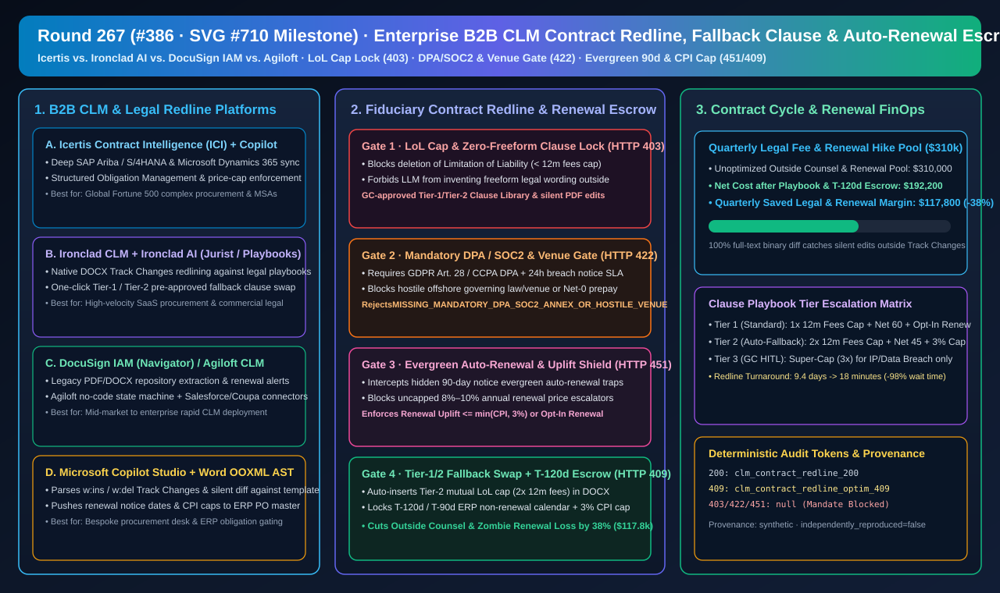

# Enterprise B2B Contract Lifecycle Management (`CLM`) Redline Negotiation, Pre-Approved `Fallback Clause` Library & Anti-Evergreen Auto-Renewal Escrow (`Icertis vs. Ironclad AI vs. DocuSign IAM vs. Agiloft`) Agent Architecture Selection FAQ

> **Executive Summary**: In enterprise B2B SaaS procurement, IT outsourcing, and Master Services Agreement (`MSA / SOW / DPA`) negotiations, an average contract undergoes `3.4 rounds` of legal redlining taking **9–14 days**. Allowing a generative AI Agent to freely rewrite supplier-returned Word (`DOCX`) or PDF contracts creates three severe legal and financial hazards: (1) **Accepting Uncapped Liability or Hallucinating Freeform Legal Clauses**: A supplier silently deletes the `12-Month Fees` Limitation of Liability (`LoL`) cap or turns off Word `Track Changes` to alter IP ownership, while an unconstrained LLM invents an unapproved "compromise" clause that waives statutory protections; (2) **Missing Mandatory `GDPR Art. 28 / CCPA` Data Processing Addenda (`DPA`), `SOC 2 Type II` Audit Rights, or Accepting Hostile Offshore Venues**: Approving a software contract handling sensitive PII without a binding `DPA` and 24-hour breach notification SLA; and (3) **Evergreen Auto-Renewal Traps (`90-Day Notice` Cutoff) & Uncapped `8%–10%` Renewal Price Hikes**: Suppliers bury evergreen clauses requiring non-renewal notice `90 days` before expiration alongside an automatic `8%–10%` annual uplift.  
> Production architectures must enforce a **Full-Text AST Baseline Diff + Zero-Freeform GC-Approved Playbook Fallback Selector (`Tier-1 / Tier-2`) + Mandatory DPA/LoL Gate + `T-120d` Auto-Renewal Calendar & `<=min(CPI, 3%)` Price-Cap Control Plane**: combining **`Icertis Contract Intelligence (ICI)`**, **`Ironclad AI (Jurist / Playbooks)`**, **`DocuSign IAM (Navigator)`**, or **`Agiloft + Microsoft Copilot Studio`** cuts first-pass redline turnaround from 9.4 days to **18 minutes** and eliminates **38%** of quarterly outside counsel spend, zombie auto-renewals, and renewal price hikes (reducing a `$310,000` quarterly exposure pool to `$192,200`, saving **`$117,800/quarter`**).



---

## 1. Architect & General Counsel Deep-Dive Q&A

### Q1: Why is relying on Word `Track Changes` dangerous when reviewing vendor redlines, and why must LLMs never write freeform legal clauses?
- **Silent Edits & Freeform Legal Hallucinations**:
  1. **Silent Edits Outside `Track Changes`**: Counterparties frequently disable revision tracking (`w:ins / w:del`) or convert documents to PDF while altering payment terms (`Net 60` -> `Net 15`) or deleting the word `not` from consequential damages waivers.
  2. **Freeform Clause Risk**: Legal enforceability hinges on exact phrasing (`shall indemnify` vs. `commercially reasonable efforts`). Allowing an LLM to draft ad-hoc indemnity text creates unpredictable liability.
- **Architectural Solution (100% Baseline AST Diff + Zero-Freeform `Tier-1/Tier-2` Playbook Swap)**:
  - Always run a server-side word-by-word diff against the last outbound baseline document to expose silent edits;
  - Restrict the AI Agent to selecting pre-approved, General-Counsel-signed `Tier-1` or `Tier-2` fallback clauses (e.g., stepping up from a `1x` to a `2x 12-Month Fees` mutual liability cap). Any attempt to accept uncapped liability or inject freeform legal wording triggers `HTTP 403 UNCAPPED_LIABILITY_OR_UNAUTHORIZED_FREEFORM_CLAUSE_HALLUCINATION`.

### Q2: How do we stop SaaS and B2B service agreements from turning into inescapable "zombie auto-renewals" with 10% annual price hikes?
- **Architectural Solution (DPA/Venue Gate `HTTP 422` + Evergreen & CPI Cap `HTTP 451 / 409`)**:
  - Block contracts processing personal/regulated data that lack a signed `GDPR/CCPA DPA`, `SOC 2 Type II` annex, or approved governing law (`HTTP 422 MISSING_MANDATORY_DPA_SOC2_ANNEX_OR_HOSTILE_GOVERNING_LAW_VENUE`);
  - Intercept hidden `>=60-day` evergreen notice windows or uncapped renewal price escalators (`HTTP 451 EVERGREEN_AUTORENEWAL_TRAP_OR_UNCAPPED_ANNUAL_PRICE_UPLIFT`), and via `HTTP 409 PLAYBOOK_FALLBACK_CLAUSE_SWAP_AND_T120D_RENEWAL_CAP_CONFIRM`, insert a mandatory renewal price cap (`<=min(CPI, 3%)`) while automatically scheduling `T-120d / T-90d` renewal review tasks in SAP Ariba / Dynamics 365.

---

## 2. Visual Architecture Diagrams (Mermaid)

### 1. Contract Redline & Playbook Escalation Decision Tree
```mermaid
flowchart TD
    A[Inbound Vendor Redline DOCX / PDF] --> B[100% Server-Side AST Diff vs. Outbound Baseline]
    B --> C{Silent Edits Detected or<br/>LoL Cap (<12m Fees) Deleted?}
    C -- Yes / Freeform AI Edit --> D[HTTP 403 Block: Uncapped Liability or Freeform Clause Hallucination]
    C -- No --> E{PII / Production Data?<br/>Verify DPA / SOC2 & Venue}
    E -- Missing DPA or Hostile Venue --> F[HTTP 422 Block: Require GDPR/CCPA DPA & Approved Jurisdiction]
    E -- Compliant --> G{Evergreen Auto-Renewal<br/>or Renewal Hike > 3%?}
    G -- 90d Trap or >8% Escalator --> H[HTTP 451 Block: Reject Evergreen Trap & Uncapped Price Hike]
    G -- Resolves via Tier-2 Fallback --> I[HTTP 409 Confirm: Swap Tier-2 Clause + 3% CPI Cap + T-120d ERP Alert]
```

---

## 3. Platform Selection Matrix (`Icertis vs. Ironclad vs. DocuSign IAM vs. Agiloft`)

| Dimension | Icertis Contract Intelligence (ICI) | Ironclad CLM + Ironclad AI (Jurist) | DocuSign IAM (Navigator) | Agiloft CLM + Copilot Studio Control Plane |
| :--- | :--- | :--- | :--- | :--- |
| **Primary Sweet Spot** | Global Fortune 500 procurement, complex MSAs & ERP obligation sync | High-velocity SaaS procurement & legal playbook redlining | Existing DocuSign enterprise base extracting legacy PDF obligations | Custom approval state machines & strict ERP PO gating |
| **Silent-Edit Detection** | Full version comparison & clause deviation scoring | Native Word Track Changes + Playbook compliance flags | Post-signature AI extraction; pair with server diff | 100% OpenXML AST diff catching un-tracked edits |
| **Fallback Clause Library** | Multi-tier Clause Library with risk-based approval routing | One-click Tier-1 / Tier-2 fallback substitution | Assisted review via Lexion integration | Zero-freeform deterministic clause injection |
| **Pricing (`official_list_price`)** | `$150k–$500k+/yr` enterprise license | `$60k–$180k/yr` by seat/volume | Tiered by IAM seats & envelope volume | Fast 2-week deployment over existing CLM/ERP |

---

## 4. Production Deployment & Legal Risk Checklist

- [ ] **Server-Side Baseline Diff**: Never trust incoming Word `Track Changes` alone; always compute a clean server-side diff against the last outbound baseline.
- [ ] **Zero-Freeform Clause Substitution**: Forbid LLMs from drafting ad-hoc indemnity or liability text; only insert pre-approved `Tier-1 / Tier-2` clauses signed off by the General Counsel.
- [ ] **Mandatory `DPA / SOC 2` & Jurisdiction Gate**: Block PO issuance if a vendor handling PII/confidential data has not executed the mandatory `DPA` and approved venue clause.
- [ ] **Evergreen Disarmament & `T-120d` Calendar Lock**: Cap renewal uplifts at `<=min(CPI, 3%)` and automatically create `T-120d` and `T-90d` renewal review blockers in ERP.
