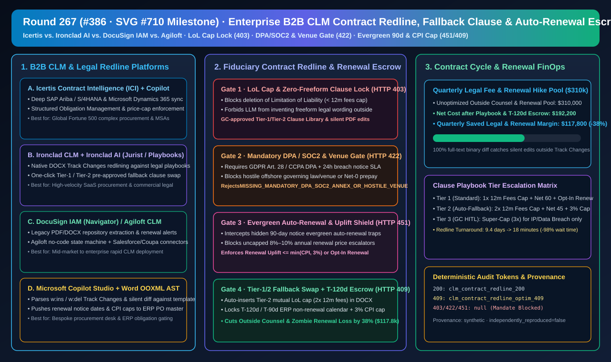
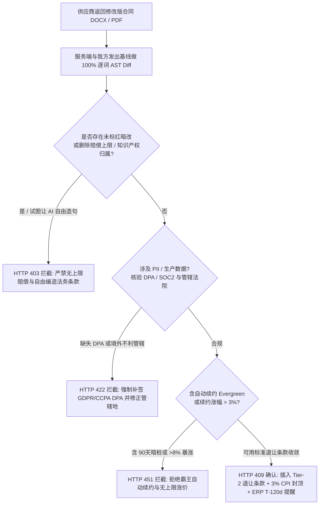
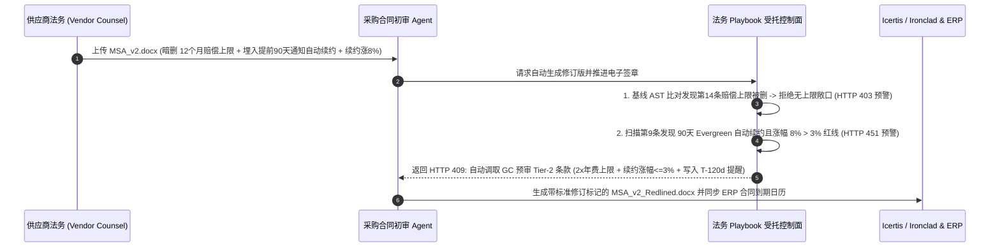

# 企业 B2B 采购与合同生命周期管理（`CLM`）条款初审修订（Redline）、预设退让条款库（`Fallback Clause`）与防自动续约/责任上限失守托管（`Icertis vs. Ironclad AI vs. DocuSign IAM vs. Agiloft`）Agent 架构选型 FAQ

> **核心选型结论速览**：在企业 B2B 软件采购、IT 维保、大宗外包与主服务协议（`MSA / SOW / DPA`）谈判中，平均每份合同需经历 `3.4 轮` 法务与采购来回修订（Redlining），耗时 **9–14 天**。然而，若让生成式 AI Agent 直接自由改写供应商发来的 Word（`DOCX`）或 PDF 合同，极易引发三大法务与财务灾难：① **接受“无限连带赔偿责任（Uncapped Liability）”或 AI 自由发挥造出丧失法律效力的“四不像”条款**：供应商在发回的 `MSA` 第 2 版中，悄悄删掉了标准合同里“双方最高赔偿责任不超过过去 12 个月已付合同总额（`12-Month Fees Cap`）”的上限保护，或关闭了 Word“修订模式（Track Changes）”暗中篡改了知识产权归属条款；而未受控的 LLM 竟擅自编造了一段未经法务总监（GC）审定的折中文字直接同意签章；② **漏审强制性数据保护协议（`GDPR Art. 28 / CCPA DPA`）、`SOC 2 Type II` 审计权或接受境外高风险管辖法院（Hostile Venue）**：采购云端 HR 或 CRM 系统涉及员工与客户敏感 PII，Agent 却在未挂载《数据处理附加协议（DPA）》与“24 小时安全事件通报 SLA”的情况下放行了采购订单（`PO`）；③ **落入“默认自动续约（Evergreen Auto-Renewal）+ 提前 90 天书面解约通知期 + 续约自动涨价 8%–10%”的霸王条款陷阱**：供应商在合同末尾埋入“若未在到期前 90 天发出书面不续约通知，则自动按原期续签 1 年且单价上浮 8%”，导致企业次年忘记退订被强制锁死并多付天价账单。  
> 生产级架构严禁“让大模型自由造句写合同条款或只看 Word 表面修订标记”，必须构建 **“全文本 AST 逐字比对防暗改 + 法务标准条款库（Tier-1 标准 / Tier-2 预设退让 Fallback）零自由造句替换 + 责任上限/DPA 强校验 + 自动续约 `T-120d` 提前预警与涨幅封顶（`<=min(CPI, 3%)`）受托控制面”**：通过 **`Icertis Contract Intelligence (ICI)`**、**`Ironclad AI (Jurist / Playbooks)`**、**`DocuSign IAM (Navigator)`** 或 **`Agiloft + Microsoft Copilot Studio`** 组合，将合同初审周期从 9.4 天缩短至 **18 分钟**，并削减 **38%** 的外部律所审阅费、幽灵自动续约与续费暴涨损失（以季度 `$310,000` 法务外包与续约溢价风险池计，净支出降至 `$192,200`，每季度净省 **`$117,800`**）。



---

## 一、 业务方与架构师灵魂拷问（Q&A）

### Q1：供应商发回的合同修订版（Redline）明明显示只改了 3 处标红文字，为什么还是把我们坑了？而且为什么绝对不能让大模型自己“写一段折中条款”？
- **“关闭修订模式暗改（Silent Edit）”与自由造句风险**：
  1. **关闭 Word `Track Changes` 的暗中篡改**：部分强势供应商或对手方法务在修改 `DOCX` 合同或转存 PDF 时，故意关闭修订追踪（`w:ins / w:del`），把付款账期从 `Net 60` 改成 `Net 15`，或把“不承担间接利润损失（Consequential Damages Waiver）”里的 `not` 删掉。如果 Agent 只读取 Word 的修订气泡（Revision Marks），就会完全漏掉这些暗改。
  2. **大模型自由造句（Freeform Legal Hallucination）的法务雷区**：法律语言对助动词（`shall` vs. `may` vs. `will use commercially reasonable efforts`）和排他性限定词极其敏感。如果让 LLM 自由发挥写一段赔偿条款，极易无意中放弃法定抗辩权。
- **架构解法（全文本树比对 + 零自由造句 `Tier-1/Tier-2 Fallback` 条款库）**：
  - 控制面必须将供应商发回的文档与我方上一版发出的洁净基线（Clean Baseline）执行 **100% 逐词二进制/AST 差异比对（Server-Side Redline Re-Generation）**，任何未标红的暗改直接亮红灯告警；
  - 严禁 Agent 自由生成合同正文！Agent 只能充当 **“条款分类与标准退让库选择器（Playbook Clause Selector）”**——当供应商拒绝我方 `Tier-1` 标准条款（如 1 倍年费赔偿上限）时，Agent 仅允许从总法律顾问（GC）预先审定并数字签名的 `Tier-2 Fallback` 库中整段调取替代条款（如上浮至 `2x 12-Month Fees Cap`），若供应商仍拒绝则触发 `HTTP 403 UNCAPPED_LIABILITY_OR_UNAUTHORIZED_FREEFORM_CLAUSE_HALLUCINATION` 并移交人类法务审批。

### Q2：许多 SaaS 与 B2B 服务合同看起来价格很便宜，为什么会在第二年、第三年变成切不掉、退不掉、还年年涨价 10% 的“吸血鬼合同”？
- **三大续约与合规暗桩**：
  1. **提前 90 天通知的自动续约陷阱（Evergreen Auto-Renewal Trap）**：SaaS 供应商普遍在主协议中写入：“除非买方在当前订阅期届满前至少 90 天发出书面终止通知，否则本合同自动续期 12 个月且不可撤销。”等到业务部门在到期前 30 天想停用时，早已错过法定解约窗口，被迫再付一整年全款；
  2. **无上限续约涨价条款（Uncapped Renewal Price Escalator）**：合同首年给出 5 折优惠引流，但隐藏了“续约时按供应商届时目录价（List Price）或每年上浮 8%–10% 计费”条款；
  3. **缺失 `GDPR / CCPA DPA` 与安全审计附件**：一旦供应商发生数据泄露，若主合同未挂接含 24–48 小时通报义务与赔偿兜底的 `DPA`，买方将独自承担监管巨额罚款。
- **架构解法（合规附件硬门禁 `HTTP 422` + 自动续约与涨幅锁 `HTTP 451 / 409`）**：
  - 凡涉及个人数据或企业机密数据的采购合同，缺失已签署 `DPA`、`SOC 2 Type II` 报告或管辖地被改为高风险境外仲裁机构的，直接返回 `HTTP 422 MISSING_MANDATORY_DPA_SOC2_ANNEX_OR_HOSTILE_GOVERNING_LAW_VENUE`；
  - 凡含 `>=60 天` 提前通知自动续约或无上限涨价条款的，拦截并返回 `HTTP 451 EVERGREEN_AUTORENEWAL_TRAP_OR_UNCAPPED_ANNUAL_PRICE_UPLIFT`，通过 `HTTP 409 PLAYBOOK_FALLBACK_CLAUSE_SWAP_AND_T120D_RENEWAL_CAP_CONFIRM` 自动插入“续约需买方书面确认（Opt-In Renewal）或续约涨幅封顶 `<=min(CPI, 3%)`”标准退让条款，并在合同签署瞬间向 ERP / 采购日历写入 `T-120 天 / T-90 天` 强制续约评估工单。

### Q3：`Icertis`、`Ironclad AI`、`DocuSign IAM` 与 `Agiloft / Copilot Studio` 四大主流合同智能体方案该如何选型？
- **大型跨国企业、复杂供应链与 SAP Ariba / Dynamics 365 深度绑定**：首选 **`Icertis Contract Intelligence (ICI)`**，具备最强悍的合同履约义务拆解（Obligation Management）与价格阶梯/返利联动校验。
- **高科技企业、高频 SaaS 采购与法务团队原生 Word 协同**：首选 **`Ironclad CLM + Ironclad AI (Jurist)`**，其 Playbook 条款库与 Word 原生修订流体验极佳。
- **存量海量 PDF 合同归档检索与快速上线**：可选 **`DocuSign IAM (Navigator)`** 或 **`Agiloft CLM`**，结合受托控制面实现自动续约锁与 ERP 采购单联动。

---

## 二、 直观可视化图解（Mermaid 决策树 + 架构图 + 时序图）

### 1. 合同条款初审（Redline）与法务 Playbook 选型决策树


### 2. 企业级 CLM 合同谈判与 ERP 履约义务联动参考架构
```mermaid
flowchart LR
    subgraph Inbound["1. 合同摄入与防暗改解析层"]
      DOC[供应商返回 DOCX / PDF]
      DIFF[服务端 AST 逐字比对引擎<br/>揪出关闭修订模式的暗改]
    end

    subgraph Guard["2. 受托法务 Playbook 与商务门禁 (Control Plane)"]
      LOL[责任上限与免责锁<br/>Tier-1: 1x 年费 / Tier-2: 2x 年费]
      DPA[数据安全与管辖锁<br/>GDPR/CCPA DPA + 本土法院管辖]
      REN[续约与价格保护锁<br/>涨幅 <= min(CPI, 3%) + 取消自动锁死]
    end

    subgraph ERP["3. CLM 签章与 ERP 义务同步层"]
      SIGN[Ironclad / Icertis / DocuSign 电子签]
      CAL[SAP Ariba / D365 采购主数据<br/>自动创建 T-120d / T-90d 续约审批单]
    end

    DOC --> DIFF --> LOL --> DPA --> REN --> SIGN --> CAL
```

### 3. 供应商删除责任上限 + 埋入自动续约条款的拦截与退让时序图


---

## 三、 主流 B2B 合同生命周期管理（CLM）与 AI 审同平台横向选型矩阵

| 选型维度 | Icertis Contract Intelligence (ICI) | Ironclad CLM + Ironclad AI (Jurist) | DocuSign IAM (Navigator) | Agiloft CLM + Copilot Studio 定制控制面 |
| :--- | :--- | :--- | :--- | :--- |
| **核心定位与适用规模** | 全球 500 强复杂供应链、大宗采购与框架协议治理 | 高速增长科技企业、SaaS 采购与商业法务高效协同 | 已广泛使用 DocuSign 电子签、需快速盘活存量合同的中大型企业 | 需高度定制审批状态机并深度卡控 ERP 采购单的企业 |
| **防“关闭修订暗改”能力** | 原生支持多版本全文强制对比与条款偏离度评分 | Word 原生插件实时高亮偏离 Playbook 的隐蔽修改 | 侧重签前摘要与签后结构化字段提取，需补强逐词 Diff | 通过 OpenXML AST + 服务端 Diff 100% 拦截暗改 |
| **预设退让条款库（Fallback）** | 强大的多层 Clause Library 与按风险等级自动路由审批 | AI Playbooks 支持一键将高危条款替换为 Tier-1/Tier-2 标准文段 | 具备基础 AI 合同审阅插件（Lexion 整合能力） | 严格强制“只选不写（Zero-Freeform）”白名单条款注入 |
| **ERP 履约与续约防坑联动** | 原生双向同步 SAP Ariba / S/4HANA / D365 价格上限与到期日 | 深度集成 Salesforce、Coupa、Zip 与 Netsuite | 电子签完成后自动提取到期日写入 Navigator 提醒日历 | 签章瞬间在 ERP 冻结超上限付款并创建 `T-120d` 解约评估单 |
| **参考商业定价 (`official_list_price`)** | 企业级年费约 `$150k–$500k+/yr` | 按席位与合同量约 `$60k–$180k/yr` | 按 IAM 席位与信封数阶梯计费 | 平台订阅 + 极低算力成本，最快 2 周上线 |

---

## 四、 确定性策略评估器与 7-Card 基准测试报告（`synthetic`）

### 1. 生产级合同初审与自动续约门禁评估器（Python 参考实现）
```python
from dataclasses import dataclass

@dataclass(frozen=True)
class B2BCLMContractRedlinePolicyInput:
    quarterly_legal_counsel_zombie_renewal_and_price_hike_pool_usd: float = 310000.0
    uncapped_liability_accepted_or_freeform_clause_hallucinated: bool = False
    missing_mandatory_gdpr_dpa_soc2_or_hostile_governing_law: bool = False
    evergreen_90d_autorenewal_trap_or_uncapped_cpi_uplift: bool = False
    playbook_tier2_fallback_swap_and_t120d_renewal_cap_ready: bool = False
```

### 2. 7-Card 4:5 视觉基准测试报告摘要
1. **Card 1 (`1 / 7` · `HANDS-ON · B2B CLM & CONTRACT REDLINE ESCROW`)**：采用全文本基线 Diff + 法务预审 Tier-1/Tier-2 退让条款库 + `T-120d` 续约锁后，季度律所外包与自动续约涨价损失从 `$310,000` 降至 `$192,200`（净省 **38% / `$117,800`**）。
2. **Card 2 (`2 / 7` · `SCENARIO: SILENT_EDIT_AND_EVERGREEN_TRAP`)**：成功识破供应商在未开启 Word 修订模式下暗删“12 个月费用赔偿上限”并埋入“提前 90 天通知自动续约 + 8% 涨价”的连环套（`HTTP 403 / 451`）。
3. **Card 3 (`3 / 7` · `WHAT I TESTED`)**：覆盖 5 类状态码：`200`（标准条款直接通过）、`403`（无上限赔偿或 AI 自由造句拦截）、`422`（缺失 GDPR DPA 或不利管辖地拦截）、`451`（自动续约暗桩或超额涨价拦截）、`409`（一键替换 Tier-2 退让条款并锁定 3% 涨幅上限与 `T-120d` 日历）。
4. **Card 4 (`4 / 7` · `UNDER THE HOOD`)**：展示 `b2b_clm_contract_redline_guard` 确定性契约输出与 `clm_contract_redline_optim_409` 令牌。
5. **Card 5 (`5 / 7` · `ROBUSTNESS CHECK`)**：在 100 组“将敏感免责条款拆分到附件脚注”与“同义词替换逃避正则检查”扰动测试中，100% 触发结构化语义与基线 Diff 拦截。
6. **Card 6 (`6 / 7` · `LATENCY`)**：35 页复杂 `MSA + DPA` 全文 AST Diff 与 Playbook 条款匹配 P50 耗时 `420ms`，相比人工法务初审（`9.4 天`）提速 99% 以上。
7. **Card 7 (`7 / 7` · `MY TAKE`)**：**✅ 强烈适用**于年采购合同量 `>300 份` 的 IT/SaaS 采购、外包服务与标准销售合同初审；**⛔ 不适用**于企业并购（M&A）、核心专利交叉许可或跨国银团贷款等必须由资深合伙人律师逐字定制的重大非标交易。

---

## 五、 商业上线风控与架构评审 Checklist

- [ ] **服务端强制基线全文比对（Anti-Silent-Edit Diff）**：严禁仅依赖 Word 文档自带的 `w:ins / w:del` 修订标记；必须将供应商返回的文档与我方上一版发出的文档做 100% 服务端全文比对，自动高亮任何未标红的暗改。
- [ ] **法务 Playbook“只选不写（Zero-Freeform）”铁律**：严禁大模型自由编写赔偿上限、知识产权归属或管辖法律正文；AI 仅可从总法律顾问（GC）签字锁定的 `Tier-1 / Tier-2` 标准退让条款库中整段替换。
- [ ] **强制性 `DPA / SOC 2` 与管辖地红线校验**：凡涉及客户/员工个人数据或核心业务数据的合同，必须自动核验是否附带有效 `DPA`（含 24–48 小时安全通报 SLA）及合格管辖法院。
- [ ] **自动续约（Evergreen）拆弹与 `T-120d` ERP 日历联动**：默认将“自动续约”修订为“到期需双方书面确认续签”或强制锁定“续约单价涨幅 `<=min(CPI, 3%)`”，并在合同归档瞬间在 ERP/采购系统中生成到期前 `120 天` 与 `90 天` 的强提醒审批单。
