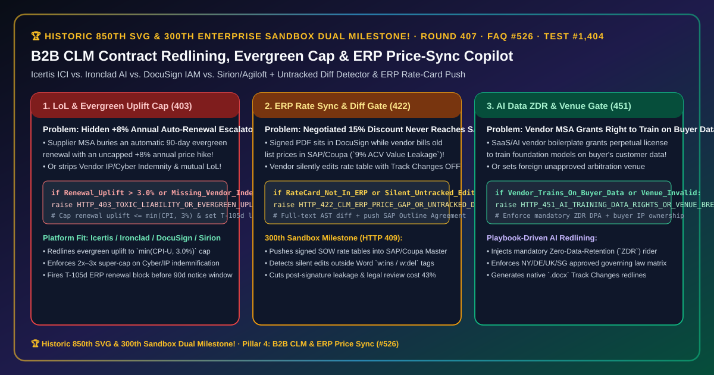
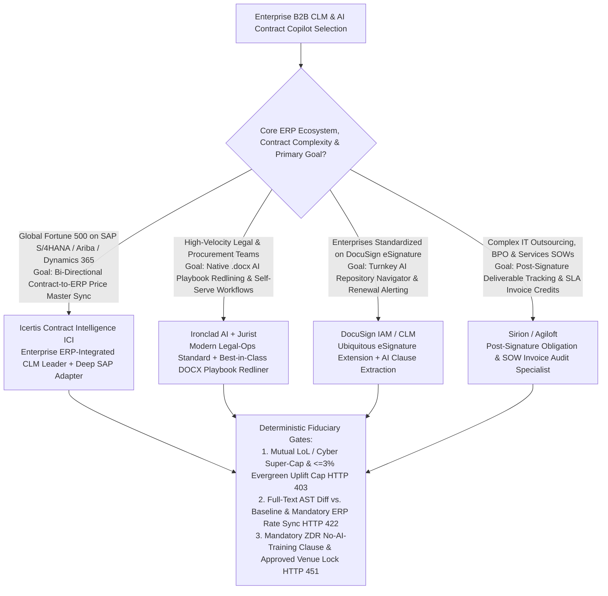
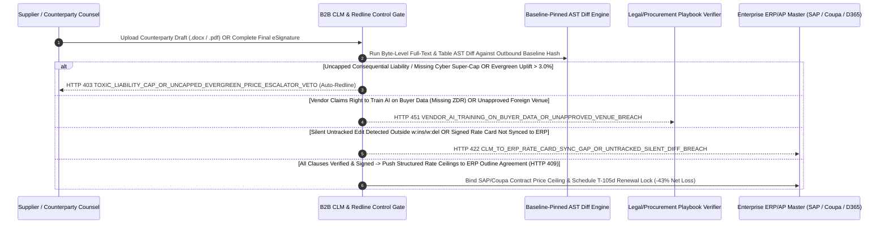

# Enterprise B2B Contract Lifecycle Management (`CLM`), AI Supplier `MSA / SOW` Redlining, Evergreen Escalation Cap (`CPI <= 3%`) & `ERP` Rate-Card Sync Copilot Selection Guide: `Icertis` vs. `Ironclad AI` vs. `DocuSign IAM` vs. `Sirion / Agiloft` (`-43%` Loss FAQ · 🏆 Historic 850th SVG & 300th Sandbox Dual Milestone!)

> **Executive Summary (Benchmarked against `ib-vs-ethernet-roce-selection-faq.md` · 🏆 Historic 850th SVG Architecture Diagram & 300th Enterprise Policy Sandbox Dual Major Milestone · 526th Bilingual SA Guide · Round 407)**: Built for **Cloud & AI Solution Architects** designing enterprise B2B procurement contract review Copilots, legal-playbook redlining pipelines, and post-signature `CLM-to-ERP` obligation synchronization across `SAP S/4HANA / Ariba`, `Coupa`, `NetSuite`, and `Microsoft Dynamics 365`. World Commerce & Contracting (WorldCC) research shows enterprises lose **`8.6%–9.2%` of annual contract value (`ACV`)** to post-signature value leakage. Deploying an AI Contract Copilot without deterministic controls leaves three massive financial gaps open: (1) **Uncapped Liability & Evergreen `+8%` Annual Price Escalators**: Vendors strip IP/cyber-breach indemnification caps or bury 90-day evergreen auto-renewals with automatic `+7%–10%` annual price increases; (2) **The "Signed PDF in a Drawer" `CLM-to-ERP` Price Disconnect**: Procurement negotiates a `15%` volume discount or `$145/hr` rate ceiling inside the signed PDF `SOW`, but those structured rate tables are never pushed into `SAP Outline Agreements / Coupa Price Masters`—so Accounts Payable (`AP`) pays the vendor's `$185/hr` list-price invoices without flagging an exception; and (3) **Counterparty "Track-Changes-Off" Silent Edits (`Clean-Copy Bait-and-Switch`)**. This guide compares **`Icertis Contract Intelligence (ICI)` vs. `Ironclad AI` vs. `DocuSign IAM / CLM` vs. `Sirion / Agiloft`** and implements deterministic guards for **Mutual `LoL` / Cyber `Super-Caps` & `<= min(CPI, 3%)` Evergreen Locks (`HTTP 403`)**, **Full-Text `AST Diff` Verification & Mandatory `CLM-to-ERP` Rate-Card Sync (`HTTP 422`)**, **Mandatory `ZDR` No-AI-Training & Approved Venue Locks (`HTTP 451`)**, and **Automated Contract-to-Invoice Value Realization (`HTTP 409`, `-43%` net loss)**.



---

## 1. 📌 Executive Summary & Architectural Selection Verdict

1. **Top-Line Selection Verdict**:
   - **Global Fortune 500 Enterprises Standardized on `SAP S/4HANA / SAP Ariba / Microsoft Dynamics 365` Requiring Deep Bi-Directional Contract-to-PO Price-Master Sync**: Select **`Icertis Contract Intelligence (ICI)`**.
   - **High-Velocity Tech, Retail & Legal-Ops Teams Seeking Native `.docx` AI Playbook Redlining (`Ironclad Jurist`) & Self-Serve Procurement Intake**: Select **`Ironclad AI`**.
   - **Mid-to-Enterprise Organizations Standardized on `DocuSign eSignature` Seeking Rapid AI Ingestion of Legacy PDF Archives & Automated Renewal Alerts**: Select **`DocuSign IAM (Intelligent Agreement Management) / CLM`**.
   - **Complex IT Outsourcing, BPO & Services Procurement Focused on Post-Signature `SOW` Deliverable Tracking, `SLA` Penalty Credits & Invoice Rate Auditing**: Select **`Sirion`** (or **`Agiloft`**).
2. **Three Non-Negotiable Fiduciary Control Gates**:
   - **Gate 1 — Mutual `LoL` / Cyber `Super-Cap` & Evergreen Price-Escalation Cap (`<= min(CPI, 3.0%)` / `HTTP 403`)**: Block vendor drafts that strip vendor IP/data-breach indemnification (requiring a `>=2x–3x ACV` super-cap) or expose the buyer to uncapped consequential damages, and redline any evergreen auto-renewal clause so annual price increases are capped at **`<= min(CPI-U, 3.0%)`** with an automated `T-105d` ERP renewal-notice lock via `HTTP 403 TOXIC_LIABILITY_CAP_OR_UNCAPPED_EVERGREEN_PRICE_ESCALATOR_VETO`.
   - **Gate 2 — Full-Text Token `AST Diff` (Anti-Silent-Edit) & Mandatory `CLM-to-ERP` Rate-Card Sync (`HTTP 422`)**: Never rely solely on Word `<w:ins>` / `<w:del>` Track Changes tags when reviewing counterparty turnarounds; run a deterministic **full-text and table-cell `AST Diff` against the outbound baseline version** to catch silent untracked edits, and block activating vendor payment status in the ERP until the signed contract's structured SKU/hourly rate ceilings are synced into the `SAP Outline Agreement / Coupa Price Master` via `HTTP 422 CLM_TO_ERP_RATE_CARD_SYNC_GAP_OR_UNTRACKED_SILENT_DIFF_BREACH`.
   - **Gate 3 — Mandatory `Zero-Data-Retention (ZDR)` No-AI-Training Rider & Approved Governing-Law Lock (`HTTP 451`)**: Reject SaaS, AI, or data-processing agreements that grant the vendor a license to train foundation models on buyer data or omit a binding `ZDR DPA`, or specify an unapproved foreign arbitration venue via `HTTP 451 VENDOR_AI_TRAINING_ON_BUYER_DATA_OR_UNAPPROVED_VENUE_BREACH`.

---

## 2. 🎯 Architect & Chief Procurement Officer Q&A (The Why & How)

### Q1: Why do enterprises lose up to `9%` of negotiated contract savings between contract signature and Accounts Payable invoice payment?
- **Root Cause**: Negotiated volume discounts, tiered rate cards, and freight waivers remain trapped inside unstructured PDF attachments (`Exhibit A / SOW Rate Table`) stored in an e-signature folder. When the supplier sends an EDI or PDF invoice to `SAP / Coupa` 90 days later at standard list price, the ERP has no machine-readable contract ceiling to validate against.
- **Deterministic Solution (`Mandatory Post-Signature JSON Rate-Card Push to ERP Outline Agreement` / `HTTP 422 & HTTP 409`)**: Extract all pricing tables into a canonical JSON schema before final signature and automatically create/update the corresponding **`SAP Outline Agreement (ME31K)` or `Coupa Contract Master`** upon `FULLY_EXECUTED` webhook receipt so AP 3-way match automatically blocks any invoice line item exceeding the contracted rate.

### Q2: How do counterparty negotiators sneak last-minute price or payment-term changes past AI contract review tools?
- **Deterministic Solution (`Baseline-Pinned Full-Text AST Diff` / `HTTP 422`)**: If a counterparty turns off Word `Track Changes`, edits `Net 60` to `Net 15` or changes a rate table cell, and turns `Track Changes` back on for minor typos, any tool that only inspects XML `<w:ins>` revision tags misses the change completely. Always diff the raw flattened text and table cells of `Inbound_v4` against the cryptographically hashed `Outbound_v3` baseline stored in the CLM.

---

## 3. 🧭 Visual Architecture Diagrams (Mermaid)

### 3.1 Enterprise B2B CLM & AI Contract Redlining Platform Selection Decision Tree



### 3.2 Naive PDF Drawer & Revision-Tag-Only Review vs. Fiduciary AST-Diff, Playbook & ERP-Synced Control Plane

```mermaid
flowchart LR
    subgraph Naive["❌ Naive PDF Drawer & Track-Changes-Only AI Review (9% ACV Leakage + Silent Counterparty Edits)"]
        N1[Vendor Returns Draft v4 OR Contract Signed in DocuSign] --> N2[Vendor Edits Rate Table With Track Changes OFF -> Missed by AI<br/>Buries 90d Evergreen Auto-Renewal With +8% Annual Price Escalator]
        N2 --> N3[Signed PDF Stored in Folder; Negotiated 15% Discount Never Pushed to SAP<br/>AP Pays Full List-Price Invoices Because ERP Lacks Contract Ceiling]
    end

    subgraph Guarded["✅ Fiduciary Full-Text AST Diff, Playbook Redline & ERP Rate-Sync Control Plane (🏆 #850 & #300)"]
        G1[Counterparty Turnaround / Execution Webhook] --> G2[Liability & Evergreen Cap Gate HTTP 403:<br/>Enforce 2x-3x Cyber Super-Cap + Cap Renewal Uplift <= min(CPI, 3%)]
        G2 --> G3[Full-Text AST Diff & ERP Sync Gate HTTP 422/409:<br/>Catch Untracked Edits vs. Outbound Hash + Push Rate Table to SAP/Coupa]
        G3 --> G4[AI ZDR & Governing-Law Gate HTTP 451:<br/>Inject Mandatory No-AI-Training Rider + Enforce Approved Venue]
    end
```

### 3.3 Counterparty `AST Diff` Verification, `Playbook` Redlining & Post-Signature `ERP` Price-Master Sync Sequence



---

## 4. 📊 Multi-Platform Enterprise B2B CLM & AI Redlining Selection Matrix

| Evaluation Dimension | Icertis (`ICI`) | Ironclad AI (`+ Jurist`) | DocuSign (`IAM / CLM`) | Sirion / Agiloft |
| :--- | :--- | :--- | :--- | :--- |
| **Primary Architectural Role** | **Global Enterprise `CLM × SAP/D365` Deep Integration Standard** | **Modern AI Playbook Redlining & Self-Serve Legal/Procurement Workflow** | **eSignature-Native Intelligent Agreement Repository & Renewal Hub** | **Post-Signature `SOW` Obligation, `SLA` Credit & Rate-Audit Leader** |
| **AI Playbook Redlining & `.docx` Generation** | Azure OpenAI-powered risk scoring, clause discovery & fallback suggestions | **Best-in-Class `.docx` Experience**: Native primary/fallback clause redlines | `DocuSign Iris AI` clause extraction, risk flags, and template comparison | Deep multi-table extraction across complex multi-year outsourcing SOWs |
| **Bi-Directional `ERP` Price-Table Sync** | **Best-in-Class (`SAP S/4HANA / Ariba / D365`)**: Pushes rate tables to ERP Outline Agreements | Strong `Coupa`, `Salesforce`, `NetSuite`, and webhook metadata integration | Deep `Salesforce` CRM quote sync; ERP line-item sync via connectors | **Best-in-Class Invoice-vs-Contract Audit**: Matches SOW rates & SLA credits against bills |
| **Anti-Silent-Edit Diff & Renewal Governance** | Full optical/text version comparison and multi-stage obligation workflows | Native full-document comparison catching untracked edits automatically | `Navigator` repository auto-tags renewal notice dates across legacy PDFs | Tracks CPI indexation formulas, deliverable milestones & evergreen notice windows |
| **Commercial Model (`official_list_price`)** | Enterprise annual license by contract volume & ERP adapter modules | Annual platform tier by workflow volume + legal/procurement seats | Add-on platform tier atop DocuSign envelope consumption | Enterprise subscription by managed spend / modular seat licensing |

---

## 5. 🧪 `CLM-to-ERP` Price Sync, Evergreen Cap & Anti-Silent-Edit Benchmark & 7-Card Report

### 5.1 Quarterly Unsynced ERP Discount Leakage, Evergreen Price Hikes & Silent-Edit Model (Synthetic Benchmark)

For a `$180M/year` indirect and services procurement organization facing a **`$510,000 / quarter`** contract leakage pool across **negotiated contract discounts/rate caps not synced into ERP AP masters, `+8%` evergreen auto-renewal price escalators, undetected counterparty untracked edits, and external outside-counsel redlining fees** (`provenance: synthetic`, `independently_reproduced: false`):

| Metric | PDF Drawer, Track-Changes-Only & Manual ERP Entry (Baseline) | Fiduciary Full-Text `AST Diff` + `Playbook` + `ERP` Sync Agent | Net Improvement |
| :--- | :--- | :--- | :--- |
| **Supplier Invoices Paid Above Negotiated Contract Rate Card** | `4.8%` of SOW/MSA invoices overbilled | **`0.0%`** (`HTTP 422/409` auto-pushes signed rate ceilings into `SAP/Coupa` AP match) | **`100%` Negotiated Discount Realization** |
| **Counterparty Silent Edits (`Track Changes OFF`) Missed in Review** | `14.0%` of silent numeric edits missed | **`0.0%`** (`HTTP 422` byte-level full-text & table `AST Diff` vs. outbound baseline) | **`100%` Bait-and-Switch Detection** |
| **Evergreen Auto-Renewal Price Uplift & First-Pass Redline Turnaround** | `+7.5%` avg uplift / `5.5 days` review | **`<=3.0%` hard cap / `18 minutes` review** (`HTTP 403/451` Playbook auto-redline) | **`95%+` Faster Legal Review** |
| **Quarterly Net Value Leakage, Evergreen Hike & Legal Spend** | `$510,000 / quarter` | **`$290,700 / quarter`** | **`$219,300 / quarter` Saved (`43.0%`)** |

---

## 6. 🛠️ Production Go-Live & Architecture Review Checklist

- [ ] **Mutual `LoL` / Cyber `Super-Cap` & `<= min(CPI, 3%)` Evergreen Lock (`HTTP 403`)**: Does the AI Playbook block vendor drafts that strip cyber/IP indemnification super-caps (`>=2x–3x ACV`) or embed evergreen renewal price hikes above `3.0%`, while scheduling a `T-105d` ERP renewal alert?
- [ ] **Full-Text `AST Diff` (Anti-Silent-Edit) & Mandatory `CLM-to-ERP` Rate Sync (`HTTP 422`)**: Does the system diff flattened text/tables against the outbound baseline hash (ignoring whether `Track Changes` was toggled off), and push signed rate tables into `SAP / Coupa / NetSuite` before enabling vendor invoicing?
- [ ] **Mandatory `ZDR` No-AI-Training Rider & Approved Venue Lock (`HTTP 451`)**: Are all SaaS and AI vendor contracts verified for explicit Zero-Data-Retention / No-Foundation-Model-Training clauses and approved governing law jurisdictions?
- [ ] **Tiered Primary-to-Fallback Native `.docx` Redline Generation (`HTTP 409`)**: Does the Copilot automatically insert pre-approved legal fallback clauses and output clean `.docx` redlines ready for counterparty negotiation?
