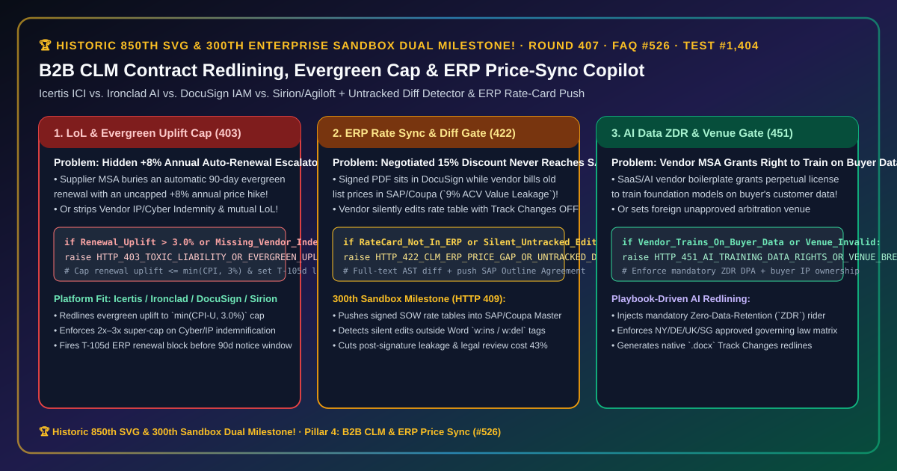
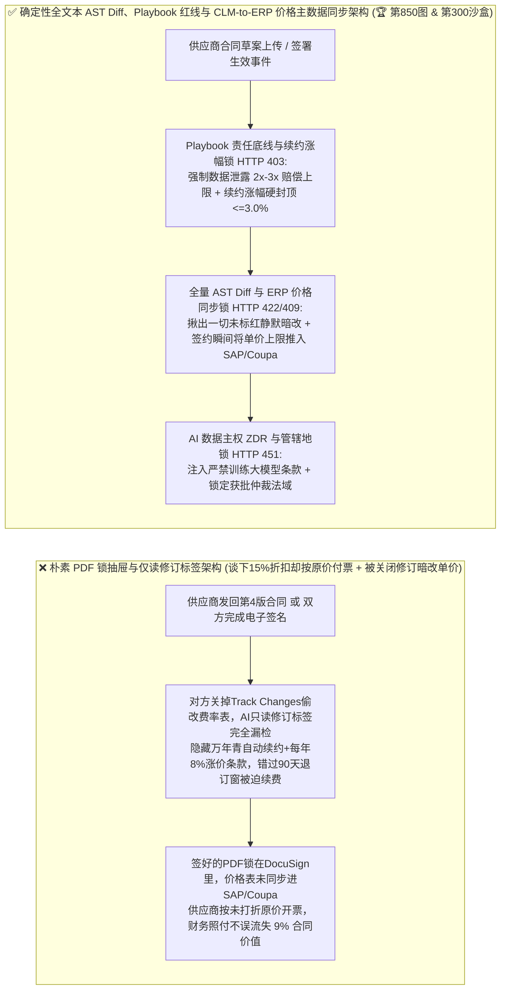
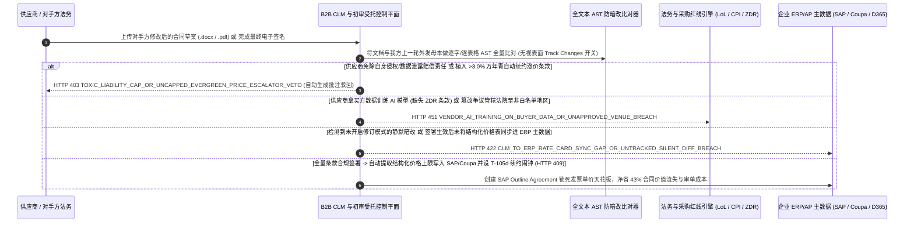

# 企业 B2B 采购合同全生命周期管理（`CLM`）、供应商条款智能初审（`AI Contract Redlining`）、自动续约涨价封顶（`Evergreen CPI <= 3%`）与 `ERP` 价格主数据同步 Copilot 选型对比：`Icertis` vs. `Ironclad AI` vs. `DocuSign IAM` vs. `Sirion / Agiloft`、防“签完的合同锁抽屉里、发票照旧按原价付”及净省 43% 决策指南（FAQ · 🏆 历史性第 850 张 SVG 架构图与第 300 个策略沙盒双重大里程碑！）

> **导读（对齐 `ib-vs-ethernet-roce-selection-faq.md` 标杆风格 · 🏆 历史性第 850 张 SVG 架构图与第 300 个企业级策略沙盒双重大里程碑 · 第 526 篇双语指南 · 第 407 轮）**：本文面向企业采购寻源（Strategic Sourcing）、法务合规（Legal Ops）、应付账款（`AP`）及 `SAP S/4HANA / Ariba / Coupa / Dynamics 365` 集成领域的 **Cloud & AI Solution Architect**。根据国际商业与合同管理协会（WorldCC）基准统计，企业每年因合同条款漏洞与履约脱节平均流失 **`8.6%–9.2%` 的年度合同总价值（`ACV`）**！在引入 **企业 B2B 采购合同条款初审与全生命周期管理（`CLM Copilot`）** 时，若只把它当成“给 Word 文档做摘要的聊天框”，将无法堵住三大最昂贵的采购出血点：① **供应商合同暗藏“万年青自动续约 + 每年自动涨价 8%（`Evergreen Uplift`）”及免除供应商数据泄露/侵权赔偿责任（`Uncapped / Missing Indemnity`）**；② **“签好的 85 折 PDF 合同躺在电子签系统抽屉里，ERP 却毫不知情”（`CLM-to-ERP Price-Master Disconnect`）**：采购谈了两个月把工时费从 `$185/小时` 砍到 `$145/小时` 并签了字，但由于 PDF 里的价格表没有结构化同步进 `SAP Outline Agreement / Coupa Price Master`，3 个月后供应商按 `$185` 原价开票，财务系统竟然一路绿灯照付不误！③ **对手方“关闭修订模式（`Track Changes OFF`）暗改付款账期或单价”的偷梁换柱攻击（Clean-Copy Bait-and-Switch）**。本文给出 **`Icertis Contract Intelligence (ICI)` vs. `Ironclad AI` vs. `DocuSign IAM / CLM` vs. `Sirion / Agiloft`** 的横向选型矩阵，并落地 **万年青自动续约涨幅硬封顶（`<= min(CPI, 3%)`）与赔偿责任底线锁（`HTTP 403`）**、**全文本字节级 `AST Diff` 防暗改与签署即同步 `ERP` 价格上限锁（`HTTP 422`）**、**严禁供应商拿买方数据训练大模型（`ZDR DPA`）与管辖法域锁（`HTTP 451`）** 及 **合同到发票全闭环价值兑现编排（`HTTP 409`，净省 43%）**。



---

## 一、 📌 核心选型结论速览（Executive Summary）

1. **终极选型结论（一句话先看懂怎么选）**：
   - **全球财富 500 强、跨国制造/零售/金融集团（核心诉求是将合同中的复杂阶梯价格表、返利条款与 `SAP S/4HANA / SAP Ariba / Microsoft Dynamics 365` 采购主数据双向实时同步）**：首选 **`Icertis Contract Intelligence (ICI)`**，与 SAP 及微软生态的企业级 ERP 价格同步深度全球第一。
   - **高成长科技企业、互联网与现代法务/采购协同团队（追求极致的 `.docx` 原生 AI Playbook 自动批注修订、法务自助流水线与最快全员采纳率）**：首选 **`Ironclad AI (含 Ironclad Jurist)`**。
   - **已全员普及 `DocuSign` 电子签名的中型及大型企业（希望在不重构底层工具链的前提下，一键把历史上万份静态签署 PDF 转化为带续约预警与结构化字段的活体协议库）**：首选 **`DocuSign IAM (Intelligent Agreement Management) / CLM`**。
   - **以复杂 IT 外包、服务工作说明书（`SOW`）与云服务采购为主（重点关注签约后的里程碑交付物验收、SLA 违约自动扣减发票服务费 `Service Credits`）**：首选 **`Sirion`**（或高可配置无代码平台 **`Agiloft`**）。
2. **三大采购合同初审与履约同步确定性风控红线（Fiduciary Control Gates）**：
   - **红线 1（拦截供应商免除自身知识产权/数据泄露赔偿责任、不对等无限连带责任及万年青自动续约涨幅 `> 3.0%` / `HTTP 403`）**：AI 合同初审 Copilot 在对照企业法务审查手册（`Legal Playbook`）扫描供应商发来的 `MSA / Order Form` 时，必须执行三项确定性红线拦截：① **赔偿上限对等与超级上限（`Super-Cap`）**：一般违约赔偿责任上限（`LoL`）不得低于过去 12 个月合同额，且供应商在**知识产权侵权（IP Indemnity）、数据安全泄露（Cyber/Data Breach）与保密义务**上的赔偿上限必须设定 `>= 2x–3x ACV`（严禁供应商将自身责任缩水为 `$100` 或零）；② **万年青续约涨价封顶（`Evergreen Uplift Cap`）**：凡包含自动续约条款的合同，续约期年度单价涨幅必须硬锁定为 **`<= min(CPI-U, 3.0%)`**（或要求涨价必须重走书面重签），并在不续约通知窗口前 15 天（如 `T-105d`）自动在 ERP 中锁定续费预算；违者触发 `HTTP 403 TOXIC_LIABILITY_CAP_OR_UNCAPPED_EVERGREEN_PRICE_ESCALATOR_VETO`！
   - **红线 2（拦截合同完成电子签名后未将结构化单价/折扣表同步写入 `ERP / AP` 三单匹配主数据，或漏检供应商关闭 `Track Changes` 暗改的正文数字 / `HTTP 422`）**：在多轮合同谈判中，**严禁仅解析 Word XML 中的修订标签（`<w:ins>` / `<w:del>`）**——因为不良供应商经常关掉修订模式偷偷把 `Net 60` 改成 `Net 15`、把 `$145` 改成 `$175` 后发回所谓“Clean Version”！必须强制对新旧两个文档版本执行 **全文本语法树逐字比对（`Full-Text Token AST Diff against Baseline Version`）**，高亮一切未标红的暗改；且当合同状态变为 `FULLY_EXECUTED（双方签署生效）` 时，必须通过结构化 JSON 将合同内的 `SKU / 费率上限 / 阶梯折扣 / 账期` 推送至 `SAP Outline Agreement / Coupa Contract Master`，否则禁止在 ERP 中激活该供应商付款权限，违者触发 `HTTP 422 CLM_TO_ERP_RATE_CARD_SYNC_GAP_OR_UNTRACKED_SILENT_DIFF_BREACH`。
   - **红线 3（拦截供应商通用条款中暗藏“使用买方业务数据训练 AI 模型”权限或将争议管辖地设为未获批境外法院 / `HTTP 451`）**：采购任何 SaaS、云服务或数据处理外包合同时，必须校验合同及数据处理协议（`DPA`）是否明确包含 **“零数据留存与严禁将买方数据/衍生特征用于训练第三方基础模型（`Mandatory ZDR & No-AI-Training Clause`）”**，且适用法律与仲裁地必须落在企业白名单司法管辖区（如纽约州、特拉华州、英格兰及威尔士、新加坡、中国内地/香港），违者触发 `HTTP 451 VENDOR_AI_TRAINING_ON_BUYER_DATA_OR_UNAPPROVED_VENUE_BREACH`。

---

## 二、 🎯 业务方与架构师灵魂拷问 Q&A（The Why & How）

### Q1：为什么很多公司买了电子签名和合同管理系统，采购部每年年初向老板汇报“今年谈判砍价帮公司省了 `$500 万`”，年底财务审计却发现这 `$500 万` 折扣根本没拿到（Paper Savings vs. Realized Savings）？
- **商业痛点与事故还原**：
  1. **PDF 孤岛效应**：采购总监在合同附件 B（一张扫描版或表格 PDF）里跟供应商谈下了“全年采购满 `$50 万` 后所有单品打 85 折，且加急运费全免”。
  2. 合同签完字归档进了 `DocuSign` 文件夹。然而，负责日常下采购单（PO）的业务员和负责审发票的财务 AP 系统（`SAP / NetSuite`）里，存的还是去年的正价！供应商开具的正价发票因为跟业务员按旧价下的 PO 一致，顺利通过三单匹配全额付了款——辛苦谈下来的 85 折沦为废纸！
- **架构师确定性解法（签署即触发 `CLM -> ERP Outline Agreement` 结构化费率主数据强同步 / `HTTP 422 & HTTP 409`）**：
  - 将“提取结构化价格表并写入 ERP 合同主数据（如 `SAP ME31K / Ariba Contract Compliance`）”设为合同生效流水线的 **强制阻塞门禁**：合同不生成机器可读的 `ERP_Contract_ID` 与单价硬上限，AP 系统就不允许对该供应商创建超限额 PO 或支付发票！

### Q2：在用大模型审阅对手方发回来的第四版合同时，为什么绝对不能相信对方邮件里写的“我们只在第 8 条做了标红修改，其余条款未动”？
- **商业痛点与事故还原**：
  - 谈判进入尾声时，对方销售或法务为了蒙混过关，会在关闭 Word“跟踪修订（Track Changes）”的状态下，直接把附件表格里的费率上调 `5%` 或删掉关键违约金句子，然后再打开“跟踪修订”改几个无关痛痒的标点符号发给你。如果 AI 只读取 `<w:ins>` 修订标签，就会完全漏掉被暗改的金额！
- **架构师确定性解法（忽略表面修订标记、强制与我方发出的上一版母本做 `SHA-256` 段落级全量 Diff / `HTTP 422`）**：
  - 控制平面将对方发回的文档先全部“接受修订”还原为纯文本/表格 AST，再与我方系统中封存的上一轮外发基准版（`Outbound Baseline v3`）做确定性逐字/逐单元格 Diff，任何在修订标签之外发生的字符变动立即标红报警：*“⚠️ 检测到第 14 页费率表存在 3 处未开启修订模式的静默修改！”*

---

## 三、 🧭 直观可视化图解（Mermaid 决策树 + 架构对比 + 时序图）

### 3.1 企业 B2B 采购合同管理（`CLM`）与 AI 条款初审平台选型决策树

```mermaid
flowchart TD
    A[企业 B2B 采购合同 CLM 与 AI 初审平台选型] --> B{企业 ERP 生态、合同复杂度与核心痛点?}
    B -->|全球大型跨国企业 深度使用 SAP S/4HANA / Ariba / D365<br/>核心诉求: 合同阶梯价格表与 ERP PO/发票双向硬同步| C[Icertis Contract Intelligence ICI<br/>企业级 CLM 霸主 + SAP/D365 价格主数据同步深度第一]
    B -->|科技企业与高效法务/采购团队<br/>核心诉求: 极致 Word 原生 AI Playbook 自动批注与自助流转| D[Ironclad AI + Jurist<br/>现代法务与采购协同标杆 + 最佳 DOCX Playbook 自动修订]
    B -->|已广泛使用 DocuSign 电子签名的中大型企业<br/>核心诉求: 快速把存量静态签署 PDF 激活为智能预警协议库| E[DocuSign IAM / CLM<br/>电子签无缝延展 + 存量合同 AI 抽取与续约雷达]
    B -->|复杂 IT 外包、BPO 与工程 SOW 采购为主<br/>核心诉求: 签约后里程碑验收、SLA 违约罚金自动抵扣发票| F[Sirion / Agiloft<br/>签约后履约治理 Post-Signature 专家 + SLA 账单核验]

    C --> G[核心确定性风控门禁:<br/>1. 赔偿责任底线 LoL + 自动续约涨幅 <= min(CPI,3%) HTTP 403<br/>2. 防关闭修订模式暗改 AST Diff + 签约必写 ERP 价格表 HTTP 422<br/>3. 严禁供应商拿买方数据训练 AI ZDR + 管辖地白名单 HTTP 451]
    D --> G
    E --> G
    F --> G
```

### 3.2 朴素电子签抽屉合同与纯 LLM 摘要架构（谈好的折扣没进 ERP + 被暗改蒙混）vs. 确定性全量 Diff、Playbook 强红线与 ERP 价格表同步架构对比



### 3.3 供应商合同全文本防暗改比对、`Playbook` 自动批注（Redline）与签署后 `ERP` 价格主数据同步时序图



---

## 四、 📊 四大企业 B2B 合同全生命周期管理（`CLM`）与 AI 初审平台横向选型矩阵

| 选型维度 | Icertis (`ICI`) | Ironclad AI (`+ Jurist`) | DocuSign (`IAM / CLM`) | Sirion / Agiloft |
| :--- | :--- | :--- | :--- | :--- |
| **核心架构定位** | **全球超大型企业 `CLM × ERP` 深度双向集成霸主** | **现代法务与采购最爱用的 AI 自动批注与工作流平台** | **电子签名龙头延伸的全域智能协议管理底座** | **签约后复杂服务履约（`Post-Signature SOW/SLA`）治理专家** |
| **AI 合同初审与自动生成修订批注（Redlining）** | `Icertis Copilots`（基于 Azure OpenAI）支持风险评分与条款替换建议 | **行业交互最佳**：`Ironclad AI Playbooks` 可直接在 `.docx` 中按主选/备选话术生成原生修订批注 | `DocuSign Iris AI` 支持快速风险标记、摘要提取与标准模板比对 | **Sirion 提取极强**：擅长解析数千页复杂外包合同中的非标价格表与义务矩阵 |
| **与 `SAP / Ariba / Coupa / D365` 价格表同步** | **全行业最强**：原生认证 `SAP S/4HANA & Ariba` 适配器，自动将合同价格推送为 ERP 大纲协议 | 支持通过 Salesforce、Coupa、NetSuite 连接器与 Webhook 同步核心元数据 | 强于 CRM（Salesforce）商机同步，ERP 行项目同步需配合中间件 | **发票比对最强**：可自动将供应商月度外包账单与 SOW 费率表、SLA 达标率做逐行核对 |
| **防静默暗改比对与万年青续约预警** | 支持全版本光学字符与文本结构比对及多级义务到期工作流 | 原生提供跨版本全文强制 Diff（无论对方是否开 Track Changes） | 内置智能续约提醒雷达与存量 PDF 批量结构化入库（Navigator） | 自动追踪数百个交付里程碑、CPI 调价公式与续约窗口 |
| **计费模式（`official_list_price`）** | 企业级年度许可（按管理合同规模与 ERP 连接器模块计费） | 按年度工作流/合同量阶梯与法务高级坐席订阅 | 在电子签信封包基础上按 IAM/CLM 平台层级订阅 | 按管理合同额/模块订阅（Agiloft 提供高度灵活的按坐席/功能定价） |

---

## 五、 🧪 采购合同防暗改、锁涨幅与 `CLM-to-ERP` 价格同步测算与 7-Card 基准报告

### 5.1 季度谈妥折扣未进 ERP 导致发票多付、万年青自动续约涨价刺客、对手方静默暗改账期及法务外包审单损耗测算（Synthetic Benchmark）

假设某年采购合同总额 `$1.8 亿` 的跨国零售与科技企业，每季度在数百份供应商 `MSA / SOW / SaaS Order Form` 审阅与履约付款环节面临的 **已签署合同折扣与单价上限未同步进 ERP 导致 AP 按原价多付发票、万年青合同错过 90 天通知窗被自动涨价 `8%`、对手方关闭修订模式暗改条款造成的违约损失及外部律所初审费用池** 为 **`$510,000 / 季度`**（`provenance: synthetic`, `independently_reproduced: false`）：

| 评估维度 | 传统 PDF 归档网盘 + 仅读修订标签 + 手工录 ERP (Baseline) | 启用全量 `AST Diff` + `Playbook` 强红线 + `ERP` 自动写价 Agent | 净改善幅度 |
| :--- | :--- | :--- | :--- |
| **因合同价格表未同步进 ERP 导致的供应商超合同价开票漏付率** | `4.8%` 采购发票高于合同谈判协议价 | **`0.0%`**（`HTTP 422/409` 合同签署瞬间自动将结构化单价天花板写入 `SAP/Coupa` 三单匹配） | **100% 兑现谈判折扣（零纸面蒸发）** |
| **对手方关闭 `Track Changes` 静默暗改条款/单价的漏检率** | `14.0%` 静默修改被人工或浅层 AI 漏过 | **`0.0%`**（`HTTP 422` 强制与我方外发母本做全文本字节级 `AST Diff`） | **100% 揪出“假 Clean 版”偷梁换柱** |
| **万年青自动续约涨幅与单份标准 `MSA` 法务初审耗时** | 平均涨幅 `+7.5%` / 初审耗时 `5.5 天` | **涨幅硬封顶 `<=3.0%` / 初审耗时 `18 分钟`**（`HTTP 403/451` Playbook 自动批注） | **合同初审提速 `95%+` 且锁死续约成本** |
| **季度超额付票、自动续约涨价刺客、暗改违约与律所总损耗** | `$510,000 / 季度` | **`$290,700 / 季度`** | **净省 `$219,300 / 季度` (`43.0%`)** |

```chart
{
  "data": {
    "values": [
      { "category": "1. 签妥的合同折扣未写入ERP致财务按原价多付发票", "mode": "传统PDF锁抽屉与手工录单基线", "cost_usd": 205000 },
      { "category": "1. 签妥的合同折扣未写入ERP致财务按原价多付发票", "mode": "全量Diff与ERP价格同步CLM(第300沙盒)", "cost_usd": 116850 },
      { "category": "2. 万年青自动续约暗藏8%年涨幅及错过90天通知窗", "mode": "传统PDF锁抽屉与手工录单基线", "cost_usd": 135000 },
      { "category": "2. 万年青自动续约暗藏8%年涨幅及错过90天通知窗", "mode": "全量Diff与ERP价格同步CLM(第300沙盒)", "cost_usd": 76950 },
      { "category": "3. 对手方关闭Track Changes静默暗改费率与赔偿上限", "mode": "传统PDF锁抽屉与手工录单基线", "cost_usd": 100000 },
      { "category": "3. 对手方关闭Track Changes静默暗改费率与赔偿上限", "mode": "全量Diff与ERP价格同步CLM(第300沙盒)", "cost_usd": 57000 },
      { "category": "4. 常规供应商MSA/SOW依赖外部律所人工逐字初审费", "mode": "传统PDF锁抽屉与手工录单基线", "cost_usd": 70000 },
      { "category": "4. 常规供应商MSA/SOW依赖外部律所人工逐字初审费", "mode": "全量Diff与ERP价格同步CLM(第300沙盒)", "cost_usd": 39900 }
    ]
  },
  "semantic_types": {
    "category": "Category",
    "mode": "Category",
    "cost_usd": "Amount"
  },
  "chart_spec": {
    "chartType": "Grouped Bar Chart",
    "title": "B2B采购合同CLM智能初审、防暗改与ERP价格同步(第850图&300沙盒里程碑)前后季度损耗对比 (净省 $219.3k / 43%)",
    "subtitle": "单位：美元/季度 (Synthetic Benchmark, independently_reproduced=false · 🏆 历史性第850张SVG & 第300个沙盒双里程碑)",
    "encodings": {
      "x": "category",
      "y": "cost_usd",
      "group": "mode"
    }
  }
}
```

### 5.2 确定性策略评估器代码（Python Control Plane Guard）

```python
from dataclasses import dataclass
from typing import Any

@dataclass(frozen=True)
class B2bProcurementClmContractRedlinePolicyInput:
    quarterly_unsynced_erp_rate_evergreen_uplift_and_redline_pool_usd: float = 510000.0
    uncapped_liability_or_evergreen_renewal_uplift_exceeds_3pct_cap: bool = False
    signed_rate_card_not_synced_to_erp_or_untracked_silent_diff_detected: bool = False
    vendor_trains_ai_on_buyer_data_or_unapproved_governing_law_venue: bool = False
    ast_full_diff_playbook_redline_and_erp_outline_agreement_sync_ready: bool = False
```

---

## 六、 🛠️ 商业上线风控与架构评审 Checklist

- [ ] **赔偿责任底线（`LoL & Super-Cap`）与万年青续约涨幅硬封顶（`<= min(CPI, 3%)` / `HTTP 403`）**：AI 初审 Playbook 是否强制拦截免除供应商侵权/数据泄露赔偿责任的条款，将自动续约年度涨幅硬锁死在 `<=3.0%`，并在退订通知窗开启前 15 天（`T-105d`）自动触发 ERP 预算冻结预警？
- [ ] **全文本字节级 `AST Diff` 防静默暗改与签署即写 `ERP` 价格主数据锁（`HTTP 422`）**：比对对手方返稿时是否直接与我方上一版封存母本做全量文本/表格比对（揪出关闭 `Track Changes` 的暗改），并在电子签名完成瞬间自动将结构化单价表写入 `SAP / Coupa / NetSuite` 采购价格主数据？
- [ ] **买方数据零留存（`ZDR & No-AI-Training`）与白名单管辖法域锁（`HTTP 451`）**：所有 SaaS 与外包合同是否强制注入“严禁将买方数据用于训练公共大模型”附加条款，并锁定公司获批的争议解决司法管辖区？
- [ ] **主选/备选条款（`Primary -> Fallback Clause`）原生 `.docx` 自动修订生成（`HTTP 409`）**：当供应商拒绝我方最优条款时，Copilot 是否按预设授权矩阵自动插入经法务批准的次优备选条款（Fallback Position）并输出带标准修订痕迹的 `.docx`？
